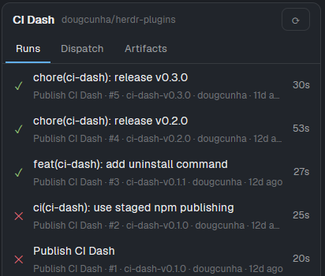
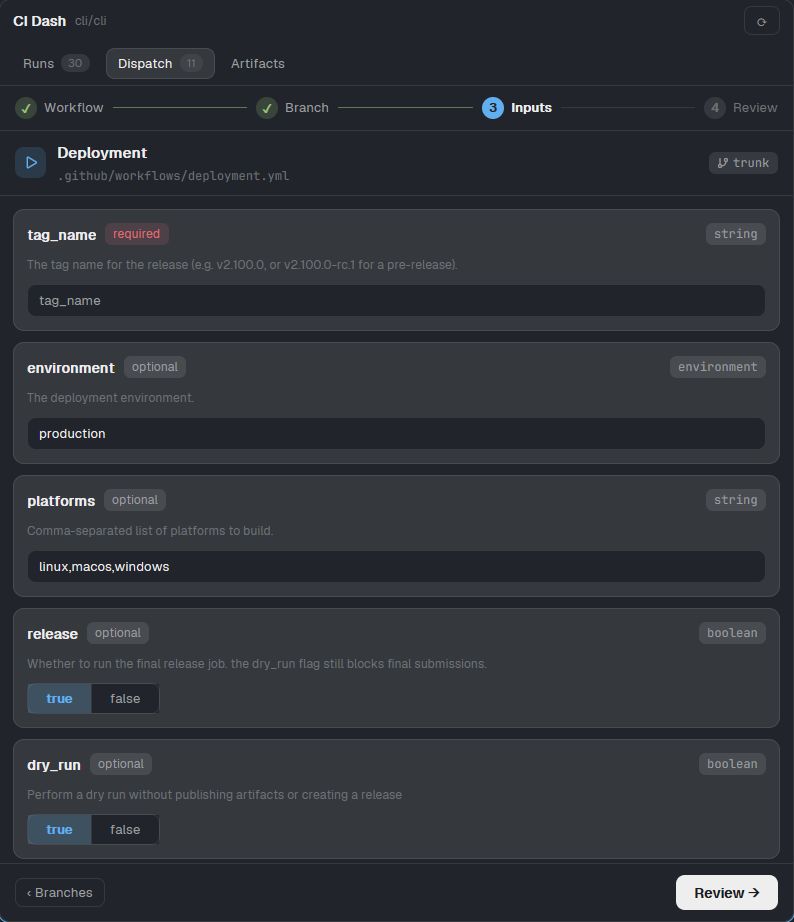

# Herdr Mods

Mods, layouts and themes for the [Herdr](https://github.com/herdrdev/herdr)
**desktop app**. They dispatch GitHub Actions, follow every job, show the
pending work of your repositories and more, without leaving the app.

These tools run only in the Herdr app. The plugins for the Herdr **TUI** (the
terminal) live in a separate repository:
[`herdr-plugins`](https://github.com/dougcunha/herdr-plugins). A TUI plugin does
not run in the app, and an app mod does not run in the TUI.

## Quick Start

Copy and paste one prompt to your LLM agent (Claude Code, AmpCode, Cursor, etc.).

For the Herdr TUI, see [`herdr-plugins`](https://github.com/dougcunha/herdr-plugins).

For the Herdr app, the CI Dash mod:

`Read ~/.config/herdr-app/AGENTS.md, then add this mod: https://github.com/dougcunha/herdr-mods/tree/main/ci-dash-app`

For the Herdr app, the **Dock** layout (a tab bar whose side-panel buttons come from a file, so you add a button without a new clone):

`Read ~/.config/herdr-app/AGENTS.md, then add this layout: https://github.com/dougcunha/herdr-mods/tree/main/dock-app`

For a **CI** button in the Dock, add the CI Dash mod and then the button:

`Read ~/.config/herdr-app/AGENTS.md, then add this mod: https://github.com/dougcunha/herdr-mods/tree/main/ci-dash-app and add it to the dock: the "main-dock" layout reads ~/.config/herdr-app/dock/panels.json`

For the Herdr app, the Agent Cards mod (the agents of the sidebar as cards, with a small robot that acts out each status; the Dock layout uses it):

`Read ~/.config/herdr-app/AGENTS.md, then add this mod: https://github.com/dougcunha/herdr-mods/tree/main/agent-cards-app`

For the Herdr app, the Space Deck mod (the Spaces sidebar as cards or a list, with an icon, a color and a note for each space, pinned spaces, git status and recent spaces):

`Read ~/.config/herdr-app/AGENTS.md, then add this mod: https://github.com/dougcunha/herdr-mods/tree/main/space-deck-app and put it in the "spaces" block of the layout that I use`

For the Herdr app, the Spec Board mod (the SDD specs of a repository and its worktrees, with status, phase and task progress, a markdown editor, and buttons that start or continue a spec with an agent, here or in a new worktree):

`Read ~/.config/herdr-app/AGENTS.md, then add this mod: https://github.com/dougcunha/herdr-mods/tree/main/spec-board-app and add it to the dock: the "main-dock" layout reads ~/.config/herdr-app/dock/panels.json`

For the Herdr app, the Image Viewer mod (shows an image file, with fit and zoom):

`Read ~/.config/herdr-app/AGENTS.md, then add this mod: https://github.com/dougcunha/herdr-mods/tree/main/image-viewer-app`

For the Herdr app, the Changes Split mod (Herdr's Changes panel with a **Unified / Split** switch for a side-by-side diff; the Kanban and Dock layouts use it):

`Read ~/.config/herdr-app/AGENTS.md, then add this mod: https://github.com/dougcunha/herdr-mods/tree/main/changes-app`

For the Herdr app, the Git Dash mod (pending work of every repository under a base folder, with a **Pending** button in the Dock):

`Read ~/.config/herdr-app/AGENTS.md, then add this mod: https://github.com/dougcunha/herdr-mods/tree/main/git-dash-app and add it to the dock: the "main-dock" layout reads ~/.config/herdr-app/dock/panels.json`

For the Herdr app, the Agent Resume mod (starts your Claude Code, Codex, Antigravity and OpenCode sessions again after a reboot):

`Read ~/.config/herdr-app/AGENTS.md, then add this mod: https://github.com/dougcunha/herdr-mods/tree/main/agent-resume-app and follow its README to install the hook of each agent that I have`

For the Herdr app, the Repo Launcher mod (`Ctrl+P`: find a repository by a fuzzy name and open a terminal or an agent, with any of its accounts, in its open space or in a new one):

`Read ~/.config/herdr-app/AGENTS.md, then add this mod: https://github.com/dougcunha/herdr-mods/tree/main/repo-launcher-app and merge its keys.json`

For the Herdr app, the Tab Namer mod (F2 and a pencil on the agent cards rename the tab of an agent, with a button that asks Claude Haiku or Codex Luna for a short name from the agent's session):

`Read ~/.config/herdr-app/AGENTS.md, then add this mod: https://github.com/dougcunha/herdr-mods/tree/main/tab-namer-app and merge its keys.json`

For the Herdr app, the TokenHound mod (the quotas of the [TokenHound](https://github.com/dougcunha/TokenHound) HUD in the status bar, a **Quota** panel in the Dock and an optional sidebar section; Windows only):

`Read ~/.config/herdr-app/AGENTS.md, then add this mod: https://github.com/dougcunha/herdr-mods/tree/main/tokenhound-app and follow its README to add its status bar item and its Quota panel`

For the Herdr app, the Skill Bundles mod (the agent skills of the focused project against your skill Catalog: up to date, outdated, missing and extra skills, and buttons that install, update, add and remove them with `npx skills`):

`Read ~/.config/herdr-app/AGENTS.md, then add this mod: https://github.com/dougcunha/herdr-mods/tree/main/skill-bundles-app and follow its README to add its status bar item and its Skills panel`

For the Herdr app, five light themes (One Light, GitHub Light, Solarized Light, Catppuccin Latte and Gruvbox Light):

`Read ~/.config/herdr-app/AGENTS.md, then copy the themes of https://github.com/dougcunha/herdr-mods/tree/main/light-themes-app to ~/.config/herdr-app/themes/ without overwriting a file that exists`

For the Herdr app, six soft dark themes with lighter backgrounds (Nord, Catppuccin Frappé, Everforest Dark, Gruvbox Dark Soft, Palenight and Zenburn):

`Read ~/.config/herdr-app/AGENTS.md, then copy the themes of https://github.com/dougcunha/herdr-mods/tree/main/dark-themes-app to ~/.config/herdr-app/themes/ without overwriting a file that exists`

Optional, to open Markdown files from the Files panel:

`Read ~/.config/herdr-app/AGENTS.md, then add this mod: https://github.com/kissmikijr/herdr-markdown-reader`

To set up **everything** on a fresh Herdr app (every mod and layout of this repository, a few third-party mods and the dock, keys and settings), paste the prompt in [`SETUP-PROMPT.md`](SETUP-PROMPT.md). The same prompt **updates** a machine that ran it before: it installs the new mods, updates the files that you did not change, asks about the ones that you did, and keeps your own settings. The [`mods-hub-app`](mods-hub-app/README.md) mod, which the prompt installs, shows an **Update mods** button in the status bar when the prompt has a new version, lists your installed mods, and starts the agent that you choose with the prompt.

`AGENTS.md` is the file that the Herdr app writes in its home folder. It tells
the agent how to add a mod or a layout. The agent reads the folder, tells you
what the mod runs, and copies it into `~/.config/herdr-app/`. It never
overwrites a file that exists.

## Herdr app mods

| Folder | What it is |
| ------ | ---------- |
| [`ci-dash-app`](ci-dash-app/README.md) | The CI Dash mod. It has three tabs: **Runs**, **Dispatch** and **Artifacts**. It opens in a tab or beside a terminal. |
| [`dock-app`](dock-app/README.md) | A layout (`main-dock`) whose tab bar draws its side-panel buttons from `~/.config/herdr-app/dock/panels.json`. Add one entry and a button and its panel show up, with no new clone. It holds three mods: `tabs-dock`, `files-md` (the Files panel: rendered Markdown, syntax colors, images in the Image Viewer, and a right-click menu with Open with default app, Show in Explorer and Copy path) and `files-md-menu` (that menu). Its sidebar shows the Agent Cards mod. |
| [`agent-cards-app`](agent-cards-app/README.md) | The Agent Cards mod (`agent-cards`): the agents of the sidebar as cards, with a small robot that acts out each status, sub-agents and a pin button. The `main-dock` layout shows it; a setting in Herdr Mods turns it off. |
| [`space-deck-app`](space-deck-app/README.md) | The Space Deck mod (`space-deck`): a replacement for Herdr's Spaces sidebar. Cards or a list; an icon, a color and a note for each space, kept by its repository; a Pinned section; the agents, tabs, terminals, git status and last activity of each space; recent spaces; and a + that opens Repo Launcher. |
| [`spec-board-app`](spec-board-app/README.md) | The Spec Board mod (`spec-board`), a Dock panel or dialog with the SDD specs (`tasks/prd-*`) of the shown repository and its worktrees. Each spec shows its status (Needs you, Blocked, Active, Paused, Not started, Done), a phase bar and its task progress. It reads and edits the PRD, TechSpec, tasks and reviews, moves old specs to the Recycle Bin, and starts an agent with `sdd-triar` (new spec) or `sdd-orquestrar-fluxo` (start, continue), here or in a new git worktree. |
| [`changes-app`](changes-app/README.md) | The Changes Split mod (`changes-split`): Herdr's Changes panel with a **Unified / Split** switch. Split shows the old file on the left and the new file on the right, each with its own line numbers. The `kanban` and `main-dock` layouts use it for their Changes panel. |
| [`image-viewer-app`](image-viewer-app/README.md) | The Image Viewer mod. It shows one image file, fitted to the pane or zoomed from 10% to 800%. |
| [`kanban-app`](kanban-app/README.md) | A layout (`kanban`) where every agent is a card in a column by status: idle, needs you, working, waiting for subagents, done. You can hide any column and turn the waiting column off. It has a side panel for Files, Changes and the buttons of `dock/panels.json`. It holds one mod, `kanban`. |
| [`repo-launcher-app`](repo-launcher-app/README.md) | The Repo Launcher mod. `Ctrl+P` opens a popup with a fuzzy search of the Git repositories under your root folders, favorites, recent ones and an indicator of their open space. It opens a terminal or an agent (one choice per account of Claude Code and Codex) in the open space of the repository or in a new space. The list is cached; Refresh reads the folders again. A second mod, `repo-launcher-status`, puts `Ctrl+P  repos` in the status bar. |
| [`agent-resume-app`](agent-resume-app/README.md) | The Agent Resume mod, with hooks for Claude Code and Antigravity and a plugin for OpenCode (Codex needs none). After a reboot, it types the resume command of each agent (for example `claude --resume <id>`) in the shell that replaced its lost terminal. A status bar indicator opens a panel with the settings and the monitored sessions. |
| [`tab-namer-app`](tab-namer-app/README.md) | The Tab Namer mod (`tab-namer`). F2 and the pencil of the Kanban and Agent Cards cards open a dialog that renames the tab of an agent. **Generate with AI** reads the agent's session and asks a small model (Claude Haiku or Codex Luna) for a name of 2 to 5 words. Agent Resume clears the name after `/clear` or `/new`. |
| [`git-dash-app`](git-dash-app/README.md) | The Git Dash mod. It scans a base folder and lists the Git repositories with pending work (unpushed commits, stash, changes, conflicts). Each card offers the safe fixes (commit, push, pull, publish) after a confirmation, and opens the repository in a terminal or a new space for the other problems. It has a refresh button and a **Pending** button for the Dock. |
| [`light-themes-app`](light-themes-app/README.md) | Five light themes for `~/.config/herdr-app/themes/`: One Light, GitHub Light, Solarized Light, Catppuccin Latte and Gruvbox Light. The app ships only one light theme (`paper`). |
| [`mods-hub-app`](mods-hub-app/README.md) | The Herdr Mods dialog (before version 5: Mods Update). A status bar item compares the version of `SETUP-PROMPT.md` on GitHub with the version of your last run. When GitHub is newer, it shows **Update mods**. The dialog lists the installed mods with their errors and local changes, shows the settings of the kit mods in one place (with one language for the kit), shows the release notes, and starts an installed agent in a new space with the prompt. |
| [`tokenhound-app`](tokenhound-app/README.md) | The TokenHound mod (`tokenhound`). It reads the `hud.json` file of the [TokenHound](https://github.com/dougcunha/TokenHound) tray app and shows its HUD in the Herdr app: a status bar item with one agent icon and one percent for each provider, a **Quota** panel in the Dock with every quota and reset countdown, and an optional section under the agents list. It needs Windows and TokenHound 0.1.16 or newer. |
| [`skill-bundles-app`](skill-bundles-app/README.md) | The Skill Bundles mod (`skill-bundles`). It compares the agent skills of the focused project with a skill Catalog: a repository with a `bundles.yaml` (named groups of skills), read through the `skills.yaml` of each project. It shows each skill as up to date, outdated, missing, extra or local, and starts, installs, updates, adds and removes skills with `npx skills`. A status bar item counts the skills that ask for action; a **Skills** panel goes in the Dock. Windows and macOS. |
| [`dark-themes-app`](dark-themes-app/README.md) | Six soft dark themes for `~/.config/herdr-app/themes/`: Nord, Catppuccin Frappé, Everforest Dark, Gruvbox Dark Soft, Palenight and Zenburn. Their backgrounds are lighter than the shipped dark themes. |





### What the app mod does

- **Runs:** the 30 latest runs, grouped by state. A filter box and status chips
  narrow the list. A run shows its jobs and steps live, with **Open**,
  **Cancel** and **Rerun**.
- **Dispatch:** four steps (workflow, branch, inputs, review). Nothing starts
  until you press **Dispatch**.
- **Artifacts:** the artifacts of the latest run, with filters for name, status
  and file type. A click downloads the file to `<repo>/.ci-dash/artifacts/`.

### Install the app mod

The Herdr app must be running, and the
[GitHub CLI](https://cli.github.com/) must be logged in (`gh auth login`).
Copy the mod folder and check it:

```sh
cp -r ci-dash-app/mods/ci-dash ~/.config/herdr-app/mods/ci-dash
herdr-app check ~/.config/herdr-app/mods/ci-dash
herdr-app do tab.new --name "CI" --mod ci-dash
```

On Windows PowerShell, use `Copy-Item -Recurse` and `$env:USERPROFILE`. The
[`ci-dash-app` README](ci-dash-app/README.md) shows the commands.

The mod runs `gh`, `git` and your file manager through the app's `exec`. It
reaches GitHub through your `gh` login and stores no credentials.
[`ci-dash-app/RECIPE.md`](ci-dash-app/RECIPE.md) describes it in full.

### Add a **CI** button with the Dock

Install the CI Dash mod (above) and the [`dock-app`](dock-app/README.md)
layout. Then add one entry to `~/.config/herdr-app/dock/panels.json`:

```json
{ "panels": [ { "id": "ci", "label": "CI", "icon": "mods/ci-dash/ci.svg", "mod": "ci-dash" } ] }
```

The button shows in the tab bar within seconds, and it opens CI Dash as a side
panel next to Files and Changes. `Ctrl+Shift+L` switches layouts.

The `main-dock` layout is a copy of a Herdr 0.1.11 and 0.1.12 file (the two are the same). It does not receive
later Herdr updates. The [`dock-app` README](dock-app/README.md) explains the
limits.

## Topics

This repository is tagged with
[`herdr-mod`](https://github.com/topics/herdr-mod) for the app mods and
[`herdr-layout`](https://github.com/topics/herdr-layout) for the app layouts.

## License

MIT
