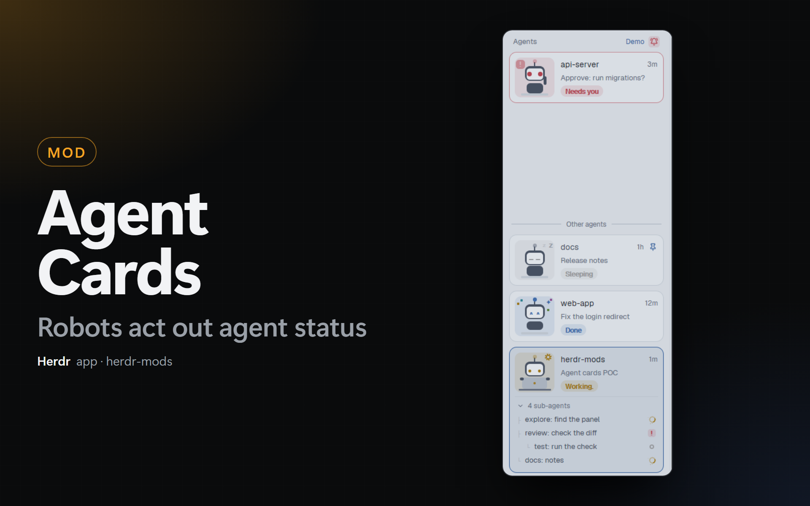

# Agent Cards

A Herdr app mod (`agent-cards`) that shows the agents of the sidebar as cards: one card for each agent, with a small robot that acts out the status.

## Quick Start

Copy and paste this prompt to your LLM agent:

`Read ~/.config/herdr-app/AGENTS.md, then add this mod: https://github.com/dougcunha/herdr-mods/tree/main/agent-cards-app`

The [Dock](../dock-app) layout (`main-dock`) shows it in its `agents` block. Install this mod before the Dock layout.

## What it shows

| Status | The robot | The pill |
| ------ | --------- | -------- |
| Working | Types on a laptop: the hands move, the head bobs and a gear turns. | `Working...` |
| Idle | Sleeps: the eyes are closed and "z" letters rise. | `Sleeping` |
| Blocked | Waves an arm, shakes, and shows a `!` bubble. The card border is red. | `Needs you` |
| Done | Jumps with happy eyes and confetti. | `Done` |

- Each card shows the program icon, the space, the tab (or the agent's title) and the time since the last status change. Click a card to go to the agent.
- The order is the order of Herdr's own list: pinned agents first, then the ones that need you, done, working and idle. `agent.next` and `agent.prev` follow it.
- Put the pointer on a card for the **pin** button. A pinned card stays at the top and shows the pin.
- Sub-agents show under their card, one row each. Click a row to peek at the sub-agent. Click "N sub-agents" to fold them.
- A narrow sidebar (the rail) shows a number and a status dot for each agent.
- **Needs you first.** Click the bell in the header to put the agents that need you at the top. The other cards go to the bottom of the panel, under the line "Other agents", so they do not move when an agent asks for you. Click the bell again to turn it off. The same switch is in Herdr Mods → **Settings** → **Needs you first**, and `herdr-app do agent-cards.needs-you` flips it.
- The animations run inside Herdr (no timer redraws the panel).

To see all four robots at once, run `herdr-app do agent-cards.demo`. Run it again to show your agents.

## Where it shows

- **Dock layout.** The `agents` block of `layouts/main-dock.json` shows the cards. Turn them off in Herdr Mods → **Settings** → **Agent cards**. Off, the sidebar shows Herdr's own Agents list again; on, the cards come back. The Dock tab bar (`tabs-dock`) makes the change in the layout and keeps the size of the block. `tabs-dock.agent-cards` in `keys.json` flips the same setting.
- **Your own layout.** Set the mod of the agents block to `agent-cards`: `{ "id": "agents", "content": { "mod": "agent-cards" } }`. Only the Dock tab bar reads the **Agent cards** setting, so in another layout you change the block by hand.

## What it does on your machine

- It reads the agents, terminals, panes, spaces and layout of Herdr, and sets the order of `agent.next`.
- A click runs Herdr commands: `pane.focus`, `terminal.pin` and `terminal.peek`.
- It runs no program, reads no file and uses no network.

## Limits

- Checked with `herdr-app check` and with screenshots of the four statuses (`agent-cards.demo`), the sub-agents, the pin and **Needs you first**. A click on the pin, on a sub-agent row and on the bell was not tested in a real session.
- **Needs you first** looks only at the status of the agent. An agent whose sub-agent needs you stays in the lower part.
- Tested only in the `main-dock` layout, on Windows. Untested: macOS, Linux, a remote machine's window, other layouts.
- `RECIPE.md` has the full brief to build it from scratch.
