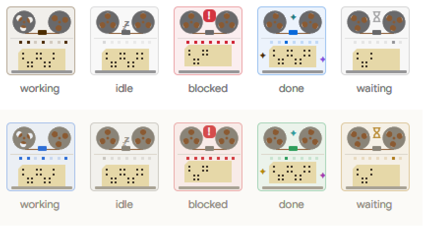
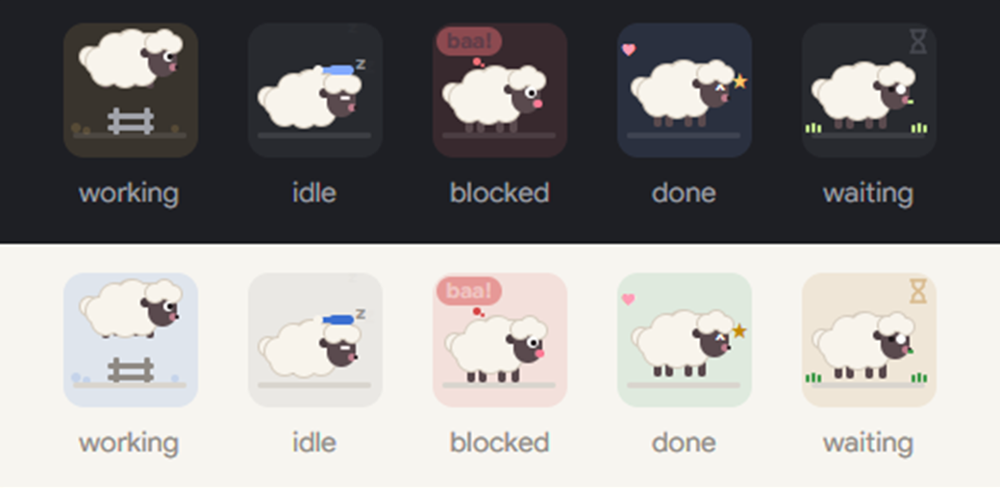

# Agent Cards

A Herdr app mod (`agent-cards`) that shows the agents of the sidebar as cards: one card for each agent, with a small robot that acts out the status.

## Quick Start

Copy and paste this prompt to your LLM agent:

`Read ~/.config/herdr-app/AGENTS.md, then add this mod: https://github.com/dougcunha/herdr-mods/tree/main/agent-cards-app`

The [Dock](../dock-app) layout (`main-dock`) shows it in its `agents` block. Install this mod before the Dock layout.

## What it shows

| Status | The robot | The pill |
| ------ | --------- | -------- |
| Working | Types on a laptop: the hands move, the head bobs and a gear turns. | `Working...` |
| Idle | Sleeps: the eyes are closed and "z" letters rise. | `Sleeping` |
| Blocked | Waves an arm, shakes, and shows a `!` bubble. The card border is red. | `Needs you` |
| Done | Jumps with happy eyes and confetti. | `Done` |
| Waiting | Looks from side to side next to an hourglass. | `Waiting` |

- Each card shows the program icon, the space, the tab (or the agent's title) and the time since the last status change. Click a card to go to the agent.
- The order is the order of Herdr's own list: pinned agents first, then the ones that need you, done, working and idle. `agent.next` and `agent.prev` follow it.
- Put the pointer on a card for the **pin** button. A pinned card stays at the top and shows the pin.
- Put the pointer on a card for the **duplicate** button, as in the `kanban` mod. It opens the duplicate menu of `kanban`: start a new session of the same agent in a new tab of its space, or in a new worktree. The button shows only when `kanban` is installed and on.
- Sub-agents show under their card, one row each. Click a row to peek at the sub-agent. Click "N sub-agents" to fold them.
- **Waiting**, as in the `kanban` mod: a Claude Code agent that shows as Done or Idle while its background subagents or background shell commands still run gets the **Waiting** status. Next to the pill, the card tells what it waits for ("2 subagents · 1 command"). Put the pointer on the card and click the check to say that the agent does not wait (Claude Code can leave a finished subagent marked as waiting): the card goes back to Done or Idle until the agent takes another turn. The switch is the one of `kanban`: PowerMods → **Settings** → **Waiting status** (or **Waiting column** of `kanban`), saved in `kanban.waiting`. The check of a card also counts in `kanban`.
- A narrow sidebar (the rail) shows a number and a status dot for each agent.
- **Needs you first.** Click the bell in the header to put the agents that need you at the top. The other cards go to the bottom of the panel, under the line "Other agents", so they do not move when an agent asks for you. Click the bell again to turn it off. The same switch is in PowerMods → **Settings** → **Needs you first**, and `herdr-app do agent-cards.needs-you` flips it.
- **Animation styles.** PowerMods → **Settings** → **Animation** sets the style of the scene on each card:
  - **Robot** (default): the robot of the table above.
  - **Retro (8-bit)**: a pixel robot on a small old screen with scan lines. It moves in hard steps: the eyes blink, the hands type over a loading bar, the "z" letters come one by one, a pixel `!` blinks, and pixel sparks show in turn.
  - **Modern**: a soft orb in the status color. Working: 2 rings turn and the orb breathes. Idle: a dim orb breathes slowly. Blocked: a ring ripples out from a `!` orb. Done: a check orb with dots that fly out. Waiting: a slow ring turns around an hourglass orb.
  - **Mainframe (cards & tape)**: the computer room of the first computers: a tape drive with 2 reels, a row of panel lamps and a punched card in the reader. Working: the reels turn, the tape goes from one reel to the other, the lamps blink and the holes of the card are punched one column at a time. Idle: the reels stand still, only the power lamp glows and "z" letters rise between the reels. Blocked: the card is stuck half out of the reader and shakes, all the lamps blink and a `!` shows. Done: the tape rewinds fast, a light runs along the lamps and the finished card jumps out. Waiting: the tape creeps on slowly next to an hourglass.

    

  - **Sheep (fluffy)**: a fluffy little sheep, seen from the side. Its wool stays cream in every theme. Working: it jumps a fence again and again, with dust in the status color where it takes off. Idle: it sleeps lying down in a blue nightcap, breathes slowly, and "z" letters rise. Blocked: it shakes and bleats "baa!" in a speech bubble ("mé!" when the kit language is Portuguese), with wide eyes. Done: it bounces in place with happy `^` eyes, hearts and sparkles. Waiting: it chews a blade of grass and looks from side to side next to an hourglass.

    

  `herdr-app do agent-cards.style` shows the next style.
- The animations run inside Herdr (no timer redraws the panel).

To see all five robots at once, run `herdr-app do agent-cards.demo`. Run it again to show your agents.

## Where it shows

- **Dock layout.** The `agents` block of `layouts/main-dock.json` shows the cards. Turn them off in PowerMods → **Settings** → **Agent cards**. Off, the sidebar shows Herdr's own Agents list again; on, the cards come back. The Dock tab bar (`tabs-dock`) makes the change in the layout and keeps the size of the block. `tabs-dock.agent-cards` in `keys.json` flips the same setting.
- **Your own layout.** Set the mod of the agents block to `agent-cards`: `{ "id": "agents", "content": { "mod": "agent-cards" } }`. Only the Dock tab bar reads the **Agent cards** setting, so in another layout you change the block by hand.

## What it does on your machine

- It reads the agents, terminals, panes, spaces and layout of Herdr, and sets the order of `agent.next`.
- A click runs Herdr commands: `pane.focus`, `terminal.pin` and `terminal.peek`. The duplicate menu belongs to `kanban`, which runs `hc get` and `tab.new` or opens Herdr's worktree dialog.
- For the **Waiting** status, it runs `hc get <terminal> --json` for the Claude Code agents that are Done or Idle, and reads the Claude Code session files: `~/.claude*/sessions/*.json` and the transcript `~/.claude*/projects/<project>/<session>.jsonl`. It reads a transcript again only when the agent takes a new turn, or every 30 seconds while the agent waits. Turn the setting off and it reads no file.
- It uses no network.

## Limits

- Checked with `herdr-app check` and with screenshots of the five statuses (`agent-cards.demo`), the sub-agents, the pin and **Needs you first**. A click on the pin, on a sub-agent row, on the bell and on the duplicate button was not tested in a real session.
- **Needs you first** looks only at the status of the agent. An agent whose sub-agent needs you stays in the lower part.
- Tested only in the `main-dock` layout, on Windows. Untested: macOS, Linux, a remote machine's window, other layouts.
- `RECIPE.md` has the full brief to build it from scratch.
