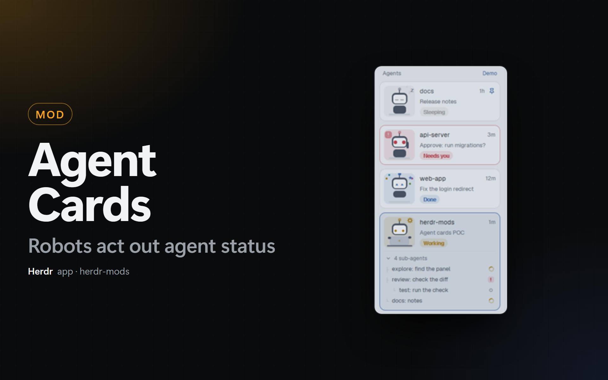

# Agent Cards

A Herdr app mod (`agent-cards`) that draws the agents list of the sidebar as cards, each with a small robot that acts out the status. The [Dock](../dock-app) layout (`main-dock`) shows it in its `agents` block.

## What you see

The head "Agents" (11.5px, `dim`) with "N active · M" on the right, then one card for each agent, 8px apart, 10px from the sides. A card is 12px radius, 8px padding, `surface` (`selected` when focused), 1px `border` (`accent` when focused, `blocked` at 60% when blocked). On its left, a 64px stage (10px radius, the status color at 12%) with a small robot made of `div`s: antenna with a bulb, a 32 x 24px head (`muted`, 8px radius), a `background` face plate and eyes in the status color, and a body. On its right: the agent's program icon (14px), the space name (medium), the time since the last status change (11px, `dim`); the tab name or the agent's title (11.5px, `dim`); a status pill (18px, the status color at 13%): `Working...` (the dots animate), `Sleeping`, `Needs you`, `Done`. An agent on another machine shows the machine name after the pill.

## How it behaves

- The robot acts out the status. `working`: it types on a laptop (the hands move up and down, 260 and 300 ms), the head bobs, the bulb blinks and a gear turns above it. `idle`: the eyes are closed lines, the head moves slowly (breathing, 3.2 s) and three "z" rise and fade. `blocked`: big eyes, a fast red bulb, the head shakes, one arm waves and a `!` bubble pulses. `done`: the robot jumps, the eyes are `^ ^`, confetti rises and a star blinks. All of it is `loop`, `frames` and `spin`: no timer redraws the mod (only a 30 s timer for the times).
- The cards are in the order of Herdr's list: pinned first, then blocked, done, working, idle (a card counts its most urgent sub-agent), then the most recent change. The mod calls `setAgentOrder` with that order, so `agent.next` follows it. A click on a card runs `pane.focus`.
- **Pin.** With the pointer on a card, a pin button replaces the time; a pinned card always shows it in `accent`. A click runs `terminal.pin {terminal, pinned}`.
- **Sub-agents.** A card with live sub-agents (`terminals()` with `parent`) shows, under a line, the head "N sub-agents" with a chevron, and one 22px row for each: `├` or `└` (14px more indent for each level), the program icon, the name, and a mark (a turning ring for working, `!` for blocked, a dot or a ring). A click on a row runs `terminal.peek`. A click on the head folds the rows; folded, it shows the mark of the most urgent one.
- A sidebar narrower than 160px shows a rail: the number and a status dot of each agent.
- **On and off.** The mods-hub setting **Agent cards** (`shared("agent-cards.enabled")`, `kit.json` of `agent-cards`; absent means on) chooses the mod of the `agents` block of `main-dock`. The Dock tab bar (`tabs-dock`) reads it and makes the change (see the [Dock recipe](../dock-app/RECIPE.md)). Off shows Herdr's own `agents` list.
- `herdr-app do agent-cards.demo` shows one example card for each status, with sub-agents and a pin; the next run shows the real agents again.

## Built from

- `mods/agent-cards/`, `mod.json` `{ "place": "none", "title": "Agent Cards" }`. `main.js` builds the list (`agents()`, `terminals()`, `panes()`, `spaces()`, `layout()`, `setAgentOrder`, `nextCommand`, `run`); the name and detail of a card come from the same rules as Herdr's `agents` mod (the tab name, or the agent's title when nobody named the tab). `robot.js` draws the stage: every part is an `absolute()` box in a `relative()` 64px square, and a moving part is a box whose `top` or `left` is a `loop`. `gear.svg` is the gear (a dashed circle). It uses `mods/workspace-chrome/spinner.svg`, `pin.svg`, `pin-off.svg`, `chevron-down.svg` and `chevron-right.svg`.
- `kit.json` lists the **Agent cards** setting for the mods-hub.
- Commands: `pane.focus`, `terminal.pin`, `terminal.peek`. No program, no file, no network.

## Watch out

- `loop("top")` sets `top` itself: give the moving box no `top`, and put its two positions in `from` and `to`. One element takes one `loop` for each property; a "z" that rises and fades is an outer `loop("top")` with an inner `loop("opacity")`.
- Emoji are not used: the robot is boxes, so it does not depend on the font.
- The Dock tab bar replaces the block's mod, not the block: keep the id `agents`, because the tab bar looks it up.
- Write `mod.json` before `main.js` in a new mod folder, or Herdr docks a copy of the mod into the shown layout.
- Untested: macOS, Linux, a remote machine's window, layouts other than `main-dock`.

## Done when

- `herdr-app check ~/.config/herdr-app/mods/agent-cards` passes. `herdr-app do agent-cards.demo` shows 4 cards (Needs you, Done, Working, Sleeping), and `herdr-app shot` shows the robots.
- With the Dock layout, `herdr-app do tabs-dock.agent-cards` changes the `agents` block of `layouts/main-dock.json` to `"mod": "agents"`, and the next run changes it back to `"mod": "agent-cards"`. The block's size stays.
