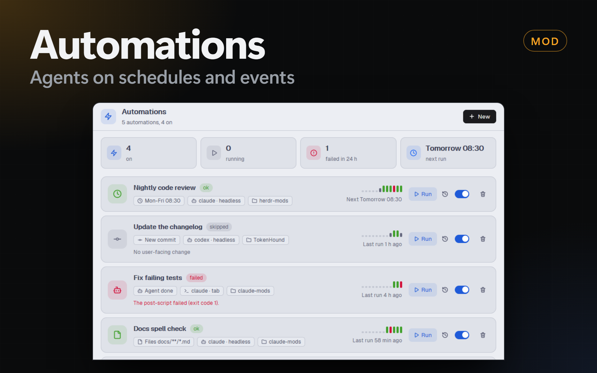

# Automations

A Herdr app mod (`automations`) that runs a coding agent with a prompt in a
folder when a trigger fires: a schedule, a button, an agent status, a file
change or a git change. A check script can skip the run. A pre-script and a
post-script run before and after the agent, and the post-script gets the
result of the agent.



## What it does

- **Status bar item:** `automations` at the right of the status bar, or
  `2 running` while runs go on. A click opens the dialog. This item is also the
  runner: without it in the shown layout, nothing runs.
- **Dialog:** the list of automations, with the last result, the next
  scheduled time, an on/off switch, **Run now**, **History** and **Delete**
  (click 2 times). A click on a row opens the form, with the tabs General,
  Agent, Prompt, Trigger, Scripts and Options. A red dot marks a tab with an
  error.
- **History:** the last 50 runs of each automation. A click on a run shows the
  output of the check and the scripts, the result file and the last 200 lines
  of the agent. **Show the agent** focuses the tab of a run that is still open.
- **Toasts:** on a failure and when an agent of a run needs you. A click on the
  toast opens the dialog on the history of the run.

## An automation

| Field | What it does |
| --- | --- |
| Name, Folder, Enabled | The folder is where the agent and the scripts run. **Choose…** opens the folder picker. |
| Agent | An agent of Herdr's agent list (`knownAgents()`). |
| Mode | **Headless**: no tab, the agent runs in a background terminal of herdr-core and its output goes to the history. **Tab**: a tab with the agent in the space that works in the folder (or a new space). You can follow it and help it. |
| Command (headless) | Empty: the built-in command of the agent (below). Or your own command with `{prompt}`, `{prompt_file}` and `{run_dir}`. |
| Space (tab) | The space of the folder, or a fixed space. |
| More arguments | Added to the agent command, for example `--model sonnet` or `--permission-mode acceptEdits`. |
| Tab at the end (tab) | Keep, close when OK (the agent finished and the post-script passed), or close. |
| Timeout | Minutes. After this time the run is `timed out`. A headless agent is stopped; a tab stays open. |
| Prompt | The first message to the agent, with variables (below). |
| Trigger | Manual, Schedule, Agent status, Files, Git (below). Every automation also has **Run now**. |
| Check, Pre-script, Post-script | **None**, **Script file** (the path of a `.ps1`, `.sh`, `.py` or `.js` file) or **Inline script** (PowerShell on Windows, bash elsewhere, or sh without bash; 1 or more lines), with a timeout in seconds (max 600). |
| When it fires during a run | Skip (default), queue 1 run, or run in parallel. |
| Notifications | Failures (default; also when an agent needs you), failures and skips, all, never. |
| Require a result | Without a result file at the end, the run failed. |

Built-in headless commands:

| Agent | Command |
| --- | --- |
| Claude Code | `claude -p {prompt} --add-dir {run_dir}` |
| Codex | `codex exec --skip-git-repo-check {prompt}` |
| Gemini | `gemini -p {prompt}` |
| OpenCode | `opencode run {prompt}` |
| Copilot | `copilot -p {prompt}` |

A headless agent cannot ask you for permission. Give it the permissions that
the task needs in **More arguments** (for example
`--permission-mode acceptEdits` or `--allowedTools "Bash(git *)"` for Claude
Code), or in the settings of the agent.

### Triggers

- **Schedule:** every N minutes (counted from the last run), daily at a time,
  on days of the week at a time, or a 5-field cron
  (`minute hour day month weekday`, local time; `*`, `n`, `a-b`, lists and
  steps). The form shows the next 3 times. **Catch up**: if Herdr was closed at
  a due time, the run starts 1 time when Herdr opens again. Without it, a
  missed time is skipped.
- **Agent status:** an agent changes to **Done** or **Needs you**. Only agents
  in the folder of the automation, or in any folder. An optional app filter
  (`claude`, `codex`). Agents that an automation started never fire it, so 2
  automations cannot start each other in a loop.
- **Files:** a change under the folder, with an optional glob
  (`src/**/*.ts, *.md`). The run starts after 5 s without changes. Changes in
  `.git`, during a run of the automation and 10 s after it are ignored.
- **Git:** a new commit on the current branch, or a change of branch (checked
  every 30 s).

### Variables

The prompt can use `{pre}` (the output of the pre-script), `{check}` (the
output of the check), `{folder}`, `{trigger}` (what fired the run), `{files}`
(the changed files), `{commit}`, `{branch}`, `{date}`, `{result_file}` and
`{run_dir}`.

The scripts get the same values as environment variables:
`HERDR_AUTO_FOLDER`, `HERDR_AUTO_TRIGGER`, `HERDR_AUTO_FILES`,
`HERDR_AUTO_PRE`, and so on. The post-script also gets:

| Variable | Value |
| --- | --- |
| `HERDR_AUTO_STATUS` | `ok`, `failed` or `timed out` |
| `HERDR_AUTO_REASON` | why it failed |
| `HERDR_AUTO_RESULT_FILE` | the path of the result file |
| `HERDR_AUTO_RESULT` | the first 8 KB of the result file |
| `HERDR_AUTO_OUTPUT_FILE` | the stdout of a headless agent |
| `HERDR_AUTO_TAIL_FILE` | the last 200 lines of the agent |
| `HERDR_AUTO_TERMINAL` | the terminal of the agent |

### The result of the agent

Each run has its own folder: `~/.config/herdr-app/data/automation-runs/<run>/`.
Tell the agent to write its result to `{result_file}` (for example "Write the
summary as Markdown to {result_file}."). The post-script reads it from
`HERDR_AUTO_RESULT` or `HERDR_AUTO_RESULT_FILE`. Two runs never share the
file, and the file is not in your repository.

The built-in Claude Code command adds `--add-dir {run_dir}`, so the agent can
write there. In a tab, the agent can ask you for permission to write outside
the folder.

### A run

1. **Check:** exit code 0 runs. Another code skips the run, and the first line
   of its output is the reason in the history.
2. **Pre-script:** a failure cancels the run. Its output is `{pre}`.
3. **Agent:** headless or in a tab. A tab run ends when the agent finishes its
   turn. When the agent needs you, the run waits.
4. **Post-script:** runs with the status and the result. A failure makes the
   run `failed`.

Scripts run with `pwsh` on Windows and `sh` on macOS and Linux.

## Example

Every weekday at 08:30, when the branch has new commits, ask Claude Code for a
review and save it:

- Trigger: Schedule, days of the week, 08:30, Mon to Fri.
- Check: `git fetch -q; if ((git rev-list --count 'HEAD..@{u}') -eq 0) { Write-Output "No new commits"; exit 1 }`
- Pre-script: `git log --oneline 'HEAD..@{u}'`
- Prompt: `Review these new commits: {pre}. Write the review as Markdown to {result_file}.`
- Post-script: `Copy-Item $env:HERDR_AUTO_RESULT_FILE "reviews/$(Get-Date -Format yyyy-MM-dd).md"`

## Install

1. Copy `mods/automations/` to `~/.config/herdr-app/mods/automations/`. Copy
   `mod.json` first: without it, Herdr docks a stray copy of the mod in your
   layout.
2. Add the status bar item to the `status-row` of your layout (`main-dock`,
   `kanban`, or your own). Without it, the automations do not run:

   ```json
   { "id": "automations-status", "type": "block", "content": { "mod": "automations", "props": { "part": "status" } }, "size": { "px": 120 } }
   ```

3. Optional: a Dock panel. Add this entry to
   `~/.config/herdr-app/dock/panels.json`:

   ```json
   { "id": "automations", "label": "Automations", "icon": "mods/automations/zap.svg", "mod": "automations" }
   ```

4. Optional: a key. In the **Settings** tab of PowerMods, or in `keys.json`:
   `"ctrl-shift-a": "mod.open:automations"`.

## Files and commands

- `~/.config/herdr-app/data/automations.json`: the automations. You can edit
  it by hand; the runner reads it again within 30 s.
- `~/.config/herdr-app/data/automation-runs.json`: the history.
- `~/.config/herdr-app/data/automation-runs/<run>/`: the files of each run. The
  mod deletes the folder when the run leaves the last 50.
- `herdr-app do automations.run-<id>`: runs an automation (the id is in
  `automations.json`).
- `herdr-app do automations.open`: opens the dialog.

## Limits

- Automations run only while the Herdr app is open and the shown layout has
  the status bar item. One status item runs them (a lease in
  `shared("automations.leader")`); the others only show the state.
- This computer only: no remote machines in this version.
- An agent that waits in a prompt before it reports a status (for example the
  "trust this folder" question of Claude Code in a new folder) makes a tab run
  fail after 2 minutes. Open the agent in the folder 1 time first.

## What it runs

- `pwsh` (Windows) or `sh` for the check, the scripts and the headless agent.
- `hc run`, `hc get`, `hc read`, `hc label`, `hc kill` and `hc rm` for the
  agent terminals.
- `git rev-parse`, `git branch --show-current` and `git log -1` for the git
  trigger.
- The agent that you choose, with your account.
- Herdr commands: `tab.new`, `space.new`, `tab.close` (only the tab of a run,
  by id), `agent.focus`, `mod.open`.
- It reads and writes only its own files in `~/.config/herdr-app/data/`. No
  network, except what your agent and your scripts do.
