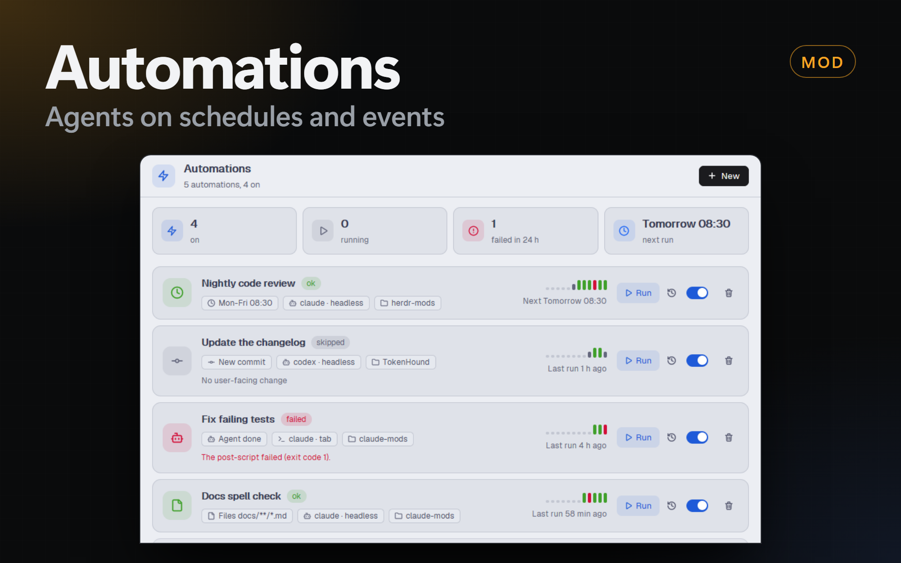

# Automations

A Herdr mod that runs a coding agent with a prompt in a folder when a trigger fires (a schedule, a button, an agent status, a file change, a git change). A check script can skip a run; a pre-script and a post-script run before and after the agent. A status bar item runs the automations and opens a dialog with the list, a form and the history.

## What you see

- **Status bar item** (block of 120 px in `status-row`): right-aligned, `bg(chrome)`, top border `border`, 11.8 px text. A 12 px icon (`zap.svg`, or `spinner.svg` spinning at 900 ms while runs go on) and the text `automations` in `dim`, or `<n> running` in `working`. Hover: `hover` background and `foreground` text. The tooltip says which copy runs the automations and the next scheduled time.
- **Dialog** (860 × 680, `mod.json` overlay): `bg(popover)`. A 52 px header with the title (15 px, semibold) and buttons, a border below.
  - **List** (`list.js`): a 58 px header (a 32 px `zap` tile, "Automations" and "<n> automations, <m> on", a primary **New** button). A warning band (`blocked` at 11% alpha, alert icon) when no runner holds the lease or the file is broken. A band of 4 stat tiles (`surface`, radius 10, a 30 px tinted icon tile, a 15 px value, an 11 px label): on, running, failed in 24 h, next run. One card per automation (`surface`, radius 12; `working` border while it runs; 72% opacity when off; hover `hover`): a 40 px tile with the trigger icon (clock, bot, file, git, hand; a spinner while it runs) tinted with the last status color (ok `ansi2` green, failed and timed out `blocked`, skipped `dim`, running `working`, none `accent`); the name (13.5 px semibold), a status pill and an "off" pill; 20 px meta labels with icons (trigger, "agent · headless|tab", folder name); the reason of a failed or skipped last run. At the right: 12 bars of the last runs (5 px wide; 14 px high, 8 px for skipped, 4 px gray for none; a tooltip with status, time and reason) above "Next <time>", "Running · <phase>", "Last run <n> ago" or "Never ran"; a tinted **Run** button, History, the on/off switch, Trash (red after the first click; the second click deletes). Empty: a 56 px `zap` tile, "No automations yet", 3 example ideas and **New automation**.
  - **Form** (`form.js`): a 62 px header (back button, a 34 px `zap` tile in `accent` at 12% alpha, the name and a line "agent · headless|tab · folder", an Enabled switch at the right), a tab bar (38 px tabs with a 14 px icon, a 2 px `accent` underline on the shown tab, a 6 px `blocked` dot on a tab with an error), the tab content (scrolls, 24 px side padding), and a bottom bar (`surface`: the first error with an alert icon, Cancel, Save or Create).
    - Most tabs are settings rows: a 200 px left column with the label (12.5 px) and a hint (11.2 px `dim`), the control at the right, a `border` line between rows. Single choices are segmented controls (a framed row; the chosen part is `raised` with a border and a small shadow); multiple choices are pill chips.
    - **General:** name, folder + Choose…. **Agent:** agent chips (`knownAgents()`, installed ones), mode Headless / Tab, then the command (with the built-in command below) or the space and the tab end, more arguments, timeout in minutes. **Prompt:** a 14-row textarea, the variables as mono tokens (a click inserts `{name}` at the cursor), Require a result. **Trigger:** 5 cards of 116 px (icon tile, name, 1 line) to pick the type, then its rows; the schedule shows the next 3 times as small chips, or its error. **Scripts:** a flow of numbered cards: 1 Check, 2 Pre-script, the agent (a tinted bar), 3 Post-script, with arrows between them; each card has the command field and a 64 px timeout field with "s"; the number is `accent` when the step has a command. **Options:** overlap and notifications.
    - Save checks the draft; with errors, the form shows them under their fields and goes to the first tab that has one.
  - **History:** a back button, "History: <name>", **Run now**. One card per run: the status pill (ok `done`, failed/timed out `blocked`, skipped `dim`, running `working`), start time, duration, trigger. A click opens the reason, **Show the agent** (when its terminal is alive), and mono blocks (max 120 to 260 px high, scroll) for check, pre-script, result.md, the agent's last lines and the post-script.

## How it behaves

- **Runner:** every status copy beats every 2 s. A copy claims `shared("automations.leader") = { copy, build, at }` when it is empty, older than 45 s, or from another build (a save of the mod reloads every copy, and the old ones stop). It starts the engine on the next beat if the lease is still its own, then renews it every 15 s. Only the runner fires triggers. The dialog and the Dock panel never run anything.
- **Run now** (dialog, or `herdr-app do automations.run-<id>`): appends `{ id, at }` to `shared("automations.requests")`; the runner takes the list on its next beat and reads `automations.json` again when an id is unknown.
- **Schedule:** each beat, for each enabled schedule automation, the next due time after the last beat (`nextDue`) is compared with now. Interval counts from `lastFired` (in `shared("automations.state")`), else from `updatedAt`. A due time more than 2 min old was missed (Herdr was closed): it runs 1 time only with **Catch up**. A new runner starts from the time of the old lease.
- **Agent status:** the runner keeps the last status of each agent. A change to `done` or `blocked` fires the matching automations (folder of the agent's pane inside the automation folder unless "any folder"; app filter on `app`, `program.key` or `program.name`). Terminals with the label `automation` and the terminals of active runs never fire it.
- **Files:** one `watchFolder` loop per automation. Paths lose the `\\?\` prefix (Windows), `.git` paths drop, the glob filters (comma-separated, `**` crosses folders). 5 s without new changes starts the run. Changes are ignored while the automation runs and 10 s after.
- **Git:** every 30 s, `git rev-parse HEAD` and `git branch --show-current`. The first read is the baseline. A new branch fires "branch changed"; a new HEAD on the same branch fires "new commit" with `git log -1 --format=%h %s`.
- **Overlap:** skip (a `skipped` run in the history), queue (1 waiting trigger in `shared("automations.queue")`, run when the active one ends), or parallel.
- **A run:** an id, a folder `data/automation-runs/<run>/`, an entry in `shared("automations.running")` (phase start → check → pre → agent → post). Check exit ≠ 0: `skipped` with its first output line. Pre-script exit ≠ 0: `failed`. Variables `{name}` in the prompt are replaced.
  - **Headless:** `prompt.md` and `agent.ps1` (or `agent.sh`) go in the run folder. The script sets `HERDR_AUTO_*`, goes to the folder, reads the prompt into `$prompt` and runs the agent with `*> output.txt`. `hc run --bg --json --no-parent --label automation=<id> --label automation-run=<run> --cwd <folder> -- pwsh -NoProfile -ExecutionPolicy Bypass -File agent.ps1` starts it. Each beat, `hc get <t> --json`: `state: finished` ends the agent step with its `exit_code`; then `hc rm`.
  - **Tab:** `tab.new { space, folder, argv: [...agent.run, ...args], task: prompt, name }` in the space that works in the folder (fixed space, else a pane whose `cwd` is the folder, else a space whose `folder` is the folder), or `space.new { folder, argv, task }`. The new terminal is the address that `terminals()` did not have before (polled for 10 s); `hc label` marks it. It is done when it worked (`status` working, or `turn` higher than at start) and its status is `done` or `idle`. `blocked` posts a toast with `agent.focus`. A closed tab fails the run; no work in 2 min fails it.
  - **Timeout:** a headless agent gets `hc kill`; the run is `timed out`.
  - **End:** `tail.txt` (the last 200 lines: `hc read` or `output.txt`), `result.md` (required or not), the post-script with `HERDR_AUTO_STATUS`, `_REASON`, `_RESULT`, `_RESULT_FILE`, `_OUTPUT_FILE`, `_TAIL_FILE`, `_TERMINAL`. A post-script failure fails an `ok` run. Tab end: `tab.close { id, confirmed: true }` for "close", or for "close-ok" when the run is ok.
- **History:** `data/automation-runs.json` holds `{ <automation id>: [run summaries] }`, the newest first, 50 each; outputs clipped to 2000 characters, the result to 8 KB. A run that leaves the 50 loses its folder. The runner bumps `shared("automations.runsRev")`; the dialog reads the file again.
- **Toasts:** failed and timed out always (unless "never"), skipped with "skips", all with "all". The toast sets `shared("automations.focus") = { automation, run }` and its action is `mod.open automations`: the dialog opens on that history with that run open.
- **Keys:** Esc goes back to the list from the form or the history, and closes the dialog from the list. A text field gets Esc first; its `on_key_down` does the same.
- **Off:** with `automations` in `shared("herdr-mods.disabled")`, every copy draws nothing, closes its dialog and skips its beat.

## Built from

- `mods/automations/`: `mod.json` (`place: none`, title, dialog 860 × 680), `main.js` (the View: status part with the lease, dialog part with the list and the history), `form.js` (the form and its checks), `list.js` (the list), `engine.js` (the runner), `schedule.js` (cron and presets), `shell.js` (scripts, headless agent, `hc`), `store.js` (files, shared keys, defaults), `ui.js` (buttons, chips, segmented control, switch, fields, tab bar, settings row, choice card, step card, token, pill, output block), icons `zap`, `play`, `pencil`, `history`, `trash`, `plus`, `back`, `folder`, `terminal`, `check`, `spinner`, `settings`, `bot`, `message`, `code`, `sliders`, `clock`, `hand`, `file`, `git`, `alert`, `arrow-down` (Lucide style, 24 × 24, stroke 2, `currentColor`).
- Status block: `{ "id": "automations-status", "type": "block", "content": { "mod": "automations", "props": { "part": "status" } }, "size": { "px": 120 } }` in `status-row`.
- Dock entry: `{ "id": "automations", "label": "Automations", "icon": "mods/automations/zap.svg", "mod": "automations" }`.
- `herdr`: `shared`, `setShared`, `agents`, `terminals`, `panes`, `spaces`, `knownAgents`, `pickFolder`, `watchFolder`, `exec`, `hc`, `readTextFile`, `writeTextFile`, `notify`, `run`, `nextCommand`, `closeOverlay`, `appHome`, `window`; `fs/promises` (`mkdir`, `writeFile`, `readdir`, `unlink`, `rmdir`).
- `gpui-base`: `InputState`, `Input`, `TextareaState`, `Textarea`, `h_flex`, `v_flex`.
- Commands: `automations.open`, `automations.run-<id>` (status copy); `automations.new`, `.edit-<id>`, `.tab-<tab>`, `.history-<id>`, `.detail-<run>`, `.list`, `.save` (an open dialog, for tests).

## Watch out (form)

- An element is single-use: a part that shows more than 1 time (the arrows of the Scripts flow) must be made by a function.
- The control column of a settings row is `items_start`, so a segmented control keeps its own width; fields and chip rows need `w_full`.

## Watch out

- `exec` has no environment option: every script is a file in the run folder that sets `$env:HERDR_AUTO_*` (single quotes doubled) or `export` lines.
- Never put the prompt in a Windows `argv` of a terminal: Herdr runs it as `pwsh -NoExit -Command "& 'prog' 'arg'"`. Headless reads it from `prompt.md`. A tab gets it as `task`.
- `hc read` is a screen (wrapped lines), not stdout: headless output comes from `output.txt`.
- `done` turns `idle` once someone looks. Use `turn` (from `terminals()`) to know the agent worked.
- `watchFolder` gives `\\?\C:\…` paths on Windows.
- `fs/promises` has no `rm`: delete files with `unlink`, then `rmdir`.
- `readTextFile` stops at 1 MiB: a large `output.txt` is read with `Get-Content -Tail 200` or `tail`.
- A copy's `close()` does not run on a save of the mod: the build id in the lease frees it.
- Claude Code asks "trust this folder" in a new folder before it reports a status: a tab run waits, then fails after 2 min.
- Headless agents cannot ask for permission: the person adds the flags in **More arguments**.

## Done when

1. `herdr-app check` passes on `~/.config/herdr-app/mods/automations`.
2. With the status block in the shown layout, `shared("automations.leader")` has a fresh `at` (within 15 s), also 10 s after a save of `main.js`.
3. An automation with a custom headless command `Write-Output "AGENT SAW: $prompt"; Set-Content -LiteralPath $env:HERDR_AUTO_RESULT_FILE -Value "RESULT-OK"`, a check, a pre-script and a post-script, run with `herdr-app do automations.run-<id>`: the history has `ok`, the check and pre outputs, `result: RESULT-OK`, and the post output shows `HERDR_AUTO_STATUS=ok` and the result.
4. A check with `exit 3` gives `skipped` with its output; a command with `exit 7` gives `failed: The agent gave exit code 7.`
5. An interval of 1 minute runs within 70 s.
6. A files automation with the glob `*.txt` runs 1 time after 3 files change (2 `.txt` and 1 `.md`), with only the `.txt` files in `{files}`.
7. A git automation runs on a new commit and on `git checkout -b`.
8. An agent automation runs when another agent in its folder becomes done, and not when the agent of an automation does.
9. A tab run with Claude Code (`--model haiku`, "Reply with the word PONG only") ends `ok`, the post-script gets the terminal, and "close when OK" closes the tab.
