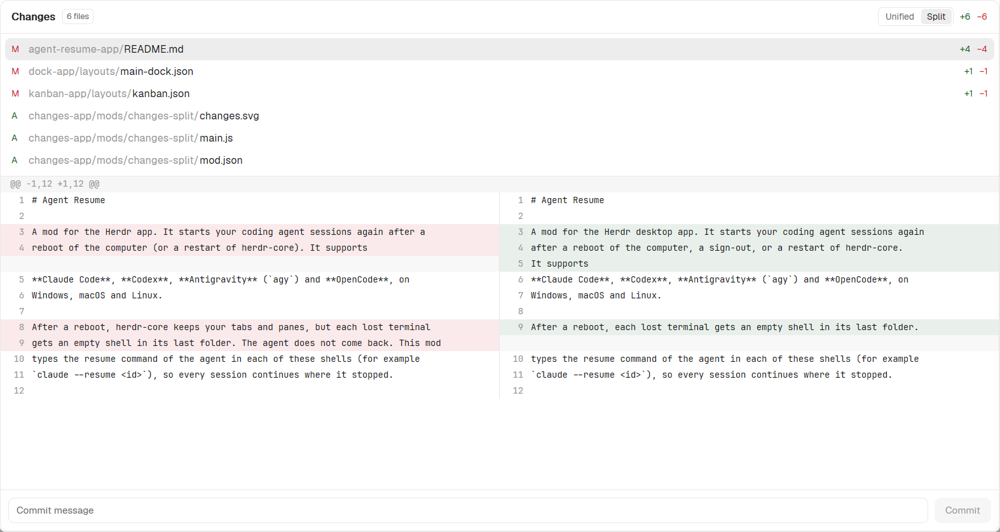

# Changes Split for the Herdr app



A Herdr app mod: the Changes panel of Herdr with a side-by-side diff. A **Unified / Split** switch in the header of the panel sets how the diff shows:

- **Unified:** the diff of Herdr's own Changes panel. Removed and added lines show one under the other.
- **Split:** the old file on the left and the new file on the right, each side with its own line numbers. Removed and added lines that replace each other share a row. When one side has more lines, the other side shows empty rows. Each side is half of the panel, and a long line wraps into more rows.

The mod remembers the choice, and every copy of the panel (side panel, dialog, other layouts) shows the same view. The commands `changes-split.split`, `changes-split.unified` and `changes-split.toggle` set the view too, for example from a key in `keys.json`. Everything else is the same as Herdr's Changes panel: the list of changed files, the `+` and `−` counts, the commit message and the **Commit** button.
[`RECIPE.md`](RECIPE.md) describes the mod in full.

The [Kanban](../kanban-app) and [Dock](../dock-app) layouts of this repository use this mod for their Changes panel.

## Install

With an agent (Claude Code or any agent that can read files), paste this prompt:

`Read ~/.config/herdr-app/AGENTS.md, then add this mod: https://github.com/dougcunha/herdr-mods/tree/main/changes-app`

Or copy the folder yourself. The Herdr app must be running. Copy `mod.json` first:

```sh
mkdir -p ~/.config/herdr-app/mods/changes-split
cp changes-app/mods/changes-split/mod.json ~/.config/herdr-app/mods/changes-split/
cp changes-app/mods/changes-split/changes.svg changes-app/mods/changes-split/main.js ~/.config/herdr-app/mods/changes-split/
herdr-app check ~/.config/herdr-app/mods/changes-split
```

On Windows PowerShell:

```powershell
$to = "$env:USERPROFILE\.config\herdr-app\mods\changes-split"
New-Item -ItemType Directory -Force $to | Out-Null
Copy-Item changes-app\mods\changes-split\mod.json $to
Copy-Item changes-app\mods\changes-split\changes.svg, changes-app\mods\changes-split\main.js $to
herdr-app check $to
```

The mod has `"place": "none"`: it adds no panel by itself.

## Use it in a layout

Herdr's own layouts are read-only. In a layout of your own (a clone, or the `kanban` and `main-dock` layouts of this repository), set the `content.mod` of the Changes block to `changes-split`. Keep the block id `changes`: the tab bars find the panel by that id.

```json
{ "id": "changes", "type": "block", "content": { "mod": "changes-split" } }
```

## What it runs, and its limits

- The same as Herdr's Changes panel: `git` through the app's `exec` (`rev-parse`, `status`, `diff`, and `add -A` and `commit` when you click **Commit**). It reads changed files that Git does not track yet. It uses no network.
- It saves the choice (`unified` or `split`) in the shared value `changes-split.view` (`shared()`), which Herdr keeps after a restart.
- The mod is a copy of Herdr's `changes` mod of version 0.1.12. It does not get the fixes of newer Herdr versions.
- Split needs width. In a side panel of 368 px each side has about 180 px, so most lines wrap. Make the panel wider, or open it in a dialog (the panel-open button of the Kanban and Dock bars).
- Split wraps a line at a fixed number of characters (7 px each), not at a word. Unified keeps one row per line and scrolls sideways, as in Herdr.
- Tested on Windows only.
