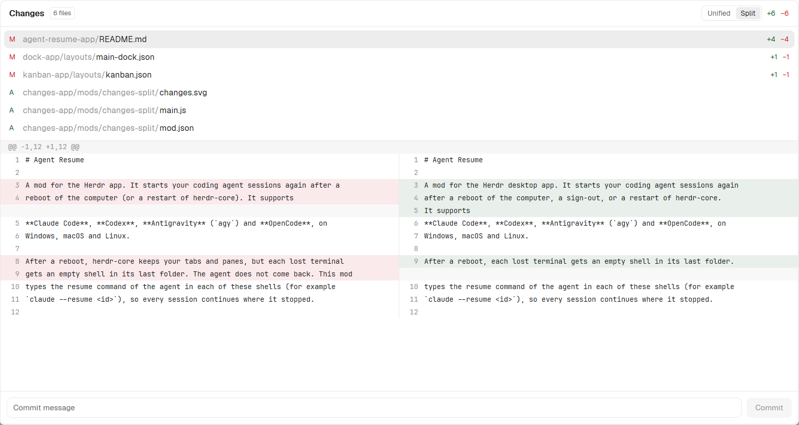

# Changes Split

The Changes panel of the Herdr app with a side-by-side diff. A **Unified / Split** switch in the header sets how the diff of the selected file shows. Everything else is Herdr's own `changes` mod of version 0.1.12.

## What you see

The panel of Herdr's `changes` mod, with one addition in the header:

1. **Header, 42 px, 1 px bottom `border`, 14 px side padding, 8 px gap.** From the left: `Changes` in semibold, the file count badge (`<n> files`), a spacer, then the **view switch**, then the `+<added>` (`ansi2`) and `−<removed>` (`ansi1`) totals.
   - The view switch is one rounded group: 24 px high, 2 px padding, 2 px gap, radius 6, 1 px `border`. It holds 2 buttons, `Unified` and `Split`: 7 px side padding, radius 4, 11 px text. The active button has a `selected` fill and `foreground` text. The other button has `muted` text, a `hover` fill under the pointer and a pointer cursor.
2. **File list**, as in Herdr: status letter, folder in `dim`, file name, `+` and `−` counts. A click opens the diff of the file. A 2nd click closes it.
3. **Diff**, 11 px text in the terminal font, rows of 20 px and a vertical scroll bar. Unified also has a horizontal scroll bar.
   - **Unified:** as in Herdr. A hunk header row (`@@ … @@`) has the `raised` fill and `dim` text. Each line row has a 30 px number column in `dim` (the new line number; the old one for a removed line) and the text. Added rows have `ansi2` at 9% opacity (`18` hex alpha), removed rows `ansi1` at 9%.
   - **Split:** a hunk header row spans the full width, as in Unified. Each other row has 2 halves of the same width with a 1 px `border` line between them. Each half has its own 30 px number column and the text. A long line wraps into more lines of 20 px; the number shows on the first one, and the row is as tall as its taller half. The left half is the old file, the right half the new file. A context line shows on both halves, with its old number at the left and its new number at the right. An empty half has `foreground` at 3% opacity (`08` hex alpha).
4. **Commit row**, as in Herdr: a message field and the **Commit** button.

## How it behaves

- **Split rows.** The mod reads the same `git diff` lines as Unified. In each hunk, a run of `-` lines and the run of `+` lines right after it share rows, index by index: the 1st removed line with the 1st added line, and so on. The shorter run gets empty halves at its end. A `-` run with no `+` run after it has only empty right halves, and the reverse. A context line ends the run. A line that is not `-`, `+`, space or `@@` (for example `\ No newline at end of file`, or a message such as `Binary file changed`) spans the full width and also ends the run.
- **New files.** A file that Git does not track yet shows all its lines as added, so in Split the left halves are empty.
- **Width.** In Unified the diff is as wide as the longest line (7 px a character plus 50 px, at least 300 px) and scrolls sideways. Split has no sideways scroll: each half is half of the visible width less 1 px. A half holds `floor((half − 46) / 7)` characters a line (at least 8): 30 px numbers, 10 px gap, 6 px margin. A longer line is cut into pieces of that length. The mod measures the visible width with `on_size_change` and divides it by the app `zoom`.
- **Do not size the halves by the longest line.** A first version did that with one shared sideways scroll. With long lines (Markdown) the left half filled the panel and the right half was off screen, so the added lines looked empty.
- **Saved choice.** A click on `Unified` or `Split` saves `unified` or `split` with `setShared("changes-split.view", …)`. Every copy of the panel reads `shared("changes-split.view")` in `render`, so the side panel, the dialog and the other layout change together, and the value stays after a restart. Any other value means Unified. Do not use `localStorage`: it is one store for each copy of the mod, so each copy had its own choice.
- **Commands.** `changes-split.split`, `changes-split.unified` and `changes-split.toggle` (from `nextCommand()`) set the view, as the switch does. Bind them in `keys.json` or run `herdr-app do changes-split.toggle`.
- **Default:** Unified.

## Built from

- `mod.json`: `{ "place": "none", "cloned_from": { "name": "changes", "version": "0.1.12" } }`, written by `herdr-app do mod.clone '{"name":"changes","as":"changes-split"}'`. Create this file **before** `main.js` (see Watch out).
- `changes.svg`: the icon of Herdr's `changes` mod, copied by the clone.
- `main.js`: Herdr's `changes` mod of version 0.1.12 with these changes:
  - `splitRows(lines)` builds the Split rows from the diff lines: `{ kind, text }` for a full-width row, `{ left, right }` for a pair, where a half is `{ kind, number, text }` or `null`.
  - `setLines(lines)` builds both the Unified rows (`diffRows`) and the Split rows, and computes `diffWidth`.
  - `splitLayout()` wraps the Split rows for the visible width (`wrap(text, width)`) and gives each row its height (`lines * 20`). It keeps the result until the rows or the width change.
  - `currentView()` reads `shared("changes-split.view")`. `setView(view, cx)` calls `setShared`. A `nextCommand()` loop in `init` takes `split`, `unified` and `toggle`.
  - `viewToggle(t, view)` draws the switch. `splitRow(item, t)` and `splitCell(cell, pieces, t)` draw a Split row.
  - The diff area (`id("changes-diff-area")`) has `on_size_change`, which stores the visible width in `diffArea`.
  - `render` passes the rows of the active view to the same `v_virtual_list("changes-diff", …)`: Unified with 1 size of 20 px and `min_w(diffWidth)`, Split with one size for each row and no `min_w`.
- Programs that the mod runs with `exec`: `git` only, the same as Herdr's `changes` mod. It uses no network.

## Watch out

- **Disclose this before installing.** The mod runs `git` in the folder of the focused terminal. **Commit** runs `git add -A` and `git commit -m <message>` in that repository. It reads changed files that Git does not track yet.
- **Create `mod.json` first.** When Herdr sees a new folder in `mods/` without `mod.json`, it docks a copy of the mod at the right edge of the layout and saves it in the layout. With `"place": "none"` nothing is docked. If it happens, remove that block from your layout file.
- **Do not edit Herdr's `changes` mod.** Herdr's mods are read-only: on the next start Herdr moves an edited copy to `changes-edited` and restores its own. That is why this mod is a clone with its own name.
- **Keep the block id `changes`** in the layouts. The `kanban` and `tabs-dock` bars open and close the panel by that id.
- **A clone does not follow Herdr.** When a new Herdr version changes its `changes` mod, compare `mods/changes/main.js` with the base of this mod and bring the changes over by hand.
- **Not tested:** other machines (`on`), macOS and Linux.

## Done when

- `herdr-app check` passes for `mods/changes-split`.
- In a layout whose Changes block has `"mod": "changes-split"`, the Changes panel shows `Unified` and `Split` between the file count and the totals. `herdr-app status` lists no error.
- In a repository with a hunk that replaces 2 lines with 3, Split shows the 2 old lines at the left of the first 2 new lines, and 1 empty left half next to the 3rd new line.
- In the same hunk, the context lines after the change show different numbers at the left and at the right.
- A file that Git does not track yet shows empty left halves and every line at the right.
- In a file with lines longer than the half (a Markdown file), Split shows every added line at the right, wrapped, and no sideways scroll bar.
- After a click on `Split`, the side panel, the dialog and the other layout show Split, also after a restart of the app.
- `herdr-app do changes-split.toggle` switches the view.
- No panel named `Changes` appears in the layout after you add the mod.
