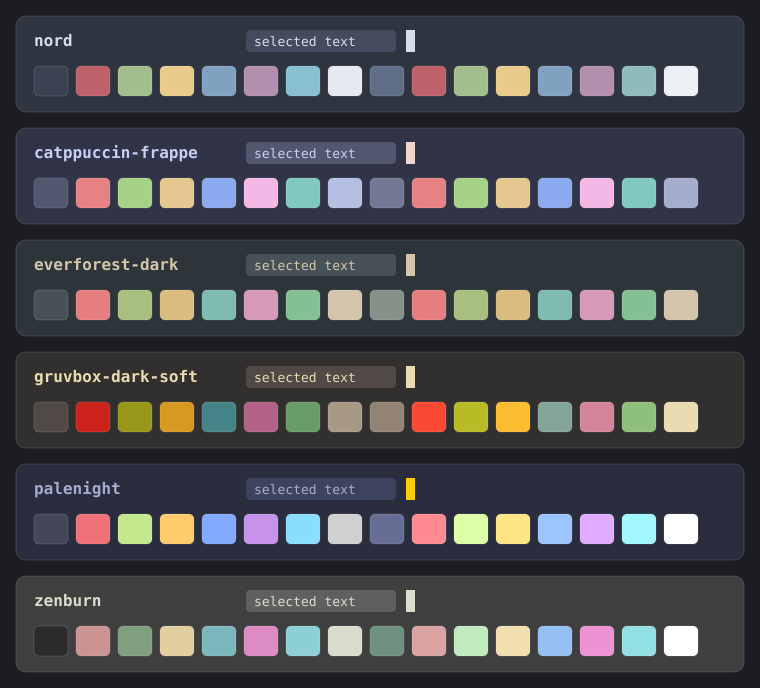

# Soft dark themes for the Herdr app



Six dark themes for the Herdr app, with lighter backgrounds than the shipped dark themes (`graphite`, `ink`, `moss`) and `atom-one-dark` (`#21252b`). The text stays light and the contrast stays high, but the screen is less black.

| File | Background | Look |
| --- | --- | --- |
| `nord.json` | `#2e3440` | Blue-gray, with the Nord frost colors. |
| `catppuccin-frappe.json` | `#303446` | Blue-gray, with pastel colors. |
| `everforest-dark.json` | `#2d353b` | Green-gray, with soft warm colors. |
| `gruvbox-dark-soft.json` | `#32302f` | Warm brown-gray, with retro colors. |
| `palenight.json` | `#292d3e` | Indigo, from Material Palenight. |
| `zenburn.json` | `#3f3f3f` | Neutral gray, the lightest of the six, with low-contrast colors. |

Each file sets only the terminal colors (`background`, `foreground`, `selection`, `cursor` and the 16 `ansi` colors). The app derives the panel colors from them.

Changes from the original palettes, so text stays visible:

- `nord`: ANSI 8 (bright black) is `#616e88`, not `#4c566a`.
- `gruvbox-dark-soft`: ANSI 0 (black) is `#504945`, not the background color of the original palette.
- `palenight`: ANSI 0 (black) is `#434758`, not the background color.
- `zenburn`: the red and blue colors come from the Zenburn editor palette (`#cc9393`, `#7cb8bb`), because the original terminal colors (`#705050`, `#506070`) are too dark on the background.

## Install

With an agent (Claude Code or any agent that can read files), paste this prompt:

`Read ~/.config/herdr-app/AGENTS.md, then copy the themes of https://github.com/dougcunha/herdr-mods/tree/main/dark-themes-app to ~/.config/herdr-app/themes/ without overwriting a file that exists`

Or copy the files yourself. Do not overwrite a theme that you already have.

```sh
cp -n dark-themes-app/themes/*.json ~/.config/herdr-app/themes/
```

On Windows PowerShell:

```powershell
Get-ChildItem dark-themes-app\themes\*.json | ForEach-Object {
  $dest = Join-Path "$env:USERPROFILE\.config\herdr-app\themes" $_.Name
  if (-not (Test-Path $dest)) { Copy-Item $_.FullName $dest }
}
```

The themes show up in Settings by themselves. No restart is necessary.

## Use a theme

1. Set the dark appearance: in Settings, or with `"appearance": "dark"` in `~/.config/herdr-app/settings.json`. If `appearance` is absent, the app follows the system.
2. Pick the theme in the theme menu, or run `herdr-app do app.theme --name nord`.

`app.theme` sets the dark half of the layout's theme, because these themes are dark. The light half stays as it was. To follow the system, put both halves in a layout or in `settings.json`:

```json
{ "theme": { "light": "one-light", "dark": "nord" } }
```

For light themes, see [`light-themes-app`](../light-themes-app/README.md).

## Limits

- The files contain only colors. They run nothing and use no network.
- Tested on Windows only.
