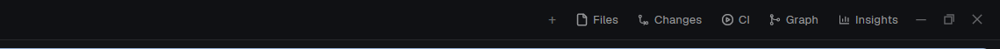

# Dock

A Herdr app layout whose tab bar builds its side-panel buttons from a file.

Herdr's own `main` layout is read-only, and its tab bar has a fixed list of
buttons (Files, Changes). To add one more button you had to clone the tab bar
and the layout, and edit both. With Dock you clone nothing more: you add one
line to `~/.config/herdr-app/dock/panels.json`, and the button and its panel
show up while the app runs.



## Quick Start

Copy and paste this prompt to your LLM agent:

`Read ~/.config/herdr-app/AGENTS.md, then add this layout: https://github.com/dougcunha/herdr-mods/tree/main/dock-app`

To add a button later, for example the [Git Graph](https://github.com/rabeeh-ta/herdr-git-graph) mod:

`Read ~/.config/herdr-app/AGENTS.md, then add this mod: https://github.com/rabeeh-ta/herdr-git-graph and add it to the dock: the "main-dock" layout reads ~/.config/herdr-app/dock/panels.json`

## What it adds

| Part | What it is |
| ---- | ---------- |
| `layouts/main-dock.json` | Herdr's `main` layout (the same in 0.1.11 and 0.1.12) with the tab bar `tabs-dock`. Side panel: Files and Changes. |
| `mods/tabs-dock/` | Herdr's tab bar plus the dock: it reads `dock/panels.json`, draws the buttons and adds the panels to the layout. |
| `mods/files-md/` | Herdr's Files panel (a copy of 0.1.12) with a right-click menu, rendered Markdown and syntax highlighting. See [The Files panel](#the-files-panel). |
| `mods/files-md-menu/` | The popup of that right-click menu. `files-md` needs it. |

Switch to the layout with `ctrl-shift-l`. Your own layout stays as it was.

## The Files panel

`files-md` is Herdr's Files panel with these changes:

- **Markdown** opens in the panel as rendered text (headings, tables, code blocks, links you can select and copy). The **Source** button in the header shows the same file as highlighted text, and **Rendered** goes back.
- **Code and other text files** open in the panel with syntax highlighting, line numbers and folding. The editor colors Python, C#, Rust, Go, Java, C, C++, Ruby, PHP, Lua, SQL, JavaScript, JSON, HTML, CSS, YAML and shell files. Kotlin, Scala, TypeScript, TOML, PowerShell, XML and Dockerfile-like files borrow the colors of a close language (Java, JavaScript, YAML, shell or HTML), so they are approximate. Other types, such as Swift, Markdown source and diffs, show as plain text. A file with a null byte shows "Binary file". A text file over 400,000 characters is cut there.
- **Icons** show the type of each row: folders (amber, open or closed), Markdown, code, JSON, shell scripts, images, tables (CSV, Excel), archives, config files (YAML, TOML, dotfiles) and text or documents. Any other file gets a plain file icon. The table is `KINDS` at the top of `files-md/main.js`; the icons are the `.svg` files of the folder (one color, drawn in the color of the type).
- **Images** open in the [Image Viewer](../image-viewer-app), beside the terminal.
- **Right-click** a file or a folder for a menu:

| Item | On | What it does |
| ---- | -- | ------------ |
| Open with default app | files | Opens the file in the app that Windows (macOS, Linux) has for its type: `Invoke-Item`, `open` or `xdg-open`. |
| Open in Markdown Reader | Markdown files | Opens the file in the [Markdown Reader](https://github.com/kissmikijr/herdr-markdown-reader) beside the terminal. It shows only when that mod is installed. |
| Show in Explorer | files | Opens the folder with the file selected: `explorer /select,`, `open -R`, or the folder in `xdg-open` (Finder and the file manager have the same item). |
| Open in Explorer | folders | Opens the folder. |
| Open terminal here | folders | A new terminal in that folder, to the right of the focused pane. |
| Open in new space | folders | A new space in that folder. |
| Copy path, Copy relative path, Copy name | all | Writes the text to the clipboard. |

Each item has an icon. For a folder on another machine, only the three Copy items show: the other items act on this computer's files. ↑/↓ and Enter work in the menu, and Esc closes it.

## `panels.json`

```json
{
  "panels": [
    { "id": "graph", "label": "Graph", "icon": "mods/git-graph/icons/graph.svg", "mod": "git-graph" },
    { "id": "insights", "label": "Insights", "icon": "mods/insights/insights.svg", "mod": "insights", "opens": "tab", "name": "Insights" }
  ]
}
```

| Field | Meaning |
| ----- | ------- |
| `id` | `a-z`, `0-9`, `-`, up to 32 characters, unique. |
| `label` | The button text. |
| `icon` | A path in the Herdr home: `.svg` (drawn in the text color) or a picture. |
| `mod` | The folder in `mods/` to show. It must exist. |
| `props` | Optional. Given to the mod as its `props()`. |
| `opens` | `"panel"` (default): a block in the side panel. `"tab"`: a tab per space with the mod as its only pane. `"command"`: a button that runs a Herdr command (no `mod`). |
| `name` | For `"tab"`: the tab name. |
| `run`, `args` | For `"command"`: the command and its arguments, for example `"run": "layout.switch", "args": { "name": "kanban" }`. |

A `layout.switch` entry goes to the **layout switch**, a group at the right end of the bar with a button for the shown layout and one for each `layout.switch` entry; the shown layout is lit. A click saves the shown layout in `shared("layout.previous")` first. The [Kanban](../kanban-app) layout reads it and draws the same group in the same place, so the button does not move when you switch.

- A save of the file shows in the bar at once. Remove an entry and its button and panel go.
- A broken file keeps the last good list and shows an error toast. A bad entry is skipped.
- Bind a key to a panel in `keys.json`: `"layout:main-dock": { "ctrl-alt-shift-g": "tabs-dock.graph" }`.

## What it does on your machine

- It reads `dock/panels.json` and the folder list of `mods/` in the Herdr home.
- It edits `layouts/main-dock.json` with the `layout.set` command, to add or remove panel blocks.
- The tab bar runs no program. The Files panel runs `git` and `powershell` or `sh` to list folders and mark changed files, as Herdr's own Files panel does. Only a click on a right-click menu item runs more: `powershell`, `explorer`, `open` or `xdg-open`, on the file you chose.
- It uses no network.

## Limits

- `files-md` needs the `files-md-menu` mod (the right-click menu) and the `image-viewer` mod ([this repository](../image-viewer-app), for images). Without the viewer, a click on an image does nothing useful. The `markdown-reader` mod (third party) is optional: only the menu item "Open in Markdown Reader" uses it. To go back to Herdr's own Files panel, point the `files` block of `layouts/main-dock.json` to the mod `files`.
- The right-click menu, the Explorer and default app items and the clipboard items were not clicked in a real session: the checks were `herdr-app check`, a screenshot of the menu popup, and the Markdown and highlighting views in the app. Test them on your machine. Tested only on Windows; the macOS and Linux commands are written, not run.
- It works only on a personal layout, so it comes with its own copy of `main`.
  That copy does not follow Herdr updates. When Herdr changes the tab bar,
  clone `main` and `tabs` again.
- Built and tested on Windows with Herdr 0.1.11. Herdr 0.1.12 did not change the `main` layout or the `tabs` mod, and the dock loads there without errors. Untested: macOS, Linux, remote machines.
- `RECIPE.md` has the full brief to build it from scratch.
