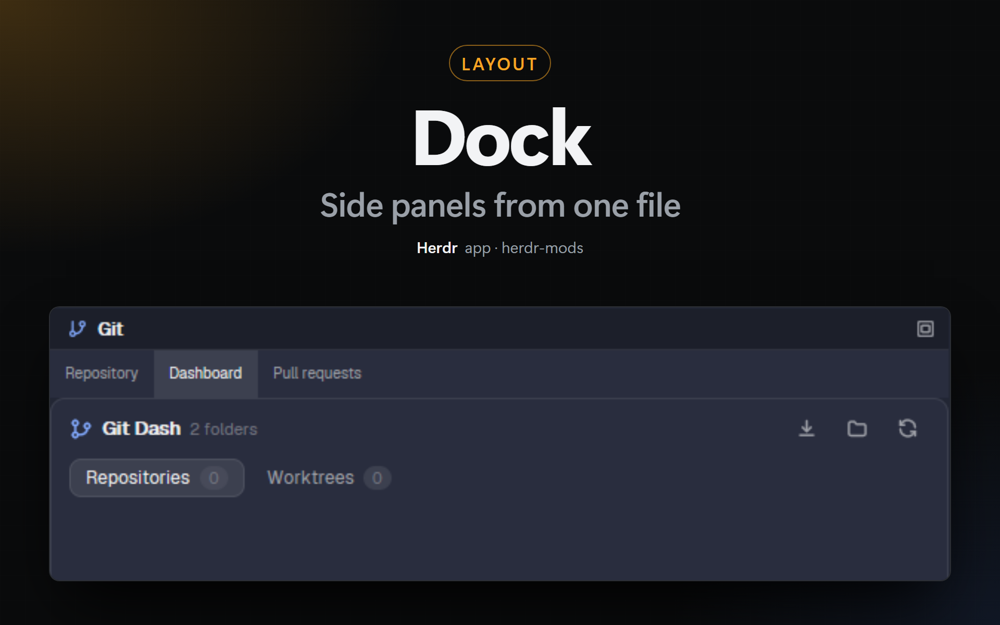

# Dock

A Herdr app layout whose tab bar builds its side-panel buttons from a file.

Herdr's own `main` layout is read-only, and its tab bar has a fixed list of
buttons (Files, Changes). To add one more button you had to clone the tab bar
and the layout, and edit both. With Dock you clone nothing more: you add one
line to `~/.config/herdr-app/dock/panels.json`, and the button and its panel
show up while the app runs.



## Quick Start

Copy and paste this prompt to your LLM agent:

`Read ~/.config/herdr-app/AGENTS.md, then add this layout: https://github.com/dougcunha/herdr-mods/tree/main/dock-app`

To add a button later, for example the [CI Dash](../ci-dash-app) mod:

`Read ~/.config/herdr-app/AGENTS.md, then add this mod: https://github.com/dougcunha/herdr-mods/tree/main/ci-dash-app and add it to the dock: the "main-dock" layout reads ~/.config/herdr-app/dock/panels.json`

## What it adds

| Part | What it is |
| ---- | ---------- |
| `layouts/main-dock.json` | Herdr's `main` layout (the same from 0.1.11 to 0.1.16) with the tab bar `tabs-dock`. Side panel: Files and Changes (the [Git](../git-client-app) mod: changes, hunks, commit and the commit graph). |
| `mods/tabs-dock/` | Herdr's tab bar plus the dock: it reads `dock/panels.json`, draws the buttons and adds the panels to the layout. |
| `mods/files-md/` | Herdr's Files panel (a copy of 0.1.12, with the folder listing of 0.1.16) with a right-click menu, rendered Markdown and syntax highlighting. See [The Files panel](#the-files-panel). |
| `mods/files-md-menu/` | The popup of that right-click menu. `files-md` needs it. |

Switch to the layout with `ctrl-shift-l`. Your own layout stays as it was.

## The Files panel

`files-md` is Herdr's Files panel with these changes:

- **Markdown** opens in the panel as rendered text (headings, tables, code blocks, links you can select and copy). The **Source** button in the header shows the same file as highlighted text, and **Rendered** goes back.
- **Code and other text files** open in the panel with syntax highlighting, line numbers and folding. The editor colors Python, C#, Rust, Go, Java, C, C++, Ruby, PHP, Lua, SQL, JavaScript, JSON, HTML, CSS, YAML and shell files. Kotlin, Scala, TypeScript, TOML, PowerShell, XML and Dockerfile-like files borrow the colors of a close language (Java, JavaScript, YAML, shell or HTML), so they are approximate. Other types, such as Swift, Markdown source and diffs, show as plain text. A file with a null byte shows "Binary file". A text file over 400,000 characters is cut there.
- **Icons** show the type of each row: folders (amber, open or closed), Markdown, code, JSON, shell scripts, images, tables (CSV, Excel), archives, config files (YAML, TOML, dotfiles) and text or documents. Any other file gets a plain file icon. The table is `KINDS` at the top of `files-md/main.js`; the icons are the `.svg` files of the folder (one color, drawn in the color of the type).
- **Images** show in the panel preview, like Markdown and code: fit to the panel, or zoomed from 10% to 800% with scrollbars. The zoom bar in the header has **Fit**, **100%**, **−**, the scale and **+**; the keys `+` (or `=`), `-`, `0` (100%) and `F` (Fit), and Ctrl + mouse wheel, work too. For an image whose size Windows cannot read (SVG, WebP, and every image on macOS and Linux), 100% is the size of the panel. The header shows the size in pixels and in bytes. The right-click item **Open in Image Viewer** opens the image in the [Image Viewer](../image-viewer-app), beside the terminal. Images on another machine have no preview.
- **Filter**: the field at the top has the keyboard when the panel opens and after ← in the preview. Type in it to find a file or a folder anywhere under the root with a fuzzy match (`rdm` finds `README.md`, `deep main` finds `src/deep/main.js`). Each word must match the name or the folders of the path; matched letters are bold. ↑/↓ pick a result, Enter or a click opens it, Esc or × clears the field; in a dialog, Esc with an empty field closes the dialog. A file opens in the preview, and ← or Esc goes back to the results (or to the tree). A folder clears the filter and shows the folder open in the tree. In a Git work tree the filter searches the files that `git ls-files` lists (no ignored files); in other folders it lists all files but skips `.git` and `node_modules`. It searches the first 20,000 files and folders and shows the best 200 matches. Right-click a result for the same menu as a row.
- **Right-click** a file or a folder for a menu:

| Item | On | What it does |
| ---- | -- | ------------ |
| Open with default app | files | Opens the file in the app that Windows (macOS, Linux) has for its type: `Invoke-Item`, `open` or `xdg-open`. |
| Open in Markdown Reader | Markdown files | Opens the file in the [Markdown Reader](https://github.com/kissmikijr/herdr-markdown-reader) beside the terminal. It shows only when that mod is installed. |
| Show in Explorer | files | Opens the folder with the file selected: `explorer /select,`, `open -R`, or the folder in `xdg-open` (Finder and the file manager have the same item). |
| Open in Explorer | folders | Opens the folder. |
| Open terminal here | folders | A new terminal in that folder, to the right of the focused pane. |
| Open in new space | folders | A new space in that folder. |
| New file…, New folder… | folders, empty area | Asks for a name and makes the file or the folder in that folder. A name that is already there shows an error. |
| Cut, Copy | all | Keeps the file or the folder for Paste, in every Files panel. It does not use the system clipboard. |
| Paste “name” | all | Copies (or, after Cut, moves) the kept item into the folder, or into the folder of the file. A copy into a folder that has the same name gets ` - Copy` (`copy` on macOS and Linux). Shows only when an item is kept on the same machine. |
| Duplicate | all | Makes a copy in the same folder: `name - Copy.ext`. |
| Rename… | all | Asks for the new name. The name is selected without its extension. |
| Delete | all | Asks first. On Windows the item goes to the Recycle Bin. On macOS, Linux and other machines it is deleted for good (`rm -rf`). |
| Copy path, Copy relative path, Copy name | all | Writes the text to the clipboard. |

Right-click the empty area below the rows for New file, New folder and Paste in the root folder. For a folder on another machine, the open items do not show (they act on this computer's files); the edit items run on that machine. ↑/↓ and Enter work in the menu, and Esc closes it. The menu opens at the click, also when the panel is a dialog.

## The agent cards

The **Agents** list of the sidebar is the [Agent Cards](../agent-cards-app) mod (`agent-cards`): one card for each agent, with a small robot that acts out the status. Install it before the layout.

**Turn them off** in PowerMods → **Settings** → **Agent cards**. Off, the sidebar shows Herdr's own Agents list again; on, the cards come back. The tab bar makes the change in `layouts/main-dock.json` and keeps the size of the block. `tabs-dock.agent-cards` in `keys.json` flips the same setting.

## `panels.json`

```json
{
  "panels": [
    { "id": "repos", "label": "Dashboard", "icon": "mods/tabs-dock/repos.svg", "mod": "git-dash", "group": "git" },
    { "id": "insights", "label": "Insights", "icon": "mods/insights/insights.svg", "mod": "insights", "opens": "tab", "name": "Insights" }
  ]
}
```

| Field | Meaning |
| ----- | ------- |
| `id` | `a-z`, `0-9`, `-`, up to 32 characters, unique. |
| `label` | The button text. |
| `icon` | A path in the Herdr home: `.svg` (drawn in the text color) or a picture. |
| `mod` | The folder in `mods/` to show. It must exist. |
| `props` | Optional. Given to the mod as its `props()`. |
| `opens` | `"panel"` (default): a block in the side panel. `"tab"`: a tab per space with the mod as its only pane. `"command"`: a button that runs a Herdr command (no `mod`). |
| `name` | For `"tab"`: the tab name. |
| `run`, `args` | For `"command"`: the command and its arguments, for example `"run": "layout.switch", "args": { "name": "kanban" }`. |
| `group` | Optional. The entries with the same group share one button. `"git"` places the `repos` and `prs` panel entries in the **Git** panel. A group of 1 command entry is a plain button. |
| `section` | Optional. In the menu of a group, a line comes before the first entry of another section ([Quick Actions](../quick-actions-app) puts its pinned actions in the section `pinned`, after **Actions**). |

**Git.** The Git button opens a panel with **Repository**, **Dashboard**, and **Pull requests** in the dock or in a dialog. Dashboard and Pull requests use the `repos` and `prs` entries with `"group": "git"`. Dashboard loads when you select it. Other groups still use a menu.

The bar has its own icons for the panels, from [Lucide](https://lucide.dev) (ISC license): `mods/tabs-dock/files.svg`, `changes.svg`, `git.svg`, `graph.svg`, `repos.svg` and `ci.svg`. Use them in `panels.json` for a set of icons that match.

The bar organizes controls into three distinct categories so stateful panels and one-off tools never mix:

- **Panels dock** (Soft Surface container on the right): holds the **mode switch** (`Auto` → `Side` → `Modal`, showing the active mode icon and label) followed by your **pinned panels** (by default **Files** and **Git**). Every button in this dock obeys the Side/Modal toggle. When an unpinned panel (such as **Issues** or **CI**) is opened from **Apps**, a dashed **dynamic chip** appears inside the dock while it is open (left-click closes it; right-click pins or unpins any panel).
- **Apps** (`Apps ▾`): a categorized launcher popover for everything not pinned to the bar (showing configured `keys.json` shortcuts as `<kbd>` badges on matching rows, and in tooltips of pinned bar panels):
  - **Panels (Side / Modal):** unpinned side panels, with a `Panel` / `Open` tag and a pin button on each row to pin it to the bar.
  - **Views:** `opens: "tab"` entries (such as **Visual Review** and **Insights**) with a `Tab` tag; clicking always opens or focuses their tab.
  - **Tools & Quick Actions:** `opens: "command"` entries (such as **GitHub Clone** with a `Modal` tag, **Quick Actions**, and pinned quick-action commands indented underneath with a `Run` tag).

The **gear** button, right of **Apps**, opens a menu: **Herdr settings**, **Density** (**Auto → Compact → Normal**, showing button names from 1280 px of bar width in **Auto**), **Bar buttons** and, with the `mods-hub` mod installed, **PowerMods**. `tabs-dock.gear` in `keys.json` opens it, and `tabs-dock.apps` opens the Apps popover.

A mod can hide a command button for a while: `shared("dock.hiddenEntries")` is `{ "<mod>": [ "<id>", … ] }`, and the Apps menu leaves out these ids. [Quick Actions](../quick-actions-app) writes its `qa-<id>` entries in `panels.json` and hides the ones whose filter leaves out the focused terminal. A key of the entry still runs it.

**Bar buttons** opens a two-section panel manager (**Pinned in bar** and **In Apps menu**). Pinned panels have ↑ and ↓ to reorder and a pin icon to unpin; unpinned panels have a pin icon to pin to the bar. **Reset** restores the default pinned set (**Files** and **Git**). Unpinned panels remain reachable from the **Apps** menu and via their keys in `keys.json`. The choice is saved in `shared("kanban.barButtons")`, and the [Kanban](../kanban-app) bar reads the same value, so both bars stay in sync. `tabs-dock.buttons` in `keys.json` opens the editor.

Language: English, or Portuguese with `"lang": "pt"` in the `props` of the bar block. With the `mods-hub` mod, its **Language** setting (`shared("herdr-mods.lang")`) wins over the prop.

The **panel-open** mode switch (the first button inside the Panels dock) cycles **Auto → Side → Modal**. **Modal** opens the panel in the middle of the window, 82% wide and 85% high. **Auto** (the default) opens a modal when the window is narrower than 1600 px (the px of the app: with a Windows scale of 125%, a 1920 px monitor has 1536 px), else the side panel. This applies strictly to side panels (**Files**, **Git**, and `opens: "panel"` entries); tab views always open in their tab and command tools always run their own action or modal. The side panel has a title row with the name of the shown panel and a button that opens that panel in a dialog. The dialog has a title row with a button that moves the panel to the side panel and a close button; Esc and a click beside it close it too. The Kanban bar has the same mode switch and uses the same value (`shared("kanban.panelOpen")`). A dialog stays open when you switch layout.

- A save of the file shows in the bar at once. Remove an entry and its button and panel go.
- A broken file keeps the last good list and shows an error toast. A bad entry is skipped.
- Bind a key to a panel in `keys.json`: `"layout:main-dock": { "ctrl-alt-shift-g": "tabs-dock.graph" }`. `tabs-dock.group-git` toggles the Git panel. `tabs-dock.repos` and `tabs-dock.prs` open it on the corresponding tab.

## What it does on your machine

- It reads `dock/panels.json` and the folder list of `mods/` in the Herdr home.
- It edits `layouts/main-dock.json` with the `layout.set` command, to add or remove panel blocks, and to switch the `agents` block between the agent cards and Herdr's own list.
- The tab bar runs no program. The Files panel runs `powershell` or `sh` to list folders. It does not mark changed files: the Changes panel shows them. The filter runs `git ls-files`, or `powershell` or `sh` (`find`), once to list the files, and again when the files change. Only a click on a right-click menu item runs more: `powershell`, `sh`, `explorer`, `open` or `xdg-open`, on the file you chose. The edit items change files on disk: New, Paste, Duplicate, Rename and Delete.
- It uses no network.

## Limits

- `files-md` needs the `files-md-menu` mod (the right-click menu). The `image-viewer` mod ([this repository](../image-viewer-app)) is optional: only the menu item "Open in Image Viewer" uses it. To show an image, `files-md` copies it to `data/files-md/` in the Herdr home and deletes the copy when you open another file or close the panel. The `markdown-reader` mod (third party) is optional: only the menu item "Open in Markdown Reader" uses it. To go back to Herdr's own Files panel, point the `files` block of `layouts/main-dock.json` to the mod `files`.
- The Changes panel is the `git-client` mod ([this repository](../git-client-app)). Install it before the layout, or the panel stays empty. To go back to Herdr's own Changes panel, point the `changes` block of `layouts/main-dock.json` to the mod `changes`.
- The right-click menu, the Explorer and default app items and the clipboard items were not clicked in a real session: the checks were `herdr-app check`, a screenshot of the menu popup, and the Markdown and highlighting views in the app. Test them on your machine. Tested only on Windows; the macOS and Linux commands are written, not run. The scripts of the edit items were run on Windows (PowerShell and Git's `sh`) outside the app.
- The `agents` block shows the `agent-cards` mod ([this repository](../agent-cards-app)). Install it before the layout, or turn **Agent cards** off in PowerMods.
- It works only on a personal layout, so it comes with its own copy of `main`.
  That copy does not follow Herdr updates. When Herdr changes the tab bar,
  clone `main` and `tabs` again.
- Built and tested on Windows with Herdr 0.1.11. Herdr 0.1.12 to 0.1.16 did not change the `main` layout. The tab bar has the changes of Herdr's `tabs` mod up to 0.1.16: tab names that follow the agent session, one tab per wheel notch, and a scroll to the active tab. Untested: macOS, Linux, remote machines.
- `RECIPE.md` has the full brief to build it from scratch.
