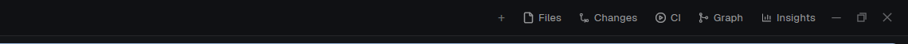

# Dock

A Herdr layout (`main-dock`) whose tab bar draws its side-panel buttons from a file, `~/.config/herdr-app/dock/panels.json`. Add one entry to the file and a new button shows in the bar, with its panel. You do not clone the tab bar or edit the layout again. Remove the entry and the button and its panel go away.



## What you see

The window of Herdr's `main` layout, with the same sidebar, tabs as pills and pane cards. Only the tab bar differs: 44px high (the same as the Kanban bar), 10px right padding, 6px gap. After the row of tab pills (it scrolls sideways):

- `+` (26px, tooltip "New tab"): the new-tab menu (`new-menu` popup, 250 x 512).
- The gear button, in the same rounded group, right of the density button (26px, 8px radius, `mods/tabs-dock/settings.svg` 15px in `muted`, tooltip "Settings"). A click reads `<appHome>/mods/mods-hub/mod.json`: missing, it runs `app.settings`; there, it opens the gear menu, a popup of `tabs-dock` with `part: "gear-menu"` (the size and look of the group menu): the head "Settings", "Herdr settings" (`settings.svg`, runs `app.settings`) and "PowerMods" (`mods.svg`, a copy of `hub.svg` of the mods-hub; it writes `tab: "settings"` into `shared("mods-hub")`, keeping its other fields, then runs `mod.open {name: "mods-hub"}`). The command `tabs-dock.gear` does what a click does.
- The density button, in a rounded group with the gear button (26px, 8px radius, `mods/tabs-dock/density.svg` 15px): it goes `auto` → `compact` → `normal` → `auto` in `shared("kanban.density")`, the same key and steps as the density button of the Kanban bar. It is lit (`accent` on `accent` at 15%) while the buttons show only icons. Its tooltip names the mode and the next one ("Density: Auto (compact now). Click to switch to Compact.").

Then the right end. It is the same as the right end of the Kanban bar (`mods/kanban`), in the same place and size, so a layout switch does not move it. 6px between its parts:

- **Panels**, one rounded group (32px high, 10px radius, 1px `border`, background `foreground` at 6%): first the panel-open button (26px, `mods/tabs-dock/dialog.svg` 14px, lit while a panel button opens a dialog) and a short line (1 x 14px, `foreground` at 15%); then **Files** and **Changes**, when their blocks are in the layout and the welcome screen chose them (`shared("workspace.panels")`; icons `mods/tabs-dock/files.svg` and `mods/tabs-dock/changes.svg`); then one button for each valid `panel` or `tab` entry of `panels.json`, in the file's order; then the `command` entries that are not `layout.switch`. A button is 26px high, 7px radius, 14px icon, `muted`; lit (`accent` text on `accent` at 15%) while its panel is open.
- **Group buttons.** The buttons with the same `group` become one button, in the place of the first of them. Changes is in the `git` group, so `"group": "git"` on Pending and PRs gives one **Git** button (icon `mods/tabs-dock/git.svg`, then a 10px `chevron-down.svg`) in the place of Changes. It is lit while one of its panels is open; its tooltip lists the names ("Git: Changes, Pending, PRs"). A click opens a popup menu at the pointer, 220px wide: the group name (11px semibold, `dim`), then one 32px row per panel with its 15px icon and its full name (13px), and a tick (`tick.svg`) on the open one. A click on a row runs `tabs-dock.<id>` (the same as the panel button) and closes the menu. A group that is not `git` uses its id as its name and the icon of its first panel.
- **Layout switch**, one rounded group: a button for the shown layout (icon `mods/tabs-dock/layout-main.svg`, label from the layout name: `main-dock` → "Main dock") and one for each `layout.switch` entry of `panels.json`. The shown layout is lit. Only names in `layouts()` count, each once. Hidden with fewer than 2 layouts.
- On Windows and Linux the minimize, maximize and close buttons (28px, 7px radius, 2px apart).

The density sets the buttons of both groups: `normal` shows the names, `compact` shows only the icons, and `auto` (or no value) shows the names from 2250px of bar width (`on_size_change`). Without names, the names go to the tooltips ("Show or hide {name}", "Switch to the {name} layout"). The Kanban bar uses the same rule, so the right ends stay the same. `props.lang` `"pt"` gives Portuguese tooltips; the default is English. `shared("herdr-mods.lang")` (`en` or `pt`, set in the mods-hub) wins over the prop. The language is a getter read on every use: do not assign `this.lang`.

The side panel is 368px wide (min 280, max 900), hidden at first, on the right of the work area, with a stack `panel-body`. The stack holds `files`, `changes` and one block for each panel entry.

The `agents` block of the sidebar shows the `agent-cards` mod ([`agent-cards-app`](../agent-cards-app); its recipe describes the cards).

## How it behaves

- A click on a panel button opens the panel on that child (`layout.select` then `layout.show`). A click on the button of the open panel hides it. A click on another button switches the child.
- **Panels in a dialog.** The panel-open button goes `auto` → `side` → `dialog` → `auto` in `shared("kanban.panelOpen")` (absent: `auto`), the same key and steps as in the Kanban bar. A panel button opens a dialog always in `dialog`, and in `auto` while the bar plus the visible `sidebar` (its `size.px`) is narrower than 1600px. The dialog is `openOverlay({ kind: "dialog", width: 0.82, height: 0.85, layout })`: a `column` with a 36px block `{ mod: "tabs-dock", props: { part: "panel-title", panel, label, icon, lang, tab? } }` over a block with the same `content` as the child of `panel-body` (for a tab entry: `{ mod, props? }`). A layout gives the panel a real block, so `v_virtual_list` (the Git panel) draws. The bar saves `{ id, panel }` in `shared("kanban.panelDialog")` and adds the id to `globalThis.__kanbanPanelDialogs`, the same as the Kanban bar, so a dialog opened in one layout stays lit in the other. A button is lit while its panel shows in the side panel or in the dialog. A click on any panel button first closes the open dialog; a click on the button of that dialog stops there. The `panel-title` part draws the 14px icon, the name (13px semibold) and 2 icon buttons of 26px: `panel.svg` (show that child in the side panel) or, for a tab entry, `open.svg` (its tab), and `close.svg`. Its `close()` removes the id and clears the key when it names this dialog. The command `tabs-dock.panel-open` steps the mode.
- The open panel is remembered for each space (`localStorage` key `panels` of the tab bar): switching space restores that space's panel, or hides it if the space never had one. While the bar adds blocks, a saved choice such as `graph` is not lost: it waits up to 3 s.
- **Entry kinds.** `"opens": "panel"` (default) adds a block to `panel-body`. `"opens": "tab"` makes the button focus the space's tab that shows `mod` as its only pane, or make that tab with `tab.new {name, mod}`. It adds no block.
- **The file is live.** The bar watches `dock/` (`watchFolder`). Each save reloads the list. A missing file is an empty list. A file with broken JSON, or without a `panels` array, keeps the last good list and posts an error toast (`Dock: panels.json`). A bad entry (a wrong id, a missing label or icon, a `mod` that is not in `mods/`, a repeated id) is skipped, and the toast names the first one. The other entries still work.
- **Adding blocks.** A panel entry whose block is missing is added to the layout with one `layout.set` of the whole tree, read from `layout()` and written back with the new child. The same call removes the blocks that this bar added before and the file no longer lists. The bar remembers the ones it added in `localStorage` key `injected`.
- **One try.** The bar tries once for each pair of layout name and file version. A layout that refuses the edit (a shipped layout, such as Herdr's own `main`) is not tried again until the file changes.
- An entry whose `id` is the id of another node of the layout (`main`, `status`, `agents`, ...) is ignored.
- Keys: a command `tabs-dock.<id>` toggles that panel as its button does (`nextCommand`). Bind it in `keys.json`, for example `"layout:main-dock": { "ctrl-alt-shift-g": "tabs-dock.repos" }`. The command `tabs-dock.density` steps the density, as the density button does. The command `tabs-dock.group-<group>` opens the menu of a group button (`tabs-dock.group-git`). Ask before taking a key that the person already uses.
- Agent statuses show on the tab pills as in Herdr's tab bar: a spinner (`working`), a dot in `blocked` or `done` color. `idle` shows nothing.
- **Agent cards on and off.** The mods-hub setting **Agent cards** (`shared("agent-cards.enabled")`, `kit.json` of `agent-cards` in [`agent-cards-app`](../agent-cards-app); absent means on) chooses the mod of the `agents` block. The tab bar reads it on every render: when the block's mod is `agents` or `agent-cards` and is not the chosen one, it changes `content.mod` with one `layout.set` (one try for each layout and choice; not in the same render as a panel edit). Off shows Herdr's own `agents` list. The command `tabs-dock.agent-cards` flips the setting.

### `panels.json`

```json
{
  "panels": [
    { "id": "repos", "label": "Dashboard", "icon": "mods/tabs-dock/repos.svg", "mod": "git-dash", "group": "git" },
    { "id": "ci", "label": "CI", "icon": "mods/tabs-dock/ci.svg", "mod": "ci-dash", "props": { "repo": "owner/name" } },
    { "id": "insights", "label": "Insights", "icon": "mods/insights/insights.svg", "mod": "insights", "opens": "tab", "name": "Insights" }
  ]
}
```

| Field | Meaning |
| ----- | ------- |
| `id` | `a-z`, `0-9`, `-`, 1 to 32 characters, unique. It is the stack child id and the key command name. |
| `label` | The button text. |
| `icon` | A `.svg` (drawn in the text color) or a picture, a path in the Herdr home. |
| `mod` | The folder in `mods/` that the panel (or the tab) shows. It must exist. |
| `props` | Optional. Passed to the mod as its `props()`. |
| `opens` | `"panel"` (default) or `"tab"`. |
| `name` | For `"tab"`: the tab name. Default: `label`. |
| `group` | Optional. `a-z`, `0-9`, `-`. The entries with the same group share one button with a menu. `"git"` puts the entry with Changes, under the **Git** button. |

## Built from

- `layouts/main-dock.json`: Herdr's `main` layout, the same in 0.1.11 and 0.1.12 (a row: `sidebar` with `brand`, `spaces`, `agents`, `sidebar-footer`; `work` column with `tabs` 44px (42px in `main`), `work-body`, `status` 28px), with `tabs` set to the mod `tabs-dock`, `agents` set to the mod `agent-cards` (from [`agent-cards-app`](../agent-cards-app)), and `panel-body` holding only `files` (mod `files-md`) and `changes` (mod `git-client`, from [`git-client-app`](../git-client-app)). Ids `panel`, `panel-body`, `files` and `changes` must stay: the bar and other mods look them up.
- `mods/tabs-dock/`, `mod.json` `{ "place": "none", "title": "Dock tabs" }`. `main.js` is Herdr's `tabs` mod (tab pills, drag to reorder, rename, close, window buttons, per-space panel memory) with the dock added. `props.part` `"panel-title"` draws the title row of a panel dialog instead of the bar, and `"group-menu"` draws the menu of a group button (a `popup` overlay with an explicit `height`: 2 x 5px padding + 26px title + 32px a row, because a popup does not size itself). The icons of the panel group are [Lucide](https://lucide.dev) icons (ISC license), `lucide-static` 0.460.0: `files.svg` (folder-tree), `changes.svg` (file-diff), `git.svg` (git-branch), `graph.svg` (git-graph), `repos.svg` (folder-git-2), `ci.svg` (workflow), `chevron-down.svg`, `tick.svg` (check). `panels.json` can point at them.
- `herdr` functions: `layout()`, `shared()`, `spaces()`, `panes()`, `appHome()`, `readTextFile`, `watchFolder`, `nextCommand`, `notify`, `openOverlay`, `run`. Commands: `layout.set`, `layout.select`, `layout.show`, `layout.hide`, `tab.new`, `tab.select`, `tab.move`, `tab.rename`, `tab.close`, `tab.next`, `tab.prev`, `pane.focus`, `pane.zoom`, `window.*`. `fs/promises`: `mkdir`, `readdir`.
- `mods/files-md/`, `mod.json` `{ "place": "none", "cloned_from": { "name": "files", "version": "0.1.12" } }`. `main.js` is Herdr's `files` mod with these changes. A click on a Markdown file shows it in the panel preview with `TextView.markdown(id, text)` (id includes the file path, `selectable(true)`, `scrollable(false)`, inside a scrolling `div`), and a header button, **Source** / **Rendered**, switches to a read-only `Editor`. Any other text file shows in a read-only `Editor` with syntax colors from the theme's `ansi` colors; the `LANG` table maps an extension to a language name the editor knows (`py`, `cs`, `rs`, `go`, `java`, `c`, `cpp`, `ruby`, `sql`, `php`, `lua`, `js`, `json`, `html`, `css`, `yaml`, `bash`; names such as `markdown`, `ts`, `toml` and `rb` are not known and must be mapped). A file with a null byte shows "Binary file"; text over 400,000 characters is cut. A click on an image shows it in the panel preview: `image()` loads only paths inside the app folder, so the file is copied to `data/files-md/<hash>-<time>.<ext>` (PowerShell `Copy-Item` and `System.Drawing` for the width and height on Windows; `cp` and no size elsewhere; at most 64 MB) and drawn fit to the preview (never above 100%), or at a scale with scrollbars. The header has a zoom bar: **Fit**, **100%**, **−**, the scale in percent, **+** (steps 10, 25, 50, 75, 100, 150, 200, 300, 400 and 800%; − and + step from the scale on screen). The keys `+`/`=`, `-`, `0` and `f` and Ctrl + wheel (one step per 40 px of wheel) zoom too. When the size is not known, 100% is the box of the visible area. The space comes from `on_size_change` on the root, divided by `settings().zoom`, minus the 42 px header, the padding and the border. The header shows the path, the size and the bytes. The copy is deleted when another file opens, on ← or Esc, and in `close()`; copies older than 1 day are deleted at start (`sh -c 'find …'`: a bare `find` on Windows is `find.exe`, which waits for input). Images on another machine show a message. The menu item Open in Image Viewer runs `pane.split` with the mod `image-viewer` (props `file`, `fileOn`); an open pane of that mod is closed first; it shows only when the tab has a terminal pane. A right-click on a row (`on_mouse_down("right")`) opens the popup `files-md-menu` at the pointer (230 px wide, 31 px a row, 5 px padding, 9 px a divider) with the items as props. Its icons are its own, one-color `svg()` files in `mods/files-md/`: `chevron-down`, `chevron-right`, `file`, `folder`, `folder-open`, `file-markdown`, `file-code`, `file-json`, `file-image`, `file-terminal`, `file-config`, `file-text`, `file-archive` and `file-table`. A `KINDS` table maps a file name to an icon and a color (a theme `ansi` name, or a hex color for folders `#e0a526` and JSON `#e07b39`, because the theme's yellow is nearly black on a light theme); the row's `svg` is 14 px.
- `mods/files-md-menu/`, `mod.json` `{ "place": "none" }`. `main.js` draws a list of items from `props().items`. An item has `label` and any of `copy` (text for the clipboard, `cx.write_to_clipboard`, written before the popup closes), `exec` (`[program, [args]]`, run with `exec`; a nonzero exit shows an error toast, except `explorer`, which exits 1 when it works) and `cmds` (`[[command, args], ...]` for `run`), `share` (`[key, value]` for `setShared`) and `on` (the machine for `exec`); `icon` names `mods/files-md-menu/<icon>.svg` (`external-link`, `folder-open`, `book-open`, `terminal`, `square-plus`, `copy`, `link`, `type`, `file-plus`, `folder-plus`, `scissors`, `clipboard-paste`, `copy-plus`, `pencil`, `trash`), drawn 14 px in the muted color; `sep: true` draws a divider above; `danger: true` draws the row in `ansi1`. An item with `ask: { title, value, select: [start, end] }` first shows a text field in the popup (an `InputState`, focused again after 40 ms; Enter submits; an empty name, `.`, `..`, `/`, and on local Windows `\ : * ? " < > |` show an error); in its `exec` arguments `{{value}}` becomes the text and `{{value:ps}}` the text as a PowerShell string. An item with `confirm: { title, button }` first shows the question with Cancel and the button. Up, down, Enter and Escape work. `files-md` builds the items: Open with default app (`Invoke-Item -LiteralPath`, `open`, `xdg-open`), Open in Markdown Reader (only when `mods/markdown-reader/mod.json` can be read), Show in Explorer (`explorer` with the two arguments `/select,` and the path with backslashes; a path with forward slashes opens Documents), Open in Explorer, Open terminal here (`terminal.open {folder, place: "right"}`), Open in new space (`space.new {folder}`), the edit items, and the three Copy items. Folders on another machine get no open items. The edit items (the `FS` table: PowerShell on local Windows, `sh` elsewhere, with `on` set to the folder's machine): New file… and New folder… (folders and the empty area of the tree, which opens the menu for the root; the row handler calls `cx.stop_propagation()`), Cut and Copy (`setShared("files-md.clipboard", { path, name, cut, on })`), Paste “name” (only when the kept item is on the same machine; into the folder, or the folder of a file; a move fails when the name is there, a copy gets a free name `name - Copy (2).ext` on Windows or `name copy 2.ext` with `sh`; a folder cannot go into itself; after a move the key is set to null), Duplicate (the same free name), Rename… (the name selected without its extension; a change of case only is allowed) and Delete (confirm; `Microsoft.VisualBasic.FileIO.FileSystem` with `SendToRecycleBin` on Windows, `rm -rf` elsewhere). A filter field (`InputState`, placeholder "Filter files (fuzzy)…", 34 px, search icon `search.svg`, clear icon `x.svg`) sits under the header when no file is open. `init` focuses it, and again after 40 ms (`cx.timer.after`); the ← button focuses it again after 40 ms. Its text, after a 70 ms pause in the typing, is matched by `fuzzy.js` (the fzf "v1" method of `repo-launcher/fuzzy.js`: every word must be a subsequence of the name, counted twice, or of the relative path; bonuses for the first letter, word starts, camel case and runs) against an index of the root: `git ls-files -z --cached --others --exclude-standard` in a Git work tree, else a recursive PowerShell walk (local Windows) or `find` that skips `.git` and `node_modules`; the folders of each path are entries too; at most 20,000 entries. The index is built on the first search and again after a folder-watch event (on another machine, on the 10 s timer). When the text only grows, the search runs on the last matches. The best 200 results show as a flat list (icon, name and parent path with bold accent letters, Git mark); ↑/↓ move the pick, Enter (`submit`) or a click opens it, Esc and × clear the field, and Esc with an empty field closes the panel dialog (`props().overlay`, else the id in `shared("kanban.panelDialog")`), because the focused field keeps Esc from Herdr; a file opens in the preview (← goes back to the results), a folder opens it and its parents in the tree and clears the filter; right-click opens the row menu. The popup opens at `at: { x, y }` from the mouse event's `position`, because `at: "pointer"` uses the last spot that the layout saw and is wrong when the panel is a dialog.
- Shipped mods it uses: `workspace-chrome`, `spaces`, `agents` (when Agent cards is off), `pane`, `workspace-status`, `new-menu`, `menu`. Mods of this repository in the layout: `git-client` ([`git-client-app`](../git-client-app)), for the Changes panel (the Git panel), and `agent-cards` ([`agent-cards-app`](../agent-cards-app)), for the agents list. Mods it opens from the menu: `image-viewer` (this repository, optional), and `markdown-reader` (third party, optional).
- Art: `win-min.svg`, `win-max.svg`, `win-restore.svg`, `win-close.svg` in `mods/tabs-dock/` (vector window icons), and `dialog.svg`, `panel.svg`, `open.svg`, `close.svg` (24px stroke icons, the same as in `mods/kanban/`) for the panel-open button and the dialog title.
- The tab bar reads `mods/` (a folder list) and `dock/panels.json` in the Herdr home and runs no program. `files-md` runs `powershell` or `sh` to list folders (no `git status` and no change marks: the Changes panel shows changes), the filter runs `git ls-files` when it builds its index, and a click on a menu item runs `powershell`, `sh`, `explorer`, `open` or `xdg-open`. Nothing uses the network.

## Watch out

- **`layout.set` only works on personal layouts.** Herdr's own `main` refuses it, so this is a layout of its own. Clone it again from the shipped `main` when Herdr changes the tab bar: this copy is frozen at 0.1.12 (it equals 0.1.11). To merge a Herdr update, compare the new shipped `main.json` and `mods/tabs/main.js` with this copy: only your own edits (the `tabs` mod name, `panel-body` children, the dock code in the bar) should differ.
- `layout.set` replaces the whole tree. Read `layout()` and change only `panel-body`, or you lose the person's other edits. A block does not keep unknown fields (a `"dock": true` marker was dropped), so the bar keeps its own list of the blocks it added.
- Never call `layout.set` from `render()` without a guard: it re-renders. The bar keeps a key of layout name plus file version and tries once for each key.
- `watchFolder` needs a folder that exists. The bar makes `dock/` with `mkdir` before it watches. Watch `dock/`, not the Herdr home: the home changes all the time.
- Keep `panels.json` outside `mods/`: a reinstall of the mod replaces its folder.
- Write `mod.json` before `main.js` in a new mod folder, or Herdr docks a copy of the mod into the shown layout.
- Blocks removed from the file are removed from the layout only if this bar added them. A block you wrote by hand in `panel-body` stays.
- A panel entry needs its mod to be a panel (it fills a block). A mod made for panes only may look wrong in 368px.
- The agent cards replace the block's mod, not the block: keep the id `agents`, because the tab bar looks it up. A block with any other mod is never changed.
- Untested: macOS, Linux, a remote machine's window.

## Done when

- `herdr-app check ~/.config/herdr-app/mods/tabs-dock` passes, and `herdr-app status` shows `"layout": "main-dock"` and `"errors": []`.
- With no `panels.json`, the bar shows Files and Changes only, and both open their panels.
- Add `{ "id": "ci", ... }` to `panels.json` while the app runs: within 5 s a CI button shows, `layouts/main-dock.json` has a `ci` child in `panel-body`, and a click on the button opens the panel.
- Remove that entry: the button goes and the `graph` child leaves the file. A block that you added by hand stays.
- Save `{ "panels": [ ` (broken): an error toast shows, and the buttons stay as they were.
- An entry with `"mod": "does-not-exist"`, or with `"id": "main"`, is skipped, and the other entries work.
- An entry with `"opens": "tab"` focuses its tab on the second click, and does not make a second tab.
- Open CI in space A and close the panel in space B: switching between the spaces restores each choice.
- `herdr-app do tabs-dock.agent-cards` changes the `agents` block of `layouts/main-dock.json` to `"mod": "agents"`, and the next run changes it back to `"mod": "agent-cards"`. The block's size stays.
- With `"group": "git"` on Pending and PRs, the bar shows one **Git** button in the place of Changes, and no Changes, Pending or PRs buttons. `herdr-app do tabs-dock.group-git` opens its menu with the rows Changes, Pending, PRs. After `herdr-app do tabs-dock.repos`, the Git button is lit and the menu shows a tick on Pending.
