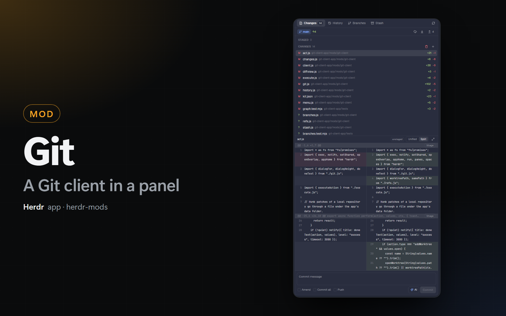

# Git for the Herdr app



A Herdr app mod: a Git client in one panel, for the daily work with Git. It joins the Changes panel (with a Unified / Split diff) and the commit graph of [Git Graph for Herdr](https://github.com/rabeeh-ta/herdr-git-graph) by rabeeh-ta (MIT license). The panel follows the repository of the focused terminal, also on another machine of Herdr.

The [Kanban](../kanban-app) and [Dock](../dock-app) layouts of this repository show it as their Changes panel.

## What it shows

- **Tabs:** **Changes** (with the number of changed files), **History**, **Branches** and **Stash** (with the number of stashes). In a panel narrower than 420 px the tabs show only their icons.
- **Branch bar:** the branch, how far it is ahead (↑) and behind (↓) its upstream, and 3 buttons: **Fetch** (all remotes, with `--prune` unless you turn it off), **Pull** (as the Pull setting says) and **Push** (sets the upstream on the first push). Right-click **Push** to force push with `--force-with-lease`; it asks first.

### Changes

- **Lists:** **Conflicts** (only during a merge, a rebase, a cherry-pick or a revert), **Staged** and **Changes** (the files that are not staged, untracked ones too). Point at a file for its buttons: **Stage**, **Unstage**, **Discard** (or **Delete** for an untracked file), **Mark resolved**. The title of a list has **Stage all**, **Unstage all** and **Discard all**. Right-click a file for the same actions, **Open file** and **Copy path**. Discard and delete ask first.
- **Diff:** a click on a file shows its diff under the lists: the diff of the index for a staged file, of the work tree for the others. The **Unified / Split** switch sets the view for every copy of the panel. **Expand** opens the diff in a wide dialog.
- **Hunks:** a click on the `@@` row of a hunk (or a right-click on any of its lines) opens a menu: **Stage hunk**, **Unstage hunk** or **Discard hunk**. An untracked file stages as a whole.
- **Commit box:** the message (more lines grow the box; Ctrl+Enter commits), and **Amend** (an empty box gets the last message), **Commit all** (stages every change first; not with conflicts) and **Push** (pushes after the commit). The button says what it does: `Commit 3 files`, `Amend`, `Commit all & push`.
- **AI:** writes the message from the staged changes (all the changes with Commit all) with Claude Code or Codex. You can edit the message before you commit.
- **Operation in progress:** a bar shows the operation and the number of files in conflict, with **Continue** (when no conflict is left) and **Abort** (asks first).

### History

- The graph of Git Graph for Herdr: a lane for each branch, labels for branches, remote branches and tags, the details and the diffs of a commit. A double-click on a label checks it out. A right-click on a commit or a label opens its actions: checkout, create branch, tag, merge, rebase, cherry-pick, revert, reset, rename, delete, push, copy.
- **All branches / Current** and **Remotes** choose what the graph shows.
- **Search:** type and press Enter. Plain text searches the messages, a hash finds that commit, `author:<name>` and `path:<file>` filter by author and by file (quotes keep spaces: `path:"src/a b.js"`). Git searches the whole history; the list shows the commits without lanes. Esc or × clears it.
- The **Uncommitted changes** row opens the Changes tab.

### Branches

A filter field at the top finds branches and tags by name. Each section opens and closes with a click on its title. A click (or a right-click) on a row opens its menu.

- **Local:** the checked-out branch first (a check mark), its upstream, ↑ and ↓ (or `gone`) and its age. Menu: Checkout, Create branch from here, Rename, Delete, Merge into the current branch, Rebase the current branch on it, Push, Force push (with lease), Set upstream, Copy name. **+** makes a branch from HEAD.
- **Remote:** the remote branches, by remote. Menu: Checkout (a tracking branch), Merge, Delete on the remote, Copy name.
- **Tags:** Delete, Push, Copy name. **+** makes a tag at HEAD (a message makes an annotated tag).
- **Remotes:** each remote and its URL. Menu: Fetch, Rename, Change URL, Remove, Copy URL. **+** adds a remote.
- **Worktrees:** each worktree, its branch, its folder, its number of changed files and the badges `main`, `here`, `locked` and `gone`. Menu: Open in a space (the space that shows that folder, else a new space), Lock or Unlock, Remove (asks; Force only when you tick it), Copy path. **+** makes a worktree: a new or an existing branch, in `<repo>-<branch>` next to the repository unless you type a folder, and opens it in a new space. **×** prunes the worktrees whose folder is gone.

### Stash

The stashes, newest first, with their branch and age. **New stash…** stashes the uncommitted changes (a message, untracked files too). A click on a stash shows its files and the diff of a file, with **Apply**, **Pop** and **Drop…** (asks). Right-click a stash for the same menu.

## Settings

In the **Settings** tab of Herdr Mods:

- **Diff view:** Unified or Split (`shared("git-client.view")`).
- **Pull:** Git config (what `pull.rebase` and `pull.ff` say; the default), Fast-forward only, Rebase or Merge.
- **Fetch prunes:** Fetch removes the remote branches that are gone (on by default).
- **AI program:** Auto (Claude Code when it is installed, else Codex), Claude Code or Codex.
- **AI model:** empty means `haiku` for Claude Code and `gpt-6-luna` for Codex.
- **Message format:** the same style as the last 20 commit subjects, Conventional Commits, or free.
- **Extra instructions:** text added to every request, for example `Write in English.`

The first time, the mod takes the Unified / Split choice of `changes-split` and the column widths of `git-graph`, if you had them.

## Commands

`git-client.changes`, `git-client.history`, `git-client.branches`, `git-client.stash`, `git-client.commit`, `git-client.fetch`, `git-client.pull`, `git-client.push`, `git-client.refresh`, `git-client.split`, `git-client.unified` and `git-client.toggle`, for example from `keys.json`. They reach a copy of the panel that shows. The mod binds no key.

## Install

With an agent (Claude Code or any agent that can read files), paste this prompt:

`Read ~/.config/herdr-app/AGENTS.md, then add this mod: https://github.com/dougcunha/herdr-mods/tree/main/git-client-app`

Or copy the folder yourself. The Herdr app must be running. Copy `mod.json` first:

```powershell
$to = "$env:USERPROFILE\.config\herdr-app\mods\git-client"
New-Item -ItemType Directory -Force $to | Out-Null
Copy-Item git-client-app\mods\git-client\mod.json $to
Copy-Item -Recurse -Force git-client-app\mods\git-client\* $to
herdr-app check $to
```

The mod has `"place": "none"`: it adds no panel by itself. In a layout of your own, set `content.mod` of the Changes block to `git-client`. Keep the block id `changes`: the tab bars find the panel by that id.

```json
{ "id": "changes", "type": "block", "content": { "mod": "git-client" } }
```

## What it runs, and its limits

- `git` through the app's `exec`, in the repository of the panel, on its machine. The reads use `--no-optional-locks` and write nothing under `.git`.
- Hunks: `git apply` with a patch. In a local repository the patch goes to a file under `~/.config/herdr-app/data/git-client/`, which the mod deletes at once. On another machine it goes through `sh -c` (a Unix machine).
- **AI:** `claude -p` or `codex exec`, only when you click **AI**. The staged diff (cut to 6,000 characters), its `--stat` and the last 20 commit subjects go to that program.
- **Open file:** the default app of the system, only on this computer.
- **Continue** runs `git <operation> --continue` with `core.editor=true`: Git keeps the message that it prepared.
- Push pushes the current branch to the remote of its upstream (else `origin`).
- Branches runs one `for-each-ref`, `remote -v`, `worktree list` and a `status` in each worktree (the first 20), when the tab shows. **New worktree** makes a folder next to the repository and **Open in a space** opens a Herdr space there.
- Stash shows the untracked files of a stash with git 2.32 or newer.
- The Expand dialog shows the diff only: stage hunks in the panel.
- With **Commit all**, the AI sees the changes of tracked files, not the new untracked files.
- A list shows its first 300 files; the "all" buttons act on every file.
- No Submodules tab, no file history or blame, and no agent for conflicts yet: they come in the next version.
- A menu opens at the spot of the click, also in the panel dialog of the dock.
- Tested on Windows. The `sh -c` route for another machine is tested on Windows with Git's `sh`.

## Tests

`node tests/graph.test.mjs` runs the tests of Git Graph for Herdr and the tests of the Changes, Branches and Stash tabs (`tests/changes.test.mjs`, `tests/branches.test.mjs`) against throwaway repositories. On Windows, put Git's `usr\bin` in `PATH` first (the tests run `mkdir` and `sh`).

## Credit

The History tab, the menus, the dialogs and the actions are based on [Git Graph for Herdr](https://github.com/rabeeh-ta/herdr-git-graph) by rabeeh-ta, v0.3.2, MIT license (`LICENSE`). The icons are drawn after [Lucide](https://lucide.dev) (ISC license, `icons/LICENSE-lucide.txt`).
