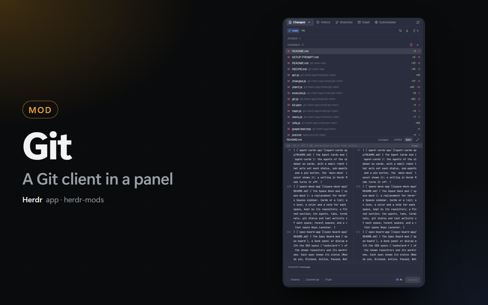

# Git

A Git client in one Herdr panel: a **Changes** tab that stages files and hunks and commits (amend, commit all, push after, an AI message), and a **History** tab with the commit graph of Git Graph for Herdr. A bar under the tabs shows the branch and has Fetch, Pull and Push. The panel follows the repository of the focused terminal.

## What you see

Top to bottom, in a panel of any width (the side panel is 368 px):

1. **Tab bar**, 40 px, a border under it: 2 tabs of 30 px (14 px icon, 12.5 px label, rounded 7 px; the shown one `selected` and semibold). **Changes** has a count pill (`raised`, 10.5 px) with the number of changed files. Under 420 px wide, the tabs show only the icon, with the name as a tooltip. At the right: a Refresh icon button.
2. **Branch bar**, 34 px: a pill (`accent` at 15% alpha, `accent` text) with a branch icon and the branch (or `detached at <hash>`), its tooltip `branch → upstream`; `↑n` in `ansi2` and `↓n` in `ansi1`; `gone` when the upstream is gone. At the right, only when the repository has a remote: Fetch (`cloud-down`), Pull (`pull`, with the behind count) and Push (`push-line`, with the ahead count), 26 px each.
3. **The tab.**

**Changes tab:**

- An operation bar, only during a merge, rebase, cherry-pick or revert: a rounded box (`ansi1` border and 8% fill with conflicts, else `blocked`), an `alert` icon, "`Merge` in progress" and "n files in conflict…" or "No conflicts left…", and the buttons **Abort** and **Continue** (`solid`; disabled while there are conflicts).
- The lists, in a scrolling box as tall as its rows, at most 38% of the panel: section titles of 28 px (11 px, `dim`, upper case, a count, and icon buttons at the right: Unstage all; Discard all and Stage all) and file rows of 26 px: the status letter (12 px wide; `ansi2` added or untracked `?`, `ansi1` deleted or conflict `U`, `blocked` modified), the name, the folder in `dim` 11 px, and `+n` / `−n`. Under the pointer the counts give way to 22 px icon buttons (`trash` in `ansi1`, `plus`, `minus`, `check`). The open file is `selected`.
- The diff bar, 32 px between borders: the file name, a `staged` / `unstaged` / `conflict` tag, the Unified / Split switch (24 px) and an Expand icon button.
- The diff, the rest of the height, in the monospace font at 11 px, 20 px rows: `@@` rows on `raised` with a small pill at the right (`Stage` or `Unstage`) when the hunk can be applied; added lines `ansi2` at 9%, removed lines `ansi1` at 9%; 30 px line numbers. Split: the old file left, the new file right, each half wraps its lines.
- The commit box, a border above it: a textarea (2 to 8 rows, `accent` border while typing; Ctrl+Enter commits), then the toggles **Amend**, **Commit all**, **Push** (13 px boxes), the **AI** button (`sparkles` icon in `accent`) and the commit button (`solid` when it can commit, else `raised`): `Commit n files`, `Amend`, `Commit all`, with ` & push`.

**History tab:** a search row of 36 px (a 26 px field with a `search` icon; with a search, the count of commits and a × button), the toolbar of Git Graph (All branches / Current, Remotes; hidden during a search), the column header (Graph, Description, Date; Author and Commit from 600 px) and the rows of 24 px, then the details pane of a commit (320 px). During a search the graph column is 18 px with no lanes.

## How it behaves

- The panel reads the repository of the focused pane (`panes()[i].cwd`), on its machine (`spaces()[i].machine`), or `props.folder`. A new folder shows its last state at once and reads again.
- The History part is the one reader: one `git log`, refs and `git status --porcelain=v1 -z --no-renames --untracked-files=all --branch` in a round, a `watchFolder` on the work tree (and on the common `.git` of a linked worktree), a status read at most every 1.5 s, a full read when refs change, and a 15 s timer for a remote repository. After every read it calls the Changes part, which reads `git diff --cached --numstat`, `git diff --numstat`, the operation files under `.git` and the shown diff.
- A click on a file shows its diff; a second click closes it. The first file shows by itself until you close one.
- Hunk: a click on the `@@` row, or a right-click on a line, opens a popup menu at the pointer with the actions of that side. The patch is the header of `git diff` of that file plus that hunk.
- An action from the panel, a menu or a dialog sets `shared("git-client.changed")`; every copy reads again.
- The Uncommitted row of History and **Show in Changes** set `shared("git-client.show")` = `{ tab, at }`; every copy shows that tab.
- Esc: in the commit box it leaves the box (in a dialog, an empty box closes the dialog); in the search it clears the text, then closes a dialog; in History it closes a diff, the details, then the search; else it closes the dialog of the panel.
- When the mod is off in Herdr Mods (`herdr-mods.disabled`), it draws nothing, closes its dialog and skips its timers.

## Built from

- `mods/git-client/`, `mod.json` `{ "place": "none", "title": "Git" }`.
- `main.js`: the roles (`props.role`): `menu` (the popup menu), `dialog` (an action dialog), `diff` (the Expand dialog), else the panel.
- `client.js`: the panel: the tabs, the branch bar, Esc, the commands (`nextCommand`), `pushNow` (reads HEAD again, then `push [--set-upstream] <remote> <branch>`).
- `history.js`: Git Graph's `graph.js` without the Manygit list and the self-update, plus the search and the status of the branch.
- `changes.js`: the Changes tab. `diffview.js`: the Unified / Split diff in a `v_virtual_list` (rows report clicks with `on_item_click` and `on_item_secondary_click`).
- `git.js`: no herdr imports, tested with node: status, branch, log and search arguments, hunks (`parsePatch`, `hunkPatch`, `patchRows`, `splitRows`), menus, dialogs, `commandsFor` (paths after `--literal-pathspecs … --`, in chunks of 100), the AI prompt.
- `execute.js`: runs an action; a HEAD and branch check before actions that move a branch; hunks with `git apply [--cached] [-R]` through a file (`act.js` writes it under `appHome()/data/git-client/` with `fs`) or `sh -c 'printf "%s" "$1" | git apply … -'` on another machine.
- `ai.js`: `claude -p <prompt> --model <m> --no-session-persistence --tools ""` or `codex exec -m <m> --skip-git-repo-check --ephemeral -s read-only <prompt>`, on the machine of the repository, 120 s time limit.
- `menu.js`, `dialog.js`, `lanes.js`: from Git Graph for Herdr.
- Shared keys: `git-client.view`, `git-client.ai` (`provider`, `model`, `format`, `instructions`), `git-client.columns`, `git-client.changed`, `git-client.show`. First values from `changes-split.view` and `git-graph.columns`.
- Icons: Lucide (ISC), in `icons/`.

## Watch out

- `exec` has no input: a patch for `git apply` needs a file (here) or an argument of `sh -c` (another machine).
- Build a hunk patch from the raw `git diff` output, never from the shown rows: they cut long lines and long diffs.
- A combined diff (a conflict, `@@@`) has no hunks that `git apply` takes: show it, do not offer hunk actions.
- Stage all must never stage files in conflict: it stages the listed paths, and Commit all refuses while `git ls-files --unmerged` lists files.
- `git merge --continue` opens an editor unless `core.editor=true` is set for the call.
- A filtered `git log` has parents that are not in the list: draw it without lanes.
- The prompt of the AI is one argument: keep the diff short (6,000 characters): a `.cmd` shim on Windows takes 8,191 characters in all.
- A virtual list row cannot hold its own buttons.
- `herdr-app check` does not show later async states: test in the app with `herdr-app shot`.

## Done when

- `herdr-app check ~/.config/herdr-app/mods/git-client` passes, and `node tests/graph.test.mjs` prints `all tests passed`.
- In `main-dock`, the Changes panel shows the tabs Changes and History and the branch bar of the focused repository.
- A changed file shows in Changes; Stage moves it to Staged; a click on a hunk row and **Stage hunk** stages only that hunk.
- With a message and a staged file, the commit button commits; `git log -1` shows the message.
- `herdr-app do git-client.history` shows the graph; a search with `author:` shows only those commits.
- A merge with a conflict shows the operation bar; **Abort** asks and ends the merge.
