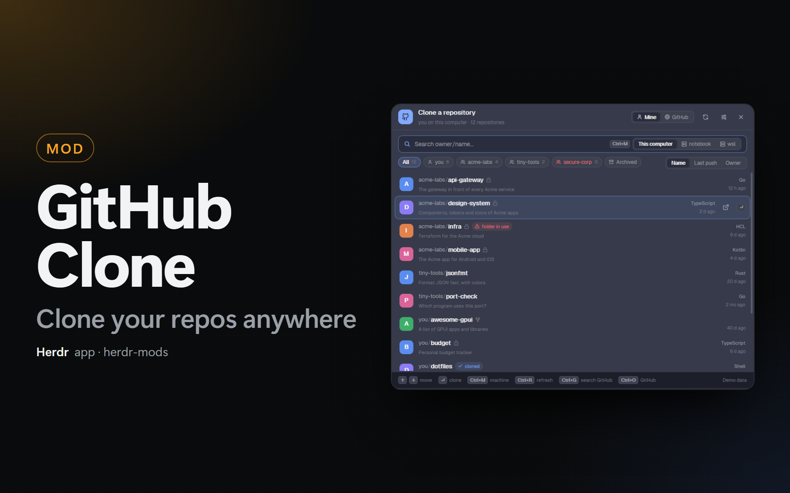

# GitHub Clone for the Herdr app



A Herdr app mod that clones a GitHub repository from a dialog. Press `Alt+G` (or click **Clone** in the Dock bar, or the GitHub button of Repo Launcher), find the repository, check the folder and press Enter. The clone runs in a terminal of a new space, on this computer or on another machine of Herdr.

- **The repositories of your account.** Every repository that the `gh` account owns, works on as a collaborator, or sees as a member of an organization.
- **Each machine with its own account.** The machine picker (`Ctrl+M`) selects where the list comes from: the list comes from the `gh` of that machine, and the clone runs there with the same account. A machine of `hc machine ls` works the same as this computer.
- **Owner chips.** **All**, your user and 1 chip for each organization, with a count. An organization with no repositories in the list shows in red: the `gh` token may need SSO authorization for it.
- **Fuzzy search.** Type a part of `owner/name`: `hm` finds `herdr-mods`. Words separated by a space can match the owner or the name.
- **Archived chip.** The archived repositories are hidden until you click **Archived**.
- **Order.** Name (the default), Last push or Owner. The choice stays.
- **Cloned mark.** A repository that is cloned in its folder already shows **cloned**. A folder with the same name and other content shows **folder in use**. The mod does not clone over them: it asks for another folder.
- **Search all of GitHub.** The **GitHub** tab (`Ctrl+G`) searches every public repository with `gh search repos`. Type words of the name or the description; the search starts after a short pause. Qualifiers work too (`topic:cli`, `org:vercel`, `user:torvalds`, `language:rust`, `stars:>500`, `-topic:deprecated`), and chips write the common ones. Sort by best match, stars or last update; 30 results, and **More results** up to 100. A result clones the same way as your own repositories.
- **Open on GitHub.** `Ctrl+O`, or the arrow button of the selected row or of the clone step, opens the page of the repository in your browser.
- **Clone step.** The folder (with a check that it is free), the branch (with the branches of the repository as suggestions) and a **Shallow clone** switch (`--depth 1`). The step shows the command that it runs.
- **A visible clone.** A new space starts a shell in the parent folder and runs `gh repo clone`. You see the progress and can answer a prompt (an SSH passphrase, a host key). At the end, the shell is in the new folder, and the space takes the name of the repository.
- **Clone folders.** 1 folder for each machine (`~` is the home folder of that machine), and owner rules: the repositories of 1 owner go to another folder on 1 machine. Open them with the gear of the dialog.
- **Repo Launcher.** A new clone goes into the list of Repo Launcher at once, so `Ctrl+P` finds it. When a clone folder is outside the folders of Repo Launcher, the folder settings say so and offer **Add to Repo Launcher**. The mod works without Repo Launcher.

The mod only clones. To open a repository, use [Repo Launcher](../repo-launcher-app).

[`RECIPE.md`](RECIPE.md) describes the mod in full.

## Install

With an agent (Claude Code or any agent that can read files), paste this prompt:

`Read ~/.config/herdr-app/AGENTS.md, then add this mod: https://github.com/dougcunha/herdr-mods/tree/main/github-clone-app and merge its keys.json`

Or copy the folder yourself. The Herdr app must be running. Copy `mod.json` first: without it, Herdr docks a stray copy of the mod in your layout.

```sh
cp -r github-clone-app/mods/github-clone ~/.config/herdr-app/mods/github-clone
herdr-app check ~/.config/herdr-app/mods/github-clone
```

Then add the key to the `global` section of `~/.config/herdr-app/keys.json` (the file [`keys.json`](keys.json) has it):

```json
"alt-g": "mod.open:github-clone"
```

For a button in the Dock and Kanban bars, add this entry to `~/.config/herdr-app/dock/panels.json`:

```json
{ "id": "github-clone", "label": "Clone", "icon": "mods/github-clone/github.svg", "opens": "command", "run": "mod.open", "args": { "name": "github-clone" } }
```

Without a key, open it with `herdr-app do mod.open --name github-clone`, or from the command palette.

## First use

1. Press `Alt+G`.
2. Wait for the list. The first read takes a few seconds (about 3 s for 160 repositories); the next openings show the saved list at once.
3. Type a part of the name and press Enter.
4. Check the folder. With no clone folder for the machine yet, the step suggests the first folder of Repo Launcher, and **Save … as the clone folder** saves its parent folder.
5. Press Enter, or click **Clone**.

## Keys

| Where | Key | What it does |
| --- | --- | --- |
| List | `↑` `↓`, `PgUp` `PgDn` | Move the selection |
| List | `Enter` | Open the clone step |
| List | `Ctrl+M` | Next machine |
| List | `Ctrl+R` | Read the list again (GitHub tab: search again) |
| List | `Ctrl+G` | Switch between your repositories and the GitHub search |
| List, clone step | `Ctrl+O` | Open the repository on GitHub |
| List | `Esc` | Close the dialog |
| Clone step | `Enter` | Clone (in the branch field with a suggestion selected: take the suggestion) |
| Clone step | `↑` `↓` | Move through the branch suggestions |
| Clone step | `Esc` | Go back to the list |
| Clone folders | `Esc` | Go back to the list |

## What it runs, and its limits

- **Programs.** `gh api` (the account, its repositories, its organizations and the branches of 1 repository) and `gh search repos` (the GitHub tab) on the machine of the list. PowerShell on Windows, or `sh`, to list the clone folders (and the `origin` URL of each Git folder), to check that a folder is free and to make the parent folder. `hc read` and `hc send` to send the clone line to the new terminal. `gh repo clone` runs in that terminal. Everything uses the `gh` login of the machine; the mod stores no credential.
- **Network.** Only through `gh`. **Open on GitHub** opens `https://github.com/<owner>/<name>` with the opener of the system (`rundll32 url.dll,FileProtocolHandler`, `open` or `xdg-open`).
- **Files that it writes.** Its settings, the saved lists and the clones in progress go in the shared state of the app (`shared.json`, keys `github-clone.*`). It adds new clones to `repo-launcher.cache`, and a folder to `repo-launcher.settings` only when you click **Add to Repo Launcher**.
- **No `gh` or no login.** The dialog says so. **Log in…** opens a terminal on that machine with `gh auth login`.
- **SSO.** An organization that requires SAML SSO shows no repositories until the `gh` token is authorized for it (`gh auth refresh`, or the SSO page of the organization).
- **Only github.com.** GitHub Enterprise hosts are not supported.
- **The folder picker** shows only this computer. For another machine, type the path.
- **A failed clone.** The error stays in the terminal. The next time the dialog opens, it removes the entry of that clone from the list of Repo Launcher.
- Tested on Windows (this computer and a Windows machine over SSH) and with the folder listing on Linux (WSL).
