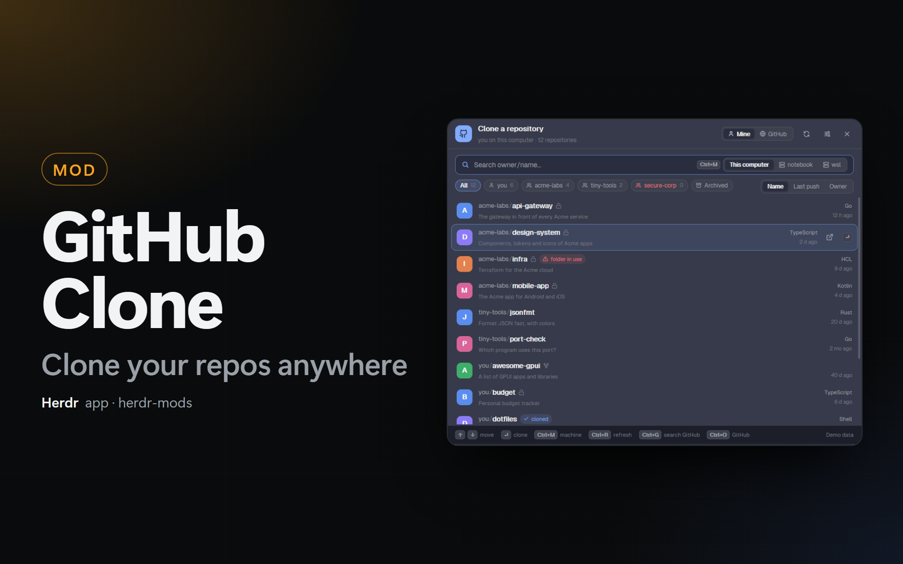

# GitHub Clone

A dialog for the Herdr app that lists the GitHub repositories of the `gh` account of a machine, or searches all public repositories of GitHub, and clones one into a folder of that machine, in a visible terminal. The mod only clones; Repo Launcher opens repositories. The design decisions are in [`docs/github-clone-plan.md`](../docs/github-clone-plan.md).

## What you see

A dialog of 840 × 660 (`mod.json`: `"overlay": { "kind": "dialog", "width": 840, "height": 660 }`), `popover` fill, 13 px text. 3 views share a 60 px header (a 34 px tile or a back button, a 15 px semibold title, an 11.5 px `dim` subtitle, buttons, a close `×`) and a 38 px footer (`chrome` fill, key hints on the left, a note or buttons on the right).

1. **List.**
   - Header: an `accent` tile with the GitHub mark, `Clone a repository`, the subtitle `<login> on <machine> · <n> repositories`, the tab switch (a segmented control: `Mine` with a user icon, `GitHub` with a globe; `Ctrl+G`), a refresh button (it turns while a read runs) and a gear button (the folders view).
   - Search bar, 40 px, radius 10, `accent` border: a magnifier, the text field (`Search owner/name…`), the match count while text is typed, and the machine picker: a `Ctrl+M` key cap and a segmented control with `This computer` and each machine of `machines()` (a server icon; a machine that Herdr cannot reach is dim and does not take clicks).
   - Chip row: wrapping chips of 24 px (radius 12): `All` with the count, the account (user icon), each other owner of the list (people icon), the organizations of `GET /user/orgs` with no repository in the list (red, with an SSO tooltip), and `Archived` (archive icon). At the right, a segmented control: `Name`, `Last push`, `Owner`.
   - When a read failed and a saved list exists: a `blocked` banner with the error, the age of the list and, for a missing login, `Log in…`.
   - The rows, 54 px: a 32 px letter tile (a color from the name), `owner/` in `muted` and the name in bold, with the fuzzy hits in `accent`; a lock (private), a fork icon, an archive icon; the pill `✓ cloned` (`done`) or `⚠ folder in use` (`blocked`); the description in 11 px `dim` (when there is one); at the right, the language and the time of the last push. The selected row has an `accent` border and fill, an arrow button (`Open on GitHub (Ctrl+O)`) and a `↵` key cap. Only the rows in view are drawn (rows at fixed offsets, `on_scroll_wheel`, a 4 px thumb).
   - Empty states: a 54 px round icon, a title and a hint: reading (spinner), `gh is not installed on …`, `gh is not logged in on …` (with `Log in…` and `Refresh`), `… cannot be reached now`, no match, no repositories, and the SSO hint for an organization chip with no repositories.
   - Footer: `↑↓ move`, `↵ clone`, `Ctrl+M machine`, `Ctrl+R refresh`, `Ctrl+G search GitHub`, `Ctrl+O GitHub`, and `Read <time> ago`.
   - **The GitHub tab** uses the same frame. Subtitle: `Search all of GitHub with the gh of <machine>`. The search bar has a globe icon (a spinner while a search runs), the field `Search GitHub: words, topic:cli, org:vercel, language:go…`, a clear `×` and the machine picker. The chip row: `Add:` and the chips `language:`, `topic:`, `org:`, `user:`, `stars:>100`; at the right, a segmented control `Best match`, `Stars`, `Updated`. The rows are the same as in the list, with a star and the star count (`1.2k`, `34k`) after the language; the list is dim while a new search runs. After the last row, when more results can come: a `More results (up to <n>)` button. Empty states: a start text with examples of qualifiers, `Searching GitHub for “…”…`, no match, and the errors of the list. Footer: `↑↓ move`, `↵ clone`, `Ctrl+G your repos`, `Ctrl+O GitHub`, and `<n> results`.
2. **Clone step.** Header: back, a letter tile, the name, `owner · description`, pills `private`, `fork`, `archived`, and an arrow button (`Open on GitHub`). Body (a scroll area, 18 px padding), with 70 px labels on the left:
   - A `blocked` banner when the repository is cloned in its folder already, or when the folder is in use.
   - `Machine`: a pill and `The clone runs there, with the gh account <login>.`
   - `Folder`: a monospace text field with a folder icon, `Browse…` on this computer, then a line: `Checking the folder…`, `✓ The folder is free. The clone makes it.`, `⚠ The folder exists. Choose another folder.` or a problem (`Use a full path, for example ~/code/<name>.`). With no clone folder for the machine, and a folder that no owner rule gave: a switch `Save <parent> as the clone folder of <machine>` (on). A folder with a control character, a typographic quote (U+2018 to U+201B) or a backtick shows `The folder has a character that the clone line cannot carry …` and cannot clone.
   - `Branch`: a monospace text field with the default branch, a list of up to 6 matching branches while the field has the keyboard (the selected one has an `accent` tint, `default` on the default branch), and `<n> branches. Default: <b>. A name that is not in the list works too.` A branch name must match `^[\w][\w./+@-]*# GitHub Clone

A dialog for the Herdr app that lists the GitHub repositories of the `gh` account of a machine, or searches all public repositories of GitHub, and clones one into a folder of that machine, in a visible terminal. The mod only clones; Repo Launcher opens repositories. The design decisions are in [`docs/github-clone-plan.md`](../docs/github-clone-plan.md).

## What you see

A dialog of 840 × 660 (`mod.json`: `"overlay": { "kind": "dialog", "width": 840, "height": 660 }`), `popover` fill, 13 px text. 3 views share a 60 px header (a 34 px tile or a back button, a 15 px semibold title, an 11.5 px `dim` subtitle, buttons, a close `×`) and a 38 px footer (`chrome` fill, key hints on the left, a note or buttons on the right).

1. **List.**
   - Header: an `accent` tile with the GitHub mark, `Clone a repository`, the subtitle `<login> on <machine> · <n> repositories`, the tab switch (a segmented control: `Mine` with a user icon, `GitHub` with a globe; `Ctrl+G`), a refresh button (it turns while a read runs) and a gear button (the folders view).
   - Search bar, 40 px, radius 10, `accent` border: a magnifier, the text field (`Search owner/name…`), the match count while text is typed, and the machine picker: a `Ctrl+M` key cap and a segmented control with `This computer` and each machine of `machines()` (a server icon; a machine that Herdr cannot reach is dim and does not take clicks).
   - Chip row: wrapping chips of 24 px (radius 12): `All` with the count, the account (user icon), each other owner of the list (people icon), the organizations of `GET /user/orgs` with no repository in the list (red, with an SSO tooltip), and `Archived` (archive icon). At the right, a segmented control: `Name`, `Last push`, `Owner`.
   - When a read failed and a saved list exists: a `blocked` banner with the error, the age of the list and, for a missing login, `Log in…`.
   - The rows, 54 px: a 32 px letter tile (a color from the name), `owner/` in `muted` and the name in bold, with the fuzzy hits in `accent`; a lock (private), a fork icon, an archive icon; the pill `✓ cloned` (`done`) or `⚠ folder in use` (`blocked`); the description in 11 px `dim` (when there is one); at the right, the language and the time of the last push. The selected row has an `accent` border and fill, an arrow button (`Open on GitHub (Ctrl+O)`) and a `↵` key cap. Only the rows in view are drawn (rows at fixed offsets, `on_scroll_wheel`, a 4 px thumb).
   - Empty states: a 54 px round icon, a title and a hint: reading (spinner), `gh is not installed on …`, `gh is not logged in on …` (with `Log in…` and `Refresh`), `… cannot be reached now`, no match, no repositories, and the SSO hint for an organization chip with no repositories.
   - Footer: `↑↓ move`, `↵ clone`, `Ctrl+M machine`, `Ctrl+R refresh`, `Ctrl+G search GitHub`, `Ctrl+O GitHub`, and `Read <time> ago`.
   - **The GitHub tab** uses the same frame. Subtitle: `Search all of GitHub with the gh of <machine>`. The search bar has a globe icon (a spinner while a search runs), the field `Search GitHub: words, topic:cli, org:vercel, language:go…`, a clear `×` and the machine picker. The chip row: `Add:` and the chips `language:`, `topic:`, `org:`, `user:`, `stars:>100`; at the right, a segmented control `Best match`, `Stars`, `Updated`. The rows are the same as in the list, with a star and the star count (`1.2k`, `34k`) after the language; the list is dim while a new search runs. After the last row, when more results can come: a `More results (up to <n>)` button. Empty states: a start text with examples of qualifiers, `Searching GitHub for “…”…`, no match, and the errors of the list. Footer: `↑↓ move`, `↵ clone`, `Ctrl+G your repos`, `Ctrl+O GitHub`, and `<n> results`.
2. **Clone step.** Header: back, a letter tile, the name, `owner · description`, pills `private`, `fork`, `archived`, and an arrow button (`Open on GitHub`). Body (a scroll area, 18 px padding), with 70 px labels on the left:
   - A `blocked` banner when the repository is cloned in its folder already, or when the folder is in use.
   - `Machine`: a pill and `The clone runs there, with the gh account <login>.`
   - `Folder`: a monospace text field with a folder icon, `Browse…` on this computer, then a line: `Checking the folder…`, `✓ The folder is free. The clone makes it.`, `⚠ The folder exists. Choose another folder.` or a problem (`Use a full path, for example ~/code/<name>.`). With no clone folder for the machine, and a folder that no owner rule gave: a switch `Save <parent> as the clone folder of <machine>` (on). A folder with a control character, a typographic quote (U+2018 to U+201B) or a backtick shows `The folder has a character that the clone line cannot carry …` and cannot clone.
   - `Branch`: a monospace text field with the default branch, a list of up to 6 matching branches while the field has the keyboard (the selected one has an `accent` tint, `default` on the default branch), ; any other name shows `Use only letters, digits and . / _ + @ - in the branch name.`, and Clone stays off.
   - A switch `Shallow clone (--depth 1)` with a hint, and at its right `Submodules: cloned too`.
   - `Runs`: the clone line in a monospace box, and `In a new space on <machine>. You see the progress there and can answer a prompt.`
   - Footer: `↵ clone`, `Esc back`, `Back`, and the primary `Clone` button (download icon; a spinner and `Starting…` while it starts; dim until the folder check says free).
3. **Clone folders.** Header: back, the tile, `Clone folders`. 2 cards (radius 12, `background` fill): `Clone folder of each machine` (1 row per machine: a pill, a monospace text field, `Browse…` on this computer) and `Owner rules` (1 box per rule: a machine segmented control, a trash button, the owner field, `→`, the folder field, `Browse…` on this computer, and owner chips while the owner is empty; then `Add rule`). Under a folder that Repo Launcher does not read: `⚠ Repo Launcher does not read this folder, so Ctrl+P does not find these clones.` and `Add to Repo Launcher`. Footer: `Changes are saved at once.` and `Esc back`.

## How it behaves

**The machine.** The dialog opens on the machine of the focused space (this computer when that machine is unavailable). `Ctrl+M` or the picker changes it; the owner chip goes back to `All`.

**The list.** `gh api user --jq .login`, then `gh api --paginate "user/repos?per_page=100&affiliation=owner,collaborator,organization_member"` (300 s time limit) and `gh api --paginate user/orgs`, with `exec(…, { on: machine })`. Each repository keeps `full`, `owner`, `name`, `private`, `fork`, `archived`, `desc`, `lang`, `pushed` and `branch` (the default branch). The list goes into `shared("github-clone.cache")[<machine key>]` (`""` for this computer) with `fetchedAt`. The dialog shows the saved list at once and reads it again in the background when it is older than 15 minutes; a failed read is tried again after 1 minute. A failed read keeps the saved repositories and adds `error: { kind, message }`: `nogh` (gh cannot start), `login` (`gh auth login` or HTTP 401 in the error), `offline` (the machine cannot be reached) or `error`.

**Filters and order.** The owner chip and the Archived chip filter first. With text, `matchRepo(text, name, owner)` of `fuzzy.js` (a copy of Repo Launcher's) gives the order. Without text, `shared("github-clone.order")`: `name` (`owner/name`, the default), `pushed` (newest first) or `owner` (the account first, then owner and name).

**Destination.** `folderFor(machine, owner)`: the first owner rule of that machine with the same owner (case-insensitive), else the clone folder of the machine. Destination: `<folder>/<name>`. With neither, the first root folder of Repo Launcher on that machine is the suggestion. `~` expands with the home folder of the machine (`machineInfo()`: `uname` and `$HOME` through `sh`, else PowerShell).

**Cloned mark.** 1 program per machine (PowerShell or `sh`) lists every subfolder of the clone folder and of the owner rule folders, with the `origin` URL of each Git folder (from `.git/config`). `cloned`: the destination exists and its `origin` is the repository. `used`: the destination exists with other content. The listing is read again after 15 s, after Refresh, and when you leave the folders view.

**Clone step.** The folder check runs 350 ms after the last change of the field (`Test-Path` or `[ -e ]` on the machine). The branches come from `gh api repos/<full>/branches?per_page=100` when the step opens. `↑`/`↓` move through the suggestions; Enter takes the selected one, else starts the clone.

**The clone.** Clone checks the folder again, makes the parent folder, saves the clone folder when the switch is on, runs `space.new { machine, folder: <parent> }`, waits for the new terminal of `panes()` (at most 10 s), waits until its screen stops changing (`hc read`, at most about 12 s), and sends 1 line with `hc send`:
- Windows: `gh repo clone '<owner>/<name>' '<folder>' '--' --recurse-submodules --branch '<b>' --depth 1 --shallow-submodules; if ($?) { Set-Location -LiteralPath '<folder>' }` (Windows PowerShell 5.1 has no `&&`).
- Other systems: `gh repo clone '<owner>/<name>' '<folder>' '--' --recurse-submodules --branch '<b>' --depth 1 --shallow-submodules && cd '<folder>'`.

`--recurse-submodules` is always there (it clones and checks out the submodules; no effect without them). `--branch` is there only for a branch that is not the default branch, `--depth 1 --shallow-submodules` only with the switch. Then it focuses the terminal, adds `{ machine, path, at }` to `shared("github-clone.pending")`, adds `{ path, name, root, machine }` to `shared("repo-launcher.cache").repos` (when `mods/repo-launcher/mod.json` exists; `root` is the Repo Launcher root that holds the folder, else the parent folder), and closes the dialog. When the dialog opens, each pending clone whose folder exists leaves the list; one whose folder is still missing after 2 minutes leaves it and its Repo Launcher entry goes too.

**The GitHub tab.** `gh search repos --limit <n> --json fullName,owner,name,description,language,stargazersCount,updatedAt,isPrivate,isFork,isArchived,defaultBranch [--sort stars|updated] -- <words>` on the source machine. The words are the text split at spaces; a quoted phrase stays 1 word, and `--` keeps a word that starts with `-` (an excluded qualifier) from being a flag. The search runs 600 ms after the last change of the text, at once on Enter when the text changed (else Enter opens the clone step), when the order or the machine changes, and on `Ctrl+R`. A chip writes its qualifier at the end of the text with the cursor after it; `stars:>100` starts the search, the others wait for a value. `More results` adds 30, up to 100, and keeps the selection. The last text, order and results stay in memory until Herdr restarts, and the dialog opens on the last tab.

**Open on GitHub.** `Ctrl+O` (list and clone step) and the arrow buttons open `https://github.com/<full>` on this computer: `rundll32 url.dll,FileProtocolHandler <url>` on Windows, `xdg-open` on Linux, `open` on macOS. Only an `https://` URL reaches the opener.

**Log in.** `Log in…` runs `space.new { machine, argv: ["gh", "auth", "login"] }` and closes the dialog.

**On and off.** When `shared("herdr-mods.disabled")` names `github-clone`, `render()` closes the dialog and draws nothing. The Dock and Kanban bars hide the `mod.open` button of the mod.

**Commands** (`herdr-app do github-clone.<name>`, for tests and the preview): `demo` (example data on and off), `folders`, `list`, `refresh`, `machine`, `owner` (next owner chip), `down`, `up`, `tab` (switch the tab), `step` (the clone step of the selected row), `clone` (in the clone step), `web` (open the selected repository on GitHub).

## Built from

Files in `mods/github-clone/`: `mod.json` (`{ "place": "none", "title": "GitHub Clone", "overlay": … }`), `kit.json`, `main.js` (the `View`, the list, the keys), `step.js` (the clone step and the clone), `folders.js` (the folders view), `search.js` (the GitHub tab), `gh.js` (every `gh` call), `sys.js` (paths, `machineInfo()`, the folder listing, the folder check, `makeDir`, the clone line), `store.js` (the shared keys, and the keys of Repo Launcher that it reads and writes), `common.js` (shared constants, `memory`, the machine list), `ui.js` (tiles, pills, chips, buttons, the switch, the segmented control, highlights), `fuzzy.js` (from Repo Launcher), `demo.js` (the example data), and the icons (Lucide, ISC license, 24 px, 2 px stroke, `currentColor`).

Imports: `View`, `div`, `svg` from `gpui-kit`; `v_flex`, `h_flex`, `InputState`, `Input` from `gpui-base`; `theme`, `props`, `closeOverlay`, `notify`, `spaces`, `panes`, `run`, `hc`, `exec`, `home`, `window`, `shared`, `setShared`, `machines`, `settings`, `nextCommand`, `checking`, `appHome`, `pickFolder` from `herdr`; `fs/promises` (only `exists`).

Programs it runs (tell the person before installing): `gh api`, `gh search repos`, PowerShell or `sh` (folder listing, folder check, `mkdir`), `git config -f` (on Linux and macOS, to read an `origin` URL), `hc read`, `hc send`, the opener of the system for **Open on GitHub**; and in the new terminal, `gh repo clone`. The network goes only through `gh`.
