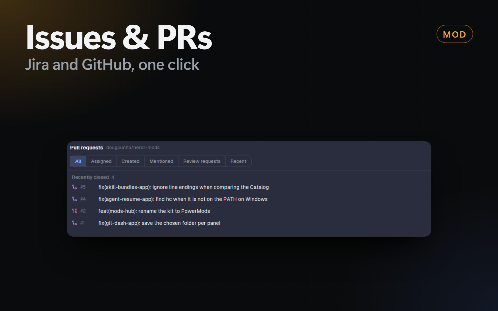

# Issues & PRs



2 mods for the Herdr app that show the work of the shown space next to its terminals and agents:

- **`issues`**: the issues of the space from Jira Cloud or GitHub. Each issue opens as a page. **Start agent** opens a coding agent on the issue in a new git worktree and space.
- **`prs`**: the pull requests of the space, grouped by what each one waits for (review requested, yours to fix, ready to merge). Each pull request opens as a page with its checks, files and a merge box. **Agent review** checks it out, builds, tests and reports.

Both mods only read, with two exceptions on a Jira issue page: **Comment** adds the comment that you type, and **Move** moves the issue to the status that you pick (a Jira transition). They write nothing else to Jira and nothing to GitHub. The page shows the last 10 comments; older ones are in Jira. **Start agent** makes a local worktree and branch, and pushes nothing.

## Credits

These mods are a copy of `herdr-ranch-issues` and `herdr-ranch-prs` of [Herdr Ranch](https://github.com/jslowack/herdr-ranch) by Jelle Slowack, version 0.5.0 (commit `999eb3e`), under the [MIT license](LICENSE). Thank you, Jelle.

The changes of this kit:

- The mods are called `issues` and `prs`.
- The settings (**Order**, **Page** and the shortcut) are in the **Settings** tab of **PowerMods**, not in the cog. The cog keeps **Link space…** and **Prompts…**. Your settings of Herdr Ranch move over once.
- The kit updates the mods (**PowerMods**), so the update check of Herdr Ranch and its **Update** button are gone.
- The mods are Dock panels (`dock/panels.json`), not buttons of the `mod-buttons` layout. The **Opens in** setting is gone.
- In a dialog of the Dock, the header of the list does not repeat the name and the × of the dialog, and Esc closes the dialog also after a click in the header.
- No Linear: the issues come from Jira Cloud or GitHub.
- Extra Jira fields for the prompts: see below.

## The Jira issue page

- **Key:** the copy button next to the key in the title copies it (`C` also does).
- **The list:** a right-click on an issue opens a menu with **Move** (Jira only), **Open in Jira** (or GitHub), **Start agent** (when the space has a git repository) and **Copy key**.

- **Under the title:** chips for the status, the type, the priority, the story points, the sprint and the due date. A high priority, the active sprint and a due date that is near or past show in color.
- **Tabs:** **Description**, a tab for each long extra field (for example **Refinement**, see below) and **Activity** (the comments, the changes of status, assignee and priority, and the comment box).
- **Details:** the assignee, the reporter, the priority, the story points, the sprint, the fix versions, the affected versions, the components, the labels, the due date, the parent, the short extra fields and the dates. A narrow page shows the card above the tabs. A click on **Details** collapses or expands the card; every page keeps that choice.
- **Pictures:** the people show with their Jira picture, in the list too. The mod downloads only the public pictures (Atlassian's avatar host and Gravatar) to `~/.config/herdr-app/data/issues-app/avatars/`, and sends no sign-in for them. A person without a picture shows their initials.

The mod finds the Sprint and the story points fields (`Story Points` or `Story point estimate`) in the field list of the site; you set nothing.

## The pull request page

- **Under the title:** the state, and for an open pull request chips for the review (approved, changes requested, review required), the checks (failing, running, passed), the merge state (conflicts, behind the base, ready to merge) and the size (+/−). A copy button copies `owner/repo#number`.
- **Tabs:** **Description**, **Conversation** (comments, reviews, events and the merge box), **Checks** and **Files**. Keys 1 to 4.
- **Details:** the author, the reviewers with their verdict, the assignees, the labels, the branches (with a copy button), the changes, the commits and the dates. A click on **Details** collapses or expands it.
- **The list:** a right-click on a pull request opens a menu with **Open on GitHub**, **Agent review** (an open pull request, when the space has a git repository), **Copy number** and **Copy branch**. The **Hide merged** chip next to the filters leaves the merged pull requests out; it is also a setting in PowerMods → Settings → Pull Requests.

## Default Jira project

A space shows the issues of, first that has one: its own link (**Link space…**), the link of another space of its repository, the repository's `.herdr/jira.toml`, the **default project**, a Jira key in its branch, its GitHub repository.

Set the default project once for all the spaces that have no link of their own:

- In **Link space…**, pick the project and, under **Use it for**, **Every space without a link (default)**. Or:
- In **PowerMods** → **Settings** → **Issues**: **Default Jira site**, **Default Jira project** and **Default JQL filter**.

A space that needs another project gets a link of its own: **Link space…** → **Only <space>**. The list header shows `(default)` when a space follows the default.

## Start agent

The **Start agent** dialog of an issue asks where the agent runs:

- **New worktree** (the default): a new branch in a new git worktree (`~/.herdr/worktrees/<repo>/<branch>`) of the repository of the shown space, in a new space.
- **Open space · new tab**: a new tab in an open space that you pick (the shown space first), on the branch that it has now. Nothing is created in git. Pull requests always use a new worktree: their prompts check out and reset the branch.

The dialog shows the repository (the main checkout of the shown space) and its branch. **Default** of Model and Effort shows what the agent uses: the `model` and `effortLevel` of `~/.claude/settings.json` (Claude Code), the `model` and `model_reasoning_effort` of `~/.codex/config.toml` (Codex), else the documented default (Claude Code: the account's model, usually Opus 5.5, with medium effort). An environment variable such as `ANTHROPIC_MODEL` can still change them.

## Extra Jira fields

A Jira custom field (for example **Refinement**, with the full text of the task) can go into the Start agent prompts:

1. Open **PowerMods** → **Settings** → **Issues**.
2. In **Extra Jira fields**, type the name or the id of each field, split by commas: `Refinement` or `customfield_10545`.

Each field is a placeholder of its own in **Prompts…**: its name in lower case, with `_` for spaces and signs (`Refinement` → `{refinement}`). `{fields}` holds all of them, one `## <name>` section each, and the default prompts include it under the description. On the issue page, a long field (more than 80 characters or more than 1 line) gets a tab of its own; a short one is a row of the Details card.
- On Windows, **Connect** in **Link space** stored the token but showed "The credential store refused it". Fixed.
- The **Mods** tab of PowerMods can turn each mod off.
- The `herdr-ranch-reviews` mod is not part of the kit: it runs Unix programs only.

## Install

The setup prompt of this repository installs the mods (item `issues-app`). By hand:

1. Copy `mods/issues/` and `mods/prs/` to `~/.config/herdr-app/mods/`.
2. Add the panels to `~/.config/herdr-app/dock/panels.json`:

   ```json
   { "id": "issues", "label": "Issues", "icon": "mods/issues/issue.svg", "mod": "issues" },
   { "id": "prs", "label": "PRs", "icon": "mods/prs/pr.svg", "mod": "prs", "group": "git" }
   ```

3. Add the keys to `~/.config/herdr-app/keys.json`:

   ```json
   "global": {
     "ctrl-shift-j": "mod.open:issues",
     "ctrl-shift-g": "mod.open:prs"
   },
   "mod:issues": { "ctrl-r": "issues.refresh", "ctrl-o": "issues.browser" },
   "mod:prs": { "ctrl-r": "prs.refresh", "ctrl-o": "prs.browser" }
   ```

**Needs:** [`gh`](https://cli.github.com) signed in, and `git`. `curl` for the avatars of the pull requests. A Jira Cloud site (`*.atlassian.net`) with a classic API token, only if you use Jira.

## Connect Jira

1. Create a **classic** API token at <https://id.atlassian.com/manage-profile/security/api-tokens> (not "Create API token with scopes").
2. Open the Issues panel and click the cog, then **Link space…**.
3. Select **Jira**. Type the site, your e-mail and the token, and click **Connect**.
4. Select the project and, if you want, a filter.

The token goes to the credential store of the system (Windows Credential Manager, macOS Keychain, Linux Secret Service), never to the settings of Herdr. The full guide: [Connect Jira](https://github.com/jslowack/herdr-ranch/blob/main/docs/connect-jira.md).

## What it runs

- `git` and `gh` in the folder of the space.
- `curl` for the avatars (GitHub, and the public Jira pictures), `powershell` (Windows), `security` (macOS) or `secret-tool` (Linux) for the token.
- Network: your Jira site, GitHub (through `gh`), and the hosts of the Jira pictures (`*.atl-paas.net`, `secure.gravatar.com`).
- Files: `~/.config/herdr-app/data/issues-app/` (icons, avatars and, for a moment, the token before it goes to the credential store).

More: [RECIPE.md](RECIPE.md).
