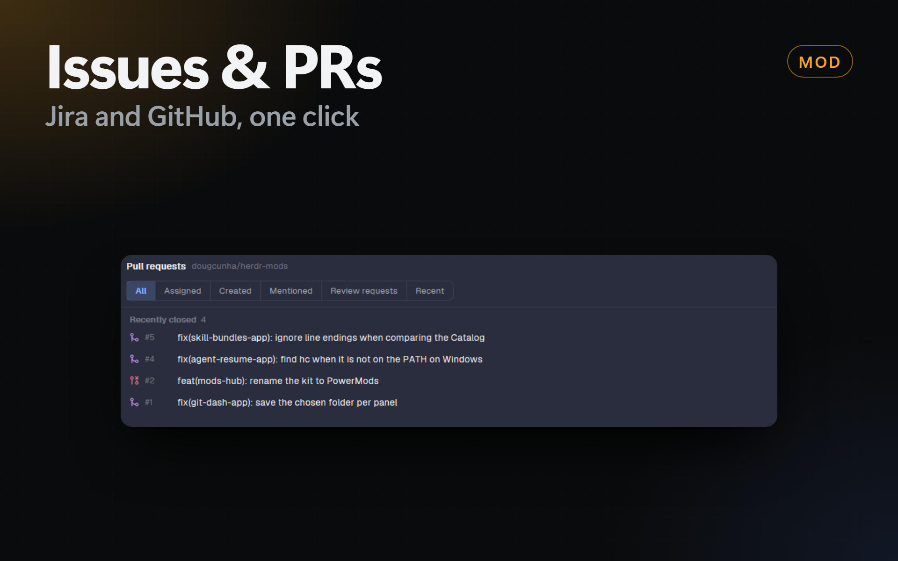

# Issues & PRs

The issues and the pull requests of the shown space, in 2 mods: `issues` and `prs`. They are a copy of `herdr-ranch-issues` and `herdr-ranch-prs` of [Herdr Ranch](https://github.com/jslowack/herdr-ranch) by Jelle Slowack (MIT, version 0.5.0). The 2 recipes below are the recipes of Herdr Ranch, with the names of this kit.

## Changes in this kit

Build the mods from the recipes below, with these changes:

- The mods are `issues` and `prs`. `migrateSettings` in `links.js` moves `shared("mod-settings")["herdr-ranch-issues"]` and `["herdr-ranch-prs"]` to the new names once.
- No `update.js`: the cog menu ends with the line "Based on Herdr Ranch by Jelle Slowack", not a version and an **Update** button.
- No `button` in `mod.json` and no **Opens in** setting: the mods are Dock panels (`dock/panels.json` entries `issues` and `prs`, `prs` in the `git` group).
- No Linear: no `linear.js` and `linear-client.js`, no Linear choice in **Link space**, no Linear sign-in in `jira-client.js`. A Herdr Ranch link with `issues: "linear"` shows the Jira choice. Leave out every Linear part of the recipes below.
- The settings are in the **Settings** tab of mods-hub (`kit.json`): `issues.order`, `issues.page` and `prs.page`, 1 shared key each, read by `pref(mod, key)` on every render. The cog menu shows only **Link space…**, **Prompts…** and the credit line. The Start agent templates are in `issues.prompts` and `prs.prompts`. `migrateSettings` moves `page`, `order` and `prompts` from `shared("mod-settings")` (old or new mod name) to these keys once, then removes those entries.
- The buttons look like the buttons of `ci-dash` and `git-dash`. `links.js` has them, and every file uses them: `iconButton` (28px, a Lucide icon from `data/issues-app/icons`, a spinner, a tooltip: ↻ `refresh`, the cog `settings`, × `x`, copy), `button` (30px, `primary` with the accent color and its key as a hint, `plain` with a border, `link`, `small` 24px for Go and ↑ ↓), `chip` (26px, rounded, for presets and choices) and `segmented` (28px, the picked choice in the accent color).
- Extra Jira fields: `shared("issues.extraFields")` (a text setting of mods-hub) names fields by name or id, split by commas, at most 10. `extraFields(site, names)` in `jira.js` finds their ids in `/rest/api/3/field` (read once per site) and `issue()` asks for them too. `fetchPage` keeps them as `page.extra` (`{ name, ph, text, md }`; ADF as Markdown, options and people by name), the page shows each one in a card under the description, and `dispatch` gives each one its placeholder (`placeholderOf`: lower case, `_` for the rest, `field_` in front of a name that is a placeholder already) and `{fields}` with all of them as `## <name>` sections. The default issue prompts put `{fields}` in a fence under the description. The setting is part of the page cache key.
- No key hints on buttons (`⌘↵`, `O`): the keys still work, and the page footers list them.
- Start agent of an issue has **Where**: New worktree (as in the recipe) or Open space · new tab (`tab.new { space, name, argv, task }` in a space of the same machine, picked from chips with its name and branch; `{branch}` is that space's branch; nothing in git). Pull requests always use a worktree. The dialog shows the repository (main checkout and its branch). The Default chips of Model and Effort show the agent's value (`agentDefaults`: Claude Code `~/.claude/settings.json` `model` and `effortLevel`, else the account default and the model's default effort; Codex `~/.codex/config.toml` top-level `model` and `model_reasoning_effort`).
- The agents of Start agent come from `shared("issues.agents")` (`{ [machine or "local"]: { list, checkedAt } }`), else from the repo-launcher's `shared("repo-launcher.agents")` for this computer, so the dialog shows them at once. Only an empty list, or ↻ next to **Agent**, calls `knownAgents()` (it starts a shell). Each agent card shows the provider's icon on its tile (`programTile` in `links.js`, as in the repo-launcher).
- **Move** on a Jira issue page (the one write of this kit to Jira): a popup of the mod (`transition.js`, props `{ dialog: "transition", site, key, status }`) lists `GET /rest/api/3/issue/<key>/transitions` (the moves open to the account now) and a pick sends `POST …/transitions { transition: { id } }`. A move whose screen needs fields comes back 400: the menu says to make it in Jira. After a move it sets `shared("issues.changed")` `{ site, key, at }`; every copy of the mod drops that issue's cached pages, reloads an open page of it, and the list refreshes. `call()` accepts the empty 204 answer.
- A default Jira project: `shared("issues.defaultJira")` `{ site, key, filter? }` (`defaultJira()` in `links.js` checks and cleans it). `projects()` uses it after the space's link (or its repository's) and `.herdr/jira.toml`, before the guess, also for a space outside a repository; the list header says `(default)`. Link space shows it for a space without a Jira link and has **Use it for**: Every space without a link (writes the default; the space keeps only its GitHub part) or Only <space> (a link of its own). Herdr Mods has 3 text fields for it (`path` site, key, filter). Its site counts as typed by the person (`personSite`), and `knownSites()` lists it first. The list's context key includes it, so a change reloads the list.
- In a dialog of the Dock (`inDockDialog()` in `links.js`: `props().overlay` is the id in `shared("kanban.panelDialog")`), the header leaves out the name and the ×: the title row of the dialog shows them. The press handler of the header focuses the list before it stops the press, so Esc closes the dialog after a click in the header.
- `kitOff()` and `offView()`: `render()` starts with `if (kitOff()) return offView();`, and the timers skip their work while `shared("herdr-mods.disabled")` names the mod.
- Windows, `storeSignIn` in `jira-client.js`: the `finally` block deletes the token file only when it still exists (`if (Test-Path …)`). A delete of a missing file made `powershell` exit 1, and the dialog showed "The credential store refused it" for a token that was stored.
- The data folder is `data/issues-app/`, not `data/herdr-ranch/`.
- `agent-dialog.js`, `jira-client.js`, `linear-client.js`, `link-dialog.js`, `links.js`, `page-kit.js` and `prompts.js` are the same in the 2 mods. Change both copies.
## Issues · Herdr Ranch

Your Jira, Linear or GitHub issues for each Herdr space, with a page like GitHub's and a coding agent one key away. The shown space's open issues from Jira Cloud, Linear or GitHub, in a side panel next to your terminals, with a page per issue in a dialog over the window. **Start agent** opens a coding agent on an issue in a fresh git worktree.

### What you see

- **Header:** "Issues", where they come from in `dim` ("RKT", "GitHub acme/website"; "(guessed)" or "(.herdr/jira.toml)" when the Jira project isn't linked), " · Refreshing…" while a refresh runs over the shown list, ↻ (Herdr's spinner while loading), a cog, and × when open as a window. At 720px and wider the 220px search field sits in this row; narrower, it gets its own row.
- **Filters:** one segmented control: **All**, **Assigned**, **Created**, **Mentioned** (**Watching** for Jira), **Recent**.
- **List:** groups High, Medium, Low and No priority with a count, or one "Backlog" group. One 30px row per issue:
  - a type icon in its theme color: Bug (red bug), Task (blue checkbox), Sub-task (blue corner arrow), Story (green bookmark), Epic (purple bolt), Feature (yellow bulb), anything else a green dot;
  - the key in `dim`, in a column as wide as the longest key shown;
  - the summary, a red `blocked` pill when blocked, the status as a pill (`accent` tint while in progress);
  - the assignee as initials in a tinted circle (an empty circle when unassigned), and the age.
  - Sub-tasks sit under their parent, 18px further in. Below 520px a row takes two lines: icon, key, summary and age, then the assignee's initials and name and the status.
- **Page:** a dialog over the window (or under the list, or in its place, see **Page** below), laid out like GitHub's issue page:
  - **Header** (stays put while the body scrolls): ↑ ↓ and "3 of 12" (in the dialog), **Open in Jira** (or GitHub) with its key `O`, and **Start agent** as the green primary button with `⌘↵`; the summary large with the key in `dim`; the status as a filled badge (green Open on GitHub; on Jira gray to do, blue in progress, green done), the type with its icon, "Reporter reported this 6h ago · 2 comments".
  - **Timeline:** the description as the first card, then the last 10 comments as cards with the author's initials, and status, assignee and priority changes (Jira's changelog) or label, assignee, close and mention events (GitHub's timeline) as small lines between them.
  - **Sidebar** (230px, from 700px wide; narrower, its sections wrap above the timeline): Assignee, Reporter, Priority, Labels, Parent, Milestone, **Sub-tasks** with their state and "1 of 2" (GitHub's sub-issues too), **Relations** (Jira issue links; GitHub blocked by / blocks, `owner/repo#n` for another repository), and **Development**: the pull requests that name the key (Jira: `gh pr list --search "KEY in:title,body"` in the space's GitHub repository; GitHub: the issue's cross-references) with their state and checks.
  - **Footer:** the keys. `C` copies the key.
- **Not linked:** "No issues linked to this space…" and **Link this space**. **Not signed in** (Jira answers 401): where to put a classic API token, **API tokens ↗** and **Link space**.
- **Agents:** a issue with an agent space (Start agent's worktree under `~/.herdr/worktrees/<repo>/`, found by its `agent/…` branch or folder) shows a chip on its row with the agent's state (working, needs you, done, idle, no agent running); a click goes to that space. The page shows them in an **Agent** sidebar section with **Go**, and its main button becomes **Go to agent** (⌘↵, only for a running agent) with **Start another** next to it.
- **This branch:** the issue the shown space's branch names is pinned on top (when it passes the search and filter).
- **Footer:** the keys (↑ ↓ move, ↵ open, Esc close in a window).
- **Text sizes** follow Herdr's UI font size (13 by default): summaries at that size, keys, statuses and ages one smaller; row heights grow with it.

#### The cog

**Order** By priority | Backlog order, **Page** Overlay | Split | Full, **Link space…** and **Prompts…**.

#### Link space (a dialog, 560×640)

A header ("Link space", the space's name and "and its worktrees"), three numbered sections, and a footer with **How to connect ↗** (opens docs/connect-jira.md on GitHub), **Cancel** and a green **Save ⌘↵**.

1. **GitHub repository:** an input with the link, else the folder's remote. Suggestions while typing: your repositories (`gh repo list`, up to 200), then `gh search repos` results from 3 characters. Under it "gh is signed in as <login>", or how to sign in.
2. **Issues from** Jira | Linear | GitHub (a segmented control in the section's header).
   - **Linear:** a status block like Jira's ("Connected to Linear as <name>", "No Linear key yet", or a refused key) and a **Connect** form with a masked personal API key, **Create a key ↗**, **Remove key** and **Connect**; then the **Team**, searched as you type ("Connect first to search teams." without a key), and **Show**: Active cycle, All open, Assigned to me.
   - **GitHub:** an optional **GitHub issue filter** (GitHub search, e.g. `label:bug milestone:v2`).
   - **Jira:** the **site**, then a status block: green "Connected to <site> as <name>" with where the sign-in came from (Keychain, Secret Service, Credential Manager or environment) and **Change**; gray "Not connected to this site yet"; red "Jira doesn't accept the sign-in…". When not connected (or after Change), a **Connect** form: **Email** (prefilled from `git config user.email`), a masked **API token** with **Create a token ↗**, "Tested against Jira, then stored in <the platform's store>. Never in Herdr's settings.", **Remove sign-in** (when connected) and **Connect**.
3. **Project and filter** (Jira only; dimmed without a site): **Project** searched in Jira as you type (up to 8 results; the key guessed from the branch is marked), its name under it; **Show** as chips: Current sprint (`sprint in openSprints()`, the default for a new link), All open, Assigned to me (`assignee = currentUser()`), Custom JQL… (shows a JQL field).

Save first asks Jira whether the filter parses and shows Jira's error instead of saving.

#### Start agent (a dialog, 660×640)

- **Header:** "Start agent" (or "Review with agent"), the item's type icon, key and title.
- **Agent:** a card per installed agent (initials in a tinted circle, "last used" for the one picked last time, kept in local storage), and "N more known agents aren't installed on this machine."
- **Model** and **Effort** chips for agents that take them: Claude Code (`--model` fable / opus / sonnet / haiku, `--effort` low … max), Codex (`-m`, `-c model_reasoning_effort=`), OpenCode (`-m provider/model`, typed); others say they use their own settings. Remembered per agent in local storage; values are checked before they become arguments.
- **Mode** (segmented), with a line on what it does. Issues: **Work on it**, **Plan first**, **Investigate only**. Pull requests: **Review** (read-only), **Address review comments**, **Fix failing checks** (these two get a branch of their own: `agent/fix-…`, `agent/checks-…`).
- **Branch** in monospace with "new" or "exists: reuses it" (`git show-ref`); a branch already checked out in another worktree (a second start on the same item) is renamed to the next free `…-2`, `…-3`. Under it the base (the main checkout's branch) and the worktree path. Issue modes get a branch each: `agent/<KEY>-…`, `agent/plan-<KEY>-…`, `agent/investigate-<KEY>-…`.
- **Fork warning** (pull requests from a fork): the agent builds and runs that code on this machine.
- **Repository prompts:** when the repository's `.herdr/prompts.md` has this mode and it isn't approved yet, "Show and use them"; approval is kept per repository with the file's hash, and a repository prompt is shown whole.
- **Prompt:** a 5-line preview with where it came from (the default, yours, or the repository's `.herdr/prompts.md`), **Edit** (a textarea) and **Reset** once edited.
- **What happens:** ① the worktree and branch, nothing pushed; ② the new space and the agent; a **Switch to the new space** checkbox (on by default; off returns to the space you were in).
- **Footer:** "Esc cancels", **Cancel**, a green **Start agent ⌘↵** (**Start review** for Review). The new space is named after the item.

#### Prompts (cog → Prompts…, a dialog, 680×620)

One template per mode (segmented), a monospace textarea, the placeholders as chips that insert at the cursor, a status line on whether the repository's `.herdr/prompts.md` overrides this mode, **Reset to default**, **Cancel** and **Save ⌘↵**. Saved in `shared("mod-settings")[mod].prompts`, only the changed modes.

**Needs:** for Jira a classic API token ([docs/connect-jira.md](https://github.com/jslowack/herdr-ranch/blob/main/docs/connect-jira.md)), for Linear a personal API key, for GitHub `gh` signed in, and `git`. Optional: the [mod-buttons](../mod-buttons/RECIPE.md) layout for the **Issues** button in the tab bar; without it, open the list with `mod.open` or its key.

### How it behaves

- **Which source**, first that applies: the space's link with "Issues from: GitHub repository"; the link's Jira project; `.herdr/jira.toml` in the repository's main checkout (`[[project]]` tables with `site`, `key`, optional `filter`); a guess (the `KEY` in a `KEY-123` branch name, else the key most seen in branch names and the last 300 commit subjects, on the site another space links); the space's GitHub repository. Worktree spaces use their repository's link.
- **Jira:** `POST /rest/api/3/search/jql` with `project = "KEY" AND statusCategory != Done AND (filter)`, newest first or `Rank ASC` for backlog order, 100 per page, at most 500.
- **Linear:** GraphQL at `https://api.linear.app/graphql` with a personal API key (`Authorization: <key>`), from the credential store item `herdr-linear:linear.app` or `LINEAR_API_KEY`. The team's open issues (state type not completed or canceled), narrowed by the link's preset (`cycle`: the active cycle; `mine`: assigned to me), 100 per page, at most 500. State types map to the categories (started: in progress; completed, canceled: done; others: to do), priority 1 and 2 to High, 3 Medium, 4 Low; Watching is the issues you're subscribed to. The page reads description, comments, history (state, assignee, priority changes), children, relations, and GitHub pull request attachments.
- **GitHub:** `gh issue list --state open --search "<filter> sort:updated-desc"`, at most 500. The type is GitHub's issue type, else a `bug` or `enhancement` label; priority groups come from labels (P0/P1, `priority: high`, critical: High; P2, medium: Medium; P3/P4, low: Low); sub-issues nest; `blockedBy` marks blocked.
- **When it loads:** every 2 minutes, on ↻, and when the space or its link changes. A newer load supersedes one still running; an unchanged answer only updates the ages.
- **Space switch:** shows that space's own list at once (kept for the last 20 spaces, else stored, else empty while loading), never the previous space's, then refreshes it.
- **Filters**, one at a time, against the signed-in account (`/rest/api/3/myself` or `gh api user`): **Assigned** (any assignee), **Created** (author or reporter), **Mentioned** (`mentions:@me`; Jira can't search mentions, so it shows **Watching**, `watcher = currentUser()`; fetched when picked and on each refresh), **Recent** (updated in the last 7 days).
- **Search** matches every typed word across key, summary, status, assignee, labels and type; a word with a capital is case-sensitive.
- **Page:** the header shows at once from the row; description and comments follow, converted to Markdown once. Opened pages are cached (the last 30), and the row under the pointer or the highlight fetches its page after 0.3 s. **Overlay** (the default) opens the page in a dialog (62% × 85% of the window): the mod opens itself with `props.dialog: "page"` and hands over the list in its order, the page when cached, and what loading needs (a dialog is a copy of its own and can't read the list's cache); Up/Down step through the list, Esc or × closes it. **Split** puts the page under the list in Herdr's `v_resizable` split; Up/Down step through the list with the page following. **Full** replaces the list, with **← Back**. An unknown stored value counts as Overlay.
- **Read only:** nothing is written to Jira, Linear or GitHub (this kit: except the Move menu, see "Changes in this kit").
- **Start agent:** finds the main checkout, creates `~/.herdr/worktrees/<repo>/<branch>` (`git worktree add -b <branch> <path> HEAD`, without `-b` when the branch exists), then `space.new` with the agent and the prompt as its first message, and a toast. Nothing is pushed.
- **Keys:** Up/Down move the highlight, Enter opens, Esc goes back or closes. Commands `issues.<name>`: `down`, `up`, `open`, `refresh`, `browser`, `link`, `back`, `close`.
- **Sign-in** per site `x.atlassian.net`: the credential store item `herdr-jira:<site>` (macOS Keychain via `security`; Linux Secret Service via `secret-tool`, attributes `service herdr-jira site <site>`, account as `account`; Windows Credential Manager via PowerShell's `PasswordVault`), then `JIRA_X_EMAIL`/`JIRA_X_API_TOKEN`, `JIRA_EMAIL`/`JIRA_API_TOKEN`, `ATLASSIAN_USERNAME`/`ATLASSIAN_API_KEY` (from the app, then a login shell on macOS and Linux). HTTP Basic over HTTPS only. A 401 forgets the cached sign-in. **Connect** tests with `/rest/api/3/myself` first, then stores: the token goes into a file in a folder only the user can open (`data/issues-app/private`, mode 700 on macOS and Linux, checked before writing; on Windows the user's profile folder), the store's command reads it (`security -i`, `secret-tool store` from stdin, PowerShell `Get-Content`) and deletes it in the same command, so it never appears on a command line. Values are checked before they go into a command (site, email, token shape) and refused otherwise. A sign-in only goes to `*.atlassian.net` / `*.jira.com`, or to a host the person typed in Link space (`shared("jira-sites")`); redirects are refused; the cache lasts 10 minutes.
- **Platforms:** browser buttons use `open` (macOS), `xdg-open` (Linux) or `rundll32 url.dll,FileProtocolHandler` (Windows); the home folder for worktrees comes from Herdr (`home()`), a remote machine's from its shell.

### Built from

- `mods/issues/main.js` (the list and page), `jira.js` (link file, search, slim rows), `github.js` (`gh`, same row shape), `rows.js` (grouping, nesting, search), `adf.js` (Atlassian Document Format to Markdown).
- Shared with prs, identical copies of the repository's `shared/`: `links.js` (the space link, settings, split, icons, initials and GitHub avatars, segmented control, text sizes), `page-kit.js` (the page's header, timeline, sidebar, tabs and footer), `jira-client.js` (sign-in and REST), `link-dialog.js`, `agent-dialog.js` (Start agent and Prompts), `prompts.js` (modes, default templates, placeholders, `.herdr/prompts.md`).
- The dialogs are this mod too: it opens itself as an overlay with `props.dialog` (`"link"` or `"agent"`), like the cog's popup (`props.settings`), and renders only that.
- herdr: `spaces`, `shared`, `setShared`, `theme`, `props`, `settings`, `exec`, `readTextFile`, `writeTextFile`, `appHome`, `knownAgents`, `run`, `notify`, `openOverlay`, `closeOverlay`, `nextCommand`; global `fetch`.
- Programs: `gh`, `git`; `security`, `secret-tool` or `powershell` for the Jira sign-in; `open`, `xdg-open` or `rundll32` for the browser.

### Watch out

- **Herdr interrupts a render that runs too long** (roughly 50 to 100 ms of script time; `herdr-app check` doesn't enforce it). Slim rows at load, cache the groups until the issues, search or filter change, draw at most 300 rows as a plain list (a `v_virtual_list` runs script on every frame, so hovering lags), cap Markdown at 2000 characters, and make the open page a retained child view, so a live change redraws only the list.
- **Icons:** `svg()` reads only real files under the app's home, not a linked mod folder, so the Lucide icons are written to `data/issues-app/icons` at start.
- **Split height:** Herdr reopens a hidden panel shrunk (about 370px), so each open gets a fresh `v_resizable` id and the page height is kept from `on_resize` (localStorage `split:<id>`, default 560).
- **Width:** the list starts from the width it last had in the same place and takes a new width once it held for 200 ms, else it jumps between the narrow and the wide layout while a panel opens.
- Read `fetch` answers with `JSON.parse(await r.text())`; `r.json()` keeps the result in the app and every property read crosses over (2.2 s against 80 ms for one page).
- Wrap the `nextCommand()` loop in try/catch: a reload rejects it. Base64 is done by hand.
- Scoped Atlassian tokens need `api.atlassian.com`; this calls the site directly, which classic tokens accept.

### Done when

- `herdr-app check mods/issues` passes.
- A space linked to a Jira project lists its open issues by priority with type icons, sub-tasks under their parent and initials; a clicked issue opens in a dialog with its description as Markdown; Esc goes back to the list.
- A space on a GitHub repository lists its issues, and **Bug** and **Feature** show from types or labels.
- **Assigned**, **Created**, **Mentioned** and **Recent** narrow the list; **All** shows everything.
- **Link space…** opens the dialog and saves a link; **Start agent** opens the dialog with the branch and prompt filled in and starts the agent in a new worktree space.
- With 500 issues, the list and page redraw without the "interrupted" banner.

## Pull requests · Herdr Ranch

GitHub pull requests for each Herdr space, grouped by what they wait on, with a merge box and a review agent. The shown space's pull requests in a side panel next to your terminals, grouped by what each one waits on, with a page per pull request in a dialog over the window. **Agent review** starts a coding agent that reviews one in a fresh git worktree.

### What you see

- **Header:** "Pull requests", the repository in `dim`, " · Refreshing…" while a refresh runs over the shown list, ↻ (Herdr's spinner while loading), a cog, and × when open as a window. At 720px and wider the 220px search field sits in this row; narrower, it gets its own row.
- **Filters:** one segmented control: **All**, **Assigned**, **Created**, **Mentioned**, **Review requests**, **Recent**.
- **List:** groups with a count: Review requested, Yours to fix, Ready to merge, Open, Recently closed (the last 10). One 30px row per pull request:
  - a state icon: open (green), draft (`dim`, with a `muted` title), merged (purple), closed (red);
  - `#number` in `dim`, the title;
  - one review pill on an open pull request: `draft` (`muted`), `needs review` (yellow), `approved` (green) or `changes` (red);
  - the checks as one icon and a count: ✗ failing (red), a clock while running (yellow), ✓ passing (green);
  - `+add −del`, the author's GitHub avatar (initials in a tinted circle until it loads, when it fails, for bots and on GitHub Enterprise), and the age.
  - Below 520px a row takes two lines: icon, number, title and age, then the author's avatar and name, the diff, the checks and the pill.
- **Stacks:** a stack of dependent pull requests (each one's base is the head of the one below it) is one row in the group of its least ready layer: a chevron, the Lucide `layers` icon (`ansi4`), the bottom layer's title (semibold), and **Agent review** (green, as on a pull request's page). Each layer's own review pill and checks show which one holds the stack up. Its layers follow as a flat list, bottom first, indented once under the stack row with their place (1, 2, 3) in front; they don't show again as loose rows. The chevron collapses them. Under a search or filter the stack shows whole when any layer matches, the others dimmed. A stack counts as one in its group.
- **Page:** a dialog over the window (or under the list, or in its place, see **Page** below), laid out like GitHub's pull request page:
  - **Header:** ↑ ↓ and "1 of 8", **Open on GitHub** (`O`) and **Agent review** as the green primary button (`⌘↵`, open pull requests only); the title large with `#number`; a badge (Open green, Draft gray, Merged purple, Closed red), "author wants to merge 3 commits into `base` from `head`" with the branches as code and a copy button (`B`).
  - **Tabs** (`1` `2` `3`): **Conversation** (count of comments), **Checks** (failing first, each with its icon and conclusion), **Files** (path, +, −; at most 300).
  - **Conversation:** the description as the first card, comments and reviews (with their verdict as a pill) as cards, and review requests, labels, pushes, merging and closing (the issues timeline API) as small lines; it ends in the **merge box**: checks (all passed, n failing, n running; a click opens Checks), the review state ("You were asked to review" when you were), and mergeability (ready, conflicts, behind, blocked, merged), with "Merge on GitHub: these mods never write to GitHub."
  - **Sidebar:** Reviewers with their verdict ("(you)" for you), Assignees, Labels, **Development** (issues it closes, and Jira keys in its title, branch or description with their summary when the space links a Jira site), Changes.
  - **Footer:** the keys.
- **Agents:** a pull request with an agent space (Start agent's worktree under `~/.herdr/worktrees/<repo>/`, found by its `agent/…` branch or folder) shows a chip on its row with the agent's state (working, needs you, done, idle, no agent running); a click goes to that space. The page shows them in an **Agent** sidebar section with **Go**, and its main button becomes **Go to agent** (⌘↵, only for a running agent) with **Start another** next to it.
- **This branch:** the pull request the shown space's branch names is pinned on top (when it passes the search and filter), only for a branch of this repository, not a fork's.
- **Footer:** the keys (↑ ↓ move, ↵ open, Esc close in a window).
- **Text sizes** follow Herdr's UI font size (13 by default): titles at that size, numbers, pills and ages one smaller; row heights grow with it.

#### The cog

**Page** Overlay | Split | Full, **Link space…** and **Prompts…**.

#### Link space (a dialog, 560×640)

A header ("Link space", the space's name and "and its worktrees"), three numbered sections, and a footer with **How to connect ↗** (opens docs/connect-jira.md on GitHub), **Cancel** and a green **Save ⌘↵**.

1. **GitHub repository:** an input with the link, else the folder's remote. Suggestions while typing: your repositories (`gh repo list`, up to 200), then `gh search repos` results from 3 characters. Under it "gh is signed in as <login>", or how to sign in.
2. **Issues from** Jira | Linear | GitHub (a segmented control in the section's header).
   - **Linear:** a personal API key with **Connect**, then the team and Active cycle, All open or Assigned to me, as in the Issues mod's recipe.
   - **GitHub:** an optional **GitHub issue filter** (GitHub search, e.g. `label:bug milestone:v2`).
   - **Jira:** the **site**, then a status block: green "Connected to <site> as <name>" with where the sign-in came from (Keychain, Secret Service, Credential Manager or environment) and **Change**; gray "Not connected to this site yet"; red "Jira doesn't accept the sign-in…". When not connected (or after Change), a **Connect** form: **Email** (prefilled from `git config user.email`), a masked **API token** with **Create a token ↗**, "Tested against Jira, then stored in <the platform's store>. Never in Herdr's settings.", **Remove sign-in** (when connected) and **Connect**.
3. **Project and filter** (Jira only; dimmed without a site): **Project** searched in Jira as you type (up to 8 results; the key guessed from the branch is marked), its name under it; **Show** as chips: Current sprint (`sprint in openSprints()`, the default for a new link), All open, Assigned to me (`assignee = currentUser()`), Custom JQL… (shows a JQL field).

Save first asks Jira whether the filter parses and shows Jira's error instead of saving.

#### Start agent (a dialog, 660×640)

- **Header:** "Start agent" (or "Review with agent"), the item's type icon, key and title.
- **Agent:** a card per installed agent (initials in a tinted circle, "last used" for the one picked last time, kept in local storage), and "N more known agents aren't installed on this machine."
- **Model** and **Effort** chips for agents that take them: Claude Code (`--model` fable / opus / sonnet / haiku, `--effort` low … max), Codex (`-m`, `-c model_reasoning_effort=`), OpenCode (`-m provider/model`, typed); others say they use their own settings. Remembered per agent in local storage; values are checked before they become arguments.
- **Mode** (segmented), with a line on what it does. Issues: **Work on it**, **Plan first**, **Investigate only**. Pull requests: **Review** (read-only), **Address review comments**, **Fix failing checks** (these two get a branch of their own: `agent/fix-…`, `agent/checks-…`). Stacks: **Review stack** (read-only, `agent/stack-review-…`) and **Fix stack to merge** (`agent/stack-…`: checks out the stack with `gh stack`, fixes the blockers bottom up, rebases the layers above and pushes; never merges). **Agent review** opens on the mode for whose work it is: your own pull request on **Address review comments**, your stack (any layer yours) on **Fix stack to merge**, someone else's on **Review** or **Review stack**. Without the `gh stack` extension the dialog has no fix mode and opens on the review, with a toast on how to install it (`gh extension install github/gh-stack`).
- **Branch** in monospace with "new" or "exists: reuses it" (`git show-ref`); a branch already checked out in another worktree (a second start on the same item) is renamed to the next free `…-2`, `…-3`. Under it the base (the main checkout's branch) and the worktree path. Issue modes get a branch each: `agent/<KEY>-…`, `agent/plan-<KEY>-…`, `agent/investigate-<KEY>-…`.
- **Fork warning** (pull requests from a fork): the agent builds and runs that code on this machine.
- **Repository prompts:** when the repository's `.herdr/prompts.md` has this mode and it isn't approved yet, "Show and use them"; approval is kept per repository with the file's hash, and a repository prompt is shown whole.
- **Prompt:** a 5-line preview with where it came from (the default, yours, or the repository's `.herdr/prompts.md`), **Edit** (a textarea) and **Reset** once edited.
- **What happens:** ① the worktree and branch, nothing pushed; ② the new space and the agent; a **Switch to the new space** checkbox (on by default; off returns to the space you were in).
- **Footer:** "Esc cancels", **Cancel**, a green **Start agent ⌘↵** (**Start review** for Review). The new space is named after the item.

#### Prompts (cog → Prompts…, a dialog, 680×620)

One template per mode (segmented), a monospace textarea, the placeholders as chips that insert at the cursor, a status line on whether the repository's `.herdr/prompts.md` overrides this mode, **Reset to default**, **Cancel** and **Save ⌘↵**. Saved in `shared("mod-settings")[mod].prompts`, only the changed modes.

**Needs:** `gh` signed in and `git`; `curl` for the avatars (without it, initials show). Optional: the `gh stack` extension for **Fix stack to merge**. Optional: the [mod-buttons](../mod-buttons/RECIPE.md) layout for the **PRs** button in the tab bar; without it, open the list with `mod.open` or its key.

### How it behaves

- **Which repository:** the space's link (set with **Link space…**), else the space folder's remote (`gh repo view`), on the space's machine. Worktree spaces use their repository's link.
- **Listing:** `gh pr list --state open --limit 100` and `--state closed --limit 10`, every 60 seconds, on ↻, and when the space or its link changes. A GitHub 502, 503 or 504 is asked again once at once; when it fails again over a list already shown, a quiet `dim` note says GitHub didn't answer and the list stays. A newer load supersedes one still running; an unchanged answer only updates the ages.
- **Groups:** Review requested (your review is asked directly), Yours to fix (yours, with changes requested or a failing check), Ready to merge (approved, not a draft, no failing or running check), Open, Recently closed.
- **Stacks** (`stacks.js`, worked out at load): open pull requests of this repository (no forks) whose `baseRefName` is another one's `headRefName`, 2 layers or more, depth-first from the bottom with children by number; a base cycle makes no stack. The group: Review requested when any layer is, else Yours to fix when any layer is, else Ready to merge when every layer is, else Open. Up/Down step through the layers of open stacks; a stack row isn't a stop. `gh extension list` tells whether `gh stack` is installed, once per machine.
- **Space switch:** shows that space's own list at once (kept for the last 20 spaces, else stored, else empty while loading), never the previous space's, then refreshes it.
- **Filters**, one at a time, against `gh api user`: **Assigned** (any assignee), **Created** (the author), **Mentioned** (`mentions:@me`, fetched when picked and on each refresh), **Review requests** (asked of you directly; team requests don't count), **Recent** (updated in the last 7 days).
- **Search** matches every typed word across number, title, author and branch; a word with a capital is case-sensitive.
- **Page:** the header shows at once from the row; the rest follows from `gh pr view`, worked out once. Opened pages are cached (the last 30), and the row under the pointer or the highlight fetches its page after 0.3 s. **Overlay** (the default) opens the page in a dialog (62% × 85% of the window): the mod opens itself with `props.dialog: "page"` and hands over the list in its order, the page when cached, and what loading needs (a dialog is a copy of its own and can't read the list's cache); Up/Down step through the list, Esc or × closes it. **Split** puts the page under the list in Herdr's `v_resizable` split; Up/Down step through the list with the page following. **Full** replaces the list, with **← Back**. An unknown stored value counts as Overlay.
- **Start agent:** finds the main checkout, creates `~/.herdr/worktrees/<repo>/<branch>` (`git worktree add -b <branch> <path> HEAD`), then `space.new` with the agent and the prompt as its first message, and a toast. Nothing is pushed.
- **Avatars:** Herdr shows images only from its own folder, so after each list or page load the mod downloads each new GitHub login's picture (`curl https://github.com/<login>.png?size=64`) to `data/issues-app/avatars/`, once per session; at most 4 at a time; a failed download is not tried again that session, and the page dialog gets the list's downloaded logins. Logins other than letters, digits and `-` (bots like `app/dependabot`) keep their initials, and so does everyone on a pull request outside github.com.
- **Keys:** Up/Down move the highlight, Enter opens, Esc goes back or closes. Commands `prs.<name>`: `down`, `up`, `open`, `refresh`, `browser`, `link`, `back`, `close`.

### Built from

- `mods/prs/main.js` (the list), `data.js` (`gh` calls, grouping, search, the review prompt), `detail.js` (the page), `stacks.js` (stacks, their blocker and what Start agent gets for one).
- Shared with issues, identical copies of the repository's `shared/`: `links.js` (the space link, settings, split, icons, initials and GitHub avatars, segmented control, text sizes), `page-kit.js` (the page's header, timeline, sidebar, tabs and footer), `jira-client.js` (Jira summaries for linked keys), `link-dialog.js`, `agent-dialog.js` (Start agent and Prompts), `prompts.js` (modes, default templates, placeholders, `.herdr/prompts.md`).
- The dialogs are this mod too: it opens itself as an overlay with `props.dialog` (`"link"` or `"agent"`), like the cog's popup (`props.settings`), and renders only that.
- herdr: `spaces`, `shared`, `setShared`, `theme`, `props`, `settings`, `exec`, `readTextFile`, `writeTextFile`, `appHome`, `knownAgents`, `run`, `notify`, `openOverlay`, `closeOverlay`, `nextCommand`.
- Programs: `gh`, `git`, `curl` for the avatars; `security`, `secret-tool` or `powershell` for Jira summaries of linked keys; `open`, `xdg-open` or `rundll32` for the browser.

### Watch out

- **Herdr interrupts a render that runs too long** (roughly 50 to 100 ms of script time; `herdr-app check` doesn't enforce it). Keep slim rows (check counts, not the raw `statusCheckRollup`), group at load, cap Markdown at 2000 characters, and make the open page a retained child view, so a live change redraws only the list.
- **Icons:** `svg()` reads only real files under the app's home, not a linked mod folder, so the Lucide icons are written to `data/issues-app/icons` at start.
- **Split height:** Herdr reopens a hidden panel shrunk (about 370px), so each open gets a fresh `v_resizable` id and the page height is kept from `on_resize` (localStorage `split:<id>`, default 560).
- **Width:** the list starts from the width it last had in the same place and takes a new width once it held for 200 ms, else it jumps between the narrow and the wide layout while a panel opens.
- Checks: SUCCESS, NEUTRAL and SKIPPED pass; anything unfinished is running.
- Wrap the `nextCommand()` loop in try/catch: a reload rejects it.
- GitHub Enterprise works when `gh` is signed in to it for that remote. Avatars are off there: a picture comes from github.com, where an Enterprise login can name someone else, so Enterprise pull requests keep the initials.

### Done when

- `herdr-app check mods/prs` passes.
- In a space on a GitHub repository, **PRs** lists its pull requests in the groups above, with state icons, checks, diff sizes and the authors' avatars (initials until they load).
- `herdr-app do prs.down` then `prs.open` opens the first pull request's page in a dialog, with its description and checks; Down steps to the next one and Esc closes it.
- The filters narrow the list; **All** shows everything.
- **Agent review** opens the dialog with the review branch and prompt and starts the agent in a new worktree space.
- In a repository with a stack of 3, **PRs** shows one stack row with its three layers under it, in the group of its least ready layer, and the blocker names the right pull request; **Fix stack to merge** opens Start agent on that mode with the blockers in the prompt.
