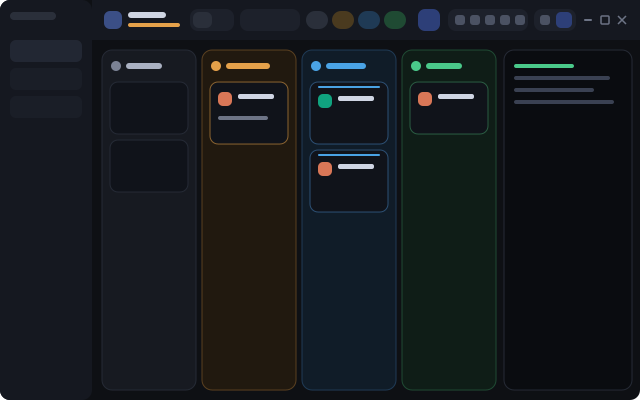

# Kanban

A Herdr app layout where every agent is a card in a column by status:
**Needs you**, **Working**, **Waiting**, **Done**, **Idle**. You can hide any column and
change the order of the columns. **Waiting** holds the Claude Code agents that look
finished but still wait for background subagents or background shell commands (see below);
you can turn it off.

A card moves between columns by itself when the agent changes status. Click a
card and the terminal of that agent opens in the panel at the right.

## Quick Start

Copy and paste this prompt to your LLM agent:

`Read ~/.config/herdr-app/AGENTS.md, then add this layout: https://github.com/dougcunha/herdr-mods/tree/main/kanban-app`

Switch to the layout with `ctrl-shift-l`. Your own layout stays as it was.

## What you see

| Part | What it shows |
| ---- | ------------- |
| Top bar | Title and agent count (the count of "need you" turns amber), then six sections: **View** (switch Board / Terminals); **Filter** (search box and a funnel button for "this space only"); **Columns** (one chip per column and the hourglass button for the Waiting column); **Look** (column width − / +, density and card view, in one group); **Blocks** (Agent terminal and Shell) and **New agent**; then the right end, the same as in the [Dock](../dock-app) bar and in the same place: **Panels** (Files, Changes and your dock buttons), the **layout switch** and the window buttons. |
| Columns | Needs you, Working, Waiting, Done, Idle, in that order by default. Each has a color, a count, 2 arrow buttons that move it and an eye button that hides it. |
| Cards | The program icon, the space name in large bold text with the program name under it, the terminal title, the Git branch, the folder (not when it is the space name), the tab (not when it is the program name), the age, a pin and an "open in its tab" button. A summary view shows 2 lines only. |
| Shell under the board | Optional. A shell of its own (`kanban-shell`), in no tab. A button in the top bar shows or hides it. Drag its top edge to resize. |
| Terminal panel | The terminal of the selected agent (`{ "agent": "focused" }`). Drag its edge to resize. |

## How it behaves

- **Hide a column:** click its chip in the top bar, or the eye button in the column header. A hidden chip is dim with a struck name. The choice is saved. If you hide all of them, a button shows them again.
- **Column order:** click the `<` or `>` arrow in a column header. The column changes place with the next visible column at that side. Hidden columns keep their place. At the edge of the board the arrow is dim. The chips in the top bar follow the same order. The order is saved in `shared("kanban.order")`.
- **Column width:** the − and + buttons set the widest a column may be: 150, 180, 220, 260, 320, 400 px or **Auto** (the columns share the whole board). **Auto** is the step after 400 px. To go back to **Auto** in 1 click, click the value between − and +. The columns get narrower with the board, down to 150 px (120 px in compact density). Below that the board scrolls sideways and each column keeps that width. On a super wide monitor, pick 220 or 260 px to get narrow cards. The choice is saved in `shared("kanban.width")`.
- **Density (small monitors):** the button with two chevrons, in the Look group next to the card view button, goes **Auto → Compact → Normal → Auto**. It is lit while the kanban is compact, and its tooltip shows the mode. The choice is saved in `shared("kanban.density")`, and the [Dock](../dock-app) bar has the same button and uses the same value. The density also sets the panel buttons and the layout switch, in both bars: **Normal** shows their names, **Compact** shows only their icons, **Auto** shows their names from 2250 px. **Auto** (the default) makes the top bar compact when it is narrower than 1800 px, and the board compact when it has less than 220 px for each visible column. In compact density:
  - **Waiting** goes under **Working** and **Idle** under **Done**: each pair shares one place on the board, one column under the other, at the place of the first of the two in the column order. So the board has 3 places instead of 5. With the Waiting column off, only Done and Idle share a place (3 places instead of 4).
  - The headers, cards and gaps are smaller. The arrows and the eye of a column header show only while the pointer is on the header, so the name has room.
  - The top bar shows icons with tooltips instead of names: the switch, the column chips (a dot and the count), and **New agent** (the panel buttons and the layout switch too). The title and the count go to the tooltip of the board icon. The search box is 150 px.
  - In every density, the search, the chips, the Look group and the Agent and Shell buttons are in one row that scrolls sideways when the bar is too narrow (for example Normal density on a 1920 px monitor). **New agent**, the Panels group, the layout switch and the window buttons always show.
- **Panels in a dialog (small monitors):** the first button of the Panels group (a window with a box in it) sets where the panel buttons open their panel. It goes **Auto → Side panel → Dialog → Auto**. It is lit while the panels open in a dialog, and its tooltip shows the mode. **Dialog** opens the panel in the middle of the window, 82% wide and 85% high, over the board. **Auto** (the default) opens a dialog when the window is narrower than 1600 px, else the side panel. These px are the px of the app: with a Windows scale of 125%, a 1920 px monitor has 1536 px. This applies to Files, Changes, the side panels of `dock/panels.json` and its tab entries (Insights): in **Side panel** mode a tab entry opens in its tab, as before.
  - The dialog has a title row with the name of the panel, a button that moves the panel to the side panel (to its tab, for a tab entry) and a close button. Esc and a click beside the dialog close it too. The button of the panel is lit while its dialog is open; a 2nd click on it closes the dialog, and a click on another panel button shows that panel in the dialog.
  - The panel in the dialog is a new copy of the mod: its scroll and selection start fresh.
  - The choice is saved in `shared("kanban.panelOpen")`, and the [Dock](../dock-app) bar has the same button and uses the same value. A dialog stays open when you switch layout, and the button of its panel stays lit in the other bar.
  - Keys: `kanban.panel-open` steps the mode, and `kanban.panel-<id>` opens or closes a panel as its button does (for example `kanban.panel-files`). Bind them in `keys.json`.
- **Card view:** the button with a list icon, right of the density button, goes **Auto → Summary → Full → Auto**. It is lit while the view is Summary. The choice is saved in `shared("kanban.cards")`. **Auto** (the default) shows summary cards while the board is compact. A summary card has 2 lines: the program icon, the space name, a pin mark when pinned and the status mark; then the terminal title (or the program and the branch). It has no age, so the title has more room. While the pointer is on the card, the pin and "open in its tab" buttons show at the end of the title line. A click selects the agent, as on a full card.
- **Waiting column (agents that wait for subagents or commands):** the Herdr app shows a Claude Code agent as **Done** (or **Idle**) when it ended its turn after it launched background subagents or background shell commands (the Bash tool with `run_in_background`), even if they still run. The Kanban reads the transcript of that Claude session and, when subagents or commands are still running, shows the card in **Waiting** with a pulsing hourglass and a line such as "2 subagents", "1 subagent · 1 command" or "1 command · Run the tests" (with the description when there is only one). When the last one reports, the agent wakes up, works, and the card goes to **Done** by itself. A command that Claude stops with TaskStop also ends the wait.
  - **Turn it off:** click the hourglass button in the top bar (lit while on). The choice is saved in `shared("kanban.waiting")`. Off, the column and its chip go away, the mod reads no transcript, and every agent shows as its Herdr status says, as before. To start with it off, add `"waiting": false` to the `props` of both `kanban` blocks in the layout (the button wins after the first click).
  - **When it is unsure, the card stays where Herdr puts it.** The mod needs to know which Claude session runs in the terminal: it uses the process id of the terminal (exact when the terminal runs Claude directly; a terminal that starts Claude from a shell has the shell's id), then the `resume.session` label of the [agent-resume](../agent-resume-app) mod, then the folder when only one session started there after the terminal. Only Claude Code agents on this computer are checked.
  - **A card stuck in Waiting:** Claude Code does not always send the final notice of a subagent, and a server that Claude starts in the background and leaves on never ends. Seen once: a subagent that replied "done" while a Monitor it had armed was still alive stayed "waiting" for good. Two ways out. A card whose subagents and commands have not reported for **1 hour** goes back to Done or Idle by itself (change it with `"waitingMinutes": 30` in the `props` of both `kanban` blocks). The limit does not apply to a background command while Claude Code says that one runs (`"status": "shell"` in its session registry): a mutation test or a long build can run for hours. And a waiting card has a **check button** ("Not waiting"; on a summary card it shows while the pointer is on the card) that sends it back at once, until the agent takes another turn.
  - **Cost:** it reads a transcript only for a Claude agent that shows as Done or Idle, once per turn of that agent (and every 30 seconds for an agent known to wait). A typical transcript (1 to 5 MiB) takes some milliseconds; the biggest ones (30 MiB or more) a fraction of a second, off the screen thread.
  - **Auto density:** with the column on, the board has 5 columns, so Auto goes compact (and to summary cards) below about 1150 px instead of about 920 px. Turn the column off, or set the density, to keep the old limit.
  - **Config folders:** the mod looks in every `~/.claude*` folder that has `sessions` or `projects` (some people keep `~/.claude` and `~/.claude-work` apart). If yours has another name, add `"claudeDirs": ["C:/Users/me/claude-home"]` to the `props` of both `kanban` blocks.
- **Working** cards have a pulsing line on top and a spinner. **Needs you** has a pulsing bell and an amber border. **Done** has a check. **Idle** has a moon.
- **Click a card:** `agent.focus` selects it and opens the terminal panel. A **Done** agent becomes **Idle** after you look at it, so its card moves.
- **Pin** keeps a card at the top of its column. **Open in its tab** goes to the tab of the agent and switches to the **Terminals** view.
- **Files and Changes:** the two buttons in the top bar open Herdr's own Files mod and the [Changes Split](../changes-app) mod (Herdr's Changes panel with a Unified / Split switch) in a side panel at the right (368 px, drag its edge to resize). Click the same button again to close the panel; click the other one to switch. The panel works in the Board and the Terminals views. It starts closed.
- **Your dock buttons:** the group of buttons also lists every entry of `~/.config/herdr-app/dock/panels.json`, the file the [Dock](../dock-app) layout reads (CI, Repos, Graph, Insights, ...). An entry with `"opens": "panel"` (the default) becomes a block of the same side panel; the Kanban top bar adds it to the layout by itself the first time. `"opens": "tab"` opens a tab with the mod and switches to the Terminals view. `"opens": "command"` runs a Herdr command (a `layout.switch` entry goes to the layout switch). A save of the file shows in the bar at once. If you remove an entry, its block goes too.
- **Layout switch:** at the right end of the top bar, before the window buttons, one group has a button for each layout: first the layout you came from (`shared("layout.previous")`; without it, `props.back` of the bar block, then `main`, then the first other layout), then the `layout.switch` entries of `dock/panels.json`. The button of the layout you are in is lit. The Dock bar draws the same group in the same place, so the button does not move when you switch.
- **Button in the other layout:** with the [Dock](../dock-app) layout, add a command entry to `~/.config/herdr-app/dock/panels.json` and the tab bar shows a **Kanban** button in its layout switch:
  `{ "id": "kanban", "label": "Kanban", "icon": "mods/kanban/board.svg", "opens": "command", "run": "layout.switch", "args": { "name": "kanban" } }`
  The Dock keeps the name of the layout in `layout.previous` before it switches, so the layout switch here goes back there. This needs the `tabs-dock` of this repository (it adds `"opens": "command"`).
- **Shell under the board:** the button with a bottom-panel icon, right of the Agent button in the Panels group, shows or hides a shell under the columns. The first time, the mod starts a terminal named `kanban-shell` with `hc run --bg --keep --no-parent`, in the folder of the active space, and adds a block `{ "terminal": "<address>" }` to the layout with `layout.set`. The terminal has no `herdr.space` or `herdr.tab` label, so it is in no tab, and a click on a card does not change it. Hide it and show it again: it is the same shell, with its history. If you type `exit`, click the button 2 times (hide, show) to get a new shell. The default shell of this computer runs; to choose one, add `"shell": ["pwsh", "-NoLogo"]` to the `props` of the `bar` block. You cannot split this shell: it is a layout block, as the terminal panel is.
- **Terminals view** shows the tabs of the current space as in the normal layout, so you can still use plain terminals.
- `agent.next` and `agent.prev` follow the order of the cards on the board.
- Window buttons, drag area and resize work as in the Dock layout (`titlebar: none`).

## What it adds

| Part | What it is |
| ---- | ---------- |
| `layouts/kanban.json` | The window: spaces sidebar (hidden at start), top bar, board plus terminal panel, tab view and status bar. |
| `layouts/kanban.svg` | The picture for the settings screen. |
| `mods/kanban/` | One mod with two parts, chosen by `props.part`: `bar` and `board`. They share state through `shared()`. `waiting.js` finds the agents that wait for subagents. |

Language: the mod shows English. Add `"lang": "pt"` to the `props` of both
`kanban` blocks in the layout for Portuguese.

## What it does on your machine

- It reads the live data of Herdr (agents, spaces, panes). It stores 11 values in `shared()`: `kanban.hidden`, `kanban.query`, `kanban.scope`, `kanban.width`, `kanban.order`, `kanban.density`, `kanban.cards`, `kanban.panelOpen`, `kanban.panelDialog`, `kanban.waiting` and `kanban.waiting.dismissed`.
- It reads `dock/panels.json` and the folder list of `mods/` in the Herdr home, and watches the `dock/` folder.
- It edits `layouts/kanban.json` with the `layout.set` command, to add or remove the side-panel blocks of `panels.json`, and to add the shell block.
- With the Waiting column on, it reads (never writes) files in your Claude Code folders under your home folder: `sessions/*.json` (with the `status` field: `"shell"` while a background command runs) and the transcript `projects/*/<session>.jsonl` of the Claude agents that show as Done or Idle. It runs `hc get <terminal> --json` for them. It reads a transcript again only when the agent changes turn, and every 30 seconds for an agent known to wait. Nothing leaves your computer.
- When you show the shell, it runs `hc get kanban-shell`, and `hc run` (or `hc rm` and `hc run`) when that terminal is absent or finished.
- Besides the reads above, it runs Herdr commands only: `agent.focus`, `terminal.pin`, `tab.select`, `space.select`, `pane.focus`, `pane.zoom`, `layout.select`, `layout.show`, `layout.hide`, `layout.toggle`, `layout.set`, `layout.switch`, `tab.new`, `window.*`, and the `run` of a command entry of `panels.json`.
- It runs no program other than `hc`, and uses no network.

## Limits

- It uses the shipped mods `workspace-chrome`, `spaces`, `workspace-status`, `pane` and `new-menu`.
  They come with Herdr and are not copied here.
- The Changes panel is the `changes-split` mod ([this repository](../changes-app)). Install it before the layout, or the panel stays empty. To go back to Herdr's own Changes panel, point the `changes` block of `layouts/kanban.json` to the mod `changes`.
- The age on a card is the age of its **tab** (`changed_at` or `working_since`). A tab with 2 agents shows the same age on both.
- The Waiting column depends on how Claude Code writes its transcript (tested with Claude Code 2.1.318): a tool result "Async agent launched … agentId" and `<task-notification>` records. If a new version changes that, the column stays empty and the agents show as Done or Idle, as before. Background shell commands are counted too: a tool result "Command running in background with ID", or the status `"shell"` in `sessions/<pid>.json`. Other agents (Codex, …) are not checked.
- Built and tested on Windows with Herdr 0.1.12. Untested: macOS, Linux, remote machines.
- `RECIPE.md` has the full brief to build it from scratch.
