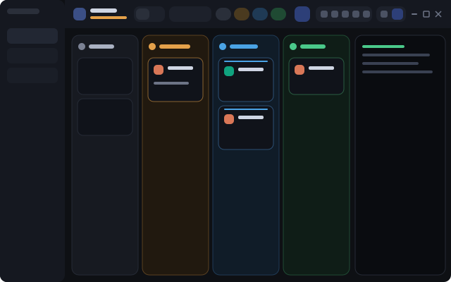

# Kanban

A Herdr app layout where each agent is a card in a status column: Needs you, Working, Waiting, Done, Idle. The person can hide any column and change the order of the columns. A panel at the right shows the terminal of the selected agent.

## What you see

Left to right, top to bottom (zoom 1):

- **Sidebar**, hidden at start (`"hidden": true`; `ctrl-shift-b` shows it), 240 px, `chrome` background: the shipped `workspace-chrome` brand (46 px), the shipped `spaces` list, the `workspace-chrome` footer (69 px). The board does not need it. While it is hidden on macOS, the bar gets 76 px of left padding so the window buttons do not cover the board tile.
- **Top bar**, 44 px (the same height as the Dock bar), `chrome` background, 1 px bottom border, `window_drag`, 10 px right padding. From the left: an accent tile with a board icon; the title "Agents" (14 px semibold) over the count ("5 agents", 11 px; amber with "· 2 need you" when an agent is blocked); then the controls in six sections, each one a purpose, with a 1 px line (`divider`) after the switch and after the view's own controls:
  1. **View**: a switch Board / Terminals (32 px high, pill, active item raised).
  2. **Filter** (board only): a search box 220 px wide and a `filter` (funnel) button, lit while the cards are limited to the active space.
  3. **Columns** (board only): 5 column chips and the Waiting button (`hourglass` icon, lit while the Waiting column is on).
  4. **Look** (board only), one rounded group: the width control (a `width` icon, `−`, the value, `+`; while a width is set, the value is a button that sets Auto, `shared("kanban.width")` = null), a line, the density button (`density` icon) and the card view button (`cards` icon).
  5. **Blocks** (board only), one rounded group: the "Agent" button (`panel` icon, the terminal panel) and the "Shell" button (`panel-bottom` icon, a spinner while it works). Then a primary "New agent" button (`bot` icon).
  6. **Right end**, the same as in the Dock bar (`tabs-dock`), in the same place and size, so a layout switch does not move it. 6 px between its parts: the **Panels** group ("Files", "Changes", the entries of `dock/panels.json` that open a panel or a tab, lit while their panel shows, then the command entries that are not `layout.switch`); the **layout switch**, one rounded group with one button per layout (the layout to go back to with the `layout-main` icon, then the `layout.switch` entries of the file, the shown layout lit); the window buttons (28 px, 2 px apart) when `window().buttons`. The buttons show their names in `normal` density, only icons with tooltips in `compact` density, and in `auto` their names only when the bar is 2250 px wide or more. The Dock bar uses the same rule and the same `shared("kanban.density")`.
- **Board**, `canvas` background, 12 px padding and gap. 5 columns of equal width (min 150 px; max set by the width control: 150, 180, 220, 260, 320, 400 px or Auto = no max, `shared("kanban.width")`; the board block has `min: 160` in the layout; the board scrolls sideways only when the columns do not fit at their minimum width, and then each column has exactly that width), in this default order: Needs you, Working, Waiting, Done, Idle. A column is a 16 px rounded box with a 1 px border and a background tinted 5% with its status color (`theme().idle`, `blocked`, `working`, `done`; Waiting has no theme color: `ansi5`, else `accent`). Header 48 px: a 26 px tile with an icon (moon, bell, zap, hourglass, check), the name (13 px semibold), a count badge, a chevron-left and a chevron-right button, an eye-off button.
- **Card**, `background` color, 12 px radius, 1 px border, 12 px padding, 9 px gap: a program tile (28 px, from `program.tile` and `program.icon`), the program name, the space name, a status mark at the right; the terminal title (12 px, 2 lines max); pills for the Git branch (mono), the folder and a named tab; a footer with the age and 2 icon buttons (pin, open).
- **Compact density** (small monitors): column min 120 px, 8 px gap, 12 px radius, header 40 px (8 px padding, 4 px gap, 22 px tile, 12 px name, 20 px buttons), cards with 9 px padding and a 24 px program tile, an empty column box of 64 px. The columns of a group share one place, one under the other (a `column` with the same gap), at the place of the first of them in the order: Working with Waiting, Done with Idle. The header arrows and eye show only while the pointer is on the header (`on_hover`). In the top bar: no title text (it is the tooltip of the board tile, which turns amber when an agent is blocked), the switch, the chips and "New agent" show icons only with tooltips (the panel buttons and the layout switch are icons in every width unless the bar is 2250 px or more), the search box is 150 px, left padding 10 px and gap 6 px.
- **Summary card**, `background` color, 9 px radius, 1 px border, padding 7 × 9 px, 4 px gap: line 1 is a 20 px program tile, the space name (12 px semibold), a pin icon when pinned and the status mark; line 2 (20 px high) is the title, else the program name and the branch (11 px `muted`), with no age so the title has room. While hovered, 2 icon buttons of 20 px (pin, open) show at the end of line 2.
- **Shell under the board** (`shell`), optional and absent from the layout file at start: a block `{ "terminal": "<address>" }`, 300 px high (min 120), `background` color, 1 px border, 14 px radius. It shares a column `board-main` (12 px gap, min 160) with the board.
- **Side panel** (`panel`), at the right of the board and the terminal panel, 368 px (min 240, max 1200), hidden at start: a stack `panel-body` with the shipped `files` and `changes` mods.
- **Terminal panel**, 460 px (min 280, max 1100), `background` color, 14 px radius, `md` shadow: `{ "agent": "focused" }`.
- **Status bar**, 28 px, the shipped `workspace-status`.

## How it behaves

- Status to column: `idle` to Idle, `blocked` to Needs you, `working` to Working, `done` to Done. Inside a column: pinned first, then the highest `seq` first.
- **Waiting** is not a Herdr status. A Claude Code agent (`app: "claude-code"`) that shows as `done` or `idle` while background subagents or background shell commands still run is shown as `waiting` (the card gets `status: "waiting"` and `wait: { count, items }`). `mods/kanban/waiting.js` finds them; it imports only `fs/promises`, so a Node script can test it:
  - The session of a terminal, in this order: the process id (`pid`, `foreground.pid` or label `resume.pid` of `hc get <t> --json`; for a Claude started from a shell these are the shell's, so they do not match) against `<config>/sessions/<pid>.json` (`{ pid, sessionId, cwd, startedAt }`); the label `resume.session`; the folder, only when exactly one session started there after `created_ms`. Unsure: no session, and the card stays where Herdr puts it. The config folders are every `~/.claude*` with `sessions` or `projects`, or `props.claudeDirs`.
  - The transcript is `<config>/projects/<cwd with every non-alphanumeric character as "-">/<sessionId>.jsonl` (the folder is found by listing if that guess misses).
  - Only structural records count: the launch is the tool result of an `Agent` or `Task` tool call (a shell command can print the same words), and a notification is a `queue-operation` record, a user message that starts with it, or a `queued_command` attachment. One record can hold several `<task-notification>` blocks: each is read on its own.
  - A subagent is pending when the transcript has a tool result "Async agent launched … agentId: <id>" for it and its last `<task-notification>` for that `<task-id>` is interim or absent. A notification is interim when it says the agent "is waiting on its own background work" (the subagent started a background job of its own and has not reported); any other one means it finished. Do not trust `subagents/agent-*.meta.json` `finished`: it turns `true` at the interim notification. A pending subagent that has not reported for 1 hour (`props.waitingMinutes`, counted from its last notification, else its launch) is ignored: Claude Code can leave a finished subagent marked interim for good (seen: the subagent ended while a Monitor it had armed was still alive, and no final notice came).
  - A background shell command is pending when the transcript has a tool result "Command running in background with ID: <id>" of a `Bash` tool call with `run_in_background: true`, and no `<task-notification>` for that `<task-id>` follows (a command has no interim notice: any notification ends it). A `TaskStop` call (`KillShell` or `KillBash` in older versions) with `task_id` (or `shell_id`) <id> also ends it, because a stopped job gets no notification. The item has `kind: "shell"` (a subagent has `kind: "agent"`) and the description of the Bash call. Also, when `<config>/sessions/<pid>.json` of the session has `"status": "shell"` (Claude ended its turn while a background command runs) and the transcript shows no pending command, the mod adds 1 shell item that counts from `statusUpdatedAt`. Another status changes nothing (just after the turn ends it can still say `busy`). While the registry says `shell`, every shell item gets `live: true` and the 1-hour limit does not apply to it (a mutation test can run for hours). Without that status, the limit applies to commands too. A server that Claude leaves on in the background keeps the status `shell`: its card stays in Waiting until the person clicks "Not waiting".
  - The card text: "N subagents", "N commands", both joined with " · ", and the description when there is only 1 job.
  - The card is waiting only for the turn it was read in (`terminals()[i].turn`): when the agent works again the answer is stale and the card goes back at once. A transcript is read again when a candidate changes `turn`, and every 30 seconds while some agent waits. Both parts (`bar` for the chip counts, `board`) run their own tracker.
  - The column and its chip exist only while `waitingOn()` is true: `shared("kanban.waiting")` (`"on"` or `"off"`, set by the hourglass button), else `props.waiting !== false`. Off, nothing is read and every agent keeps its Herdr status.
  - A waiting card has a `check` button ("Not waiting") that stores `shared("kanban.waiting.dismissed")[address] = turn`: the card shows as Done or Idle until that agent takes another turn.
  - A saved `shared("kanban.order")` without `waiting` gets the column right after the column that comes before it in the default order (under Working).
- **working**: a 2 px line on top of the card pulses (`loop opacity 0.2 to 1, 1400 ms`) and a spinner turns (`spin 900`). **blocked**: the bell pulses (`0.3 to 1, 1100 ms`), the border is amber, the column tile pulses. **done**: a check. **idle**: a moon.
- A column chip toggles the column. Hidden: dim, the name is struck, the dot is hollow. The list of hidden ids is `shared("kanban.hidden")`. With all of them hidden the board shows a message and a "Show all columns" button.
- The chevrons in a column header swap the column with the next visible column to the left or right. Hidden columns keep their place. At the edge the chevron is dim and does nothing. The order is `shared("kanban.order")`, a list of column ids; unknown ids are dropped and a missing column goes after the column that comes before it in the default order. The chips of the top bar and `setAgentOrder` follow the same order.
- The search box filters on title, program, space, tab and branch (`shared("kanban.query")`). The funnel button limits the cards to the active space (`shared("kanban.scope")`: `all` or `space`).
- Click a card: `agent.focus {terminal}`; `layout.show {id:"detail"}` when the panel is hidden. The pin button runs `terminal.pin {terminal, pinned}`. The open button runs `space.select`, `tab.select`, `pane.focus` and `layout.select {stack:"view", child:"tabs-view"}`.
- The switch runs `layout.select {stack:"view", child:"board-view" | "tabs-view"}`. In Terminals view the top bar shows the tab pills of the active space and a `+` that runs `tab.new`.
- The layout switch lists, in order: the layout to go back to, the `layout.switch` entries of `dock/panels.json` (`args.name`), then the shown layout when no entry names it. Only names in `layouts()` count, each one once. The layout to go back to is, in order: `shared("layout.previous")`, `props.back` (of the `bar` block), `main`, the first other name of `layouts()`; it never is the shown layout. The button of the shown layout is lit and does nothing. Another button first runs `setShared("layout.previous", shared("layout"))`, then `layout.switch {name}`. The label is the entry's label, or the layout name with `-` and `_` as spaces and a capital first letter (`main-dock` → "Main dock"). The switch is hidden with fewer than 2 layouts.
- The bar reads `dock/panels.json` (`{ "panels": [ { id, label, icon, mod, props?, opens?, name?, run?, args? } ] }`) and watches the `dock/` folder. An entry is skipped when its id is bad (`a-z`, `0-9`, `-`, up to 32), twice, has no label or icon, or its `mod` is not in `mods/` (a command entry needs `run` instead of `mod`). A broken file keeps the last good list and shows an error toast.
- Buttons of one rounded group, in this order: Files, Changes, then the file's entries as listed (`panel` and `tab`), then its `command` entries that are not `layout.switch` (those are in the layout switch). `panel` entries (default) are added as blocks `{ id, type: "block", content: { mod, props? } }` to `panel-body` with `layout.set`, once per file version and layout, and only after the file has loaded; the ids added are kept in `localStorage` (`kanban.injected`) so an entry removed from the file takes its block away. An id that is another node of the layout is skipped. `tab` entries run the "one tab per space" logic (focus the tab that shows the mod, else `tab.new {name, mod}`) and then `layout.select {stack:"view", child:"tabs-view"}`. A `command` entry runs `run(entry.run, entry.args)`.
- The Files and Changes buttons: when `panel` is hidden or shows the other child, run `layout.select {stack:"panel-body", child}` and `layout.show {id:"panel"}`; when it already shows that child, run `layout.hide {id:"panel"}`. The buttons show only for children that `panel-body` has. When a block leaves the layout (the shell, when its terminal ends), Herdr removes each column that keeps only one child, `panel` too: then `panel-body` is the node to show and hide, and the buttons stay.
- The Shell button (a bottom-panel icon, second in the Panels group after Agent, lit while `shell` shows, a spinner that turns while it works). When `shell` shows: `layout.hide {id:"shell"}`. Otherwise: `hc get kanban-shell --json`; if its `state` is not `live`, `hc rm kanban-shell` (when it exists) and `hc run --bg --json --keep --no-parent --name kanban-shell --label kanban.shell=1 --cwd <active space folder> [-- props.shell...]`. If the `shell` block already shows that address, `layout.show {id:"shell"}`; else `layout.set` with the block pointed at the address, or with the `board` block of `board-view` wrapped in `board-main` together with a new `shell` block. A failure shows an error toast. Why a separate terminal: a test with a `{ "tab": "active" }` block under the board turned it and `detail` black and without input (probably the same terminal in 2 visible blocks), and `pane.split` fails while a layout terminal block has the focus.
- The density button goes `auto` → `compact` → `normal` → `auto` in `shared("kanban.density")` (absent: `auto`). It is lit while the bar is compact; its tooltip names the mode and the next one. Each part measures its own root with `on_size_change` (the reported width is in the same px as `.w()`; `settings().zoom` must not be applied). With `auto`, the bar is compact below 1800 px, and the board is compact below 220 px per visible column plus the gaps. In the board view, the search, the chips, the Waiting button, the Look group and the Blocks group share one row `kb-strip` (`flex_1`, `min_w(0)`, scrolls sideways; gap 6 px compact, 10 px normal); "New agent" and the right end stay outside it, so the right end stays where the Dock bar draws it. The Dock bar has the same density button and steps the same key.
- The card view button goes `auto` → `summary` → `full` → `auto` in `shared("kanban.cards")` (absent: `auto`). It is lit while the value is `summary`. With `auto`, the cards are summary cards while the board is compact.
- The Agent button (Panels group) runs `layout.toggle {id:"detail"}`. "New agent" opens the shipped `new-menu` as a popup (250 x 512).
- The board calls `setAgentOrder` with the visible cards, so `agent.next` and `agent.prev` follow the board.

## Built from

- `layouts/kanban.json`: root `row` (`titlebar: none`, `background: canvas`): `sidebar` (column) and `work` (column). `work` holds blocks `bar` and `status`, and a `row` `work-body` (padding 12, gap 12). `work-body` holds the `stack` `view` (active `board-view`) with the `row` `board-view` (gap 12; blocks `board` and `detail`) and the block `tabs-view` (`{ "tab": "active", "pane": {...header: mod "pane"} }`), and the hidden `column` `panel` with the `stack` `panel-body` (`files`, `changes`).
- `mods/kanban/main.js`: one `View`; `props.part` is `bar` or `board`; `props.lang` is `en` or `pt`. `mods/kanban/ui.js`: the icon button, the column chip, the switch, the search box, the pill, the panel button, the button group, the divider and the button. `mods/kanban/waiting.js`: the Waiting detector.
- `mods/kanban/*.svg`: 24 px stroke icons (`currentColor`; the bar uses `filter`, `width`, `density`, `cards`, `layout-main`, `bot`, `panel`, `panel-bottom`, `hourglass`), `spinner.svg`, `hourglass.svg`, and the 4 `win-*.svg` window icons.
- `herdr` functions: `agents`, `spaces`, `panes`, `focused`, `layout`, `window`, `theme`, `props`, `shared`, `setShared`, `run`, `openOverlay`, `setAgentOrder`, `home`, `terminals`, `hc`.

## Watch out

- Write `mod.json` (`{ "place": "none" }`) before `main.js`. Without it Herdr docks a stray copy of the mod into the layout.
- Colors given to `bg` and `border_color` must be `#rrggbb[aa]`. Theme names do not work in a mod. Add alpha with a 2-digit hex suffix.
- A column needs `h_full()`. Without it the columns collapse to the header height and sit in the middle of the board.
- There is no `line_clamp`: the title uses `max_h(34).overflow_hidden()` for 2 lines.
- `props()` inside a later callback can answer for another copy: read the props once in `init(given, cx)`.
- The card age comes from the tab (`changed_at`, `working_since`), not from the agent.
- A row with `overflow_x_scrollbar()` lays out its children at their content width: `flex_1` columns do not share the board, and a long card title makes every column wider. Add the scroll only when the columns do not fit, and give them a fixed `w()` then.
- Text measures its min-content as one line. A pill in the card must shrink (`flex_shrink(1).min_w(0)`), or it goes past the edge of a narrow card.

## Done when

- `herdr-app check ~/.config/herdr-app/mods/kanban` passes and `herdr-app status` shows no errors after `layout.switch {name: "kanban"}`.
- Each agent shows as one card, in the column of its status, with its program icon.
- Clicking a column chip hides and shows that column, and the choice stays after a restart.
- Clicking a card shows its terminal in the right panel.
- The Board / Terminals switch changes the view and the tab pills work.
