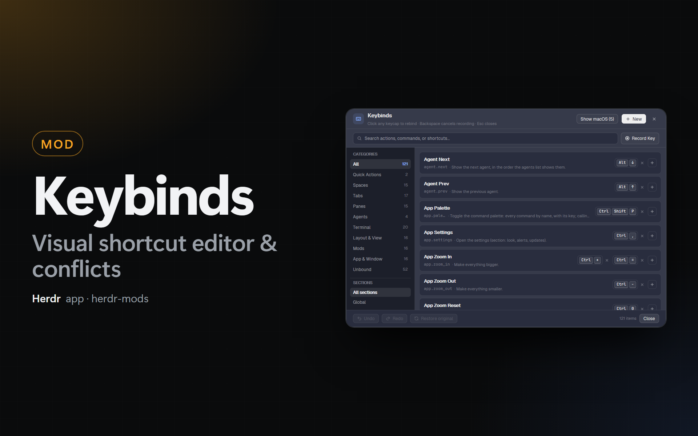

# Keybinds for the Herdr app



A visual keyboard shortcuts manager for Herdr's `keys.json`. It replaces Herdr's read-only `help` dialog (`Ctrl+Shift+?` / `Cmd+Shift+?`) with a modern two-column editor featuring press-to-record capture, conflict detection, custom bindings, Quick Actions shortcuts, and session undo.

- **Press-to-record capture.** Click any keycap to rebind that shortcut, or click `+` to add another shortcut to the same action without removing existing aliases.
- **Cross-section & same-section conflict resolution.**
  - **Same section:** inline **Replace**, **Swap**, or **Cancel** actions.
  - **Cross-section precedence (`terminal` > `layout:*` > `global`):** non-blocking inline overlap warning with **Save anyway** or **Save & remove from &lt;section&gt;**.
  - **Safety cautions:** warns before binding terminal control keys (`Ctrl+C`, `Ctrl+R`, `Ctrl+W`, etc.) or Windows `Ctrl+Alt+*` (AltGr) combinations, and blocks `Ctrl+Alt+Shift+Esc` (Herdr's escape hatch).
- **All sections & action types.** Edit `global`, `terminal`, `layout:*`, and `mod:*` bindings, view unbound Herdr commands, and create custom bindings via the guided **New** form (**Command**, **Mod Command**, **Send Text** with escape presets, or **Pass to Terminal**).
- **Search by text or by key.** Type to filter actions, commands, or shortcuts, or click **Record Key** and press a key combination to see everything bound to it.
- **macOS `cmd-*` filter.** On Windows and Linux, `cmd-*` bindings are hidden by default (with a **Show macOS (N)** toggle) and are never deleted when editing or removing other shortcuts for the same action.
- **Quick Actions integration.** Lists all actions from `data/quick-actions.json` in a dedicated **Quick Actions** category with their real names and icons (plus flags for orphaned bindings), and integrates directly with the **Quick Actions** dialog.
- **Session Undo, Redo & Restore.** `Ctrl+Z` / `Ctrl+Shift+Z` (or toolbar buttons) undo/redo edits, **Restore original** reverts `keys.json` to how it was when the dialog opened, and a live banner surfaces any `keys.error` reported by Herdr.

## Install

With an agent (Claude Code, Antigravity, Codex, etc.):

`Read ~/.config/herdr-app/AGENTS.md, then add this mod: https://github.com/dougcunha/herdr-mods/tree/main/keybinds-app and merge its keys.json`

Or copy the folder manually (Herdr must be running; copy `mod.json` before `main.js`):

```sh
cp -r keybinds-app/mods/keybinds ~/.config/herdr-app/mods/keybinds
herdr-app check ~/.config/herdr-app/mods/keybinds
```

Then update `keys.json` (see `keybinds-app/keys.json`) so `Ctrl+Shift+?` / `Ctrl+Shift+/` (and `Cmd+Shift+?` / `Cmd+Shift+/` on macOS) open `mod.open:keybinds`:

```json
"ctrl-?": "mod.open:keybinds",
"ctrl-shift-/": "mod.open:keybinds",
"ctrl-shift-?": "mod.open:keybinds",
"cmd-?": "mod.open:keybinds",
"cmd-shift-/": "mod.open:keybinds",
"cmd-shift-?": "mod.open:keybinds"
```

## Files & what it reads/writes

- Reads and atomically writes `~/.config/herdr-app/keys.json` (`writeTextFile`).
- Reads `~/.config/herdr-app/keys.error`, `~/.config/herdr-app/data/quick-actions.json`, and `~/.config/herdr-app/mods/*/mod.json`.
- Writes shared state `keybinds.showMac`, `keybinds.changed`, and `mods-hub.keysChanged`.
- No network access and no external processes.

[`RECIPE.md`](RECIPE.md) describes the mod in full.
