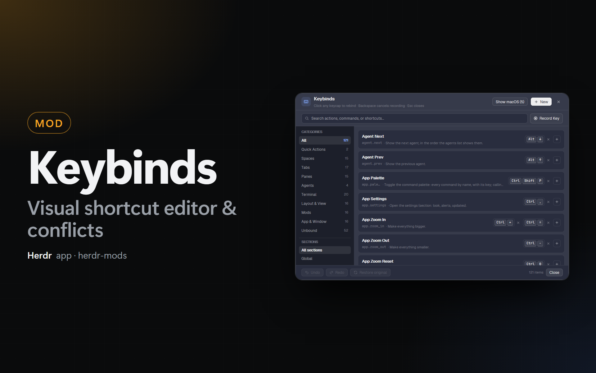

# Keybinds

A two-column visual shortcut manager dialog (`880 × 600`) for Herdr's `keys.json`. It replaces Herdr's default `app.help` keybinds (`ctrl-shift-/`, `ctrl-shift-?`, `cmd-shift-/`, `cmd-shift-?`) with `mod.open:keybinds`, supports press-to-record editing with same-section and cross-section conflict resolution, integrates with `quick-actions`, hides `cmd-*` bindings on non-macOS by default, and provides session undo/redo and restore.

## What you see

- **Header (54 px):** `keyboard.svg` icon tile (`30 px`), title `"Keybinds"`, hint `"Click any keycap to rebind · Esc cancels recording or closes"`, optional `"Show macOS (N)"` / `"Hide macOS"` button (when non-macOS has hidden `cmd-*` bindings), primary **`New`** button, and close **`×`**.
- **Search bar:** full-width input (`"Search actions, commands, or shortcuts…"`) with inline clear buttons and **`Record Key`** button (switches to `"Press key to filter…"` while waiting for a chord).
- **Error banner (when present):** tinted `blocked` alert bar showing `keys.json` parse errors, write errors, or live `keys.error` content from Herdr.
- **Two-column body:**
  - **Left sidebar (`188 px`, `chrome` background):** `CATEGORIES` (`All`, `Quick Actions`, `Spaces`, `Tabs`, `Panes`, `Agents`, `Terminal`, `Layout & View`, `Mods`, `App & Window`, `Unbound`, `Warnings`) with live counts, and `SECTIONS` (`All sections`, `Global`, `Terminal`, `Layout: *`, `Mod: *`).
  - **Right list:** scrollable cards grouped by `(section, action)`. Each row shows the friendly action title, optional section/shadow/orphaned/caution badges, raw action string + description, clickable physical-style keycaps with individual `×` remove buttons, and a `+` button to add another shortcut.
- **New Binding sub-view (`view === "new"`):** 4-mode segmented picker (`Command`, `Mod Command`, `Send Text`, `Pass to Terminal`), section chips, and integrated press-to-record box with live conflict preview.
- **Footer (`46 px`, `surface` background):** **Undo**, **Redo**, **Restore original** (2-click confirm), item count, and **Close**.

## How it behaves

- Clicking a keycap or `+` blurs text inputs, focuses the root handle (`40 ms` timer reinforcement), installs scoped `KeybindsRecording` bindings (`cx.bind_keys` + `.key_context("KeybindsRecording")` + `.on_action(...)`) for `Escape` and all existing shortcuts in `keys.json`, and enters inline `"Press keys…"` capture so already-bound shortcuts are intercepted instead of firing. `Esc`, `Backspace` (no modifiers), or **Cancel** exits capture.
- Outside `mod:*` sections, bare keys without modifiers (except `F1–F24`) are blocked inline. `ctrl-alt-shift-escape` is always blocked.
- Valid, conflict-free, caution-free chords save atomically via `writeTextFile` immediately.
- **Same-section conflict:** opens an inline banner with **Replace**, **Swap** (when editing an existing keycap), and **Cancel**.
- **Cross-section overlap (`terminal` > `layout:*` > `global`):** opens a non-blocking banner with **Save anyway**, **Save & remove from &lt;section&gt;**, and **Cancel**.
- **Safety cautions (`ctrl-c/d/l/r/w/a/e/u/k/z/[` and Windows `ctrl-alt-*`):** asks for confirmation (**Bind anyway** / **Cancel**).
- Reading `data/quick-actions.json` maps `quick-actions.run-<id>` to real Quick Action names/icons and detects orphaned bindings. Accepting `props().focusAction` and `props().autoRecord` lets `quick-actions` jump straight to a row and start recording.
- Every write pushes the previous raw text onto `history.undo`, checks `keys.error` after `300 ms`, and updates `shared("mods-hub").keysChanged` and `shared("keybinds.changed")`.

## Built from

| File | Purpose |
| --- | --- |
| `mod.json` | `place: "none"`, `title: "Keybinds"`, `overlay: { kind: "dialog", width: 880, height: 600 }`, `palette` entry. |
| `kit.json` | PowerMods metadata and settings (`open`, `open-key`, `keybinds.showMac`). |
| `model.js` | Pure domain model: chord normalization, `chordOfEvent`, `analyzeConflict`, `buildRows`, `setBinding`, `removeBinding`. |
| `store.js` | Atomic `readTextFile`/`writeTextFile` for `keys.json`, `keys.error`, `data/quick-actions.json`, `mods/*/mod.json`, shared state helpers. |
| `ui.js` | Physical-style keycaps, badges, buttons, segmented controls. |
| `form.js` | Guided 4-mode New Binding form and conflict preview. |
| `main.js` | `Keybinds` `View`, `ScrollHandle` scrolling, `nextCommand()` (`new`, `list`, `category-*`, `section-*`, `toggle-mac`, `record-filter`, `undo`, `redo`), capture state machine. |

Uses `herdr` APIs: `theme`, `props`, `closeOverlay`, `commands`, `layouts`, `nextCommand`, `checking`, `window`, `notify`, `settings`, `appHome`, `readTextFile`, `writeTextFile`, `shared`, `setShared`, plus `fs.readdir` on `mods/`.

## Watch out

- Outside active recording, `dialog` overlays in Herdr intercept `Esc` before `on_key_down` when the root has focus. During active recording, `KeybindsRecording` shadows `escape` and all bound chords in `keys.json` so `Esc` cancels recording cleanly and existing bindings (like `Alt+S`) trigger the conflict/capture handler rather than running their bound command.
- Never mutate `cmd-*` aliases hidden on Windows/Linux when editing or removing a `ctrl-*` binding on the same action.
- Guard all async loaders in `init` with `if (checking()) return;` and always `blur()` inputs before focusing `this.handle` (plus `cx.timer.after(40, ...)`).

## Done when

- `herdr-app check ~/.config/herdr-app/mods/keybinds` exits 0 with no errors.
- `herdr-app do mod.open --name keybinds` opens the 2-column dialog cleanly with no `keys.error` and no visual clipping.
- `herdr-app do keybinds.new` opens the 4-mode New Binding form.
- Clicking a keycap in the live app captures a shortcut, detects conflicts inline, writes `keys.json`, and supports Undo / Restore original.
