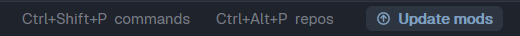

# Herdr Mods (mods-hub)

The central dialog of this kit. A status bar item tells you when this repository has a new version of its mods. A click opens the **Herdr Mods** dialog: the installed mods, the release notes, and an agent that updates the kit.

Before version 5 of the setup, this mod was `mods-update`. The setup prompt moves an installed `mods-update` to `mods-hub` (see "Move from mods-update").



No preview of the dialog ships with this recipe: a real screenshot shows the mods and the folders of the person who takes it.

## The status bar item

1. The mod downloads [`SETUP-PROMPT.md`](../SETUP-PROMPT.md) from GitHub when it starts, and again every 6 hours.
2. It reads the version in the first line of that file: `<!-- herdr-mods-setup-version: N -->`.
3. It reads the version of your last run of the prompt: the `version` field of `~/.config/herdr-app/data/herdr-mods-setup.json`. The agent writes this file at the end of a run. No file, or no field, counts as version 0.
4. If GitHub has a newer version, the item shows **Update mods**, and 1 toast tells you about it. Otherwise the item shows `mods v<N>` in a dim color.
5. A click on the item (or on the toast) opens the dialog.

## The dialog

Open it with a click on the status bar item, with `ctrl-shift-h` (`cmd-shift-h` on macOS; the setup adds the key only when it is free), or with `mod.open:mods-hub` in the palette.

The gear button of the `kanban` and `tabs-dock` bars opens a menu with **Herdr settings** and **Herdr Mods**. **Herdr Mods** opens the dialog on its **Settings** tab.

The dialog has 4 tabs. When an update is available and you did not see its notes yet, it opens on **What's new**. Otherwise it opens on the last tab that you clicked, or on **Mods**.

### Mods

The mods of `~/.config/herdr-app/mods/`, with chips that show 1 kind at a time:

- **Kit:** the mods of this repository. A mod is from the kit when its folder has a `kit.json`, or when the setup record lists it.
- **Third-party:** `git-graph`, `markdown-reader`, `markdown-reader-pane` and `insights`, which the setup prompt installs.
- **Manual:** any other mod that you installed.
- **Herdr:** the mods that Herdr installs and updates (`installed.json`).

Each row has a dot: red when the folder has a `*.error` file, yellow when a kit file changed, green when the kit files are the same as the setup run, dim when there is nothing to compare. A click on a row shows:

- The description of a kit mod (from its `kit.json`).
- The files that changed, the files that are missing, and the files that exist only on this computer. The mod compares each installed file with the hash that the setup prompt wrote in the record. The difference between CRLF and LF does not count.
- The text of each `*.error` file.
- **README of `<app>`**: the README of the mod, downloaded from GitHub, in the dialog. **← Back** or Backspace goes back to the list.

A setup run before version 5 wrote no hashes. Then the tab tells you to run the setup again.

### Settings

The settings of the kit mods in one place. At the left: **Kit** (the settings of the whole kit), then 1 row per installed kit mod with settings. At the right: the settings of the chosen row. A change is saved at once, and the mod shows it at once. The dialog opens on the last row that you chose.

- **Kit:** the language of the Kanban, Dock and Git Dash bars (or **Each layout decides**: the `lang` prop of each layout), and the shortcut of Herdr Mods.
- **agent-resume:** Auto resume, Shell wait, Toast, Agents without a hook.
- **changes-split:** Unified or Split.
- **git-dash:** the repository folders and Fetch on refresh.
- **kanban:** button density, cards, the Waiting column, column width, where panels open.
- **Repo Launcher:** Reuse open space, Open there as, the shortcut, and a button that opens the launcher for its folders, agent arguments and accounts.
- **Dock tabs:** button density and where panels open (the same values as in Kanban).

Each mod also keeps its own controls, so it works without the hub. The list of settings of a mod is in the `settings` field of its `kit.json`.

A shortcut field writes the `global` section of `~/.config/herdr-app/keys.json`. **Change**, then press the new keys. When the keys run another action, the dialog asks before it replaces it. A new key removes the other keys of the same action, also the macOS key.

### What's new

The release notes of each version after your last run, newest first. The mod downloads them from [`whats-new/<N>.md`](../whats-new). When you have the newest version, the tab shows the notes of that version.

### Update

The agents that are installed on this computer. When you choose an agent (a click, or `1` to `9`), the mod downloads `SETUP-PROMPT.md` again and takes the prompt from it: the text between `<!-- prompt-start -->` and `<!-- prompt-end -->`, without the code fence. It writes the prompt to `~/.config/herdr-app/data/herdr-mods-setup-prompt.md` and opens a new space, `Mods update`, in `~/.config/herdr-app`, with the agent and 1 short task: read that file and follow it.

The prompt finds out by itself what is installed. It installs the new mods, updates the files that you did not change, and asks you about the files that you changed.

### Footer

- **Check now** downloads `SETUP-PROMPT.md` and the release notes again. On the **Mods** tab, it also reads the mods folder again.
- **Skip version N** hides the button until a newer version comes. The dialog still opens from the dim item.
- `herdr-app do mods-hub.check` checks GitHub from a shell (the status item must be on screen).

## Install

1. Copy `mods/mods-hub/` to `~/.config/herdr-app/mods/mods-hub/`. Copy `mod.json` first: without it, Herdr docks a stray copy of the mod in your layout. Copy `main.js` last.
2. Run `herdr-app check ~/.config/herdr-app/mods/mods-hub`.
3. Put the block in the status row of your layout, at the right end. Herdr's own layouts are read-only: clone one first (`herdr-app do layout.clone '{"name":"main","as":"my-main"}'`). If the layout has a `status-row` already, add only the last block to its `children`. Otherwise replace the `status` block with a row:

```json
{ "id": "status-row", "type": "row", "size": { "px": 28 }, "resizable": false,
  "children": [
    { "id": "status", "type": "block", "content": { "mod": "workspace-status" } },
    { "id": "mods-hub", "type": "block", "content": { "mod": "mods-hub" }, "size": { "px": 130 } } ] }
```

4. Optional: add `"ctrl-shift-h": "mod.open:mods-hub"` to the `global` section of `~/.config/herdr-app/keys.json`.

The `SETUP-PROMPT.md` prompt does these steps for the `main-dock` and `kanban` layouts.

### Move from mods-update

The setup prompt does this. By hand:

1. Install `mods-hub` (steps 1 and 2 above).
2. In each layout that has the block `{ "id": "mods-update", "content": { "mod": "mods-update" } }`, change both names to `mods-hub`.
3. Delete `~/.config/herdr-app/mods/mods-update/`.

The new mod reads the shared state of `mods-update` (the skipped version, the last check) until it writes its own.

## What it runs

- **Network:** 1 GET of `https://raw.githubusercontent.com/dougcunha/herdr-mods/main/SETUP-PROMPT.md` at start, every 6 hours, on **Check now** and when you choose an agent. In the dialog: 1 GET of `whats-new/<N>.md` for each version that the **What's new** tab shows (at most 10), and 1 GET of `<app>/README.md` when you open a README.
- **Files:** it reads `data/herdr-mods-setup.json`, `installed.json`, and the files of the folders in `mods/` (to list them, read their `kit.json` and compare the kit files with their hashes). It writes `data/herdr-mods-setup-prompt.md`, and `keys.json` when you change a shortcut on the **Settings** tab. All in `~/.config/herdr-app`.
- **Settings:** the **Settings** tab writes the `shared()` keys that the `kit.json` files name (for example `kanban.density`, `agent-resume.config`, `git-dash.roots`, `herdr-mods.lang`). An object key keeps its other fields.
- **Programs:** no `exec`. It starts the agent that you choose with the `space.new` command, with the `run` entry of that agent in Herdr's program table.
- **Shared state:** the key `mods-hub` holds the version on GitHub, the time of the last check, the version that you skipped, the version that got a toast, the last tab that you clicked, the last row of the Settings tab, and the last version whose notes the dialog showed.

## Notes

- The first time an agent starts in `~/.config/herdr-app`, the agent can ask you to trust the folder. Claude Code does. The task stays in the queue: accept, and the agent starts the update.
- The agent does the update, not the mod. Read the plan of the agent before you accept it.
- The repository owner must increase the version in `SETUP-PROMPT.md` when a mod, a layout or a theme changes. Otherwise the button does not show. In the same commit, the owner adds `whats-new/<N>.md` with the changes of that version.
