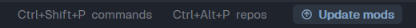
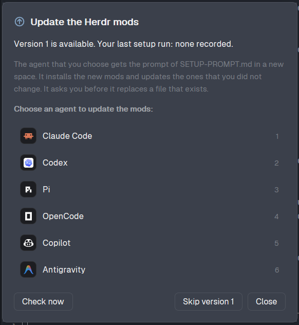

# Mods Update

A status bar item for the Herdr app. It tells you when this repository has a new version of its mods, and it starts an agent that updates them.





## How it works

1. The mod downloads [`SETUP-PROMPT.md`](../SETUP-PROMPT.md) from GitHub when it starts, and again every 6 hours.
2. It reads the version in the first line of that file: `<!-- herdr-mods-setup-version: N -->`.
3. It reads the version of your last run of the prompt: the `version` field of `~/.config/herdr-app/data/herdr-mods-setup.json`. The agent writes this file at the end of a run. No file, or no field, counts as version 0.
4. If GitHub has a newer version, the item shows **Update mods**, and 1 toast tells you about it. Otherwise the item shows `mods v<N>` in a dim color.
5. A click on the item (or on the toast) opens a dialog with the agents that are installed on this computer.
6. When you choose an agent, the mod downloads `SETUP-PROMPT.md` again and takes the prompt from it: the text between `<!-- prompt-start -->` and `<!-- prompt-end -->`, without the code fence. It writes the prompt to `~/.config/herdr-app/data/herdr-mods-setup-prompt.md`.
7. It opens a new space, `Mods update`, in `~/.config/herdr-app`, with the agent and 1 short task: read that file and follow it.

The prompt finds out by itself what is installed. It installs the new mods, updates the files that you did not change, and asks you about the files that you changed.

The dialog has 2 tabs:

- **Update:** the list of agents.
- **What's new:** the release notes of each version after your last run, newest first. The mod downloads them from [`whats-new/<N>.md`](../whats-new). When you have the newest version, the tab shows the notes of that version. When an update is available, the dialog opens on this tab.

In the dialog:

- `1` to `9` choose an agent (on the **Update** tab).
- **Check now** downloads `SETUP-PROMPT.md` and the release notes again.
- **Skip version N** hides the button until a newer version comes. The dialog still opens from the dim item, so you can run the setup again at any time.
- `herdr-app do mods-update.check` checks GitHub from a shell (the status item must be on screen).

## Install

1. Copy `mods/mods-update/` to `~/.config/herdr-app/mods/mods-update/`. Copy `mod.json` first: without it, Herdr docks a stray copy of the mod in your layout.
2. Run `herdr-app check ~/.config/herdr-app/mods/mods-update`.
3. Put the block in the status row of your layout, at the right end. Herdr's own layouts are read-only: clone one first (`herdr-app do layout.clone '{"name":"main","as":"my-main"}'`). If the layout has a `status-row` already, add only the last block to its `children`. Otherwise replace the `status` block with a row:

```json
{ "id": "status-row", "type": "row", "size": { "px": 28 }, "resizable": false,
  "children": [
    { "id": "status", "type": "block", "content": { "mod": "workspace-status" } },
    { "id": "mods-update", "type": "block", "content": { "mod": "mods-update" }, "size": { "px": 130 } } ] }
```

The `SETUP-PROMPT.md` prompt does these steps for the `main-dock` and `kanban` layouts.

## What it runs

- **Network:** 1 GET of `https://raw.githubusercontent.com/dougcunha/herdr-mods/main/SETUP-PROMPT.md` at start, every 6 hours, on **Check now** and when you choose an agent. In the dialog, 1 GET of `https://raw.githubusercontent.com/dougcunha/herdr-mods/main/whats-new/<N>.md` for each version that the **What's new** tab shows (at most 10).
- **Files:** it reads `data/herdr-mods-setup.json` and writes `data/herdr-mods-setup-prompt.md`, both in `~/.config/herdr-app`.
- **Programs:** no `exec`. It starts the agent that you choose with the `space.new` command, with the `run` entry of that agent in Herdr's program table.
- **Shared state:** the key `mods-update` in Herdr's shared state holds the version on GitHub, the time of the last check, the version that you skipped and the version that got a toast.

## Notes

- The first time an agent starts in `~/.config/herdr-app`, the agent can ask you to trust the folder. Claude Code does. The task stays in the queue: accept, and the agent starts the update.
- The agent does the update, not the mod. Read the plan of the agent before you accept it.
- The repository owner must increase the version in `SETUP-PROMPT.md` when a mod, a layout or a theme changes. Otherwise the button does not show. In the same commit, the owner adds `whats-new/<N>.md` with the changes of that version.
