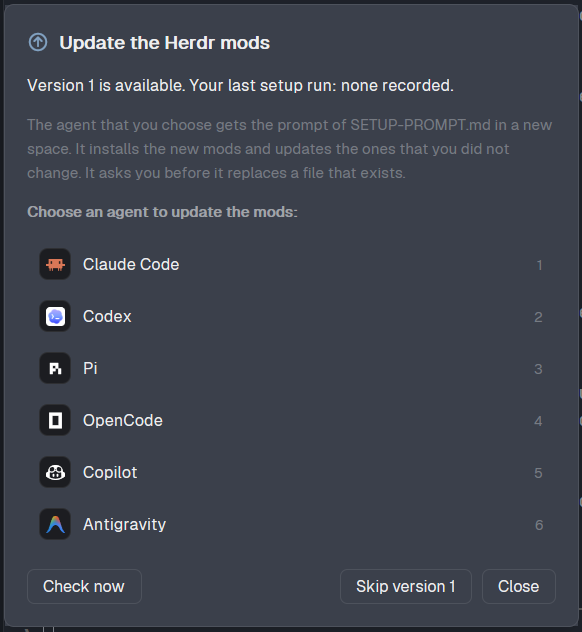

# Mods Update

A status bar item for the Herdr app. It compares the version of `SETUP-PROMPT.md` on GitHub with the version of the last run of that prompt on this computer. When GitHub is newer, it shows an **Update mods** button. The button opens a dialog where the person chooses an agent, and the mod starts that agent with the prompt.

## What you see

**Status item** (a block of 130 px in the status row, same bar look as `workspace-status`: `chrome` fill, 1 px top `border`, 11.8 px text, 14 px right padding, content at the right end):

- **Update available:** a button, 20 px tall, 8 px side padding, radius 5, `accent` text on an `accent` fill with alpha `24`, semibold. It holds `update.svg` (12 px, a circle with an up arrow) and `Update mods`. On hover the fill is `accent` and the text `accent_foreground`. Tooltip: `Version <N> of the Herdr mods is available (your last setup run: <M or "none recorded">). Click to choose an agent.`
- **No update:** `check.svg` (12 px) and `mods v<M>` in `dim` (only `mods` when no run is recorded). While a check runs, the icon is `refresh.svg`. Hover: `hover` fill, `foreground` text. Tooltip: the setup version, or `Could not check GitHub: <error>`.
- A click on either opens the dialog (`mod.open {name: "mods-update"}`).

**Toast**, once for each new version: title `Herdr mods update`, body `Version <N> is available. Click to update.`, level `info`, icon `update.svg`, 15 s, action `mod.open {name: "mods-update"}`.

**Dialog** (`kind: "dialog"`, 460 px wide, as tall as its content, `popover` fill, 18 px padding, 12 px gap, 13 px text):

1. Title row: `update.svg` (18 px, `accent` when an update is available, else `muted`) and `Update the Herdr mods` (15 px, semibold).
2. Status line: `Version <N> is available. Your last setup run: <version M | none recorded>.` in `foreground`; `You skipped version <N>. …` or `You have the newest version (<N>).` in `muted`; `Checking GitHub…` or `Could not check GitHub: <error>` in `blocked`.
3. Explanation, 12 px, `dim`: the agent gets the prompt in a new space, installs the new mods, updates the ones the person did not change, and asks before it replaces a file that exists.
4. Label, 12 px, semibold, `muted`: `Choose an agent to update the mods:` (or `… to run the setup again:`).
5. Agent list: 1 row per installed agent (at most 9), 40 px tall, radius 6, `hover` fill on hover, `selected` fill while it starts. A row has the program tile (26 px: the agent icon on its tile color), the agent name, and its number (`1` to `9`) or `Starting…` at the right in `dim`.
6. Error line, 12 px, `blocked`, when a start fails.
7. Footer: `Check now` (or `Checking…`) at the left; `Skip version <N>` (only with an update) and `Close` at the right. Buttons are 28 px tall, 12 px side padding, radius 6, 1 px `border`.

## How it behaves

- **Version on GitHub.** `fetch("https://raw.githubusercontent.com/dougcunha/herdr-mods/main/SETUP-PROMPT.md")`. The version is the number in `<!-- herdr-mods-setup-version: N -->`. A file without that line is an error.
- **Version here.** The `version` field of `<appHome>/data/herdr-mods-setup.json`, the record that the prompt writes at the end of a run. A missing file, bad JSON or a missing field gives 0. The status copy reads it every 60 s, so the button goes away after a run ends.
- **When it checks.** At start, then a timer every 10 minutes downloads the file only when the last check is older than 6 hours. The dialog checks again when the last check is older than 5 minutes. **Check now** and `herdr-app do mods-update.check` always check. A failed check keeps the last known version and stores the error.
- **Update available** when `remote > local` and `remote` is not the skipped version.
- **Shared state** (`setShared("mods-update", …)`): `remote`, `checkedAt`, `error`, `skipped`, `notified`. Every copy (the status item in each layout, the dialog) sees the same values.
- **Prompt.** The text between `<!-- prompt-start -->` and `<!-- prompt-end -->`. When the first line is a code fence (3 or more backticks or tildes), the mod removes it and the matching last line. A missing marker is an error: `SETUP-PROMPT.md has no prompt-start and prompt-end markers`.
- **Start.** A click on an agent (or its number key) downloads the file again, writes the prompt to `<appHome>/data/herdr-mods-setup-prompt.md` (`writeTextFile` with the old content as `expected`), and runs `space.new {name: "Mods update", folder: appHome(), argv: agent.run, task}`. The task is 1 line: `Read the file <path> and follow the instructions in it. It is the prompt of SETUP-PROMPT.md, version <N>, from https://github.com/dougcunha/herdr-mods.` Then the mod focuses the new terminal (it compares `panes()` before and after, for at most 2 s) and closes the dialog.
- **Agents.** `knownAgents()` filtered to `installed` with a `run` entry.

## Built from

- `mod.json`: `{ "place": "none", "title": "Mods update", "overlay": { "kind": "dialog", "width": 460 } }`. Create it **before** `main.js`.
- `setup.js`: the constants, `parseSetup(text)`, `download()`, `installedVersion()`, `writePrompt(prompt)`, `state()`, `setState(patch)` and `updateAvailable(local)`. It imports `appHome`, `readTextFile`, `writeTextFile`, `shared`, `setShared` from `herdr`.
- `main.js`: 1 `View` with 2 modes. `props().overlay` set: the dialog. Not set: the status item. It imports `View`, `div`, `svg`, `image` from `gpui-kit`, `h_flex`, `v_flex` from `gpui-base`, and `theme`, `props`, `run`, `notify`, `closeOverlay`, `knownAgents`, `panes`, `appHome`, `nextCommand` from `herdr`.
- Icons: `update.svg`, `check.svg`, `refresh.svg` (24×24, stroke `currentColor`, width 2).
- In `SETUP-PROMPT.md`: the version line at the top, the 2 markers around the prompt, and the step "Record the run" that writes `version`.

## Watch out

- **Disclose this before installing.** The mod uses the network (1 GET to `raw.githubusercontent.com`), reads and writes 1 file each in `~/.config/herdr-app/data/`, and starts an agent with a prompt that changes your Herdr files. It runs no `exec`.
- **Long text in `task`.** Do not pass the prompt itself as the task. It has about 17 KB of text with many lines, quotes, `$` and backticks. The mod writes it to a file and the task is 1 line.
- **Trust prompt.** Claude Code asks to trust `~/.config/herdr-app` the first time. The task waits and runs after the person accepts. Tested.
- **`mod.open` toggles.** A second `mod.open` closes the dialog.
- **Commands reach the status copy only.** `herdr-app do mods-update.<command>` did not reach the dialog in a test. Keep test commands in the status copy.
- **GitHub cache.** `raw.githubusercontent.com` can serve a file up to about 5 minutes old after a push.
- **Version discipline.** The button shows only when the repository owner increases the number in `SETUP-PROMPT.md`.
- **Not tested:** macOS and Linux, agents other than Claude Code for the start.

## Done when

- `herdr-app check` passes for `mods/mods-update`.
- With the block in the status row and a GitHub version newer than the record, the status bar shows **Update mods** and 1 toast appears. A second check does not post a second toast.
- A click opens the dialog with the installed agents. **Skip version N** changes the item to `mods v<M>`.
- A click on an agent writes `data/herdr-mods-setup-prompt.md` (it starts with `You will install, or update, my Herdr app mods.` and has no code fence and no marker) and opens the `Mods update` space with the agent and the 1-line task.
- After the agent writes `version: N` in `data/herdr-mods-setup.json`, the button goes away within 60 s.
- `herdr-app status` lists no error.
