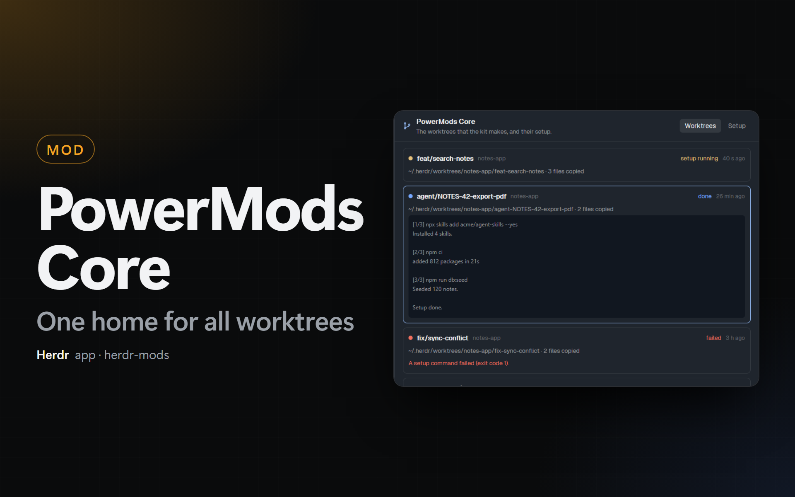

# PowerMods Core

Shared services for the mods of this kit. The first service makes the git worktrees of the kit:

- 1 folder for all new worktrees: `<worktree folder>/<repository>/<branch>`.
- 1 setup for each new worktree: files to copy, then commands to run (for example `npm install`, or `npx` to install plugins).
- 1 place that creates and removes worktrees, used by **Issues**, **PRs**, **Spec Board**, the **Git** panel and **Git Dash**.



## Install

1. Copy `mods/powermods-core/` to `~/.config/herdr-app/mods/powermods-core/` (write `mod.json` first).
2. Add its block to the `status-row` of `layouts/main-dock.json` and `layouts/kanban.json`, before the `automations-status` block (else before `repo-launcher-status`, else before `mods-hub`):

   ```json
   { "id": "powermods-core-status", "type": "block", "content": { "mod": "powermods-core", "props": { "part": "status" } }, "size": { "px": 100 } }
   ```

The block keeps the core running. **The core runs only while the shown layout has this block.** In a layout without it (for example Herdr's own `main`), a mod that makes a worktree shows an error that says so, and makes nothing.

## What you see

- **Status bar item:** `worktrees`, or `<n> setups` while a setup runs. Red after a failed setup. A click opens the dialog.
- **Dialog** (`mod.open:powermods-core`):
  - **Worktrees:** the last worktrees that the core made or removed, with their state, folder, copied files and the output of the setup.
  - **Setup:** the commands for every new worktree, 1 for each line.
- **Question:** before the commands of a repository run, the core shows them and asks. It asks again when the file changes.

## Settings

In **PowerMods** → **Settings** → **powermods-core**:

| Setting | Default | What it does |
| ------- | ------- | ------------ |
| Worktree folder | `~/.herdr/worktrees` | Every new worktree goes to `<folder>/<repository>/<branch>` (`/` and other signs in the branch become `-`). The default is the folder of Herdr's own worktrees: the Herdr sidebar then shows the space under its repository. On another machine, only a value that starts with `~` applies. |
| Files for every worktree | `~/.herdr/worktree-files` | Every file in this folder goes into each new worktree of this computer, with the same relative path. |
| Setup commands | none | **Edit…** opens the dialog. The commands run in every new worktree, before the commands of the repository. |

Until you set **Worktree folder**, the core uses the old setting of Spec Board (`spec-board.worktreeRoot`), if you had one.

## The setup of a repository

A repository can have `.herdr/worktree.json`:

```json
{
  "copy": [".env", "config/local.json"],
  "run": ["npm install"],
  "runWindows": ["npm install"]
}
```

- `copy`: git-ignored files of the main checkout, as globs. The old `.worktreeinclude` file works too.
- `run`: the commands. On Windows, `runWindows` replaces `run` when it is there.

## What happens when a mod makes a worktree

1. `git worktree add` in the main checkout. An existing branch is used. A branch that is only on `origin` is tracked. Else a new branch starts from the given commit (default `HEAD`).
2. The files of the files folder (this computer only), then the files of `copy` and `.worktreeinclude`. No file in the worktree is overwritten.
3. A new space opens in the worktree.
4. The commands run in a `setup` tab of that space: first the commands of the Settings, then the commands of the repository (PowerShell on Windows, `sh` elsewhere). You see the output and can answer a question of a command.
5. All commands end with code 0: the `setup` tab closes and the agent starts in a new tab. 1 command fails: the next commands do not run, the `setup` tab stays open, and the agent does not start.

Without setup commands, the space opens with the agent at once.

## For mod authors

A mod cannot import a file of another mod. The core puts its API on `globalThis.powermods`. Copy `client/core.js` into your mod (or add your mod to `tools/sync-core-client.mjs`) and call:

```js
import { worktrees } from "./core.js";

const r = await worktrees().create({
  repo, branch, on,            // the repository (any folder in it), the branch, the machine (null: here)
  base: "HEAD",                // optional: the start of a new branch
  path: undefined,             // optional: a folder that the person typed
  name: "my space",            // optional: the name of the space
  select: true,                // optional: false keeps the shown space
  prepare: async ({ path }) => {},                  // optional: runs after the copy, before the setup
  agent: { argv, task, tab },                       // optional: or async ({ path }) => ({ argv, task, tab })
});
// r = { path, spaceId, copied, setup: "none" | "running", done }; await r.done for the end of the setup.

await worktrees().remove({ repo, path, on, force, closeSpace: true });
const list = await worktrees().list({ repo, on });   // [{ path, branch, central, main, locked, prunable, … }]
worktrees().locate(folder, on);                      // { repo, leaf } in the central folder, or null
worktrees().preview({ repo, branch });               // the folder as text, with ~
```

`core()` throws an error with a message for the person when the core is not running. The API uses a behavior of Herdr that its reference does not document (a `globalThis` that all mods share). See [DESIGN.md](DESIGN.md).

## What it runs

`git` (`rev-parse`, `show-ref`, `check-ref-format`, `worktree add | remove | prune | list`, `branch -D` after a failed add, `config core.longpaths` on Windows, `ls-files` for the copy), PowerShell or `sh` to copy files and to run the setup script, `hc read` for the output of the setup tab. It writes the setup scripts to `~/.config/herdr-app/data/powermods-core/` (on another machine, `~/.herdr/powermods-core/`) and deletes them after. It opens and closes spaces and tabs (`space.new`, `tab.new`, `tab.close` of its own setup tab, `space.close` of a space that works only in a removed worktree). No network.
