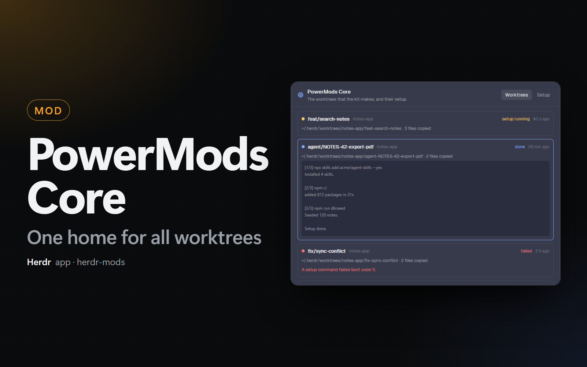

# PowerMods Core

A Herdr mod with shared services for the other mods of the kit. The first service makes, removes and lists git worktrees: 1 root folder, and 1 setup (files to copy, commands in a tab) for each new worktree. Other mods call it through `globalThis.powermods`.

## What you see

- **Status bar item** (`props.part: "status"`, a block of 100 px in `status-row`): right-aligned, `bg(chrome)`, top border `border`, 11.8 px text. A 12 px `worktree.svg` and `worktrees` in `dim`; `<n> setup(s)` in `working` while jobs run; `blocked` for 10 min after a failed job. Hover: `hover` background, `foreground` text. A click runs `mod.open {name: "powermods-core"}`.
- **Dialog** (720 × 560, `mod.json` overlay, `bg(popover)`): a header with the icon (16 px, `accent`), "PowerMods Core", a line, and 2 tabs (`selected` background on the shown one).
  - **Worktrees:** 1 card for each job of `shared("powermods-core.jobs")` (the last 15): a 8 px dot (`working` while it runs, `blocked` failed, `done` done), the branch (or "Remove · <path>"), the repository, the state text, the age; the folder, the machine and the number of copied files; the error in `blocked`. A click opens the output of the setup (mono, max 240 px, scroll) and **Show the space**. **Clear the finished ones** at the end.
  - **Setup:** the 2 folders of the settings, a textarea (170 px, mono) for the commands of the settings with **Save**, and the format of `.herdr/worktree.json`.
- **Trust dialog** (`props.part: "trust"`, 620 × 460): "Run the setup commands of this repository?", the repository, the commands (mono, `$ ` before each), **Skip them** and **Run them** (Enter runs, Esc skips; a close without an answer skips).

## How it behaves

- **API.** `init` of every copy runs `register()`: `globalThis.powermods = { version: 1, alive, missing, worktree: { create, remove, list, locate, pathFor, preview } }`. Herdr refuses an import from another mod folder, but all mods share `globalThis`. `alive()` is true when a status copy beat in the last 5 s.
- **Queue.** `create` and `remove` push a job to `globalThis.__powermodsCore.queue` and return a Promise. Every status copy runs `pump(cx)` every 500 ms: it sets the beat, takes the jobs and runs each in `cx.spawn` (sleeps with `cx.sleep`). Each status copy has an id and a heartbeat (`STATE.copies`); a job belongs to the copy that runs it, so a slow git command is never a lost job. When the owner copy stops beating for 30 s (a layout switch, a reload; `close()` removes its heartbeat at once), the next `pump` takes over a job that waits for its setup (`j.wait`: runner, space, tab, agent) and still starts the agent; any other job fails with an error toast. The queue survives a reload of the mod.
- **create.** Main checkout (`rev-parse --git-common-dir`), `check-ref-format --branch`, the home folder of the machine, the folder (`<root>/<repo>/<slug of branch>` or the typed one). `show-ref` for the branch here and on origin; a branch checked out in another worktree is refused. `worktree add` (existing branch; `--track -b` from `origin/<branch>` without a base; else `-b <branch> <path> <base|HEAD>`), `core.longpaths true` first on Windows when it is not set. A failed add: `worktree remove --force`, `worktree prune`, `branch -D` of a new branch. Then the copy, `prepare`, the trust question, `space.new` (with the agent when there are no commands; else a `setup` tab with the runner). The Promise resolves when the space shows (`{ path, spaceId, copied, setup, done }`). The runner writes the exit code to a status file; the core reads it every 1 s. Code 0: `hc read` of the setup terminal (300 lines, ANSI removed) into the job log, `tab.new` with the agent (else a shell), then `tab.close` of the setup tab. Not 0, or the tab is gone: an error toast with **space.select**, the tab stays.
- **Copy.** Files folder: PowerShell `Get-ChildItem -Recurse -File` (or `find`) and a copy of each file that is not in the worktree. Repository: `git ls-files -z --others --ignored -x <glob>… --exclude-from=.worktreeinclude` (only when the file exists), at most 500 files, `..` refused, 1 PowerShell or `sh` call.
- **Runner.** Windows: a `.ps1` file under `~/.config/herdr-app/data/powermods-core/`, run with `pwsh -NoProfile -ExecutionPolicy Bypass -File`; each command through `Invoke-Expression`, `$LASTEXITCODE` and `$?`; the status file in ASCII. Else: a `.sh` file (on another machine under `~/.herdr/powermods-core/`), each command through `sh -c`. Both print `[n/total] <command>` in cyan, stop at the first failure and delete their files after.
- **Trust.** The commands of `.herdr/worktree.json` run only when `shared("powermods-core.trusted")["<machine>:<main checkout, lower case>"]` is the FNV-1a hash of their JSON. Else the trust dialog opens; the job waits up to 30 min. Yes stores the hash. The commands of the settings need no question.
- **remove.** Main checkout from `repo` (else from the folder), the worktree in `worktree list`. Without `force`: a locked worktree, or one with `git status --porcelain` output, is refused before anything closes. With `closeSpace` (default): `space.close {confirmed}` of each space on that machine whose terminals all work inside the folder, then 1.5 s. `worktree prune` when git marks it prunable, else `worktree remove [--force]`.
- **locate.** A folder inside the root of this computer gives `{ repo, leaf }`. Any folder under `.herdr/worktrees/<repo>/…` too (Herdr's own folder, other machines).
- **Settings** (`kit.json`): `powermods-core.worktreeRoot` (`~/.herdr/worktrees` when empty; a status copy moves `spec-board.worktreeRoot` into it once and clears the old key, so the Settings field shows the folder in use), `powermods-core.filesFolder` (`~/.herdr/worktree-files`), `powermods-core.run` (a list of lines; # starts a comment). Read on every job. `"required": true`: mods-hub shows no on/off switch.

## Files

- `mods/powermods-core/`: `mod.json` (`place: none`, `title`, overlay 720 × 560), `main.js` (the 3 views), `api.js` (`register`), `worktree.js` (queue, create, remove, list, locate), `setup.js` (repository config, copy, runner, trust), `paths.js` (settings, paths, git helpers), `worktree.svg`, `kit.json`.
- `client/core.js`: the client that each calling mod keeps a copy of (`node tools/sync-core-client.mjs`, `--check`).
- `DESIGN.md`: why the API is on `globalThis`, and the request to the Herdr project.

## Checks

- `herdr-app check ~/.config/herdr-app/mods/powermods-core` passes.
- With the block in the status row, the item shows `worktrees`. A mod that calls `create` in a test repository with `.herdr/worktree.json` gets the trust dialog, a new space with a `setup` tab that prints each command, then the agent tab; the `setup` tab closes; the dialog shows the job as done with its output.
- A failing command keeps the `setup` tab open, shows an error toast and no agent starts.
- `remove` of that worktree closes its space and deletes the folder.
- Switch to Herdr's `main` layout and call `create`: the caller shows "PowerMods Core is not running in this layout".
