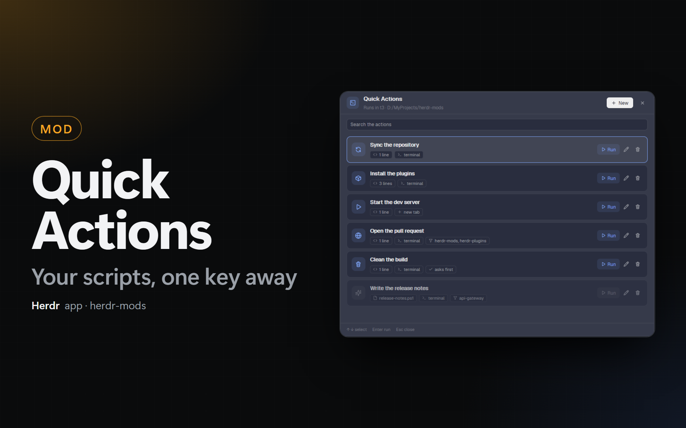

# Quick Actions for the Herdr app



A Herdr app mod that keeps named scripts and runs them in the terminal of the active space with 1 click or 1 key. Examples: sync the repository, install the plugins, start the dev server.

- **The list.** Press `Alt+Q` (or click the Quick Actions icon in the status bar). Type a part of the name, select with ↑ and ↓, and press Enter. The header shows the terminal that gets the script.
- **Inline script or script file.** Type the script in the form, or give the path of a `.ps1` or `.sh` file (`~` is your home folder).
- **Variables.** `{folder}`, `{repo}`, `{repo_name}`, `{branch}`, `{space}`, `{tab}`, `{terminal}`, `{machine}`, `{home}`, `{date}` and `{time}` get their values from the terminal and the space when the action runs. The form shows a preview of the script with these values.
- **Safe values.** Each value goes into the script in quotes for the shell. Write `cd {repo}`, not `cd "{repo}"`. A branch or a folder with spaces, `;`, `$` or quotes cannot run code. Other text in braces (`@{u}`, a PowerShell script block) does not change.
- **The terminal that has the focus.** The action types its line into that terminal, after it clears a draft at the prompt. When the terminal runs an agent or a program (`npm`, `vim`, a server), the action opens a new tab in the same space and folder and runs there.
- **New tab.** An action can always run in a new tab, with the name of the action.
- **Ask before run.** An action can show its script with the values and wait for **Run** (or Enter).
- **Only in.** An action can have a list of folders and repository names. It runs only there; elsewhere its row is gray.
- **Keys.** Each action has a command: `quick-actions.run-<id>`. The form shows it, ready for `keys.json`.

[`RECIPE.md`](RECIPE.md) describes the mod in full.

## Install

With an agent (Claude Code or any agent that can read files), paste this prompt:

`Read ~/.config/herdr-app/AGENTS.md, then add this mod: https://github.com/dougcunha/herdr-mods/tree/main/quick-actions-app, add its status bar item and merge its keys.json`

Or copy the folder yourself. The Herdr app must be running. Copy `mod.json` first: without it, Herdr docks a stray copy of the mod in your layout.

```sh
cp -r quick-actions-app/mods/quick-actions ~/.config/herdr-app/mods/quick-actions
herdr-app check ~/.config/herdr-app/mods/quick-actions
```

Then add the status bar item to the `children` of the `status-row` block of your layout (`layouts/main-dock.json`, `layouts/kanban.json`):

```json
{ "id": "quick-actions-status", "type": "block", "content": { "mod": "quick-actions", "props": { "part": "status" } }, "size": { "px": 34 } }
```

**The keys of the actions work only while the shown layout has this item.** A key sends `quick-actions.run-<id>`, and only a copy of the mod on the screen gets it. The item also remembers the last terminal that had the focus. Without it, the list shows a warning, and its **Run** buttons still work.

Then add the key to the `global` section of `~/.config/herdr-app/keys.json` (the file [`keys.json`](keys.json) has it):

```json
"alt-q": "mod.open:quick-actions"
```

## First use

1. Press `Alt+Q`.
2. Click **Add 2 examples**, or **New action**.
3. Write the name and the script, for example `git pull --ff-only`. The preview shows the script with the values of your terminal.
4. Click **Create**.
5. Select the action and press Enter.

To give an action its own key, copy the line under **Key** in the form into the `global` section of `keys.json`, for example:

```json
"ctrl-shift-1": "quick-actions.run-q1abcd"
```

## How a script gets to the terminal

| Script | What the terminal gets |
| --- | --- |
| 1 line | That line, so your shell history shows the real command. |
| 2 or more lines, or a script file | 1 line that runs a file with the script and its values: `& '<file>'` in PowerShell, `<your shell> '<file>'` elsewhere (for example `bash '<file>'`). The files are in `~/.config/herdr-app/data/quick-actions/runs/` (the last 20). |

In PowerShell, `& '<file>'` runs in your shell: a `Set-Location` in the script stays after the run.

To join a value and more text in PowerShell, use `Join-Path {repo} dist`: `{repo}\dist` gives 2 words. In `sh`, `{repo}/dist` works.

## Limits

- **Other machines.** In a space on another machine (`hc machine ls`), only scripts of 1 line run. Scripts of 2 or more lines and script files run only on this computer.
- **PowerShell commands.** On Windows, the mod finds a busy terminal through the child processes of the shell. A command that runs inside PowerShell (for example `Start-Sleep`) has no child process: the line waits and runs after it. A program with a window that the shell started (`Start-Process notepad`) is a child process too: the terminal is busy until the program closes, and the actions open a new tab.
- **No command palette entries.** A mod cannot add entries to the command palette. Use the list or a key.

## Files

- `~/.config/herdr-app/data/quick-actions.json`: the actions. You can edit it by hand; the list reads it again.
- `~/.config/herdr-app/data/quick-actions/runs/`: the run files.

## What it runs

- `hc keys` (Esc or Ctrl+U, to clear a draft at the prompt), `hc send` and `hc read` on the terminal that gets the line.
- `git rev-parse --show-toplevel` and `git branch --show-current` in the folder of the terminal, only when the script or its filter needs `{repo}`, `{repo_name}` or `{branch}`.
- On Windows, `pwsh` (or `powershell`) with `Get-CimInstance Win32_Process`, to see if the shell runs a command.
- On another machine, `sh` (`uname`, `$HOME`) or `pwsh` (`$HOME`) once, to know its system.

No network. The mod runs only the scripts that you write, and only when you start them.
