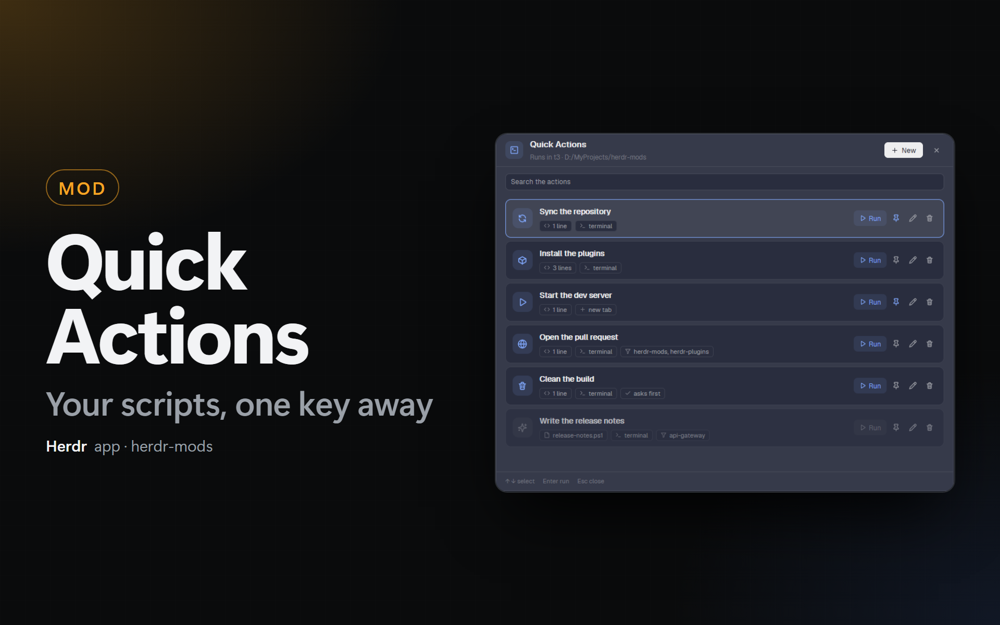

# Quick Actions

A Herdr mod that keeps named scripts and runs them in the terminal of the shown space. A status bar item gets the keys of the actions and remembers the last terminal that had the focus; a dialog shows the list, the form and the question before a run.

## Files

| File | What it does |
| --- | --- |
| `mod.json` | `place: none`, title, dialog 820 × 640. |
| `main.js` | The View: `props.part === "status"` is the status bar item and runner; else the dialog (list, form, question). |
| `store.js` | `data/quick-actions.json`, `normalize()`, the shared keys, the run files. |
| `vars.js` | The target terminal, its context (folder, busy, shell, the values of the variables), `expand()`, the filter. |
| `run.js` | `prepare()` (no side effects) and `runAction()`: the run file, the new tab, `hc keys` and `hc send`. |
| `list.js`, `form.js`, `ui.js` | The views. |
| `writer.js` | **New with an agent…** and **Edit with an agent…**: the path of the file, the task of the agent, the tab. |
| `core.js` | The client of PowerMods Core (`agentStart()`); a copy of `powermods-core-app/client/core.js`. |
| `demo.js` | Example actions for the preview (`quick-actions.demo`). |

## Data

`~/.config/herdr-app/data/quick-actions.json`: `{ "actions": [ <action> ] }`. An action:

| Field | Value |
| --- | --- |
| `id` | `a-z`, `0-9`, `-`, up to 24 characters (`q` + time + random). |
| `name`, `icon` | The icon is a file of the mod: `zap`, `play`, `terminal`, `refresh`, `download`, `package`, `git-branch`, `sparkles`, `code`, `gear`, `globe`, `server`, `file-terminal`, `folder`, `trash`. |
| `source` | `"inline"` (`script` is the text) or `"file"` (`file` is a path; `~` is the home folder). |
| `where` | `"terminal"` (the target terminal; a new tab when it is busy) or `"tab"` (always a new tab). |
| `confirm` | Ask before the run. |
| `filter` | Folders and repository names, separated by commas. Empty: everywhere. |
| `pinned` | A button in the bar of the Dock and Kanban layouts. |

Saves go through `writeTextFile(path, text, expected)` on the newest file (3 tries) and set `shared("quick-actions.rev")`; every dialog copy reads the file again when the key changes (1 s timer).

## Runner (status copy)

- A 34 px block: a 13 px `actions.svg` (Lucide square-terminal) in `dim`, `working` while a run goes on. A click runs `mod.open:quick-actions`.
- Every 500 ms: when `focused().terminal` is set and differs from `shared("quick-actions.target")` (`{ terminal, space, tab }`), it writes the key. Every 20 s: `shared("quick-actions.runner") = { at }`. The dialog shows a warning when `at` is older than 60 s.
- At start: `syncPanels(list)`. Every 500 ms, the list again when `quick-actions.rev` changes, and `updateHidden()`: for the pinned actions with a filter, when the target, its folder or the list changed, `context(target, need, { probe: false })` (git only for a name part) and `setHidden(ids)`: `shared("dock.hiddenEntries")["quick-actions"] = ["qa-<id>", …]` for the filters that leave out the target (written only when it changed).
- `nextCommand()`: `open` opens the dialog; `run-<id>` reads the file, takes the target (`currentTarget()`), and runs the action, or opens a dialog (640 × 340) with `props: { confirm: <id>, target }` when the action asks first.

## The target terminal

`currentTarget()`: `focused().terminal`; else the kept target when it is alive and in the focused space; else the focused (or first) terminal pane of the focused tab; else `{ terminal: null, space, tab }`. The dialog takes it once, when it opens.

`context(target, need)`:

- Machine: the `machine` of the space. This computer: `window().platform`. Another machine: `sh -c 'uname -s; printf "%s\n" "$HOME"'`, else `pwsh -Command $HOME` (cached).
- Folder: `focused().cwd` for the focused terminal, else the pane `cwd`, else the terminal's `foreground.cwd` or `cwd`, else the space folder. Forward slashes; values use the slashes of the machine.
- Busy: no terminal, or `program.shell` is false (an agent, or a program that Herdr sees). On Windows, Herdr reports the shell also while a command runs, so the mod also runs `Get-CimInstance Win32_Process -Filter 'ParentProcessId=<pid>'` (not `conhost.exe` or `OpenConsole.exe`): a child process makes the terminal busy (about 0.6 s). A launcher such as a scoop shim starts the real PowerShell as its only child: when the only child is `pwsh.exe` or `powershell.exe`, its children count (up to 3 levels).
- Shell: the name of the foreground process or of the program (`pwsh`, `powershell` → `ps`; `bash`, `zsh`, `sh`, `dash`, `ksh`, `fish`), else `ps` on Windows and `sh` elsewhere.
- Values: `folder`, `space`, `tab`, `terminal`, `machine` (`local`), `home`, `date`, `time`, `branch` (the pane's branch), and only when the script or the filter needs them: `repo`, `repo_name` (`git rev-parse --show-toplevel`), `branch` (`git branch --show-current` when the pane has none).

## A run

`prepare(action, target)`:

1. The script text (the file is read with `readTextFile`). Empty: an info message.
2. The context; the filter (a folder part matches the folder and its subfolders, `*` and `**` work; a name part matches `repo_name`, `*` works).
3. A new tab when `where` is `tab` or the terminal is busy. The shell of the line: the shell of the target terminal, or `ps` on Windows and `sh` elsewhere for a new tab. The shell of the script: the extension of a script file (`.ps1`, `.sh`, `.bash`, `.zsh`), else the shell of the line.
4. `expand()`: 1 pass with 1 pattern for `{name}` and `{ask:…}`, so a value (a folder or a space name with `{ask:…}` in it) is never read again; only the known `{name}`s; each value becomes 1 literal: PowerShell `'…'` with each `'`, `‘`, `’`, `‚` and `‛` doubled (PowerShell takes all of them as single quotes), sh `'…'` with `'\''`. Other braces stay.

`runAction()`:

1. 1 line (inline only): the line itself. Else: a run file `data/quick-actions/runs/<time36>-<slug>.ps1|.sh` (the last 20 stay; a `.ps1` starts with a BOM, so Windows PowerShell 5.1 reads accents right), and the line `& '<file>'` (PowerShell), `pwsh -NoProfile -File '<file>'` (a `.ps1` in a POSIX shell), or `<shell> '<file>'`. On another machine, `hc put --json <terminal> <run file>` copies the run file next to the terminal (`~/.local/state/herdr-core/default/files/<t>/` on Linux), and the line uses that path. The run file is made after the target terminal is known (a new tab first).
2. Target terminal: `hc keys <t> esc` (PowerShell: PSReadLine reverts the line) or `hc keys <t> ctrl+u`, then `hc send <t> <line>` (it pastes and presses Enter).
3. New tab: `tab.new { space, folder, name, focus: true }`; the new terminal is an address that `terminals()` did not have before, with the `herdr.space` label of the target space (150 ms polls, 10 s); then the screen must be the same in 2 reads of `hc read --lines 30` (150 ms apart, 12 s at most); then `hc send`.
4. `pane.focus { terminal }`. A failure posts an error toast `Quick action: <name>`.

## Dialog

- **List** (`list.js`): a 58 px header (32 px tile, "Quick Actions", "Runs in <terminal> · <folder>" or "a new tab (<terminal> runs <program>)", **New**, ×); a warning band when the list file is broken or no runner is alive; a search field (focused at open); 1 row per action (36 px icon tile, the name, labels: lines or file name, terminal or new tab, asks first, the filter), **Run**, pencil, trash (2 clicks). The selected row has an `accent` border. A row whose filter leaves out the target is at 70% and its Run is off. ↑ ↓ select, Enter runs, Esc closes. Empty: **Add 2 examples** (Sync the repository; Update and install, which asks first) and **New action**.
- **Form** (`form.js`): rows of 200 px labels: Name, Icon (15 buttons), Script (Inline | Script file; a mono textarea with the variable tokens, a click inserts `{name}` at the cursor; or the path field), Preview (prepare() again 400 ms after a change: where it runs, and the expanded script), Where it runs (Terminal | New tab), Ask before run, Only in, Key (`"ctrl-shift-1": "quick-actions.run-<id>"`). Save checks name and script; Esc in a field goes back to the list. A row also has a pin button (`accent` when pinned), and the form a **Bar button** switch.
- **Question** (`confirmView`): the icon, "Run <name>?", where it runs, the expanded script, Cancel and **Run** (Enter).
- `herdr-app do quick-actions.<new | edit-<id> | list | save | demo | up | down | enter>` drives an open dialog.

## Bar buttons

`syncPanels(list)` (`store.js`) makes the entries of `dock/panels.json` whose id starts with `qa-` match the pinned actions: `{ id: "qa-<id>", label: <name>, icon: "mods/quick-actions/<icon>.svg", opens: "command", run: "quick-actions.run-<id>" }`. An entry keeps its place and gets the new name and icon; a new one goes at the end; the entry of an action that is not pinned goes away. No other entry changes. No file: nothing. It writes with `writeTextFile(path, text, expected)` (3 tries) after each change of the list in the dialog, and once when the runner starts. The bars run the entry with `run("quick-actions.run-<id>")`; `entryMod()` gives `quick-actions`, so they hide the buttons when the mod is off. They also leave out the ids in `shared("dock.hiddenEntries")` (any mod; the values of all keys).

## Questions

`{ask:Label}` and `{ask:Label=default}` (`asksOf()`, `expand(text, values, shell, answers)`): each label once, in the order of the text. With answers, the answer (or the default) as 1 quoted literal; without answers (the form preview), the default or `<Label>`. The runner opens the question dialog (640 × 340 + 58 px for each question) for an action with `confirm` or with questions (it reads the script first); the list does the same in its own view. The question view makes 1 field for each label (the default as its value, the first one focused); a change of an answer prepares the preview again. Enter in a field runs, Esc goes back (or closes the question dialog).

## Scripts by an agent

In the form, for a script file: **New with an agent…** (always) and **Edit with an agent…** (when the file can be read). The panel has a textarea (what the script must do, or what must change), the installed agents of `knownAgents()` (the last one used is `shared("quick-actions.agent")`), a line with the path, and **Start**. Start needs a name, a text and an agent; it saves the action with `source: "file"` and `file` = the file of the action, else `<script folder>/<slug of the name>.ps1` (`.sh` on macOS and Linux; `<slug>-<id>` when another action uses that file), with `~` for the home folder; it makes the folder of the file (`fs.mkdir`, else `pwsh New-Item` or `mkdir -p`), and runs `tab.new { space: <target space>, folder: <folder of the file>, name: "Script: <name>", focus: true, ...agentStart(agent.run, task) }` (`space.new` without a space). Then a toast, and the dialog closes. The task (`writerTask()`) gives the path, the shell, the text of the person, and the rules: only this file, do not run it; the variables and their quotes; `{ask:…}`; `Join-Path` and `$ErrorActionPreference = 'Stop'` for PowerShell, `set -e` for sh; a short line before each step. The form reads the file again every 2 s, so the preview follows the agent.

The script folder is `shared("quick-actions.scriptDir")` (a setting of the Settings tab), else `~/.config/herdr-app/data/quick-actions/scripts`.

## On and off

`kitOff()` (`herdr-mods.disabled` has `quick-actions`): the dialog closes, the status copy draws nothing and skips its timer and its commands.
