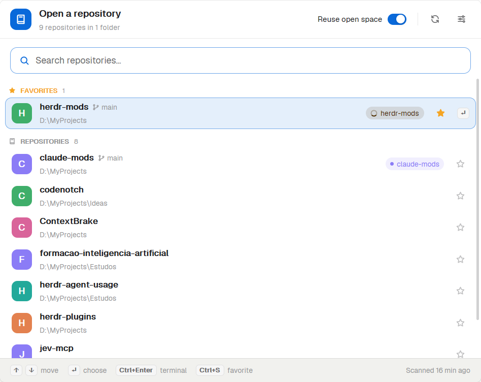
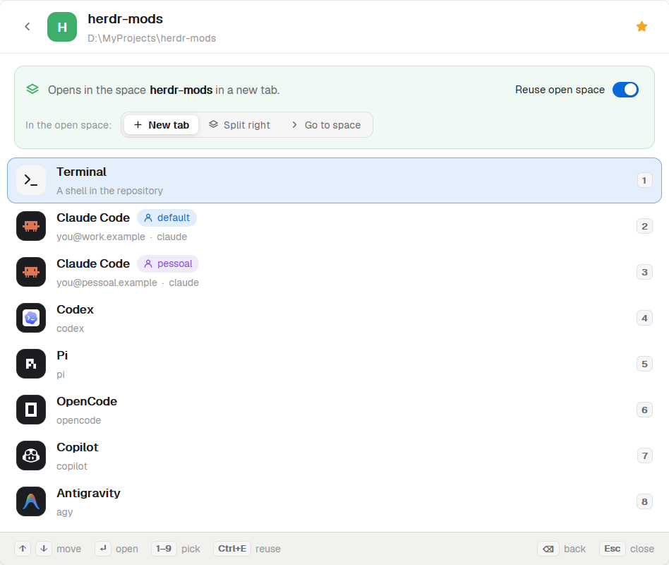

# Repo Launcher for the Herdr app



A Herdr app mod that opens a repository from the keyboard. Press `Ctrl+P`, type a part of the name (fuzzy search), and press Enter. Then pick what to open in the repository: a terminal, or an agent such as Claude Code, Codex, OpenCode or Antigravity. Each account of Claude Code and Codex is a separate choice.

- **Fuzzy search.** `hm` finds `herdr-mods`. The matched letters are highlighted. Words separated by a space can match the name or the folder.
- **Favorites.** A star (or `Ctrl+S`) puts a repository in the **Favorites** section at the top. Favorites also rank higher in the search.
- **Recent.** The 5 repositories that you opened last come next.
- **Open space indicator.** A pill on the row names the space that works in the repository, in the color of that space. A spinner shows that an agent works there; a red dot shows that an agent needs you.
- **Reuse open space.** A switch in the header (`Ctrl+E`). When it is on and the repository has an open space, the choice opens there: in a **new tab**, in a **split to the right**, or the launcher **goes to the space** (a terminal choice only; an agent gets a new tab). When it is off, or the repository has no open space, the choice opens in a new space.
- **Accounts.** The launcher finds `~/.claude`, `~/.claude-*`, `~/.codex` and `~/.codex-*` and shows the e-mail of each account. You can add other account folders in the settings.
- **Agent arguments.** Extra arguments per agent, for example `--dangerously-skip-permissions` for Claude Code or `--yolo` for Codex.
- **Cached list.** The launcher reads the root folders only when you add or remove one, or click Refresh (`Ctrl+R`). It never reads the disk when the popup opens.
- **Shortcut.** Change it in the settings: click **Change** and press the new keys. The launcher writes it to `keys.json`.



[`RECIPE.md`](RECIPE.md) describes the mod in full.

## Install

With an agent (Claude Code or any agent that can read files), paste this prompt:

`Read ~/.config/herdr-app/AGENTS.md, then add this mod: https://github.com/dougcunha/herdr-mods/tree/main/repo-launcher-app and merge its keys.json`

Or copy the folder yourself. The Herdr app must be running.

```sh
cp -r repo-launcher-app/mods/repo-launcher ~/.config/herdr-app/mods/repo-launcher
herdr-app check ~/.config/herdr-app/mods/repo-launcher
```

On Windows PowerShell:

```powershell
Copy-Item -Recurse repo-launcher-app\mods\repo-launcher "$env:USERPROFILE\.config\herdr-app\mods\repo-launcher"
herdr-app check "$env:USERPROFILE\.config\herdr-app\mods\repo-launcher"
```

Then add the key to the `global` section of `~/.config/herdr-app/keys.json` (the file [`keys.json`](keys.json) has it):

```json
"ctrl-p": "mod.open:repo-launcher"
```

Without a key, open it with `herdr-app do mod.open --name repo-launcher`, or from the command palette. Then pick a key in its settings.

> **About `Ctrl+P`.** A global key works inside the terminals too, so the programs there stop getting `Ctrl+P`. Shells (bash, zsh, PowerShell in Emacs mode) and Claude Code use it for "previous command". If you need it there, pick another key in the settings, for example `Ctrl+Shift+G` or `Alt+P`. `Ctrl+Shift+P` is the command palette of the Herdr app.

The mod has `"place": "none"`: it adds no panel by itself.

## A status bar item (optional)

The mod `repo-launcher-status` shows `Ctrl+P  repos` (your key) at the right end of the status bar, after `Ctrl+Shift+P  commands`. A click opens the launcher.

1. Copy `mods/repo-launcher-status/` to `~/.config/herdr-app/mods/repo-launcher-status/`. Copy `mod.json` first: without it, Herdr docks a stray copy of the mod in your layout.
2. Put it in your layout. Herdr's own layouts are read-only: clone one first (`herdr-app do layout.clone '{"name":"main","as":"my-main"}'`). Then replace the `status` block with a row (or, if the layout has a `status-row` already, add only the last block to its `children`):

```json
{ "id": "status-row", "type": "row", "size": { "px": 28 }, "resizable": false,
  "children": [
    { "id": "status", "type": "block", "content": { "mod": "workspace-status" } },
    { "id": "repo-launcher-status", "type": "block", "content": { "mod": "repo-launcher-status" }, "size": { "px": 120 } } ] }
```

It needs the `repo-launcher` mod (it uses its icon and opens it).

## First use

1. Press `Ctrl+P`.
2. Click **Add folder…** and pick the folder that holds your repositories (for example `~/code`). Add more folders in the settings.
3. Wait for the search. It takes about 1 second for 60 repositories.
4. Type a part of a repository name and press Enter.
5. Press the number of the choice, or use the arrows and Enter.

## Keys

| Where | Key | What it does |
| --- | --- | --- |
| List | `↑` `↓`, `PgUp` `PgDn` | Move the selection |
| List | `Enter` | Show the choices for the repository |
| List | `Ctrl+Enter` | Open a terminal in the repository at once |
| List | `Ctrl+S` | Add or remove the favorite |
| List | `Ctrl+E` | Turn "Reuse open space" on or off |
| List | `Ctrl+R` | Read the root folders again |
| Choices | `1` to `9`, or `↑` `↓` and `Enter` | Open that choice |
| Choices | `Backspace` or `←` | Go back to the list |
| Everywhere | `Esc` | Close the launcher |

## What it runs, and its limits

- **Programs.** To find the repositories, it runs PowerShell (`pwsh`, else `powershell`) on Windows and `sh` with `find` on macOS and Linux, through the app's `exec`. It uses no network.
- **Files that it reads.** The list of your home folder (to find the account folders), `.claude.json` of each Claude Code account and `auth.json` of each Codex account (only to show the e-mail). It reads no token for any other use.
- **Status bar item.** `repo-launcher-status` only reads `keys()` and runs `mod.open`.
- **Files that it writes.** Its settings and the repository cache go in the shared state of the app (`shared.json`, keys `repo-launcher.settings` and `repo-launcher.cache`). **Change** in the shortcut settings rewrites the `global` section of `keys.json`.
- **A second account.** Herdr has no field for environment variables when it starts a program. For an account that is not the default one, the launcher starts the agent through a wrapper: `env CLAUDE_CONFIG_DIR=<folder> claude …` on macOS and Linux, and `pwsh -NoProfile -Command "$env:CLAUDE_CONFIG_DIR='<folder>'; & 'claude' …"` on Windows. Codex uses `CODEX_HOME`. A shell function or an alias with the agent name does not run in this wrapper; the agent program does.
- **Search depth.** 3 folder levels under each root folder. The search does not go into a repository that it found, or into `node_modules`, `bin`, `obj`, `dist`, `build`, `target`, `vendor` and similar folders. At most 2000 repositories per root folder.
- **A search stops when the popup closes.** Keep the popup open until the search ends. When the popup opens again with root folders and no cache, the search starts again.
- **This computer only.** Spaces on other machines are not used, and the root folders are on this computer.
- Tested on Windows. macOS and Linux use the same code with `find` and `env`.
