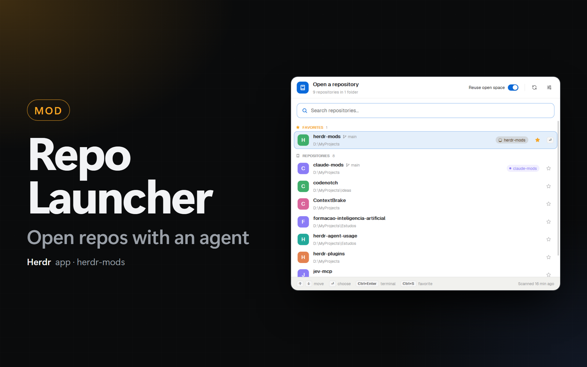
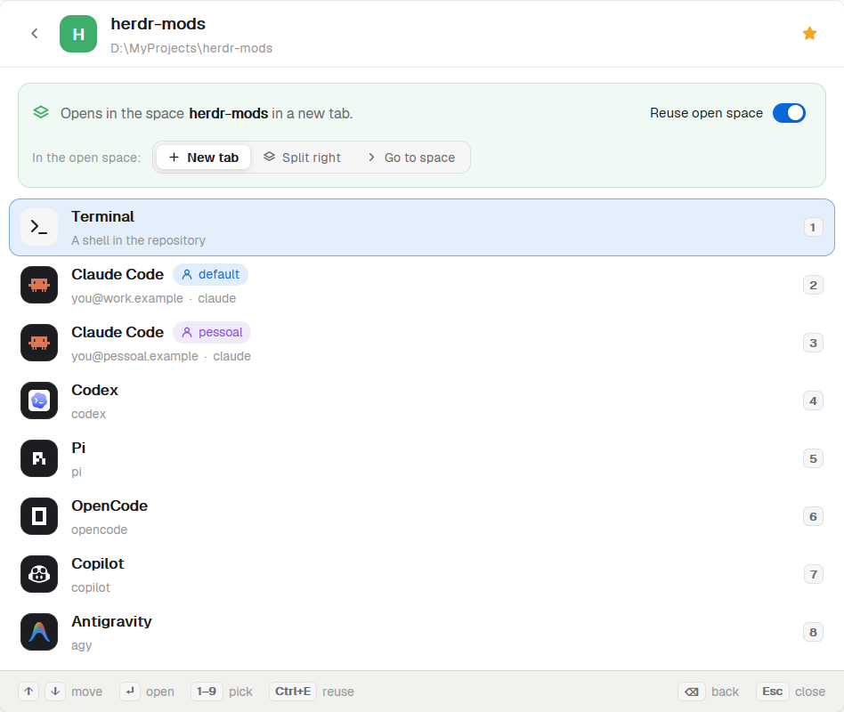

# Repo Launcher

A popup for the Herdr app that opens a repository from the keyboard. `Ctrl+P` opens it at the top of the window. You type a part of a repository name, the list filters with a fuzzy match, and Enter shows what to open there: a terminal, or each installed agent, with one row per account of Claude Code and Codex. A switch decides if the choice opens in the open space of the repository or in a new space.

## What you see

A popup, 760 px wide, at the top of the window (56 px down), `popover` background, 13 px text. It has three views. Each view has a header, a body and a footer.

### Header (all views)

60 px tall, 16 px side padding, 12 px gap, 1 px bottom `border`.

- At the left, a 34 px tile with radius 10. In the list view and the settings it is the `accent` color with a book icon (`repo.svg`, 18 px, `accent_foreground`). In the choices view it is the repository's letter tile (see below), with a back button (30 px, `back.svg`) before it.
- A title (15 px, semibold) and a subtitle (11.5 px, `dim`): `Open a repository` and `61 repositories in 2 folders`; the repository name and its full path; `Settings` and `Repo Launcher`.
- At the right of the list view: the **Reuse open space** switch (12 px label, then a 30×18 switch, `accent` when on, a white 14 px knob that slides in 140 ms), a 1 px divider, a Refresh button (`refresh.svg`; it turns while a search runs) and a Settings button (`settings.svg`).
- At the right of the choices view: a star button. A favorite has the filled star in `#f5a524`.

### List view

1. **Search box**: 42 px tall, 16 px from the sides, radius 11, `background` fill, 1 px border in `accent` at 60% alpha. A 16 px magnifier in `accent`, the text field (14 px), and `N matches` (11 px, `dim`) while a query is typed.
2. **The list**: rows that show only inside a box at most 440 px tall. The wheel scrolls it; a 4 px thumb at the right edge shows the position.
   - **Section titles**, 30 px: an 11 px icon and the title in capitals (10.5 px, bold, `dim`), then the count. Without a query: **Favorites** (filled star, title in `#f5a524`), **Recent** (the 5 last opened that are not favorites), **Repositories** (all the others, A to Z, case-insensitive). With a query: one section **Results**, best match first.
   - **Repository rows**, 50 px, 8 px from the sides, radius 10, 10 px padding, 12 px gap:
     - A 32 px letter tile (radius 9, white bold letter). Its color is the color of the open space of the repository (the same `space.colors` as the Spaces sidebar), else a color from the repository name: `#22a99a`, `#e3814f`, `#5b8def`, `#8b7cf6`, `#3fae6a`, `#d9649a`.
     - The name (13.5 px, semibold) with the matched letters in `accent` and bold. After it, when a space is open, the branch of that space (11 px, `dim`, `branch.svg`).
     - Below, the parent folder (11 px, `dim`), with `~` for the home folder and native slashes. Letters matched in the path are in `accent`.
     - The open-space pill, when the repository has an open space: 20 px, radius 10, the space name (at most 130 px) and ` +N` for more spaces. Working: a turning spinner in `working`. Blocked: a dot and text in `blocked`. Done: in `done`. Else a dot and text in the space color. The fill is the same color at 12% alpha.
     - A 28 px star button: outline star in `dim`, or the filled star in `#f5a524`.
     - The selected row has a 1 px `accent` border at 50% alpha, an `accent` fill at 11% alpha and a `↵` key cap at the end. A favorite row that is not selected has a `#f5a524` fill at 5% alpha.
3. **Empty states** (300 px tall, centered): a 54 px circle in `accent` at 10% alpha with a 24 px icon, a 14 px semibold title and a 12 px `dim` line.
   - No root folder: `Add the folders that hold your repositories` and an **Add folder…** button (`accent` fill).
   - First search: a turning spinner and `Looking for repositories…`.
   - Nothing found: `No repositories found` and a **Refresh** button.
   - No match: `No repository matches “<query>”`.
4. **Footer**, 38 px, `chrome` fill, 1 px top `border`: key caps (18 px, radius 5, `raised`, 10.5 px semibold) with their labels (11 px, `dim`): `↑ ↓ move`, `↵ choose`, `Ctrl+Enter terminal`, `Ctrl+S favorite`; at the right, `Scanned 3 min ago` or `Scanning…`.

### Choices view

1. **Destination card**, 16 px from the sides, 12 px padding, radius 11. With an open space and reuse on, its fill and border are the space color at 8% and 25% alpha. It shows a `layers.svg` icon and one line: `Opens in the space <name> in a new tab.` (the name in semibold), `… in a split to the right.`, or `Terminal goes to the space <name>. An agent opens in a new tab there.`. Without a space: `Opens in a new space.` At the right, the Reuse switch. When reuse is on and a space is open, a second line: `In the open space:` and a segmented control **New tab** / **Split right** / **Go to space** (30 px, `raised` track, the active choice on `background` with a small shadow).
2. **Choices**, 52 px rows, same look as the repository rows: a 34 px program tile (the program's `tile` color and icon from `knownAgents()`; the terminal uses `icons/shell.svg` on `raised`), the name (13.5 px, semibold), and for an account a pill with `user.svg` and the account label (`default` in `accent`, others in `ansi5`). Below (11 px, `dim`): the account e-mail and the command with its extra arguments (`claude --dangerously-skip-permissions`). At the right, the key cap `1` to `9`.
   - Order: **Terminal**, then each installed agent in the order of `knownAgents()`. An agent with more than one account has one row per account (the default account first).
3. **Footer**: `↑ ↓ move`, `↵ open`, `1–9 pick`, `Ctrl+E reuse`; at the right `⌫ back` and `Esc close`.

### Settings view

A body 560 px tall that scrolls, 16 px padding, 12 px between cards. Each card: `background` fill, 1 px `border`, radius 12, 14 px padding, a 13 px semibold title and an 11.5 px `dim` line.

1. **Repository folders**: one 40 px row per root folder (`folder.svg` in `accent`, or `blocked` when the folder is missing; the path; a pill `52 repos` or `not found`; a trash button). Below: **Add folder…** (primary), **Refresh**, and `Scanned …` at the right.
2. **Open space**: the reuse switch, and `Open there as` with the same segmented control (at 50% opacity when reuse is off).
3. **Shortcut**: a keyboard icon and the key caps of the current keys (`Ctrl+P`), or `No shortcut`. A **Change** button. While it waits, a pulsing `Press the new keys…` box and **Cancel**. When the keys run another action, a red card: `Ctrl+Shift+P runs “app.palette” now.` with **Cancel** and **Replace**. A note: the key goes to `keys.json` and a Ctrl+letter key stops reaching the programs in the terminals.
4. **Agent arguments**: one row per installed agent: a 26 px tile, the name (110 px), and a 32 px field that shows the command in the terminal font, then the arguments field. Below: **Refresh agents** (`refresh.svg`; `Checking…` while it runs) and `Checked …` at the right. With no agent: `Looking for installed agents…` during a check, else `No installed agents found.`
5. **Accounts**: one 44 px row per account: the agent tile, the label (semibold) and the e-mail (`muted`), the line `CLAUDE_CONFIG_DIR=~\.claude-work` (`dim`), and a pill `detected` or `added` (with a trash button). Below: **Add Claude Code account…** and **Add Codex account…**.
6. Footer: `Changes are saved at once.` and `Esc close`.

### Status bar item

A second mod, `repo-launcher-status`, is a 120 px block at the right end of the layout's status row, after `workspace-status`. It draws the same bar: `chrome` fill, 1 px top `border`, 11.8 px text, 14 px right padding. At the right, a 20 px chip (6 px padding, radius 5): the 12 px `repo.svg` of the launcher and `Ctrl+P  repos` in `dim` (the key bound to `mod.open:repo-launcher`, spelled like the palette hint; only `repos` without a key). Hover: `hover` fill and `foreground` text, tooltip `Open a repository`. Click: `mod.open {name: "repo-launcher"}`.

## How it behaves

- **Opening.** `mod.open:repo-launcher` opens the popup; the same key again closes it. The search field has the keyboard. The list draws at once from the cache. Agents come from `knownAgents()` (installed ones only), saved in shared state. `knownAgents()` starts a shell (with the person's profile), so the launcher calls it only when no list is saved yet or when a person clicks **Refresh agents**; a toast reports the result. Accounts come from the home folder and are kept in module memory, so the next opening draws them at once.
- **Fuzzy match.** Each word of the query must appear in order in the name or in the parent folder. The score prefers the first letter, the start of a word (after `-`, `_`, `.`, `/`, `\`, space, or a lower-to-upper case change) and letters in a row. A match in the name counts double. An exact name adds 200, a name that starts with the query adds 80. Favorites add 40 and opened repositories add 10.
- **Cache.** The search runs only when a folder is added or removed, on Refresh (button or `Ctrl+R`), or when the popup opens with root folders and no cache (a search stopped by closing the popup). Removing a folder drops its repositories from the cache without a search. A toast reports the result, and a warning lists missing folders.
- **Open space of a repository.** A space of the repository's machine with a terminal pane whose live folder (`panes()[i].cwd`) is in the repository. When more spaces match, the first is the one with the repository's name, then the one whose start folder (`spaces()[i].folder`) is in the repository, then the shown one, then the one with the most terminals there.
- **Opening a choice.**
  - Reuse off, or no open space: `space.new {folder, argv?, tab: <agent name>}`; Herdr names the space after the repository.
  - New tab: `space.select {id}`, then `tab.new {space, folder, argv?, name?}`.
  - Split right: `space.select`, `pane.focus` on a terminal pane of that space (the focused one in its shown tab when it is in the repository), then `terminal.open {place: "right", folder, argv?}`.
  - Go to space: `space.select` and `pane.focus` on that pane. An agent still gets a new tab.
  - After a new terminal starts, the launcher focuses it with `pane.focus {terminal}`, so a layout that shows the focused pane (a board of agents) shows it. The popup waits at most 2 s for the terminal, then closes.
  - The repository goes to the top of **Recent**.
- **Accounts.** The default account (`~/.claude`, `~/.codex`) starts with `argv: agent.run`. Another account starts through a wrapper (see Built from). The tab is named `Claude Code (work)`.
- **Shortcut capture.** **Change** gives the keyboard to the view. The next chord with Ctrl, Alt, Shift or Cmd (or a lone F-key) is saved. A plain key types text, so it is not taken. `Esc` closes the popup, as everywhere.
- **Keys.** See the table in `README.md`.

## Built from

- `mod.json`: `{ "place": "none", "title": "Repo Launcher", "overlay": { "kind": "popup", "at": "top", "offset": 56, "width": 760, "height": 0.78 } }`.
- `keys.json` (for people to merge): `{ "global": { "ctrl-p": "mod.open:repo-launcher" } }`.
- `main.js`: the `View` with the three views and the keys. It imports `View`, `div`, `svg` from `gpui-kit`; `v_flex`, `h_flex`, `InputState`, `Input` from `gpui-base`; `theme`, `props`, `closeOverlay`, `knownAgents`, `pickFolder`, `notify`, `panes`, `run`, `settings`, `shared`, `machines` from `herdr`. Quick machine filter: `memory.place` ("all", "local" or a machine name), a segmented control in the search bar and `Ctrl+M`; it shows only when the cache has repositories of another machine.
- `fuzzy.js`: `matchToken(token, text)` (fzf v1: the leftmost window, then the shortest window from its end, for each start of the first letter), `matchRepo(query, name, path)` and `segments(text, indices)` for drawing.
- `scan.js`:
  - `machineInfo(on)`: `{ windows, home, ps }` of a machine (null: this computer). For another machine: `sh -c 'uname -s; printf "%s\n" "$HOME"'` with `on`; `MINGW`, `MSYS`, `CYGWIN` or a failure means Windows, then `pwsh` (else `powershell`) `-Command $HOME`. Kept in memory per machine.
  - `findRepos(roots, { on, info })`: one `exec` (with `on`, timeout 120 s) for all roots of one machine; `info.windows` picks the script. Both scripts expand a root that starts with `~` to `$HOME` and print the root as given. Each repo gets `machine` (null here). Windows: `pwsh` (else `powershell`) `-NoLogo -NoProfile -NonInteractive -Command <script>`, a breadth-first walk with `[IO.DirectoryInfo].EnumerateFileSystemInfos()` that prints `repo<TAB>root<TAB>dir` for a folder with a `.git` entry and does not go into it. Elsewhere: `sh -c` with `find "$root" -maxdepth 4 \( -name node_modules -o … \) -prune -o -name .git -print`; the mod drops repositories inside other ones. Missing roots print `!missing<TAB>root`.
  - `detectAccounts()`: `fs.readdir(home())`, folders `.claude`, `.claude[-_.]*`, `.codex`, `.codex[-_.]*` (not names with `bak`, `backup`, `old` or `tmp`), with a mark file (`.credentials.json`, `.claude.json`, `settings.json`, `projects`; for Codex `auth.json`, `config.toml`, `sessions`). The e-mail: `"emailAddress"` in `.claude.json` (for the default account, `~/.claude.json` first), or the `email` claim of `tokens.id_token` in Codex's `auth.json`.
  - Path helpers: `normalize` (forward slashes), `pathKey` (lower case except on Linux), `isInside`, `displayPath(path, info)` (`~`, native slashes, for the machine of `info`), `placeId(machine, path)` (`machine|path`, or the path here).
- `launch.js`: `agentArgv(agent, extraArgs, account)`, `spacesFor(repoPath, machine)` (only spaces with the same `machine`), `paneOf(space, repoPath)`, `open(repoPath, {argv, name, reuse, mode, machine, windows})` (`space.new` gets `machine`; `windows` picks the slashes of the folder), and `splitArgs` (spaces separate, quotes group).
  - Wrapper for a second account: Windows `[ps, "-NoLogo", "-NoProfile", "-Command", "$env:CLAUDE_CONFIG_DIR='<dir>'; & 'claude' '<arg>'"]` (single quotes doubled inside values); elsewhere `["env", "CLAUDE_CONFIG_DIR=<dir>", "claude", …]`. Codex uses `CODEX_HOME`.
- `store.js`: settings in `shared("repo-launcher.settings")` = `{ roots, remoteRoots: [{machine, path}], favorites (placeId),  reuse, reuseMode: "tab" | "split" | "go", args: {agentKey: text}, accounts: [{agent, dir, label, email}], recent: {pathKey: time} }` (50 recent at most); the cache in `shared("repo-launcher.cache")` = `{ repos: [{path, name, root, machine}], scannedAt, missing: [placeId], machines: {name: {windows, home}} }`; `allRoots(known)` lists `{machine, path, id}` of both lists; a scan runs the machines at the same time, and a machine that fails keeps its old repositories; the agents in `shared("repo-launcher.agents")` = `{ list: [knownAgents() entries], checkedAt }` (`agentCache()`, `setAgentCache(list)`); the agents of other machines in `shared("repo-launcher.agents.remote")` = `{ machine: { list, checkedAt } }`, asked with `knownAgents({ on })` when a repository of that machine is chosen. Accounts are local only. Shortcut helpers: `boundKeys()` from `keys()`, `prettyKeys`, `chordOf(event)`, `bindShortcut(chord, replace)` with `readTextFile` and `writeTextFile(appHome()/keys.json, text, before)`.
- `repo-launcher-status/`: `mod.json` `{ "place": "none", "title": "Repo Launcher status" }` and a `main.js` that imports `View`, `div`, `svg` from `gpui-kit`, `h_flex` from `gpui-base`, and `theme`, `run`, `keys`, `window` from `herdr`. Layout block: `{ "id": "repo-launcher-status", "type": "block", "content": { "mod": "repo-launcher-status" }, "size": { "px": 120 } }` as the last child of the status row.
- `ui.js`: tiles, pills, key caps, the switch, icon and text buttons, the segmented control and `highlighted(text, indices)`.
- Icons: `back`, `branch`, `chevron`, `close`, `enter`, `folder`, `folder-plus`, `keyboard`, `layers`, `plus`, `refresh`, `repo`, `search`, `settings`, `spinner`, `star`, `star-fill`, `terminal`, `trash`, `user` (24 px stroke SVGs, `currentColor`), and the shipped `icons/shell.svg`.

## Watch out

- **Disclose this before installing.** The mod runs PowerShell or `sh`/`find` with `exec`, lists the home folder, reads `.claude.json` and Codex's `auth.json` to show e-mails, and can rewrite `keys.json`. It uses no network.
- **Herdr runs an `argv` inside the person's shell.** On Windows it runs `pwsh -NoExit -Command "& 'prog' 'arg' …"`: every argument is quoted, so a prefix such as `$env:X=…;` is passed to the program as an argument and does nothing. That is why a second account needs its own PowerShell. `cmd /c set X=… && …` is fragile: PowerShell quotes the value only when it has a space, and `set X=a && b` keeps a trailing space.
- **A popup is as tall as its content.** `"height"` in `mod.json` does not size a popup, so a `flex_1` list gets 0 px. Give the lists a fixed height, and give their boxes `w_full()`.
- **`v_virtual_list` drew nothing in this popup.** The list draws its own window of rows: rows at fixed offsets in one strip, the wheel moves the strip, and the strip follows the selection while the arrows move it.
- **Esc closes the popup before the mod sees it.** Back is `Backspace` or `←` in the choices view and the back button in the settings.
- **Focus after a view change.** The search field keeps the keyboard for a moment after it leaves the screen. Focus the view's handle again 40 ms later, or the digits and arrows of the choices view go nowhere.
- **Async work from a key or a click.** Run it in `cx.spawn`, and use the `cx` that the task gets.
- **`fs.readdir` reads only the home folder.** Folders outside it (`D:\Projects`) need `exec`. `readTextFile` reads any path.
- **`spaces()[i].folder` is where a space was made, not where it works.** A space made in one repository and then moved to another keeps the old folder. Find the space of a repository from the live folders of its terminals.
- **`space.select` does not show a space in every layout.** A layout that shows the focused pane (a board of agents) keeps showing its pane. `pane.focus` works everywhere.
- **Backslashes.** Write the files with an editor, not with shell `heredoc` or `sed`: some shells drop a backslash, and `"D:\\Projects"` becomes `"D:\Projects"`.
- **Limits.** 3 folder levels, 2000 repositories per root folder, accounts only for Claude Code and Codex and only on this computer. A folder on another machine is typed, not picked.

## Done when

- `herdr-app check` passes for `mods/repo-launcher`, and `herdr-app status` lists no error after the popup opens.
- With no root folder, the popup shows `Add the folders that hold your repositories` and **Add folder…** opens the system folder picker.
- After a folder is added, a toast says `Repositories updated` with the count, and the subtitle reads `N repositories in 1 folder`. Closing and opening the popup shows the list at once, with no search (`Scanned … ago` keeps its time).
- Typing `hm` shows `herdr-mods` (when it exists) with `h` and `m` in `accent`.
- `Ctrl+S` on a row moves it to **Favorites** with a filled gold star.
- A repository with an open space shows a pill with the space name; a space with a working agent shows a turning spinner in the pill.
- Enter shows the choices view. A home folder with `~/.claude` and `~/.claude-work` shows two Claude Code rows with their e-mails.
- `3` (or a click) on the second account opens a new space whose terminal runs Claude Code with `CLAUDE_CONFIG_DIR` set to that folder (check the process command line).
- With reuse on and **New tab**, `Ctrl+Enter` on a repository that has a space adds a tab with a shell to that space and focuses it.
- A click on `Ctrl+P  repos` in the status bar opens the launcher, and the item shows the new key after **Change**.
- In the settings, **Change** and then `Ctrl+Shift+G` (a free chord) writes `"ctrl-shift-g": "mod.open:repo-launcher"` to the `global` section of `keys.json` and removes the old key of the launcher.
