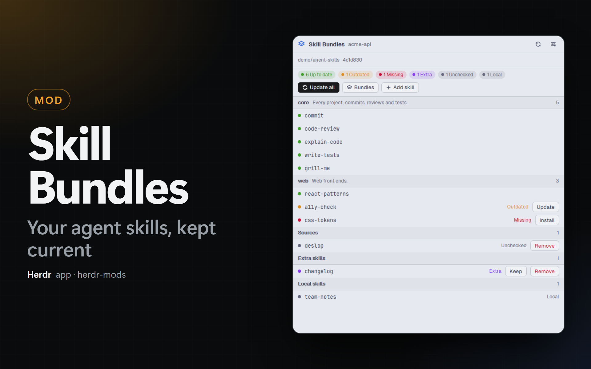

# Skill Bundles for the Herdr app

The agent skills of the focused project, against your skill Catalog. The mod shows which skills are up to date, outdated, missing or extra, and installs, updates, adds and removes them with [`npx skills`](https://skills.sh/). It works on Windows and macOS: it does not need PowerShell.



One mod, `skill-bundles`, with 2 places:

| Place | What it shows | How to add it |
| --- | --- | --- |
| **Dock panel** | The skills of the focused project, grouped by Bundle, with their state and buttons. | An entry in `dock/panels.json` (the **Skills** button of the `main-dock` and `kanban` bars). |
| **Status bar** | `skills ✓` when all skills are up to date, else the number of skills that ask for action. A click opens the panel as a dialog. | A block in the `status-row` of your layout. |

The words of this README (Catalog, Bundle, Manifest, Lock, Source, Extra skill, Local skill) are defined in [CONTEXT.md](CONTEXT.md).

## The Catalog

A Catalog is a Git repository of agent skills with a `bundles.yaml` at its root:

```yaml
repo: your-org/agent-skills

bundles:
  core:
    description: Every project.
    skills:
      - commit
      - grill-me
  dotnet:
    description: .NET projects.
    skills:
      - csharp-tests
```

`core` is in every project. Each project commits a `skills.yaml` (the Manifest) that names its Bundles, and optional Sources: skills that are not in its Bundles, from the Catalog or from another repository.

```yaml
bundles:
  - core
  - dotnet

sources:
  - repo: someone/skills
    skills:
      - deslop
```

`npx skills add` installs the skills into `.agents/skills/` (with links for each agent) and writes `skills-lock.json` (the Lock) with the hash of each skill folder.

The mod reads these files with the same rules as the PowerShell scripts of the Catalog that it replaces (`Install-Skills.ps1`, `Init-Skills.ps1`, `Configure-Skills.ps1`, `Add-Skill.ps1`). See [docs/adr/0001](docs/adr/0001-resolution-rules-in-the-mod.md).

## States

| State | When | Action |
| --- | --- | --- |
| **Up to date** | Installed, and its Lock hash is the hash of its folder in the Catalog. | — |
| **Outdated** | Installed, but the Catalog has another version. | **Update** |
| **Missing** | The Manifest asks for it, but it is not installed. | **Install** |
| **Unchecked** | Installed from a repository that is not the Catalog. The mod cannot compare it. | — |
| **Extra** | Installed with `npx skills add`, but not in the Manifest (a skill added for one task and not removed). | **Keep** (adds it to `sources:`), **Remove** |
| **Local** | A skill folder that a person wrote in the project. It has no Lock entry. | **Remove** (deletes its folder from `.agents/skills` and `.claude/skills`, after a second click) |

A project without `skills.yaml` shows the Bundles of the Catalog with check boxes (`core` is always on). **Create skills.yaml and install** writes `skills.yaml`, adds the generated files to `.gitignore` (`.agents/`, `.claude/skills/`, `.codex/skills/`, `skills-lock.json`) and installs the skills.

## Buttons

- **Update all:** installs only the Missing and Outdated skills (`npx skills add` for each repository), as a click on **Install** or **Update** of each row. Up-to-date, Unchecked, Extra and Local skills stay as they are. The button is off when no skill differs.
- **Bundles:** the Bundles of the Catalog with check boxes. **Save and apply** writes `skills.yaml`, installs the skills of the new Bundles and removes the skills of the Bundles that you took out.
- **Add skill:** the skills of the Catalog that the Manifest does not cover, with a search field. **Install** installs one skill. With **Keep in skills.yaml** off, the skill is for now and shows as Extra; with it on, the skill goes to `sources:`.
- **Remove** on a Source: takes the skill out of `sources:` and uninstalls it.
- **Batch buttons on the title of a group:** **Update N** on a Bundle or Sources group installs its Missing and Outdated skills. The Extra group (2 or more skills) has **Keep all** (adds all to `sources:` in one write) and **Remove all** (one `npx skills remove`, after a second click). The Local group (2 or more skills) has **Remove all** (deletes all their folders, after a second click).
- A click on the title of a group folds or unfolds it. Each copy of the panel keeps its folded groups.
- The refresh button of the header fetches the Catalog at once. The gear opens the Settings of PowerMods, on the row of Skill Bundles.

### Offer to update

When the mod finds Outdated skills in a project, it shows a toast: "N outdated skill(s) in <project>". A click on the toast updates these skills, as **Update all** does for Outdated skills (Missing skills stay as they are). The toast shows once for each set of Outdated skills: a new Outdated skill shows a new toast. When the project has no Outdated skills again, the next Outdated skill shows a new toast too. The mod does not show the toast while an action runs or while your own clone has a problem. Turn it off with **Offer to update outdated skills** in the Settings.

### Your own clone with a problem

When your own clone cannot be pulled, the line under the header says why and shows buttons. A button in red asks for a second click.

| Problem | Buttons |
| --- | --- |
| Changes that are not committed | **Stash the changes** (`git stash --include-untracked`), **Discard the changes** (`git reset --hard`, `git clean -fd`), **Commit and push with <agent>** (a new space in the clone; **Open a terminal** when no agent is installed) |
| Commits that are not pushed | **Push** |
| A branch that is not on the remote | **Push the branch** (`git push -u origin <branch>`) |
| New commits in the clone and on the remote | **Reset to the remote** (`git reset --hard origin/<branch>`), **Commit and push with <agent>** |

Every problem also shows **Use a clone of the mod**: it clears the setting, and the mod keeps its own clone up to date. Your clone does not change.

Each action runs in the background. The bottom of the panel shows what runs; a toast says how many skills were updated, added and removed, or shows the error. One action runs at a time, in all copies of the mod.

## What it needs

- `git`, `node` and `npx` (Node.js) on the PATH. `gh`, logged in, is optional.
- A Catalog that you can clone. A private Catalog needs `gh auth login`, or an SSH key for GitHub, or a clone URL with your credentials.

## What it runs

- `git -C <folder> rev-parse --show-toplevel` in the folder of the focused terminal, to find the project.
- `gh auth status` once, then `gh repo clone <catalog>` (or `git clone <url>`) into `~/.config/herdr-app/cache/skill-bundles/<owner>/<name>`. Every 15 minutes (a setting): `git fetch` and `git reset --hard origin/HEAD` in that folder. The mod owns that folder. With your own clone: `git fetch` and `git merge --ff-only @{u}` in your folder.
- `node mods/skill-bundles/probe.mjs` on each read: it reads the Lock and the skill folders of the project and computes the hashes of the Catalog's skill folders, the same way as `npx skills`. It writes nothing.
- `npx --yes skills add <repo> -s <skills> -y` and `npx --yes skills remove <skills> -y` in the project folder, only when you click an action. `npx skills` downloads the skills from GitHub.
- It reads and writes `skills.yaml` and `.gitignore` of the project, only when you click an action.

## Install

1. Copy `mods/skill-bundles/` to `~/.config/herdr-app/mods/skill-bundles/`. Copy `mod.json` first and `main.js` last: without `mod.json`, Herdr docks a stray copy of the mod in your layout.
2. Run `herdr-app check ~/.config/herdr-app/mods/skill-bundles`.
3. Add the places that you want (below). Herdr's own layouts are read-only: use `main-dock` and `kanban` of this kit, or clone a layout first (`herdr-app do layout.clone '{"name":"main","as":"my-main"}'`).
4. Write your Catalog (`owner/name`) in PowerMods → **Settings** → **Skill Catalog**.

### Dock panel

Add this entry to `~/.config/herdr-app/dock/panels.json`. The `tabs-dock` and `kanban` bars show a **Skills** button and add the panel block by themselves.

```json
{ "id": "skills", "label": "Skills", "icon": "mods/skill-bundles/bundles.svg", "mod": "skill-bundles" }
```

Without the Dock, open the panel beside a terminal: `herdr-app do pane.split --direction right --mod skill-bundles`.

### Status bar

Add this block to the `children` of `status-row`, after the `status` block:

```json
{ "id": "skill-bundles-status", "type": "block", "content": { "mod": "skill-bundles", "props": { "part": "status" } }, "size": { "px": 90 } }
```

## Settings

The **Settings** tab of the PowerMods dialog (`mods-hub`) shows:

- **Skill Catalog:** `owner/name` of the Catalog on GitHub.
- **Your own clone (optional):** a folder with your own clone of the Catalog. The mod keeps no clone of its own and keeps your clone up to date: each time it fetches the Catalog, it runs `git fetch` and, when the clone has no changes that are not committed, `git merge --ff-only @{u}`. So the hashes match what `npx skills` downloads from GitHub. When that clone is on a branch that is not the default one, the mod installs the Catalog's skills from that branch (`owner/name#branch`) and says so under the header. It does not install while the clone has changes that are not committed or commits that are not pushed, because `npx skills` downloads from GitHub, not from your folder. The panel then shows buttons to fix the clone (see [Your own clone with a problem](#your-own-clone-with-a-problem)).
- **Clone URL (optional):** the URL for `git clone` when `gh` is not logged in. Empty: `git@github.com:<owner>/<name>.git`.
- **Fetch the Catalog every:** 15 minutes by default.
- **Offer to update outdated skills:** on by default. See [Offer to update](#offer-to-update).
- **Shortcut of the Skill Bundles panel:** a key for `skill-bundles.open`. Only the status bar item listens for it.
- **Language** (the kit language, `herdr-mods.lang`): English or Portuguese.

## Commands

- `skill-bundles.open`: opens the panel as a dialog (the status bar item listens).
- `skill-bundles.sync`: **Update all** in the shown panel.
- `skill-bundles.fetch`: fetches the Catalog now.
- `skill-bundles.update-offered`: updates the Outdated skills of the last toast (the toast runs it).

## Limits

- A space on another machine (`hc machine ls`) works too: the mod reads the project there, writes `skills.yaml` there and runs `npx skills` there. That machine needs `git` and `node`. The Catalog clone stays on this computer, and the hashes are made here. The header shows `<project> · <machine>`.
- The project is the Git root of the focused terminal. A worktree is its own project, with its own skills.
- The mod writes `skills.yaml` in the form of the scripts: comments in the file are lost.
- **Outdated** needs the hash of the Lock. A skill that `npx skills` installed without a hash shows as Unchecked.
- **Outdated** compares content, not line endings: a text file of the Catalog that a tool wrote with LF (or CRLF) counts as the file that a git checkout gives. A change of its text still shows as Outdated.
- The mod does not run on a git hook. To keep the PowerShell hook (`Install-Skills.ps1 -Silent` in `post-checkout`), keep the scripts of the Catalog.
