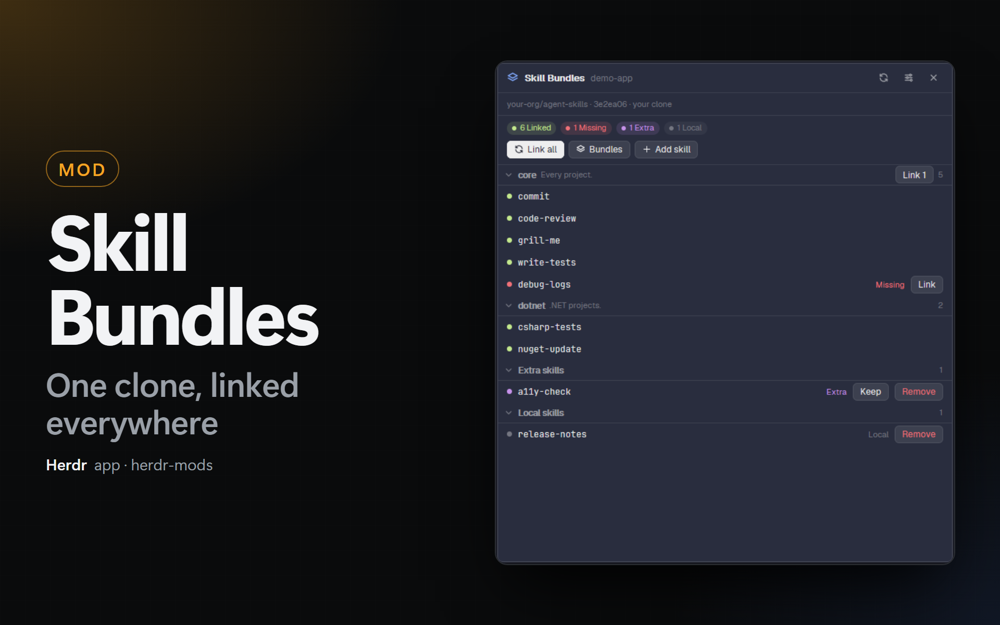

# Skill Bundles for the Herdr app

The agent skills of the focused project, as links to one clone of your skill Catalog. Only the clone has the skill files and version control. Each project has one link for each skill: a directory junction on Windows, a symbolic link on macOS and Linux. A change in the clone shows in every project at once, and no project needs an update.



One mod, `skill-bundles`, with 2 places:

| Place | What it shows | How to add it |
| --- | --- | --- |
| **Dock panel** | The skills of the focused project, grouped by Bundle, with their state and buttons. | An entry in `dock/panels.json` (the **Skills** button of the `main-dock` and `kanban` bars). |
| **Status bar** | `skills ✓` when all skills are linked, else the number of skills that ask for action. A click opens the panel as a dialog. | A block in the `status-row` of your layout. |

The words of this README (Catalog, Clone, Bundle, Manifest, Source, Link, Extra skill, Local skill, Copy, Backup) are defined in [CONTEXT.md](CONTEXT.md). The decisions are in [docs/adr/0002](docs/adr/0002-links-to-the-clone.md).

## The Catalog and the Clone

A Catalog is a Git repository of agent skills with a `bundles.yaml` at its root:

```yaml
repo: your-org/agent-skills

bundles:
  core:
    description: Every project.
    skills:
      - commit
      - grill-me
  dotnet:
    description: .NET projects.
    skills:
      - csharp-tests
```

`core` is in every project. Each project commits a `skills.yaml` (the Manifest) that names its Bundles, and optional Sources: skills of the Catalog that are not in its Bundles.

```yaml
bundles:
  - core
  - dotnet

sources:
  - repo: your-org/agent-skills
    skills:
      - deslop
```

The Clone is the folder on your computer with a checkout of the Catalog: your own clone (a setting), or a clone that the mod keeps in `~/.config/herdr-app/cache/skill-bundles/`. The mod makes, for each skill of the Manifest, a link in `.agents/skills/`, `.claude/skills/` and `.codex/skills/` of the project that points to the folder of the skill in the Clone.

- The links are not committed. The mod writes one line for each link into `.git/info/exclude` of the project. It does not change `.gitignore`.
- The projects see the Clone as it is: its branch, and also its changes that are not committed. So you can test a change of a skill before you commit it.
- An edit of a skill through a link edits the Clone. In a clone of the mod's cache, the next fetch discards it. Use your own clone to edit skills.
- The Clone and the project must be on local disks of the same computer.

## States

| State | When | Action |
| --- | --- | --- |
| **Linked** | The 3 links are there and point to the Clone. | — |
| **Missing** | The Manifest asks for the skill, but a link is not there, or points to another folder (a new worktree, a new clone, a moved Clone). | **Link** |
| **Copy** | A real folder that `npx skills` installed (it is in `skills-lock.json`). | **Change to a link** (and every other action changes it too) |
| **Stale** | A link that the mod made, but the Manifest no longer asks for the skill, or the Clone no longer has it. | **Remove** |
| **Conflict** | The Manifest asks for the skill, but the project has its own folder with that name, or Git tracks the folder. The folder of the project wins. | **Replace by link** (moves the folder to the Backup, after a second click) |
| **Not in the clone** | The Manifest asks for a skill that the Clone does not have. | — |
| **Extra** | Linked, but not in the Manifest: a skill added for one task, or a project without a Manifest. | **Keep** (adds it to `sources:`), **Remove** |
| **Local** | A skill folder that you wrote in the project, or a link that the mod did not make. | **Remove** (after a second click; a link is only removed, never its target) |
| **Not supported yet** | A skill of a repository that is not the Catalog. | — |

## A project without `skills.yaml`

A project without a Manifest can have links too. **Add skill** links one skill of the Clone, and the panel shows it as Extra. **Use Bundles** opens the Bundles of the Catalog with check boxes (`core` is always on): **Create skills.yaml and link** writes `skills.yaml` and links the skills. The skills that were linked before stay as Extra.

## Buttons

- **Link all:** makes the Missing links, changes the Copies to links and removes the Stale links. The button is off when there is nothing to do.
- **Bundles:** the Bundles of the Catalog with check boxes. **Save and apply** writes `skills.yaml`, links the skills of the new Bundles and removes the links of the Bundles that you took out.
- **Add skill:** the skills of the Clone that the project does not have, with a search field. **Link** links one skill. With **Keep in skills.yaml** off, the skill shows as Extra; with it on, the skill goes to `sources:`.
- **Remove** on a Source: takes the skill out of `sources:` and removes its links.
- **Batch buttons on the title of a group:** **Link N** makes the Missing links of the group. The Extra group (2 or more skills) has **Keep all** and **Remove all** (after a second click). The Stale group has **Remove all**. The Local group has **Remove all** (after a second click).
- A click on the title of a group folds or unfolds it. Each copy of the panel keeps its folded groups.
- The refresh button of the header fetches the Catalog at once. The gear opens the Settings of PowerMods, on the row of Skill Bundles.

The mod writes nothing in a project when it only reads it. Only a click makes, changes or removes a link.

### Offer to link

When a project has links to make (Missing skills, Copies) or to remove (Stale links), the mod shows a toast: "Skill links of <project>: N to make, M to remove". A click on the toast applies it, as **Link all** does. The toast shows once for each set of skills. This is how a new worktree or a new clone of a project gets its links. Turn it off with **Offer to make and remove links** in the Settings.

### Copies of `npx skills`

Earlier versions of the mod installed copies with `npx skills`. The first action in a project (a click on the toast or on a button) changes every Copy of the Catalog to a link:

- A Copy whose content is the content of `skills-lock.json` or of the Clone is deleted.
- A Copy with other content (your changes) moves to `.agents/skills-backup/<skill>`. The toast says how many moved.
- A Copy that Git tracks is a Conflict: the mod does not change it without **Replace by link**.
- The mod takes the changed skills out of `skills-lock.json`, and deletes the file when it is empty.
- The old block of the committed `.gitignore` (`.agents/`, `.claude/skills/`, …) stays. The line under the header shows **Remove the old block**: after it, a Local skill can be committed.

### Your own clone

The line under the header shows the Catalog, its commit and `your clone`. When the mod cannot pull your clone, the line says why and shows buttons. A button in red asks for a second click. A clone with a problem does not stop the links.

| Problem | Buttons |
| --- | --- |
| Changes that are not committed | **Stash the changes** (`git stash --include-untracked`), **Discard the changes** (`git reset --hard`, `git clean -fd`), **Commit and push with <agent>** (a new space in the clone; **Open a terminal** when no agent is installed) |
| Commits that are not pushed | **Push** |
| A branch that is not on the remote | **Push the branch** (`git push -u origin <branch>`) |
| New commits in the clone and on the remote | **Reset to the remote** (`git reset --hard origin/<branch>`), **Commit and push with <agent>** |

Each action runs in the background. The bottom of the panel shows what runs; a toast says how many skills were linked and removed, or shows the error. One action runs at a time, in all copies of the mod.

## Without Herdr: the link script

`mods/skill-bundles/link-skills.mjs` is one Node file without dependencies. It has all the rules, and the mod only shows what it reads. Copy it to the root of your Catalog, so that a person without Herdr (or a git hook) can link a project:

```sh
cd my-project
node ../agent-skills/link-skills.mjs            # the clone is the folder of the script
node ../agent-skills/link-skills.mjs --dry-run  # says what it would do
```

It links the Missing skills, changes the Copies to links and removes the Stale links. It does not change a Conflict. Options: `--project <dir>`, `--clone <dir>`.

## What it needs

- `git` and `node` (Node.js) on the PATH. `gh`, logged in, is optional.
- A Catalog that you can clone. A private Catalog needs `gh auth login`, or an SSH key for GitHub, or a clone URL with your credentials.

## What it runs

- `git -C <folder> rev-parse --show-toplevel` in the folder of the focused terminal, to find the project.
- `gh auth status` once, then `gh repo clone <catalog>` (or `git clone <url>`) into `~/.config/herdr-app/cache/skill-bundles/<owner>/<name>`, when you have no clone of your own. Every 15 minutes (a setting): `git fetch` and `git reset --hard origin/HEAD` in that folder. The mod owns that folder. With your own clone: `git fetch` and, when the clone has no changes, `git merge --ff-only @{u}`.
- `node mods/skill-bundles/link-skills.mjs` on each read: it reads `bundles.yaml`, `skills.yaml`, the agent folders, `skills-lock.json` and `.git/info/exclude`, and runs `git rev-parse --git-path info/exclude` and `git ls-files` in the project. A read writes nothing.
- The same script when you click an action: it makes and removes links, deletes or moves Copies, and writes `.git/info/exclude` and `skills-lock.json`. `.gitignore` only with **Remove the old block**.
- It reads and writes `skills.yaml` of the project, only when you click an action.

## Install

1. Copy `mods/skill-bundles/` to `~/.config/herdr-app/mods/skill-bundles/`. Copy `mod.json` first and `main.js` last: without `mod.json`, Herdr docks a stray copy of the mod in your layout.
2. Run `herdr-app check ~/.config/herdr-app/mods/skill-bundles`.
3. Add the places that you want (below). Herdr's own layouts are read-only: use `main-dock` and `kanban` of this kit, or clone a layout first (`herdr-app do layout.clone '{"name":"main","as":"my-main"}'`).
4. Write your Catalog (`owner/name`) in PowerMods → **Settings** → **Skill Catalog**, and the folder of your own clone, if you have one.

### Dock panel

Add this entry to `~/.config/herdr-app/dock/panels.json`. The `tabs-dock` and `kanban` bars show a **Skills** button and add the panel block by themselves.

```json
{ "id": "skills", "label": "Skills", "icon": "mods/skill-bundles/bundles.svg", "mod": "skill-bundles" }
```

Without the Dock, open the panel beside a terminal: `herdr-app do pane.split --direction right --mod skill-bundles`.

### Status bar

Add this block to the `children` of `status-row`, after the `status` block:

```json
{ "id": "skill-bundles-status", "type": "block", "content": { "mod": "skill-bundles", "props": { "part": "status" } }, "size": { "px": 90 } }
```

## Settings

The **Settings** tab of the PowerMods dialog (`mods-hub`) shows:

- **Skill Catalog:** `owner/name` of the Catalog on GitHub.
- **Your own clone (optional):** a folder with your own clone of the Catalog. The projects link to this folder. Each time the mod fetches the Catalog, it runs `git fetch` and, when the clone has no changes that are not committed, `git merge --ff-only @{u}`. Empty: the mod keeps a clone of its own in its cache. When you change this setting, the links of each project show as Missing, and the offer points them to the new folder.
- **Clone URL (optional):** the URL for `git clone` when `gh` is not logged in. Empty: `git@github.com:<owner>/<name>.git`.
- **Fetch the Catalog every:** 15 minutes by default.
- **Offer to make and remove links:** on by default. See [Offer to link](#offer-to-link).
- **Shortcut of the Skill Bundles panel:** a key for `skill-bundles.open`. Only the status bar item listens for it.
- **Language** (the kit language, `herdr-mods.lang`): English or Portuguese.

## Commands

- `skill-bundles.open`: opens the panel as a dialog (the status bar item listens).
- `skill-bundles.sync`: **Link all** in the shown panel.
- `skill-bundles.fetch`: fetches the Catalog now.
- `skill-bundles.add`: opens **Add skill** in the shown panel.
- `skill-bundles.update-offered`: applies the last toast (the toast runs it).

## Limits

- **Other repositories:** a skill of a repository that is not the Catalog (a Source of another repository, or a Copy from one) shows as "Not supported yet" and stays as it is. Links for other repositories come in a later version.
- **Other machines:** a project in a space on another machine (`hc machine ls`) shows a message only. Links there come in a later version.
- The project is the Git root of the focused terminal. A worktree is its own project, with its own links; it shares `.git/info/exclude` with its repository.
- `git clean -fdx` in a project removes its links (not the skill files). The mod offers them again.
- The mod writes `skills.yaml` in its own form: comments in the file are lost.
- macOS and Linux use symbolic links. Only the junctions of Windows are tested.
- A person of your team who has no links sees no skills: they run the link script.
