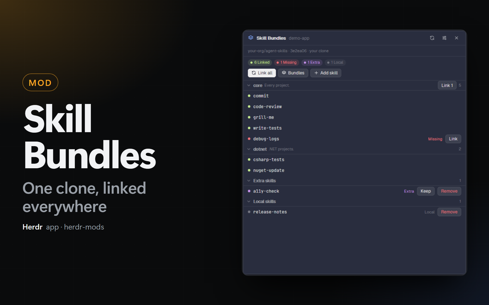

# Skill Bundles

A panel that shows the agent skills of the focused project as links to one clone of a skill Catalog (a Git repository with a `bundles.yaml`), and a status bar item that counts the skills that ask for action. The panel shows each skill as linked, missing, copy, stale, conflict, extra or local, and runs one Node script that makes and removes the links. The words are defined in `CONTEXT.md`; the decisions are in `docs/adr/0002-links-to-the-clone.md`.

## What you see

**Panel** (Dock panel, pane, or a 620×680 dialog), top to bottom, on `theme().background`, 13 px text:

1. **Header**, 40 px, bottom border: the layers icon (`bundles.svg`, 16 px, accent), `Skill Bundles` (semibold), the project folder name (12 px, dim, truncated), then 2 icon buttons of 26 px: refresh (a spinning `spinner.svg` while the Catalog is fetched or cloned) and settings.
2. **Catalog line**, 11 px, bottom border: `owner/name · <short commit>` (dim), plus `· your clone` with a clone of the person. Under it, one line per note: the branch of the person's clone (accent), why the mod cannot pull it (`ansi3`), the last fetch error (`ansi3`), a `repo:` of `bundles.yaml` that is not the setting (`ansi3`), Bundles of `skills.yaml` that the Catalog does not have (`ansi3`), a Lock that is not valid JSON (`ansi1`), Lock skills of other repositories (dim). Then the fix buttons of the person's clone, and, when `.gitignore` has the old block of `npx skills`, a note with **Remove the old block**.
3. **Body**, one of:
   - **No Catalog set** (and the project has a Manifest or no skills): `Set the Catalog`, a hint, and a primary **Open the settings** button.
   - **Cloning:** a spinner and `Cloning owner/name…`.
   - **Clone failed:** the git or gh output in a monospace box (`ansi1`), **Retry** and **Open the settings**.
   - **No Git root:** `No project`. **Remote space:** the same views, with `<project> · <machine>` in the header.
   - **List** (the normal view): a summary block with pills (18 px, round, tinted) for each state that has skills: Linked (`ansi2`), Missing, Conflict and Not in the clone (`ansi1`), Copy and Stale (`ansi3`), Extra (`ansi5`), Local and Not cloned (dim); then 3 buttons of 24 px: **Link all** (primary when there are links to make or remove), **Bundles** (**Use Bundles** without a Manifest), **Add skill**. Then a scrolling list of groups: a 28 px group title on `surface` (Bundle name, its description, the count), then one 30 px row per skill: a 7 px dot of the state color, the name (12 px, monospace), the state word in its color (not for Linked), and the row buttons. Group order: Bundles, Sources (of the Catalog), one group for each other repository of the Sources (title: the repository; then `up to date`, `N new commit(s) on the remote`, `cloning…` or the error; a primary **Update** button when there are new commits), Extra skills, Stale links, Repositories that are not cloned, Local skills.
   - **Bundles:** one 34 px line per Bundle of `bundles.yaml` with a 16 px check box (accent when on; `core` is on, tinted, and cannot be clicked, with `always included`), the name (12.5 px semibold), the description (11 px, muted) and the number of skills at the right. A bottom bar with **Cancel** and the primary **Save and apply** (**Create skills.yaml and link** without a Manifest).
   - **Add skill:** **Back**, a search field (28 px, `input` border, search icon), a **Keep in skills.yaml** switch (with a Manifest), and the skills of the Clone that the project does not have: Bundle (96 px, dim; `no Bundle` for a skill that no Bundle lists), name (monospace), and **Link**. **Another repository** at the right of the search field opens the repository view: **Back**, a repository field (Enter lists), a primary **List skills**, then a search field and one 40 px row per skill of that repository (name in monospace, description in 11 px muted, `In the project` when the project has a skill of that name, **Link**).
4. **Footer** (only when needed): a spinner and the label of the running action on `surface`, or `Failed`, the error text (monospace) and **Dismiss** on a red tint.

**Status bar item**: right-aligned in a `chrome` block with a top border, 11.8 px: the layers icon (12 px), `skills`, and a mark: `✓` (dim), the number of skills that ask for action (`ansi3`, or `ansi1` when one is Missing or a Conflict), `—` without skills, `?` without a Catalog in a project with a `skills.yaml`, `!` (`ansi1`) when the Catalog or the read failed (the tooltip has the error). A spinner replaces the icon while an action runs.

## How it behaves

- The project is the Git root (`git rev-parse --show-toplevel`) of the focused pane's live folder, else the first terminal of the tab, then of the space. A new focus reads the project again.
- A link is a directory junction on Windows and a symbolic link elsewhere (`fs.symlinkSync(target, path, "junction" | "dir")`), one in each of `.agents/skills`, `.claude/skills`, `.codex/skills`, to the folder of the skill in the Clone (the first folder with that name and a `SKILL.md`, at most 4 levels down).
- The exclude block: the lines between 2 marker comments in `.git/info/exclude` (path from `git rev-parse --git-path info/exclude`, so a worktree works): `/.agents/skills/<name>` for each link, `# extra <name>` for a skill that is Extra on purpose, `/.agents/skills-backup/` after a Backup. A link that is not in the block is not of the mod: it is a Local skill, and the mod removes it only with **Remove** (never its target).
- A read writes nothing. Only a click (a button, or the toast) runs the script with `op: "apply"`.
- Row buttons: Missing → **Link**; Copy → **Change to a link**; Conflict → **Replace by link** (`ansi1`; second click; the folder moves to `.agents/skills-backup`); Extra → **Keep** (adds it to `sources:` of the Catalog's repo) and **Remove**; Stale → **Remove**; a skill that is only in `sources:` → **Remove** (out of `sources:`, then its links); Local → **Remove** (`ansi1`; the first click changes the label to `Click again to confirm` for 5 s).
- Every apply changes each Copy (a real folder with a Lock entry of the Catalog, not tracked by Git) to a link: links first, then the folder. A folder whose hash is the Lock hash (the 2 hash versions of the `skills` CLI) or the hash of the Clone folder is deleted; any other folder moves to the Backup. The Lock loses the changed skills and is deleted when empty.
- **Link all** = link the Missing skills and the Copies, remove the Stale links. The offer toast (`notify` with `action: skill-bundles.update-offered`) does the same for the project of the toast; `shared("skill-bundles.offered")` keeps one signature per project.
- **Save and apply** (Bundles): writes `skills.yaml` (`core` first, the others sorted, `sources:` kept), reads the state again, links the Missing skills and removes the Stale links. The Extra skills of a project that had no Manifest stay Extra.
- Group titles: a chevron (`chevron-down` / `chevron-right`, 13 px, dim) before the name. A click folds or unfolds the group; the folded keys (`<kind>:<key>`) stay in `localStorage` of the copy.
- Own clone with a problem (`dirty`, `ahead`, `unpushed`, `diverged`): a row of buttons under the notes. dirty → **Stash the changes**, **Discard the changes** (danger, second click); ahead → **Push**; unpushed → **Push the branch**; diverged → **Reset to the remote** (danger, second click); dirty and diverged → **Commit and push with <agent>** (`space.new` in the clone with the first installed agent of `knownAgents()` and a task; **Open a terminal** without one). A problem does not stop the links.
- One action at a time for all copies: `shared("skill-bundles.job")` = `{ project, label, at }`. Buttons are disabled while it is set. The copy that runs it renews `at` every 60 s; a job older than 150 s is stale. On the same 60 s timer the status copy reads the Catalog and the project; a panel copy only sets `due` and calls `cx.notify()`, and `render()` reads. At the end, `shared("skill-bundles.changed")` changes and every copy reads its project again. A toast: `Skills of <project>` with the counts of the script result, or the last error line.
- The Catalog: the person's own clone (setting), else the mod's clone in `<appHome>/cache/skill-bundles/<owner>/<name>`, made with `gh repo clone` when `gh auth status` passes and no clone URL is set, else `git clone`. On the timer (15 min) and on the refresh button: the mod's clone gets `git fetch`, `git remote set-head origin --auto`, `git reset --hard origin/HEAD`; the person's clone gets `git fetch` and, when clean, `git merge --ff-only @{u}`.
- Other repositories: one clone for each in `<appHome>/cache/skill-bundles/sources/<owner>/<name>` (the script gives the folder and the URL: `op: "source"`). The mod clones a repository that a row names and that has no clone (`gh repo clone` for `owner/name` when gh is logged in, else `git clone`), then every copy reads again. On the fetch interval: `git fetch` and `git rev-list --count HEAD..origin/HEAD`, kept in `shared("skill-bundles.sources")[<repo>]` = `{ at, dir, behind, error }`. **Update** runs `git reset --hard origin/HEAD` there as a shared job. **List skills** clones (when needed) and runs the script with `op: "list"`. A new skill of another repository is linked with `repos: { name: repo }`.
- A space on another machine: every `exec` and `readTextFile` takes `on`. `place(on)` gives the folders of the mod there (`<home there>/.config/herdr-app/cache/skill-bundles`), writes `link-skills.mjs` into that cache when the file there has another text (`node -e` with base64 parts: the mod API writes only on this computer), and reads `shared.json` there. The Catalog name and the clone URL: that file, else `shared()` here. The own clone: only that file. `skills.yaml` is written there the same way. The shared keys of fetch times, sources and offers have the machine in their key. A copy applies an offer only for the machine whose Catalog it shows.
- Commands: `open` (status copy only), `sync`, `fetch` and `add` (panel copies), `update-offered` (the toast).
- In a dialog, a click gives the panel the keyboard and Esc closes the dialog; in the search field, Esc first clears the text.
- Language: `shared("herdr-mods.lang")`, then `props.lang`, then English (`text.js`, en and pt).

## Built from

- `mods/skill-bundles/`: `mod.json` (`place: none`, title, overlay 620×680), `kit.json` (settings: `skill-bundles.catalog`, `.clone`, `.gitUrl`, `.fetchMinutes`, `.offerUpdate`, and the key `skill-bundles.open`).
- `link-skills.mjs` (Node, no dependencies; also a terminal tool): the line parsers of `bundles.yaml` and `skills.yaml` (case-insensitive, `#` comments cut, quotes trimmed), the state of each skill (`op: "read"`), the Catalog of a clone (`op: "catalog"`) and the changes (`op: "apply"`: `link`, `remove`, `replace`, `deleteLocal`, `extra`, `dropGitignore`). It reads the state again before a change and skips a name whose state does not allow it.
- `main.js`: the `View`; roles by `props.part` (none: panel, `status`, `dialog`); reading, actions, the offer, the shared job.
- `manifest.js`: the writer of `skills.yaml` and the changes of `sources:`.
- `status.js`: the counts and the groups of the rows.
- `catalog.js`: `exec` wrappers (each takes the machine), clone, fetch, the state of the person's clone, the folders of the mod on a machine, and the call of the script.
- `remote.js`: the system of a machine (`uname`, else PowerShell) and a file write there. The same file as in `spec-board`.
- `herdr`: `focused`, `spaces`, `panes`, `exec`, `readTextFile`, `writeTextFile` (with the old text as `expected`), `shared`/`setShared`, `notify`, `openOverlay`, `closeOverlay`, `nextCommand`, `knownAgents`, `run("mod.open", { name: "mods-hub" })` (after `setShared("mods-hub", { …, tab: "settings" })`).
- Icons: `bundles.svg` (layers), `refresh`, `settings`, `search`, `spinner`, `plus`, `back`, `close`, `chevron-down`, `chevron-right`.

## Watch out

- Never delete a link with a recursive delete. `lstat` first; for a link, `unlink` (or `rmdir` for a junction). A recursive delete through a junction can empty the Clone.
- On Windows, Git sees a junction as a normal folder and would add its files. Write the exclude patterns without a trailing slash, so that they match a junction (a folder) and a symbolic link (a file).
- `.git` is a file in a worktree. Ask Git for the path of `info/exclude`.
- `.git/info/exclude` does nothing for a file that Git tracks. A tracked skill folder is a Conflict: do not change it without a click.
- An install of `npx skills` has `.claude/skills/x` as a link to `.agents/skills/x`. Remove the links before the real folder.
- Compare link targets after `realpath`, in lower case on Windows: `readlink` gives other text for the same folder.
- Without a Clone (no Catalog set, or a wrong folder), no link is Stale: else a cleared setting would offer to remove every link.
- The script (about 28 kB) is too long for `node -e <code>` on a Windows machine (a command line takes 32767 characters). Write it to a file there.
- `cx.notify()` is not allowed while `render` runs. The check for a new focus runs in `render`, so it starts the read with `cx.timer.after(1, …)`.
- `writeTextFile` and `readTextFile` work outside the home folder (`D:\…`); `fs` does not.
- A reload of the mod (a file saved) in the middle of an action leaves the job key: that is why it goes stale after 150 s without renewal.
- `mod.open` sizes a dialog from `overlay` in `mod.json`; without it the dialog is as small as its content.

## Done when

- `herdr-app check` passes.
- With no Catalog set, the panel shows `Set the Catalog` and the status item shows `skills ?` in a project with a `skills.yaml`.
- With a Catalog set and no clone of your own, the clone appears in `~/.config/herdr-app/cache/skill-bundles/<owner>/<name>` and the header shows its short commit.
- In a new Git project with a `skills.yaml` (`bundles: [core]`), a toast offers the links, and the status item shows the number of Missing skills. `herdr-app do skill-bundles.sync` (with the panel shown) makes 3 links for each skill; the summary shows them as Linked; `git status` does not show them; `git status` in the Clone shows no change.
- A real skill folder of the project stays as it is and shows as Local.
- In a project with an install of `npx skills`, **Link all** changes the Copies to links, an edited Copy is in `.agents/skills-backup`, and `skills-lock.json` is gone.
- After a skill leaves a Bundle, its row shows as Stale and **Link all** removes its links. The skill folder in the Clone is still there.
- `node <clone>/link-skills.mjs --dry-run` in a project prints what it would link.
- In a space on another machine, the header shows `<project> · <machine>`, the Catalog clone appears in the cache of that machine, and **Link all** makes links there that point to that clone. Back in a local space, the catalog line shows the local clone again.
- With `sources:` of a public repository in `skills.yaml`, the panel shows a group with the name of that repository, the clone appears in `cache/skill-bundles/sources/`, and **Link all** links the skill to that clone. After `git reset --hard HEAD~1` in that clone and a click on refresh, the group title says `1 new commit(s) on the remote` and shows **Update**.
