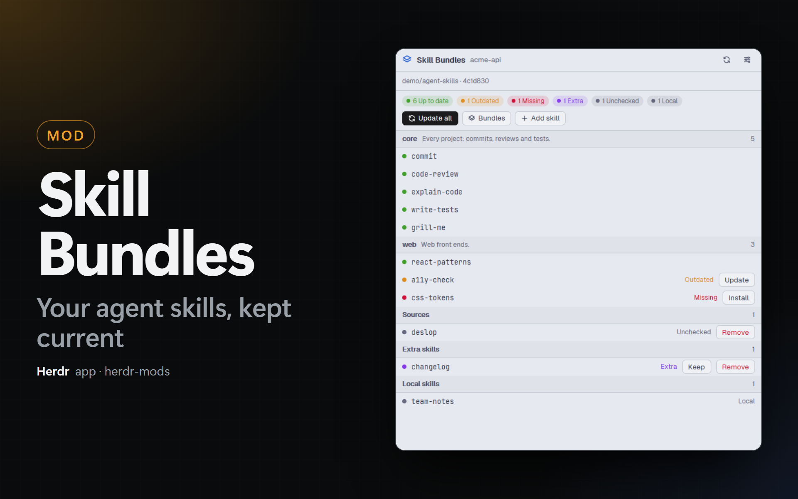

# Skill Bundles

A panel that compares the agent skills of the focused project with a skill Catalog (a Git repository with a `bundles.yaml`), and a status bar item that counts the skills that ask for action. The panel shows each skill as up to date, outdated, missing, unchecked, extra or local, and runs `npx skills` to install, update, add and remove skills. The words are defined in `CONTEXT.md`.

## What you see

**Panel** (Dock panel, pane, or a 620×680 dialog), top to bottom, on `theme().background`, 13 px text:

1. **Header**, 40 px, bottom border: the layers icon (`bundles.svg`, 16 px, accent), `Skill Bundles` (semibold), the project folder name (12 px, dim, truncated), then 2 icon buttons of 26 px: refresh (a spinning `spinner.svg` while the Catalog is fetched or cloned) and settings.
2. **Catalog line**, 11 px, bottom border: `owner/name · <short commit>` (dim), plus `· your clone` with a clone of the person. Under it, one line per note: the branch that the mod installs from (accent), why it must not install (`ansi1`), the last fetch error (`ansi3`), a `repo:` of `bundles.yaml` that is not the setting (`ansi3`), Bundles of `skills.yaml` that the Catalog does not have (`ansi3`), a Lock that is not valid JSON (`ansi1`).
3. **Body**, one of:
   - **No Catalog set:** `Set the Catalog`, a hint, and a primary **Open the settings** button.
   - **Cloning:** a spinner and `Cloning owner/name…`.
   - **Clone failed:** the git or gh output in a monospace box (`ansi1`), **Retry** and **Open the settings**.
   - **Remote space:** the same views, with `<project> · <machine>` in the header. `git`, `npx skills` and the deletes run there (`exec` with `on`; `npx.cmd` when the probe says `win32`), the Manifest is read there (`readTextFile` with `on`) and written with `node` there. The probe runs twice: there (`node --input-type=module -e <probe.mjs> {project}`) for the Lock and the skill folders, and here with `lockFile` (the Lock in `<appHome>/cache/skill-bundles/remote-lock.json`) for the hashes of the local Catalog clone. **No Git root:** `No project`.
   - **No `skills.yaml`:** an intro line, then the Bundle picker: one 34 px line per Bundle of `bundles.yaml` with a 16 px check box (accent when on; `core` is on, tinted, and cannot be clicked, with `always included`), the name (12.5 px semibold), the description (11 px, muted) and the number of skills at the right. A bottom bar with the primary **Create skills.yaml and install**.
   - **List** (the normal view): a summary block with pills (18 px, round, tinted) for each state that has skills: `13 Up to date` (`ansi2`), `1 Outdated` (`ansi3`), `1 Missing` (`ansi1`), `1 Extra` (`ansi5`), `1 Unchecked` and `1 Local` (dim); then 3 buttons of 24 px: **Update all** (primary when a skill is outdated or missing), **Bundles**, **Add skill**. Then a scrolling list of groups: a 28 px group title on `surface` (Bundle name, its description, the count), then one 30 px row per skill: a 7 px dot of the state color, the name (12 px, monospace), the state word in its color (not for Up to date), and the row buttons.
   - **Bundles:** the Bundle picker with **Cancel** and **Save and apply**.
   - **Add skill:** **Back**, a search field (28 px, `input` border, search icon), a **Keep in skills.yaml** switch, and the skills of the Catalog that the Manifest does not cover: Bundle (96 px, dim), name (monospace), `Extra` when it is installed, and **Install**.
4. **Footer** (only when needed): a spinner and the label of the running action on `surface`, or `Failed`, the error text (monospace) and **Dismiss** on a red tint.

**Status bar item**: right-aligned in a `chrome` block with a top border, 11.8 px: the layers icon (12 px), `skills`, and a mark: `✓` (dim), the number of skills that ask for action (`ansi3`, or `ansi1` when one is missing), `—` without `skills.yaml` and without installed skills, `?` without a Catalog in a project with a `skills.yaml`, `!` (`ansi1`) when the Catalog or the probe failed (the tooltip has the error). A spinner replaces the icon while an action runs.

## How it behaves

- The project is the Git root (`git rev-parse --show-toplevel`) of the focused pane's live folder, else the first terminal of the tab, then of the space. A new focus reads the project again.
- Row buttons: Missing → **Install**; Outdated → **Update**; Extra → **Keep** (adds it to `sources:` of the Catalog's repo, or of its own repo) and **Remove** (`ansi1` text, `npx skills remove`); a skill that is only in `sources:` → **Remove** (out of `sources:`, then uninstall when no Bundle needs it); Local → **Remove** (`ansi1` text; the first click changes the label to `Click again to confirm` for 5 s, the second deletes the folder from `.agents/skills` and `.claude/skills`).
- Group titles: a chevron (`chevron-down` / `chevron-right`, 13 px, dim) before the name. A click folds or unfolds the group; the folded keys (`<kind>:<key>`) stay in `localStorage` of the copy.
- Own clone with a problem (`dirty`, `ahead`, `unpushed`, `diverged`): a row of buttons under the notes of the Catalog line. dirty → **Stash the changes** (primary), **Discard the changes** (danger, second click); ahead → **Push**; unpushed → **Push the branch**; diverged → **Reset to the remote** (danger, second click); dirty and diverged → **Commit and push with <agent>** (`space.new` in the clone with the first installed agent of `knownAgents()` and a task; **Open a terminal** without one); always → **Use a clone of the mod** (clears `skill-bundles.clone`).
- **Update all** = `npx skills add <repo> -s <the Missing and Outdated skills from that repo> -y` for each repository: the same as **Install** / **Update** on each of those rows. Off when no skill is Missing or Outdated.
- **Save and apply** (Bundles): writes `skills.yaml` (`core` first, the others sorted, `sources:` kept), installs the new set, removes the installed skills that were in the old set and are not in the new one.
- **Create skills.yaml and install**: writes `skills.yaml` (new file), appends the `.gitignore` block of `Set-SkillsGitignore` (same marker text, so the script sees it) unless the marker or the 4 entries are there, installs.
- **Add skill**: installs one skill; with **Keep in skills.yaml** on, also adds it to `sources:`.
- One action at a time for all copies: `shared("skill-bundles.job")` = `{ project, label, at }`. Buttons are disabled while it is set. The copy that runs it renews `at` every 60 s; a job older than 150 s is stale. On the same 60 s timer the status copy reads the Catalog and the project; a panel copy only sets `due` and calls `cx.notify()`, and `render()` reads. Herdr does not draw a hidden copy, so a hidden panel runs no `git` until it shows again. At the end, `shared("skill-bundles.changed")` changes and every copy reads its project again. A toast: `Skills of <project>` with `N updated, N new, N removed` (from the Lock before and after), or the last error line.
- The Catalog: the mod's own clone in `<appHome>/cache/skill-bundles/<owner>/<name>`, made with `gh repo clone` when `gh auth status` passes and no clone URL is set, else `git clone <url or git@github.com:owner/name.git>`. Fetch (`git fetch`, `git remote set-head origin --auto`, `git reset --hard origin/HEAD`) when the last fetch (`shared("skill-bundles.fetchedAt")[dir]`) is older than the setting (15 min), and on the refresh button. With the person's own clone: only `git fetch`; the branch rules of `Resolve-SkillsRef` and `Assert-BundlesRepoPushed` decide whether and from where to install (`owner/name#branch`).
- Commands: `open` (status copy only), `sync` and `fetch` (panel copies).
- In a dialog, a click gives the panel the keyboard and Esc closes the dialog; in the search field, Esc first clears the text.
- Language: `shared("herdr-mods.lang")`, then `props.lang`, then English (`text.js`, en and pt).

## Built from

- `mods/skill-bundles/`: `mod.json` (`place: none`, title, overlay 620×680), `kit.json` (settings: `skill-bundles.catalog`, `.clone`, `.gitUrl`, `.fetchMinutes`, and the key `skill-bundles.open`).
- `main.js`: the `View`; roles by `props.part` (none: panel, `status`, `dialog`); reading, actions, the shared job.
- `manifest.js`: line parsers of `bundles.yaml` and `skills.yaml` with the regular expressions of `Read-BundlesCatalog` and `Read-ProjectManifest` (case-insensitive, `#` comments cut, quotes trimmed); the writer; the Bundle resolution; the `.gitignore` block.
- `status.js`: the rows and states from Manifest × Catalog × probe; the groups.
- `catalog.js`: `exec` wrappers (`npx.cmd` on Windows: `exec` does not find a `.cmd` without the extension), clone, fetch, branch check, and the probe call.
- `probe.mjs` (Node, run with `node`): the Lock, the skill folders of `.agents/skills` and `.claude/skills` that have a `SKILL.md`, and the hash of each Catalog skill of the Lock: SHA-256 over the sorted (`localeCompare`) relative paths and bytes, without `.git` and `node_modules` (the `computeSkillFolderHash` of the `skills` CLI). Each text file that git stores with LF (`git ls-files --eol`: `i/lf`) is hashed with the line endings that a checkout gives it: `eol=crlf` or `eol=lf` from `.gitattributes`, else CRLF when `core.autocrlf` is `true`; other files are hashed as they are. A 40-hex Lock hash is compared with `git rev-parse HEAD:<folder>`.
- `herdr`: `focused`, `spaces`, `panes`, `exec`, `readTextFile`, `writeTextFile` (with the old text as `expected`), `shared`/`setShared`, `notify`, `openOverlay`, `closeOverlay`, `nextCommand`, `run("mod.open", { name: "mods-hub" })` (after `setShared("mods-hub", { …, tab: "settings" })`).
- Icons: `bundles.svg` (layers), `refresh`, `settings`, `search`, `spinner`, `plus`, `back`.

## Watch out

- `cx.notify()` is not allowed while `render` runs. The check for a new focus runs in `render`, so it starts the read with `cx.timer.after(1, …)`.
- The mod runtime has no SHA-256 and reads files only as UTF-8 text, so the hashes are made in Node. Do not hash text in the mod: a binary file breaks it.
- The Lock path is lower case (`skills/x/SKILL.md`) while the Catalog folder can be `SKILLS/x`. Match folders case-insensitively, then by name.
- The clone must use the person's own `core.autocrlf`: `npx skills` checks out with the same settings, and the hash covers the bytes. Do not force a value.
- A file that a tool or an agent writes in the clone keeps its line endings: git converts only the files that it writes itself (checkout, pull). With `core.autocrlf=true`, a skill file written with LF is clean for `git status` but has other bytes than the CRLF copy that `npx skills` installed, and the skill shows as Outdated in every project. A `.gitattributes` does not prevent it. Hash each text file with its checkout line endings, not with the bytes on disk.
- `writeTextFile` and `readTextFile` work outside the home folder (`D:\…`); `fs` does not.
- A reload of the mod (a file saved) in the middle of an action leaves the job key: that is why it goes stale after 150 s without renewal.
- `mod.open` sizes a dialog from `overlay` in `mod.json`; without it the dialog is as small as its content.
- Each copy reads on its own (about 0.2 s of `node`); the fetch and the action are shared.

## Done when

- `herdr-app check` passes.
- With no Catalog set, the panel shows `Set the Catalog` and the status item shows `skills ?`.
- With a Catalog set, the clone appears in `~/.config/herdr-app/cache/skill-bundles/<owner>/<name>` and the header shows its short commit.
- In a project without `skills.yaml`, the panel shows the skills of `skills-lock.json` in one group for each repository, also without a Catalog. After `npx skills check -p` ran there, a skill with a newer version shows as Outdated, and **Update** runs `npx skills update <skill> -p -y`. **Use Bundles** shows the Bundle picker with `core` on. **Add skill** shows a repository field: **List skills** runs `npx skills add <repo> --list` and shows the skills of the repository, each with **Install**.
- In a project whose Lock has a changed hash for one skill, an extra skill, a hand-written skill folder and a Source that is not installed, the summary shows 1 Outdated, 1 Missing, 1 Extra and 1 Local, and `skills.yaml` with an unknown Bundle shows the warning.
- In a clone of the Catalog with `core.autocrlf=true`, a `SKILL.md` of an Up to date skill written again with LF only keeps the skill Up to date; one more line in it makes the skill Outdated.
- `herdr-app do skill-bundles.sync` installs the missing and outdated skills; afterwards the summary shows them as Up to date and a toast reports the counts.
