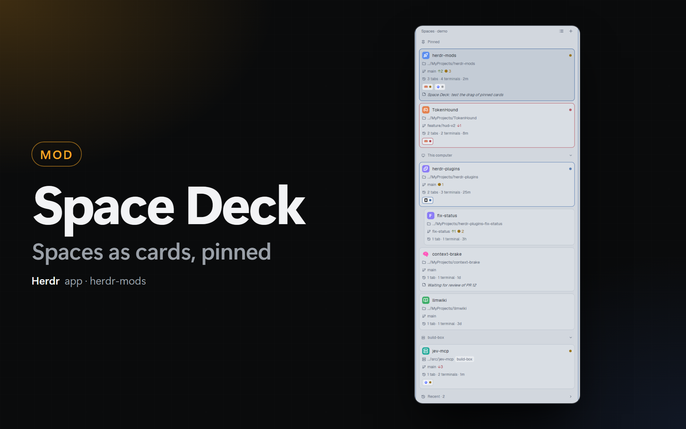

# Space Deck

A Herdr app mod (`space-deck`) that replaces the Spaces list of the sidebar. It shows your spaces as cards or as a list. Each space can have an icon, a color and a note. Pinned spaces stay on top.

## Quick Start

Copy and paste this prompt to your LLM agent:

`Read ~/.config/herdr-app/AGENTS.md, then add this mod: https://github.com/dougcunha/herdr-mods/tree/main/space-deck-app and put it in the "spaces" block of the layout that I use`

## What it shows

- **Cards or a list.** The button in the panel header changes the view. The same choice is in Herdr Mods → **Settings** → **View**.
- **A card** shows the folder where the space works (and the machine of a remote space), the git branch with ahead, behind and changed files, the number of tabs and terminals, the time of the last activity, the agents with their status, and the note. Turn each line on or off in Herdr Mods → **Settings**.
- **The list** shows one row for each space: the icon, the name, the branch and the status.
- **Pinned.** Pinned spaces go to the **Pinned** section at the top, from every machine. Drag a space into the section to pin it. Drag it inside the section to change the order. Drag it out to unpin it.
- **Groups.** Spaces of other machines show in their own group, as in Herdr's own sidebar. A worktree shows under the space of its repository. Drag a space in its group to change the order of Herdr's spaces.
- **Needs you.** A space with an agent that is blocked or done gets a colored border and a dot that pulses. With **Needs you first** on (Herdr Mods → Settings), these spaces go to the top of their section.
- **Recent.** The **Recent** section at the bottom (folded at first) lists the spaces that you closed. A click opens the space again in the same folder.
- **A narrow sidebar** (less than 160 px) shows only the icons, with a status dot.

## What you can do

- **Click** a space to show it. **Right-click** it for the menu: **Icon and color…**, **Pin** / **Unpin**, **Note…**, **New agent…**, and **Herdr options…** (Herdr's own menu: rename, worktrees, close).
- **Put the pointer on a space** for 2 buttons: **New agent** (a list of the agents installed on that machine; the agent starts in a new tab of the space) and **Close space**.
- **Icon and color.** Choose one of 52 icons, type an emoji, or click **Default** to go back to the first letter of the name. Click one of the 8 colors.
- **The + button** opens [Repo Launcher](../repo-launcher-app) when it is installed. Without it, + shows **New space** and **New space with agent…** (you choose the agent, then the folder).

The icon, the color, the note and the pin belong to the folder of the space (the top folder of its git repository), not to the space. Close a space and open the same repository again: they come back.

## Commands

Run `herdr-app do space-deck.<command>`, or bind one in `keys.json` (`"ctrl-alt-i": "space-deck.icon"`):

| Command | What it does |
| ------- | ------------ |
| `view` | Changes between cards and the list. |
| `needs-you` | Turns **Needs you first** on or off. |
| `icon` | Opens **Icon and color** for the shown space. |
| `note` | Opens the note of the shown space. |
| `pin` | Pins or unpins the shown space. |
| `menu` | Opens the menu of the shown space. |
| `agent` | Opens the list of agents for the shown space. |
| `demo` | Shows example spaces (run it again to show yours). |

## Settings

In Herdr Mods → **Settings** → **Space Deck**:

| Setting | Default |
| ------- | ------- |
| View | Cards |
| Card: agents, tabs and terminals, git, folder and machine, last activity, note | On |
| Git refresh | 15 s (5 to 120 s) |
| Needs you first | Off |
| Recent spaces | 5 (0 hides the section) |

## Where it shows

The mod has no place of its own (`"place": "none"`). Put it in the `spaces` block of your layout: change `{ "id": "spaces", "content": { "mod": "spaces" } }` to `{ "id": "spaces", "content": { "mod": "space-deck" } }`. Keep the size of the block. To go back, set the mod to `spaces` again.

## What it does on your machine

- It runs `git status` and `git rev-parse` in the folder of each space (on the machine of the space), one at a time.
- It reads `~/.config/herdr-app/view.json` (the recent spaces) and checks if `mods/repo-launcher/mod.json` exists.
- It writes only shared state: `space-deck.*` and Herdr's `space.colors`. No network.

## Notes

- Icons: [Lucide](https://lucide.dev) (ISC license).
- Herdr's own Spaces sidebar can also reconnect a machine that was rebuilt and watches the `.git` folders for changes. Space Deck does not: use Herdr's sidebar or `hc machine` to reconnect, and Space Deck reads git on its timer and when an agent changes status.
- Checked with `herdr-app check`, with screenshots of the cards, the list, the demo and each popup, and with the pin command. A drag with the mouse was not tested in a real session.
