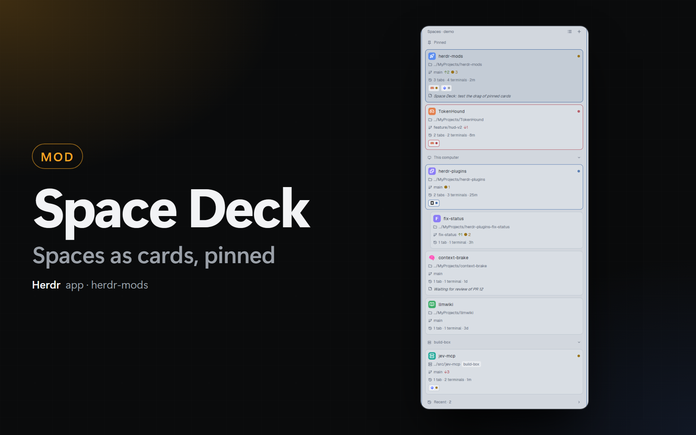

# Space Deck

A Herdr app mod (`space-deck`) that replaces Herdr's `spaces` sidebar mod: cards or a list, an icon, a color and a note for each space, a Pinned section, recent spaces, and a + that opens `repo-launcher`.

## What you see

- **Header** (31 px): "Spaces" (11.5 px, `dim`), a view button (`list.svg` in card view, `layout-grid.svg` in list view) and the + (`plus.svg`).
- **Sections**, in this order: **Pinned** (only when a pinned space is open), then one group for each machine (a head with `monitor` / `server` from `workspace-chrome` and a chevron, only when a remote machine is known; with pins and one machine, a plain "Spaces" head), then **Recent · N** (folded at first, `history.svg`).
- **Card** (9 px radius, 8 px padding, `surface`; `selected` with an `accent` border when shown; the border is the status color when an agent is `blocked` or `done`): a 22 px tile and the name (medium), and on the right a status dot or, on hover, the buttons **New agent** (`bot.svg`) and **Close space** (`x.svg`). Then 11 to 11.5 px `dim` lines: folder (`icons/folder.svg`, or `icons/server.svg` and a machine badge), git (`git-branch.svg`, branch, `↑n` in `ansi2`, `↓n` in `ansi1`, `● n` changed in `ansi3`), "N tabs · N terminals · 5m" (`history.svg`), one chip for each agent (program icon and a status dot, 6 at most and "+n"), and the note (`sticky-note.svg`, italic, `muted`). A worktree card is 16 px to the right; a pinned worktree says "worktree of <repo>".
- **List row** (30 px, 8 px radius): `├`/`└` for a worktree, an 18 px tile, the name, the git text on the right, the status dot.
- **Rail** (panel narrower than 160 px, from `on_size_change`): a 22 px tile for each space with a status dot at its top right.
- **Tile**: the emoji (no background), or the icon (`icons/<name>.svg`, white) on the color, or the first letter (bold, white) on the color. Colors are Herdr's names (`ansi6`, `ansi3`, `ansi4`, `ansi5`, `ansi2`, `ansi1`, with the same hex values as the native sidebar) or `#e0b341` and `#7d8796`.
- A status dot of `blocked` or `done` pulses (`loop("opacity")`, 1.2 s).

## How it behaves

- **Key of a space**: `"<machine>|<folder>"`, where the folder is `git rev-parse --show-toplevel` of the live folder of the first terminal, else the live folder. Folders are normalized: forward slashes, no trailing slash, lower case on Windows. Before git answers, the key uses the live folder.
- **Shared state**:
  - `space-deck.spaces`: `{ [key]: { icon?, emoji?, color?, note?, activeAt? } }`.
  - `space-deck.pins`: the keys of the Pinned section, in order.
  - `space-deck.view` (`"card"` / `"list"`), `space-deck.card` (`{ agents, tabs, git, folder, activity, note }`, `false` hides one), `space-deck.gitEvery` (s), `space-deck.needsYouFirst`, `space-deck.recentCount`. The Settings of mods-hub write them (`kit.json`); the mod reads them on every render.
  - `space.colors` (Herdr's own, by space id): the mod writes the chosen color of a space there, gives a space without a color the color used least (as the native sidebar does), and removes ids of closed spaces. So `repo-launcher` and Herdr's sidebar show the same colors.
- **Git**: `git --no-optional-locks -c core.fsmonitor=false status --porcelain=v2 --branch` in the live folder, with `on: machine`. `rev-parse --show-toplevel` and `--git-common-dir` once for each folder (a worktree has a common dir that is not `<top>/.git`). One `git` at a time. A folder is read when it is new, when its time (`gitEvery`) is due (a 1 s timer checks), and at once when the statuses of the agents of its space change. An error that is not "not a git repository" keeps the last status.
- **Last activity**: the newest `changed_at` of the tabs of the space, or `activeAt`. `activeAt` is written when the statuses of the agents of a space change, and when the shown space changes.
- **Order**: Pinned in the order of `space-deck.pins`. Each machine group in Herdr's order, with each worktree under the space of its repository (only when that space is in the same section). With **Needs you first**, the units (a space and its worktrees) with a `blocked` or `done` space go first; the order stays the same in each part. The mod does not run `space.move` for nesting.
- **Drag** (left mouse down, move, up; a click is a down and up on the same row): in Pinned, it moves the pin; from a group into Pinned, it pins at that place; from Pinned to a group, it unpins; in one group, `space.move {id, index}`. A line in `accent` shows where the row goes. Between groups of 2 machines, nothing.
- **Right click**: the popup `menu`. **Herdr options…** closes it and opens Herdr's `menu` mod with `{ tab: "space", target: { id } }`.
- **+**: `run("mod.open", { name: "repo-launcher" })` when `readTextFile(appHome() + "/mods/repo-launcher/mod.json")` gives text (checked every 10 s); else the popup `plus`.
- **Recent**: `recent` of `view.json` (read every 10 s), without the folders of open spaces, `recentCount` at most. A click runs `space.new { folder, machine: "", name? }`.
- **Popups** are the same mod with `props().part`: `menu`, `plus`, `agents` (`knownAgents({ on })`, installed only; a click runs `space.select` and `tab.new { space, argv, folder }`, or for a new space `pickFolder` and `space.new { folder, argv, machine: "" }`), `picker` (search field, a 200 px grid of 52 icons, an emoji field, 8 colors, Default), `note` (one field, 140 characters at most). Esc closes a popup also when its text field has the keyboard.
- **Commands** (`nextCommand`): `view`, `needs-you`, `demo`, and for the shown space `icon`, `note`, `pin`, `menu`, `agent`.

## Built from

- `mods/space-deck/`: `mod.json` `{ "place": "none", "title": "Space Deck" }`; `kit.json` (the settings); `main.js` (the panel); `model.js` (rows and sections); `git.js` (the git reads); `store.js` (shared state, keys, colors); `overlays.js` (the popups); `demo.js` (the example data).
- Icons: [Lucide](https://lucide.dev) 0.460.0 (ISC). The UI icons are in the mod folder, the 52 icons of the picker in `icons/`. It also uses `mods/workspace-chrome/monitor.svg` and `server.svg`.
- Herdr API: `spaces()`, `agents()`, `panes()`, `machines()`, `knownAgents()`, `pickFolder()`, `readTextFile()`, `appHome()`, `home()`, `exec()`, `openOverlay()`, `closeOverlay()`, `shared()`, `setShared()`, `nextCommand()`, `run()` with `space.select`, `space.new`, `space.close`, `space.move`, `tab.new`, `mod.open`.

## Watch out

- Write `mod.json` before `main.js` in a new mod folder, or Herdr docks a copy of the mod into the shown layout.
- A `popup` is as tall as its content: the icon grid has a fixed height.
- The buttons on a row stop the mouse down and up, or a click on them also starts a drag or shows the space.
- Not ported from Herdr's `spaces`: the **Connect** button for a rebuilt machine, the `+` on each machine head, and `watchFolder` on each repository.
- Untested: a drag with the mouse, a click on the hover buttons, a chosen color in Herdr's sidebar and in `repo-launcher` (all in a real session), macOS, Linux, a remote machine.

## Done when

- `herdr-app check ~/.config/herdr-app/mods/space-deck` passes.
- `herdr-app do space-deck.demo` shows the Pinned section (2 cards), "This computer" with a worktree under its repository, a "build-box" group and "Recent · 2". `herdr-app do space-deck.view` shows the same data as a list.
- With the demo off: `space-deck.pin` moves the shown space to Pinned and adds its key to `space-deck.pins`; a second run moves it back. `space-deck.icon`, `space-deck.note`, `space-deck.menu` and `space-deck.agent` open their popups. Wait 2 s between 2 commands.
