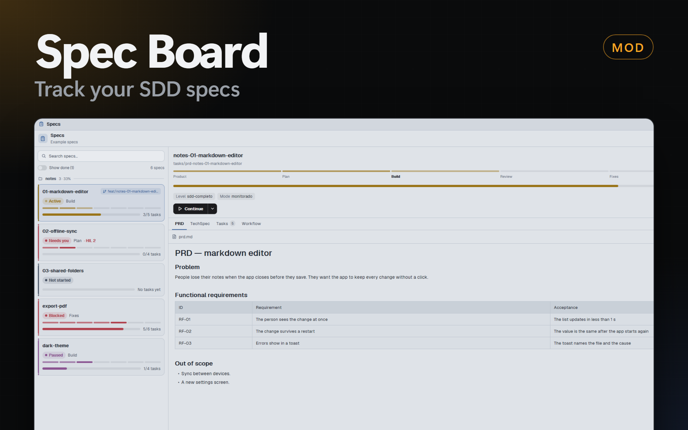

# Spec Board

A Herdr app mod (`spec-board`) that lists the SDD specs of the shown repository: the folders `tasks/prd-<name>/` that the SDD skills write (`sdd-triar`, `sdd-orquestrar-fluxo` and the skills that they call). Each spec shows its status, its phase and its task progress. You read and edit the markdown, delete old specs, and start or continue a spec with an agent, here or in a new git worktree.



## Quick Start

Copy and paste this prompt to your LLM agent:

`Read ~/.config/herdr-app/AGENTS.md, then add this mod: https://github.com/dougcunha/herdr-mods/tree/main/spec-board-app and add it to the dock: the "main-dock" layout reads ~/.config/herdr-app/dock/panels.json`

## What it shows

- **The specs of the shown space.** The panel follows the focused terminal: it finds the git repository of its folder and reads `tasks/prd-*/` in the main checkout and in every worktree (`git worktree list`). A space without a `tasks/` folder shows nothing. A spec that is in more than one worktree shows once: the copy with a checkpoint, then the one with the highest checkpoint `generation`. The detail says where the other copies are.
- **Status** (the colored chip and the left edge of the card), from `checkpoint.json`: **Needs you** (`aguardando-hil`, with the name of the pending HIL), **Blocked**, **Active** (the dot pulses), **Paused**, **Done**, and **Not started** for a folder without `checkpoint.json`.
- **Phase**, a bar of 7 steps: Product, Plan, Build, Review, Fixes, Acceptance, Done (`checkpoint.phase`; `conceito` shows on the first step).
- **Progress**: the tasks in `done/` out of all the `task_NN.md` files, as a bar and as `3/5 tasks`.
- **A worktree badge** with the branch, when the spec is in a worktree.
- **Order**: by urgency (Needs you, Blocked, Active, Paused, Not started, Done; the newest first), with the parts of one split (`name-01-…`, `name-02-…`) under one header. The sort button switches to urgency without groups or to the name. Done specs hide until you turn on **Show done**. The search box filters by name.

## Panel and dialog

The mod is one panel of the [Dock](../dock-app). The panel-open button of the dock decides where it opens: in the side panel or in a dialog.

- **Narrow** (the side panel): the list of cards. A click opens the detail in the same column; ← goes back.
- **Wide** (the dialog): the list on the left and the detail on the right.

The detail has the status, the phase with names, the progress, the level, the mode, the review status, the next action of the checkpoint, the actions, and a tab for each file: **PRD**, **TechSpec**, **Tasks** (the plan and each task with its state), **Reviews** (each `codereview_NN` with APROVADO, APROVADO COM RESSALVAS or REPROVADO, its fix tasks, and the design reviews), **Workflow**, **Snapshot** and **Brief** when they exist.

## What you can do

- **Read and edit.** The markdown shows rendered. **Edit** opens an editor; **Save** writes the file only if nobody changed it since you opened it. If an agent changed it, the panel says so, and **Reload** reads it again.
- **New spec** (+ in the header). Write the request, then **Start here** or **Start in a worktree…**. The agent starts with `/sdd-triar --prompt "<request>"`.
- **Start** (a spec that is not started) and **Continue** (a spec with a checkpoint). The agent starts with `/sdd-orquestrar-fluxo --prd <name>` in the folder of the spec: a new tab of the space that works there, else a new space. The arrow next to the button adds `--modo auto` or `--modo monitorado`. When an open session of the agent is idle in the folder of the spec, the arrow also shows **Continue in open session** (or **Start in open session**): the prompt goes to that session (`hc send`) and its terminal comes to the front. The button itself always starts a new agent.
- **Start in worktree** (a spec that is not started). You edit the branch (`feat/<name>`). The panel runs `git worktree add` into `<worktree folder>/<repository>/<branch>` and starts the agent there in a new space. If the folder of the spec is not in the last commit, the panel says so and offers to copy the folder into the worktree (on by default). The original stays.
- **Delete** (trash icon). The folder goes to the Recycle Bin after a confirmation. A spec that is not done, and a folder that git tracks, show a warning.
- **Open folder** opens the folder of the spec in the file manager.

## Commands

Run `herdr-app do spec-board.<command>`, or bind one in `keys.json`:

| Command | What it does |
| ------- | ------------ |
| `refresh` | Reads the specs again. |
| `new` | Opens **New spec**. |
| `open-<name>` | Opens the spec `<name>` (the folder name without `prd-`). |
| `tab-<id>` | Shows a tab of the open spec: `prd`, `techspec`, `tasks`, `reviews`, `workflow`, `snapshot`, `brief`. |
| `back` | Closes the sheet, the file or the detail. |
| `edit`, `delete`, `worktree`, `menu` | The same as the buttons of the open spec. |
| `demo` | Shows example specs (run it again to show yours). Nothing changes on disk in the demo. |

## Settings

In Herdr Mods → **Settings** → **Spec Board**:

| Setting | Default |
| ------- | ------- |
| Agent (a key of the agents menu) | `claude` |
| Prompt (`{skill}`, `{args}`) | `/{skill} {args}` |
| New spec skill (names, separated by commas) | `sdd-triar` |
| Flow skill (names, separated by commas) | `sdd-orquestrar-fluxo` |
| Worktree folder | `~/.herdr/worktrees` (the folder of Herdr's own worktrees) |
| Branch prefix | `feat/` |
| Order | Urgency, grouped |
| Show done specs | Off |

For each skill, the panel uses the first name of the list that is installed in `<repository>/.claude/skills`, `<repository>/.agents/skills`, `~/.claude/skills`, `~/.agents/skills` or `~/.codex/skills`. With none, it uses the first name. So a repository with English skill names works when you add them to the list (`sdd-triar, sdd-triage`).

## Add it to the Dock

Add this entry to `~/.config/herdr-app/dock/panels.json`:

```json
{ "id": "specs", "label": "Specs", "icon": "mods/spec-board/specs.svg", "mod": "spec-board" }
```

## What it does on your machine

- It runs `git rev-parse`, `git worktree list`, `git ls-files` and `git status` in the repository of the shown space, and PowerShell (`Get-ChildItem`) or `sh` (`find`) to list `tasks/`. It reads the files of the specs and watches each `tasks/` folder.
- When you ask: `git check-ref-format`, `git rev-parse`, `git worktree add`, a copy of the spec folder (`Copy-Item` or `cp -R`), the move to the Recycle Bin (`Microsoft.VisualBasic`, or `gio trash` / `rm -rf` on Linux and macOS), `explorer` / `open` / `xdg-open`, and a new tab or space with the agent.
- It writes the markdown files that you save, and the shared keys `spec-board.*`. No network.

## Notes

- Only specs of this computer: a space on another machine shows a message.
- Icons: [Lucide](https://lucide.dev) (ISC license).
- Checked with `herdr-app check`, with screenshots of the demo (list, groups, detail, tasks, reviews, editor, mode menu and the 3 sheets) in the side panel and in the dialog, and with a test repository with a worktree: the list, the copy that wins, the folder watch, the commit check and the copy and Recycle Bin commands. Typing in the editor, Save, and a real start of an agent were not tested in a real session.
