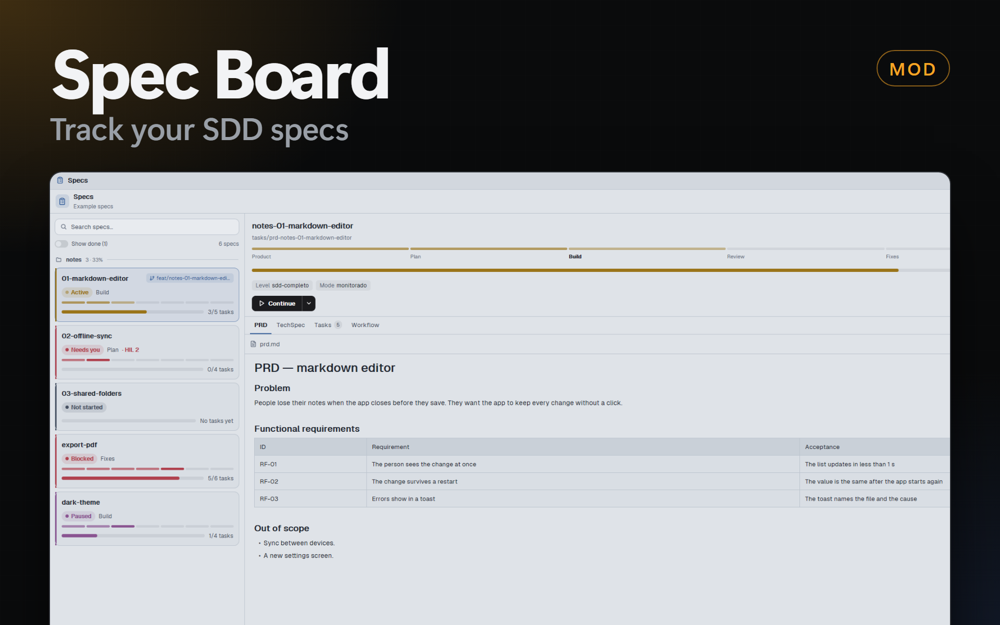

# Spec Board

A Herdr panel that lists the SDD specs (`tasks/prd-<name>/`) of the shown space's repository and its git worktrees, with a status chip, a phase bar and task progress for each. It shows the markdown of a spec, edits it, deletes old specs, and starts an agent with the SDD skills (`sdd-triar`, `sdd-orquestrar-fluxo`), here or in a new worktree.

## What you see

- **Header** (46 px, `border` line under it): a 26 px tile (`accent` at 13%) with `specs.svg` 15 px in `accent`; "Specs" (13 px semibold) over the repository name, or "Example specs" in the demo (11 px `dim`); then 3 icon buttons of 28 px (7 px radius, icon 15 px `muted`, lit `accent` on `accent` at 15%): **New spec** (`plus`), **Sort** (`sort`), **Refresh** (`refresh`, a turning `spinner` while it reads).
- **Toolbar** (10 px padding): a search box (32 px, 9 px radius, `raised`, `border`, `search.svg` 13 px), then, when Sort is lit, 3 chips (24 px, 12 px radius): Urgency, grouped / Urgency / Name; then a 26x15 px switch **Show done (n)** and `n specs` at the right (11 px `dim`).
- **Cards** (10 px side margin, 6 px apart, 10 px radius, `surface`, `border`; selected: `accent` at 8% with an `accent` border at 53%): a 3 px left edge in the status color; the name (13 px semibold; inside a group without the group prefix) and, for a worktree, a badge (18 px, `accent` at 11%, `git-branch` 10 px, the branch, max 170 px); a status chip (20 px, 11 px radius, color at 13%, 6 px dot, 11 px semibold) and the phase name (11 px `muted`), and for Needs you `· <HIL>` in the status color; the phase bar (7 segments of 5 px, 3 px apart: past steps in the status color at 67%, the current step in the full color, the rest `foreground` at 8%; hidden for Not started); the progress bar (6 px, the fill in the status color at the percent of done tasks) with `3/5 tasks` or `No tasks yet` (11 px `muted`).
- **Group header** (a split of 2 or more specs with the same `<prefix>-NN-`): `folder.svg` 12 px, the prefix (11 px semibold `muted`), `n · pct%` (10 px `dim`) and a line.
- **Status colors**: Needs you `blocked`, Blocked `ansi1`, Active `working` (dot and current step pulse, `loop("opacity")`), Paused `ansi5`, Not started `muted`, Done `done`, Bad checkpoint `ansi1`.
- **Detail**: ← (narrow only), the name (15 px semibold) over `tasks/prd-<name>` (11 px `dim`), the worktree badge and a 22 px chip; the phase bar with the 7 names under it (wide only; 10 px, the current one semibold); the progress bar; fact pills (20 px, `foreground` at 6%: Level, Mode, Review); a box in the status color at 8% with `message.svg`, the HIL name (Needs you only) and `next_action.instruction` (not for Done); "Also in: …" for other copies; the actions; a tab row (34 px, 2 px `accent` underline on the shown tab, count badges for Tasks and Reviews); the tab body.
- **Actions**: Not started: **Start** (solid `solid`/`solid_foreground`, `play`), **Start in worktree** (`git-branch`), an arrow button. Other statuses except Done: **Continue** joined to a 26 px arrow. The arrow shows a row of compact buttons: Continue (Start) in auto mode, in monitored mode, and for a new spec Start in worktree · auto. At the right: **Open folder** (`external-link`) and **Delete** (`trash`).
- **Tab body**: a file shows with a 38 px bar (path, **Edit** with `pencil`) and `TextView.markdown` in a scrolling `div` (18 px side padding). Editing: **Cancel**, **Reload** (after a conflict), **Save** (`save`), and an `Editor` (soft wrap, no line numbers). Tasks: a row "Plan (tasks.md)" and one 36 px row per task (`check` in `done` color or `file-text` in `dim`, `T01 — Title`, a `done`/`pending` pill). Reviews: one row per `codereview_NN` with the count of fix tasks and the status pill (REPROVADO `ansi1`, RESSALVAS `blocked`, APROVADO `done`), its task rows, and the design reviews.
- **Sheets** (replace the body, or the detail when wide; 16 px padding): New spec (a 5-row `Textarea`, Start here, Start in a worktree…, Cancel), Start in a new worktree (branch `Input`, the folder under it, a `blocked`-tinted box with a checkbox "Copy the spec folder into the worktree" when the folder is not committed), Delete (path, warnings in `ansi1` / `blocked` / `dim`, a red **Move to Recycle Bin**).
- **Width**: from 760 px (the root's `on_size_change` divided by `settings().zoom`) the list (380 px) and the detail sit side by side, and the first spec opens by itself.

## How it behaves

- **Which repository.** Every 1.5 s the panel reads the folder of the focused pane (a mod pane falls back to a terminal of its tab, then the active tab of the space). On a change it runs `git rev-parse --show-toplevel` and `git worktree list --porcelain` (bare and prunable entries skipped). Not in git: the folder alone. A space with a `machine`: every program (`exec` with `on`) and every read (`readTextFile` with `on`) runs on that machine, the system and home folder come from `uname` (or PowerShell `$HOME`), a save runs `node` there (base64 parts into `<file>.herdr-tmp`, then a rename, after a check against the text that was read), there is no `watchFolder` (a poll every 15 s reads the list and the cached files again), **Open folder** is hidden, and a start uses `space.new {machine}` or a space of that machine. The header shows `<repo> · on <machine>`.
- **Scan.** For each worktree it lists `tasks/` 4 levels deep (PowerShell `Get-ChildItem -Depth 3` with the write time, or `sh -c 'find . -maxdepth 4 -type f'`). A spec is a folder `prd-*` with a file. It finds (case-insensitive) `prd.md`, `techspec.md`, `tasks.md`, `workflow.md`, `snapshot-contexto.md`, `brief.md`, `checkpoint.json`, `task_NN.md` and `done/task_NN.md`, `codereview_NN/codereview.md` with its `task_NN.md` and `done/`, and `designreview_NN/designreview.md`. Task titles come from the links of `tasks.md` (`[T01 — Title](task_01.md)`).
- **Status** from `checkpoint.json`: `status` or `phase` `concluido` → Done; `aguardando-hil` → Needs you; `bloqueado` → Blocked; `pausado` → Paused; else Active. No file: Not started. Invalid JSON: Bad checkpoint. `pending_hil` may be a string or an object (`gate`, `pergunta`, `question`, `title`).
- **Duplicates.** The same slug in 2 worktrees: the copy with a checkpoint wins, then the higher `generation`, then the main checkout, then the newer files.
- **Live.** `watchFolder` on each `tasks/` folder: a change clears the read texts and scans again. A 30 s timer scans too (a new `tasks/` folder or worktree).
- **Launch.** The agent comes from `knownAgents()` by key (setting **Agent**, default `claude`), its `run` as `argv`; the prompt is the first message (`task`). The skill name is the first of the setting's list that has a `SKILL.md` in `<repo>/.claude/skills`, `<repo>/.agents/skills`, `~/.claude/skills`, `~/.agents/skills` or `~/.codex/skills`. Prompt: template `/{skill} {args}`, args `--prd <slug>` (+ `--modo auto|monitorado`) or `--prompt "<request>"` (double quotes in the request become single quotes). Where: `tab.new {space, folder, argv, task, name}` in the space with a terminal inside the folder (the shown one first), after `space.select`; else `space.new {folder, argv, task, tab}`. Then the dialog closes.
- **Worktree.** The branch field starts as `<prefix><slug>` or `<prefix>` + the first 4 words of the request in kebab case (accents removed). `git check-ref-format --branch`, then `git worktree add -b <branch> <folder>/<repo>/<branch>` from the checkout of the spec (or `git worktree add <path> <branch>` when the branch exists). Commit check: `git ls-files -- tasks/<dir>` empty → not tracked; `git status --porcelain -- tasks/<dir>` not empty → changed. Copy: `Copy-Item -Recurse` or `cp -R` into `tasks/` of the worktree.
- **Edit.** `writeTextFile(path, text, original)`; a rejection is a conflict message.
- **Delete.** `[Microsoft.VisualBasic.FileIO.FileSystem]::DeleteDirectory(path, 'OnlyErrorDialogs', 'SendToRecycleBin')`; elsewhere `gio trash` or `rm -rf`.
- **Keys.** Esc closes a sheet or a menu, else the panel dialog (`props().overlay`, else `shared("kanban.panelDialog").id`). A text field handles Esc itself (the field keeps it from Herdr): it closes the sheet, clears the search, or closes the dialog. Backspace or ← closes the shown file, then the narrow detail. In a dialog, a left click on the panel gives the root focus handle the keyboard.
- **Commands** (`nextCommand`): `refresh`, `new`, `demo`, `back`, `open-<slug>`, `tab-<id>`, `doc-<rel>`, `edit`, `delete`, `worktree`, `menu`.
- **Language**: `shared("herdr-mods.lang")` (`en`/`pt`), else `props.lang`, else English.

## Built from

- `mods/spec-board/`: `mod.json` `{ "place": "none", "title": "Spec Board" }`; `main.js` (the view), `data.js` (git, listing, parsing, sort and groups), `actions.js` (settings, skills, launch, worktree, copy, trash), `demo.js` (6 example specs of `D:/MyProjects/notes-app`, texts in memory), `kit.json` (the mods-hub settings).
- A Dock panel: `{ "id": "specs", "label": "Specs", "icon": "mods/spec-board/specs.svg", "mod": "spec-board" }` in `dock/panels.json`.
- `herdr`: `focused`, `spaces`, `panes`, `run` (`space.select`, `tab.new`, `space.new`), `knownAgents`, `readTextFile`, `writeTextFile`, `watchFolder`, `exec`, `notify`, `shared`, `setShared`, `closeOverlay`, `nextCommand`, `settings`, `theme`, `home`. `gpui-base`: `InputState`/`Input`, `TextareaState`/`Textarea`, `EditorState`/`Editor`, `TextView`.
- Shared keys: `spec-board.agent`, `.prompt`, `.triageSkills`, `.flowSkills`, `.worktreeRoot`, `.branchPrefix`, `.sort`, `.showDone`.
- Art: Lucide 0.460.0 (ISC): `specs` (clipboard-list), `play`, `save`, `sort` (arrow-up-down), `message` (message-circle), `plus`, `search`, `refresh`, `spinner`, `close`, `trash`, `chevron-down`, `chevron-left`, `chevron-right`, `check`, `folder`, `git-branch`, `file-text`, `pencil`, `external-link`.

## Watch out

- `fs.readdir` reads only in the home folder: list `tasks/` with `exec`. On Windows use `powershell`, not a bare `find` (`find.exe` waits for input).
- `TextView`, `Editor` and `Textarea` come from `gpui-base`, not `gpui-kit`.
- `watchFolder` rejects for a folder that does not exist: watch only `tasks/` folders that the scan found, and keep the 30 s timer for new ones.
- A worktree checkout gives every committed spec a second copy with a new file time: without a checkpoint, the main checkout must win, not the newer time.
- `herdr-app check` shows only the first render (no repository yet). Test with `demo` and the `open-…`/`tab-…` commands and `herdr-app shot`.
- Preview images: use `demo`, never a work repository.

## Done when

- `herdr-app check ~/.config/herdr-app/mods/spec-board` passes.
- With the panel open, `herdr-app do spec-board.demo` shows 5 cards (6 with Show done) with a `notes` group of 3, and in a dialog the first spec opens at the right.
- In a repository with `tasks/prd-x/checkpoint.json` and a worktree with a copy of a higher `generation`, the card shows the worktree badge and the status of the worktree copy; moving `task_02.md` into `done/` updates `n/m tasks` within 2 s.
- **Start in worktree** on a spec that is not committed shows the copy box; on a committed spec it does not.
- **Delete** moves the folder to the Recycle Bin and the card goes.
