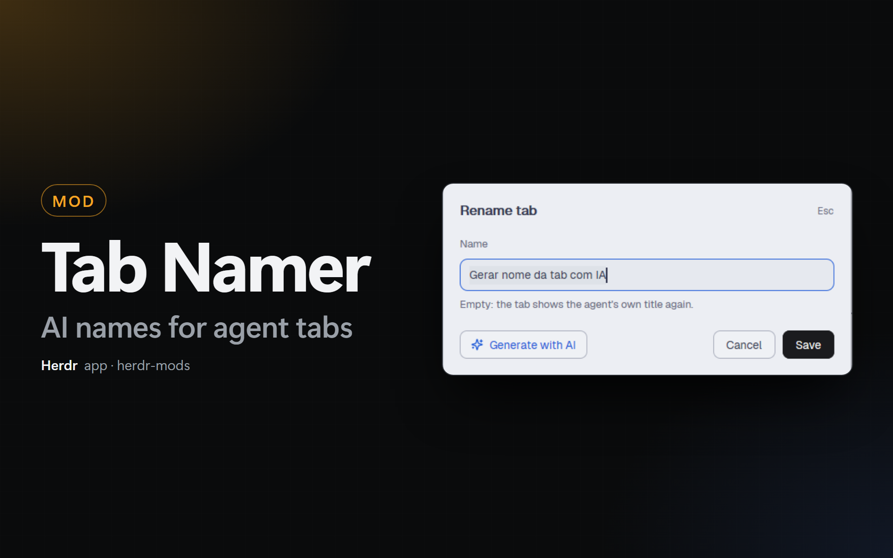

# Tab Namer

A Herdr app mod (`tab-namer`) that renames the tab of an agent. F2 and the
pencil of the agent cards open a small dialog with a text field and a
**Generate with AI** button. The button reads the agent's session and asks a
small, cheap model (Claude Haiku or Codex Luna) for a name of 2 to 5 words.

## Why

With 5 or 6 agents in one space, the title that each agent gives itself is
often a ticket key or a generic text. After a few minutes you cannot tell which
agent does what. A tab name that says what the work is about fixes that, and
the AI writes it for you in about 10 seconds.

## What it does

- **F2** opens the dialog for the focused tab. The field shows the tab name
  (empty when nobody named the tab). Enter saves. An empty name gives the tab
  its number again, and the cards show the agent's own title.
- **Generate with AI** reads the session of the agent in the tab:
  the first prompt, the last 5 prompts and the last answer of the agent (about
  6,000 characters). It asks the model for a name and puts it in the field. You
  can change it before you save.
- **The pencil** on a card of the [Kanban](../kanban-app) board and of
  [Agent Cards](../agent-cards-app) opens the same dialog for that agent's tab.
- **After `/clear` or `/new`**, the agent starts a new session, and the old
  name is wrong. The [Agent Resume](../agent-resume-app) mod sees the new
  session id and clears the name that this dialog saved. The cards show the
  agent's own title again until you name the tab again.

The Kanban cards show the tab name as the title of the card when a person
named the tab. The agent's own title is in the tooltip.

## What it needs

- **Agent Resume** for the AI button. That mod records the session id of each
  agent on its terminal (`resume.session`). Without it, the dialog has only the
  text field: it works like Herdr's own F2.
- **Claude Code or Codex** on this machine, logged in. The mod runs one of them
  once for each click:
  - `claude -p <prompt> --model haiku --no-session-persistence --tools ""`
  - `codex exec -m gpt-6-luna --skip-git-repo-check --ephemeral -s read-only <prompt>`

  The call uses your account and costs a few tokens. It does not add a session
  to your history.
- Sessions: Claude Code reads `~/.claude/projects/<folder>/<session>.jsonl`,
  Codex reads `~/.codex/sessions/…/rollout-…-<session>.jsonl`. For other agents
  (Antigravity, OpenCode) the mod reads the last 120 lines of the terminal
  (`hc read`).

## Settings

In the **Settings** tab of PowerMods (`kit.json`, key `tab-namer.settings`):

| Setting | Values | Default |
| --- | --- | --- |
| AI program | Auto, Claude Code, Codex | Auto: Claude Code when it is installed, else Codex |
| Model | any model id of that program | empty: `haiku` (Claude Code), `gpt-6-luna` (Codex) |
| Name language | Same as the session, Kit language | Same as the session |
| Shortcut | a key | F2 |

The model ids of Codex on your machine are in `~/.codex/models_cache.json`
(`slug`).

## Install

Ask your agent:

`Read ~/.config/herdr-app/AGENTS.md, then add this mod: https://github.com/dougcunha/herdr-mods/tree/main/tab-namer-app`

Or do it by hand:

1. Copy `mods/tab-namer/` to `~/.config/herdr-app/mods/tab-namer/`. Copy
   `mod.json` first, `main.js` last.
2. Merge `keys.json` into `~/.config/herdr-app/keys.json`: `"f2":
   "mod.open:tab-namer"` in `global`. This replaces Herdr's default F2
   (`tab.rename`). Shift+F2 (`space.rename`) stays.
3. Install [Agent Resume](../agent-resume-app) for the AI button, and put its
   block in every layout that you use (the clear after `/clear` runs only while
   its block is shown).
4. Run `herdr-app check ~/.config/herdr-app/mods/tab-namer`.

## Limits

- A Codex `/new` clears the name only when Agent Resume can tell the new
  session. When 2 or more Codex agents work in the same folder, it cannot, and
  the name stays.
- A tab on another machine gets only the text field.
- Esc closes the dialog without a save.
