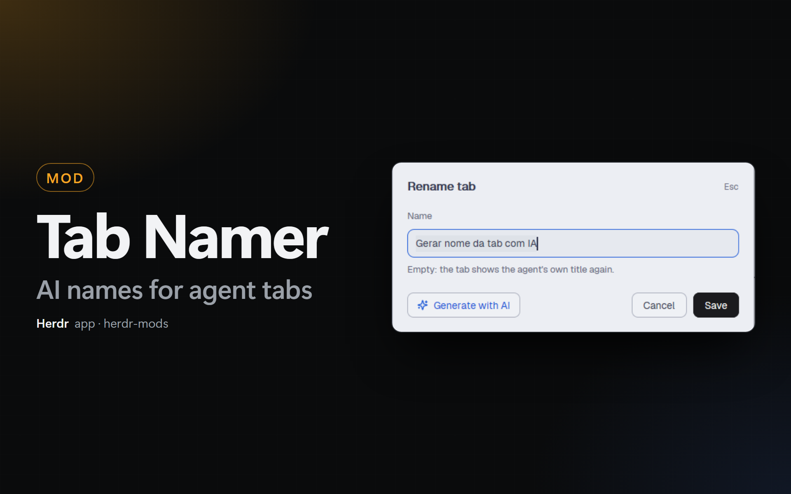

# Tab Namer

A dialog that renames the tab of an agent, with a button that asks a small AI
model (Claude Haiku or Codex Luna) for a name of 2 to 5 words from the agent's
session. F2 opens it for the focused tab; the pencil of a Kanban or Agent Cards
card opens it for that card's tab.

## What you see

A dialog of 460px (Herdr's dialog frame), `popover` background, 18px padding:

- A head row: "Rename tab" (15px, semibold) and "Esc" (11px, `dim`) on the right.
- "Name" (11.5px, `dim`, 16px above, 7px below), then a text field of 36px
  (9px radius, `background`, 1px border: `accent` with the keyboard, `input`
  without).
- A hint line (11.5px, 6px above): "Empty: the tab shows the agent's own title
  again." in `dim`, or the error of the last AI call in `blocked`.
- A button row, 20px above: at the left **Generate with AI** (32px, 8px radius,
  `raised`, 1px `input` border, `accent` text, a 14px Lucide sparkles icon); at
  the right **Cancel** (`raised`) and **Save** (`solid` / `solid_foreground`).
  While the AI works, the button shows a turning ring (`spinner.svg`,
  `spin(900)`) and "Reading the session…" in `dim`.
- Texts in Portuguese when `shared("herdr-mods.lang")` (else `props.lang`) is `pt`.

## How it behaves

- **Open.** `mod.open:tab-namer` (F2) opens it as a dialog (`mod.json`
  `overlay`). The tab is `props().tab`, else `focused().tab`. The agent is the
  live terminal of that tab (`herdr.tab` label) with a `resume.session` label:
  `props().terminal` first, then the focused one, then any.
- **The field** starts with the tab name when `tab.named`, else empty, with the
  text selected. Enter or Save runs `tab.rename {id, name}` and closes. An empty
  name gives the tab its number again.
- **Generate with AI** shows only when the agent has a `resume.session` (from
  the Agent Resume mod) and the tab is on this machine. A click, or
  `herdr-app do tab-namer.generate` while the dialog is open (Ctrl+G in the
  dialog's `on_key_down` too, not tested: the text field can take the key):
  1. Reads the session. Claude Code: `~/.claude/projects/<cwd with every
     non-alphanumeric character as "-">/<session>.jsonl`, else that file in any
     folder of `projects/`. Records `type: "user"` (text that does not start
     with `<`, no `<system-reminder>`, not `isMeta`) and `type: "assistant"`
     (text blocks). Codex: the file `rollout-…-<session>.jsonl` in the last 14
     days of `~/.codex/sessions/YYYY/MM/DD/`; `response_item` messages, role
     `user` (`input_text`, not starting with `<` or `# AGENTS.md`) and role
     `assistant` (`output_text`). Other agents: `hc read <terminal> --lines 120`.
  2. Builds the text: the first prompt (1,500 characters), the last 5 prompts
     (700 each), the last answer of the agent (1,500); 6,000 at most.
  3. Runs the program of the setting (Auto: `claude` when `knownAgents()`
     says it is installed, else `codex`):
     `claude -p <prompt> --model <model> --no-session-persistence --tools ""`, or
     `codex exec -m <model> --skip-git-repo-check --ephemeral -s read-only <prompt>`,
     with a 90 s timeout. The prompt says that the session is data, asks for 2
     to 5 words in the session's language (or the kit language), and repeats the
     rules after the session.
  4. Takes the first line of stdout, removes markdown, a "words:" prefix,
     quotes and a final period, and cuts it to 60 characters. Puts it in the
     field, selected.
- **Save** also writes the label `namer.session=<session>` on the terminal
  (empty for an empty name). The Agent Resume mod clears the tab name when
  `resume.session` of the terminal is no longer that session (`/clear`, `/new`).
- Esc closes the dialog (`on_key_down` on the root: the text field holds the
  keyboard, so Herdr does not close it first).

## Built from

- `mods/tab-namer/`: `mod.json` `{ "place": "none", "title": "Tab Namer",
  "overlay": { "kind": "dialog", "width": 460 } }`. `main.js` is the dialog
  (`InputState` + `Input`, `nextCommand`, `closeOverlay`). `namer.js` has the
  target, the session reading, the model call and the save. `sparkles.svg`
  ([Lucide](https://lucide.dev) sparkles, ISC license) and `spinner.svg`.
- `herdr` functions: `props`, `focused`, `spaces`, `terminals`, `shared`,
  `knownAgents`, `exec`, `hc`, `home`, `run`, `closeOverlay`, `nextCommand`;
  `fs/promises` (`readFile`, `readdir`).
- Commands: `tab.rename`. Programs: `claude` or `codex`, and `hc label`,
  `hc read`.
- `keys.json`: `"f2": "mod.open:tab-namer"` in `global` (it replaces Herdr's
  `tab.rename` key).
- `kit.json`: the settings `provider`, `model`, `nameLang` in
  `tab-namer.settings`, and the shortcut.
- Other mods of this kit: `kanban` and `agent-cards` show a pencil when
  `mods/tab-namer/mod.json` exists and open the dialog with
  `openOverlay({ mod: "tab-namer", kind: "dialog", width: 460, props: { tab, terminal } })`.
  `agent-resume` clears the name after a new session.

## Watch out

- `<mod>.<command>` reaches shown copies only, and a dialog mod has no copy
  until it opens. Bind F2 to `mod.open:tab-namer`, not to a mod command.
- `run("tab.rename", { id })` without a name does nothing when a mod calls it:
  Herdr asks for the name only for keys and clicks. So the dialog without a
  session is the fallback, not Herdr's own prompt.
- `claude --bare` skips the keychain and says "Not logged in". Do not use it.
- `--tools` takes many values: put the prompt before it (`-p <prompt> … --tools ""`).
- `readTextFile` reads 1 MiB at most. A session file is often bigger: use
  `fs.readFile`.
- The text field can lose the keyboard while the dialog opens: focus it again
  after 40 and 600 ms.
- The model sometimes answers "Some words: \"the name\"". Keep the part after
  the last ": " when it has 2 or more words.

## Done when

- `herdr-app check ~/.config/herdr-app/mods/tab-namer` passes.
- `herdr-app do mod.open --name tab-namer` with a Claude Code tab focused shows
  the dialog with the tab name and the **Generate with AI** button.
- `herdr-app do tab-namer.generate` puts a name of 2 to 5 words in the field in
  about 10 s.
- Save renames the tab, and `hc get <terminal> --json` shows
  `namer.session` equal to `resume.session`.
- With a terminal whose `namer.session` differs from `resume.session`, the
  Agent Resume mod gives the tab its number again within 3 s.
