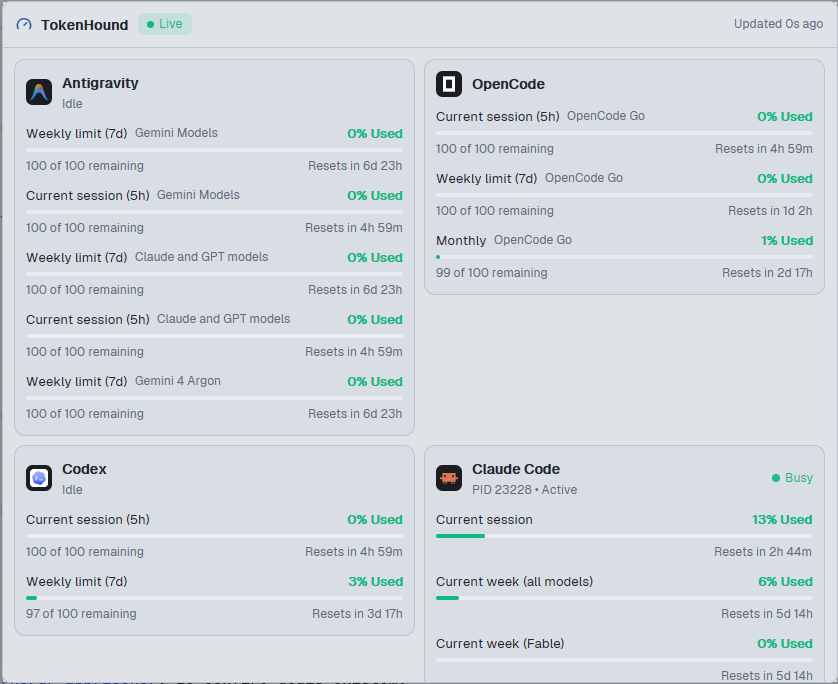
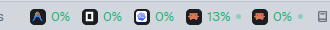
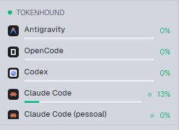

# TokenHound for the Herdr app

The quotas of your coding agents, inside the Herdr app. The mod shows the same data as the [TokenHound](https://github.com/dougcunha/TokenHound) HUD: the session and weekly use of Claude Code, Codex, Copilot, Cursor, Antigravity, OpenCode and Cline, the reset countdowns, and which agent works now.



One mod, `tokenhound`, with 3 places:

| Place | What it shows | How to add it |
| --- | --- | --- |
| **Status bar** | One agent icon and one percent for each provider, and a green dot when the agent works. A click opens the full panel. | A block in the `status-row` of your layout. |
| **Dock panel** | The full panel: a card for each provider with every quota, bar, reset countdown and status message. A wide panel shows the cards in columns. | An entry in `dock/panels.json` (the **Quota** button of the `main-dock` and `kanban` bars). |
| **Sidebar section** (optional) | One line for each provider with its session bar, under the agents list. A narrow sidebar shows only the icons and the percents. | A block in the `sidebar-lists` column of `main-dock`. |

 

## What it needs

- Windows and [TokenHound](https://github.com/dougcunha/TokenHound) **0.1.16 or newer**, running. TokenHound writes its HUD to `%LOCALAPPDATA%\TokenHound\hud.json` (the contract: [docs/HUD-FEED.md](https://github.com/dougcunha/TokenHound/blob/main/docs/HUD-FEED.md)).
- On macOS and Linux the mod shows `Windows only`.

## What it runs

Nothing. The mod only reads `%LOCALAPPDATA%\TokenHound\hud.json` (outside its own folder) and watches that folder for changes. It runs no program and uses no network. It never writes the file.

## Install

1. Copy `mods/tokenhound/` to `~/.config/herdr-app/mods/tokenhound/`. Copy `mod.json` first and `main.js` last: without `mod.json`, Herdr docks a stray copy of the mod in your layout.
2. Run `herdr-app check ~/.config/herdr-app/mods/tokenhound`.
3. Add the places that you want (below). Herdr's own layouts are read-only: use `main-dock` and `kanban` of this kit, or clone a layout first (`herdr-app do layout.clone '{"name":"main","as":"my-main"}'`).

### Status bar

Add this block to the `children` of `status-row`, after the `status` block. In a layout without a `status-row`, replace the `status` block with the row, as in the `repo-launcher-app` README.

```json
{ "id": "tokenhound-status", "type": "block", "content": { "mod": "tokenhound", "props": { "part": "status" } }, "size": { "px": 260 } }
```

260 px holds 5 providers. Give it about 50 px for each provider that you show, or 80 px with **Session · week**.

### Dock panel

Add this entry to `~/.config/herdr-app/dock/panels.json`. The `tabs-dock` and `kanban` bars show a **Quota** button and add the panel block by themselves.

```json
{ "id": "quota", "label": "Quota", "icon": "mods/tokenhound/gauge.svg", "mod": "tokenhound" }
```

### Sidebar section (optional)

In `main-dock.json`, add this block to the `children` of `sidebar-lists`, after the `agents` block:

```json
{ "id": "tokenhound-section", "type": "block", "content": { "mod": "tokenhound", "props": { "part": "section" } }, "size": { "px": 186 }, "min": 60 }
```

186 px holds 5 providers. Each provider needs about 26 px more. The list scrolls when it is longer than the block.

- **Minimize.** The arrow button at the right of the section head makes the block small: the head and one line with the icon and the session percent of each provider. Click it again to get the old height back. `herdr-app do tokenhound.minimize` does the same.
- **Hide a provider.** Put the pointer on a provider line: an eye button replaces the percent. Click it to hide the provider. The head then shows "N hidden"; click it to show all of them again.

## Settings

The **Settings** tab of the Herdr Mods dialog (`mods-hub`) shows:

- **Status bar value:** `Session` (the default) or `Session · week`.
- **Hidden providers:** provider ids to leave out of every place, separated by commas (`gemini, claude-pessoal`). The ids are in the `providerId` field of `hud.json`. The eye button of a provider (in the sidebar section on hover, and on each card of the panel) adds its id here. The panel lists the hidden providers at the bottom; click one to show it again.
- **Minimize the sidebar section:** the same as the arrow button in the head of the section.
- **Shortcut of the TokenHound panel:** a key for `tokenhound.open`. It opens the panel as a dialog. Only the status bar item listens for this command, so the key works in a layout with the status bar item.
- **Language** (the kit language, `herdr-mods.lang`): the texts of the mod in English or Portuguese. The row labels and the status messages come from TokenHound and stay in English.

## States

| State | When | What the mod shows |
| --- | --- | --- |
| Live | TokenHound wrote the file in the last 3 heartbeats (90 s). | The data. |
| Not updated | No write for more than 3 heartbeats: TokenHound crashed or was killed. | The last data, dimmed, with a warning. |
| TokenHound closed | TokenHound exited normally (`isRunning: false`). | The last data, dimmed, with a warning. |
| TokenHound not found | The file does not exist. | A message with the install hint. |
| Update this mod | The file has a `schemaVersion` newer than 1. | A message. |

## Limits

- The mod reads the file of this computer only. A space on another machine shows the quotas of this computer.
- Each provider shows the icon that Herdr shows for that agent (from `knownAgents()`, with its tile). Cline, GLM and Perplexity have no icon in Herdr: they show their text badge in a circle of the level color.
- The colors of the percents and bars follow the HUD: green below 50%, yellow below 80%, orange from 80%. The percent of a provider that needs a login or is blocked is red.
