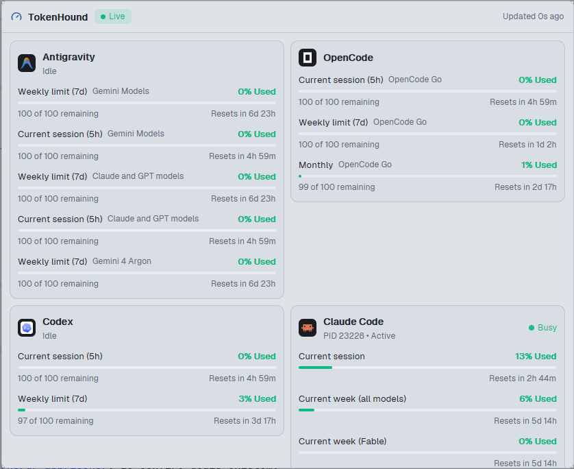

# TokenHound

The quotas of the TokenHound HUD inside the Herdr app: a status bar item with one agent icon and one percent for each provider, a Dock panel with a card for each provider, and an optional sidebar section. The data comes from the file that TokenHound (a Windows tray app) writes: `%LOCALAPPDATA%\TokenHound\hud.json`.

## What you see

All text uses the UI font. Colors are theme names, except the HUD levels: green `#10b981` below 50%, yellow `#eab308` below 80%, orange `#f97316` from 80%. A fraction that is `null` uses `dim`.

**Icon.** The icon that Herdr shows for the agent. `icons.js` maps the provider id to a Herdr program key (`claude*` → `claude`, `codex`, `copilot`, `cursor`, `gemini`/`antigravity` → `antigravity`, `opencode`, `grok`) and takes `icon`, `tint`, `tile` and `color` from `knownAgents()` (a fallback table holds the shipped `icons/<key>.svg`). With a `tile`: a square of that color, radius 25% of the size, with the glyph at 68% of the size (`svg` in `color`, or white, when `tint`; else `image`). Without a tile: the glyph at full size (`svg` in `foreground` when `tint`, else `image`). A provider without an icon (Cline, GLM, Perplexity) gets its `badge` text in a circle: the status color when `status` is not `ok`, else the level color; fill with alpha `26`, 1 px border, semibold font at 46% of the size (36% for 2 letters).

**Value color.** `ansi1` when `status` is `needsAuth`, `accessDenied` or `rateLimited`; `ansi3` for the other statuses that are not `ok`; else the level color, or `dim` for a null fraction.

**Busy dot.** A `#10b981` circle that pulses: `.loop("opacity", { from: 0.35, to: 1, period: 1200 })`.

1. **Status bar item** (`props.part: "status"`), the full block height. `chrome` fill, 1 px top `border`, 10 px side padding, 10 px gap, 11.8 px text, `muted`. One entry for each visible provider: a 15 px icon, the session percent in the value color (`–` when null), and a 5 px busy dot when `isBusy`. With the setting `both`: `<session> · <week>`. When the state is not live, the entries are at 55% opacity after a 6 px state dot. With no data: the gauge icon (12 px, state color) and the state text. Hover: `hover` fill. A click opens the dialog. The tooltip says `Click to show the quotas.`, after the state hint when the data is not live.
2. **Panel** (no `part`; a Dock panel or a pane) and **dialog** (`part: "dialog"`, 760 × 620).
   - **Header**, 10 px vertical and 12 px side padding, 1 px bottom `border`: the gauge icon (15 px, `accent`), `TokenHound` (13 px semibold), a state pill (20 px tall, radius 6, 11 px, a 6 px dot, fill = state color + `1f`), and at the right `Updated <age> ago` (11 px, `dim`).
   - **Body**, scrolling, 10 px padding, 8 px gap. A stale or closed feed shows its hint first, in `ansi3`. Then the cards in a wrapping row: one column below 2 × 340 px of inner width, else as many columns of at least 340 px as fit.
   - **Card**: `surface` fill, 1 px `border`, radius 10, 10 px padding, 8 px gap. Header: a 24 px icon, the `displayName` (13 px semibold) over a note (11 px, truncated): `statusMessage` in the status color, else `activeSessionText` in `dim`; at the right `● Busy` in `#10b981` when `isBusy`. Then one block per row: the `label` (12 px `foreground`) and the `scopeText` (11 px `dim`) at the left, the main value at the right (12 px semibold, level color); a 4 px bar (`raised` track, level color fill, clamped to 0–100%) when `usedFraction` is a number; a line with `secondaryText` at the left and the reset countdown at the right (11 px `dim`); `errorText` in `ansi1`.
   - The states without data (missing, error, newer, unsupported) show a centered message: the gauge icon (22 px, state color), the state name, and the hint (11 px `dim`, max 300 px wide).
3. **Sidebar section** (`part: "section"`): `chrome` fill, 1 px top `border`, 12 px side and 8 px vertical padding, 7 px gap. A title line: a 6 px state dot and `TOKENHOUND` (10.5 px, `dim`). Then one line per provider, in a scrolling list: a 16 px icon, the name (12 px) over a 3 px session bar, a 6 px busy dot, and the percent (11 px, value color). Below 160 px of width (the sidebar rail): an 18 px icon, the busy dot and the percent only, 6 px side padding, and no title text. A click opens the dialog.

## How it behaves

- **Reading.** Every copy reads the file on start and every 30 s (`readTextFile`). After the first good read, it also waits on `watchFolder(<home>/AppData/Local/TokenHound)` and reads the file again when a changed path ends in `hud.json` or a path without an extension is reported (the root: refresh all). TokenHound replaces the file atomically, so a read never sees half a file. A read that is asked for during a read runs once more after it.
- **State** (from the feed contract): not Windows → `unsupported`; no file → `missing`; bad JSON → `error`; `schemaVersion` > 1 → `newer`; `isRunning: false` → `stopped`; `writtenAtUtc` older than 3 × `heartbeatSeconds` (minimum 5 s) → `stale`; else `live`. `stale` and `stopped` still show the last data, dimmed in the bar and the section.
- **Countdowns** are computed from `resetTimeUtc` on every render: `Resets now`, `Resets in 7m`, `Resets in 2h 10m`, `Resets in 3d 4h` (minimum 1 minute). Without `resetTimeUtc`, the row shows TokenHound's `resetText`. The 30 s timer moves them.
- **Fractions** are never computed by the mod. A null `usedFraction` shows TokenHound's `primaryText` (`~120 requests`) and no bar.
- **Language.** `shared("herdr-mods.lang")`, else `props.lang`, else English. In Portuguese the mod's own texts change and a value with a fraction reads `<pct> usado`; the labels and messages from TokenHound stay in English.
- **Hidden providers.** `shared("tokenhound.hidden")`: ids separated by commas, spaces or semicolons, compared without case.
- **Status value.** `shared("tokenhound.statusMetric")`: `"both"` shows `<session> · <week>`; any other value shows the session.
- **Keys.** `tokenhound.open` opens the dialog. Only the status copy reads `nextCommand()`, because a mod command reaches every shown copy.
- **Esc.** In its own dialog and in a Dock panel dialog (`shared("kanban.panelDialog")`), a click gives the panel the keyboard, and Esc closes the dialog.

## Built from

- `mod.json`: `{ "place": "none", "title": "TokenHound" }`. Create it **before** `main.js`.
- `kit.json`: the kit entry and 3 settings: `tokenhound.statusMetric` (enum `session`/`both`), `tokenhound.hidden` (text), and a `key` field for `tokenhound.open`.
- `feed.js`: the path (`home()` + `/AppData/Local/TokenHound/hud.json`; mods get no environment variables, so `%LOCALAPPDATA%` cannot be read), `readFeed()`, `feedState()`, `visibleProviders()`, `percent()`, `levelColor()`, `statusColor()`.
- `text.js`: the English and Portuguese strings, `fill()`, `duration()` and `countdown()`.
- `icons.js`: `loadPrograms()` (`knownAgents()` once, in `init`) and `providerIcon()`.
- `view.js`: `panelView`, `statusView` and `sectionView`, built with `div`, `svg`, `image`, `v_flex`, `h_flex`.
- `main.js`: the `View`. It reads `props()` once in `init`, starts the 30 s timer and the watcher, keeps the width at zoom 1 from `on_size_change` (divided by `settings().zoom`), and opens the dialog with `openOverlay({ mod: "tokenhound", kind: "dialog", width: 760, height: 620, props: { part: "dialog", lang } })`.
- `gauge.svg`: a one-color gauge icon (Lucide `gauge`), for the header and the Dock button.
- Herdr functions: `knownAgents`, `home`, `readTextFile`, `watchFolder`, `window`, `theme`, `props`, `shared`, `settings`, `openOverlay`, `closeOverlay`, `nextCommand`.
- Layout blocks: `{ "mod": "tokenhound", "props": { "part": "status" } }` in `status-row` (260 px), the `dock/panels.json` entry `{ "id": "quota", "label": "Quota", "icon": "mods/tokenhound/gauge.svg", "mod": "tokenhound" }`, and optionally `{ "mod": "tokenhound", "props": { "part": "section" } }` in `sidebar-lists` (186 px, min 60).

## Watch out

- No popup: a popup is as tall as its content, and 5 providers with all their rows are taller than many windows. The status bar and the section open a dialog, which scrolls.
- `watchFolder` rejects when the folder does not exist. Start it only after a read found the file, and let the 30 s timer find the file later.
- The watcher also reports TokenHound's temporary files (`hud.json.<guid>.tmp`, `hud.json~RF….TMP`). Read only for paths that end in `hud.json`.
- The `kanban` mod and `tabs-dock` rewrite their layout when they add a Dock panel. A block that you add to the file by hand at the same moment can be lost. Add the panel entry first, wait for the layout to change, then add the status block and check the file.
- `on_size_change` reports zoomed pixels. Divide by `settings().zoom` before you compare with the 160 px rail limit and the 340 px card width.
- Keep the mod read-only. Never write `hud.json`.

## Done when

1. `herdr-app check ~/.config/herdr-app/mods/tokenhound` passes.
2. With TokenHound running, the status bar shows one agent icon per provider within 1 second of the start, and the busy dot moves to the agent that works.
3. `herdr-app do tokenhound.open` opens one dialog with the cards in 2 columns, `Live` in the header, and countdowns that match the HUD hover card.
4. The **Quota** button of the Dock opens the panel; in a wide dialog the cards show in columns.
5. When TokenHound exits from its tray menu, the status bar shows the last data dimmed and the panel shows `TokenHound closed` within 1 second. After a kill, it shows `Not updated` within 90 s.
6. With `hud.json` renamed, every place shows `TokenHound not found`.
7. `tokenhound.hidden` set to `gemini` removes Antigravity from every place at once.
