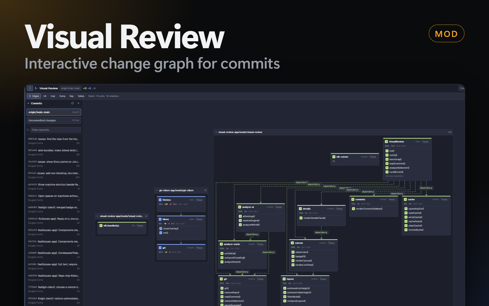

# Visual Review

An interactive change graph for Git commits, rendered natively inside the Herdr desktop app.

## What it does

- **Commit selector sidebar (collapsible):** pick a preset (**Branch vs base**, **Uncommitted changes**), click any commit, or **Shift+click** a contiguous range (`A..B`).
- **Hybrid analysis engine:**
  - **Instant static graph (`< 500 ms`):** extracts namespaces/folders, classes, interfaces, records, structs, enums, modules, heritage, imports/dependencies, SQL/Prisma/EF tables, exact Git line deltas (`+`/`−`), and `Ce`/`Ca` coupling for **C# / .NET**, **TypeScript / JavaScript**, **SQL**, and **Prisma** (with file-level fallback for other languages).
  - **On-demand AI enrichment:** clicks **Enrich with AI** to run Claude Code or Codex in read-only mode for semantic summaries, cohesion scores (`C 1`–`C 5`), indirect relations, and unchanged context neighbors. Results for immutable commit ranges are cached on disk (`~/.config/herdr-app/data/visual-review/cache`).
- **Native GPU graph canvas:** orthogonal layered layout via bundled `elkjs` (Node.js) with a pure-JS fallback, drawn natively with GPUI `PathBuilder` (`window.paint_path`) and interactive cards following your active Herdr theme.
- **Exploration controls:**
  - **3 views:** **Overview** (container summary boxes, auto-enabled for large diffs), **Diagram** (collapsible containers & UML markers), and **List** (linear rows with clickable relation pills).
  - **Relationship filters:** hide all edges or toggle individual kinds (`Inh`, `Impl`, `Comp`, `Dep`, `Tables`), plus **Focus** mode to isolate one node and its direct neighbors.
  - **3-level semantic zoom & navigation:** drag to pan, wheel/Shift+wheel, `Ctrl+wheel` / trackpad pinch, `+`/`-`/`0` (Fit), arrow keys, and `/` quick search.
- **Details & side-by-side diff panel (resizable & collapsible):** click any node, changed member, or edge to inspect metrics, clickable incoming/outgoing relations, and the unified diff inline — or expand it into a full-screen **Side-by-side** diff overlay (and open the full file in a pane). Both sidebars can be resized by dragging their borders.
- **Agent Queue:** stack change requests or questions tied to specific classes, members, tables, or edges (`+ Add to queue` / `Ctrl+Enter`), review all queued items in **Queue (N)**, and send them together via `hc send` to an active agent session in the current space (or start a new agent tab when none is running).
- **Fullscreen dialog & legend:** open in a dedicated tab or a resizable/fullscreen modal dialog, and toggle the **`?`** legend bar for state colors, UML edge types, and keyboard shortcuts.
- **`git-client` integration:** adds a **Visual Review** button to the History toolbar and commit context menu items (*Visual Review this commit*, *Visual Review to HEAD*, *Visual Review uncommitted*) whenever `visual-review` is enabled in PowerMods.

## Settings

Configure in **PowerMods → Settings → Visual Review** (or via the gear button inside the mod):

- **AI program:** `Auto` (Claude Code if installed, else Codex), `Claude Code`, or `Codex`.
- **AI model:** optional model override (defaults to `sonnet` for Claude Code).
- **Overview threshold:** file count above which selections open in **Overview** mode automatically (default `40`).
- **Clear cache:** purges all cached AI design models from disk.

## License

MIT. Bundles [elkjs](https://github.com/kieler/elkjs) 0.9.3 under EPL-2.0 (`mods/visual-review/vendor/ELK-LICENSE.md`).
